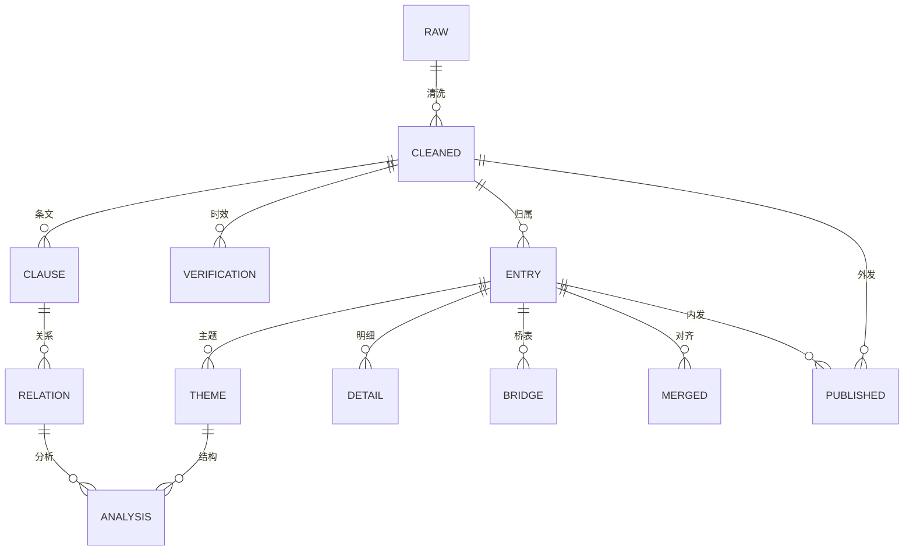
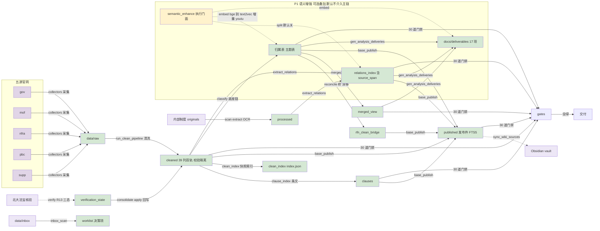
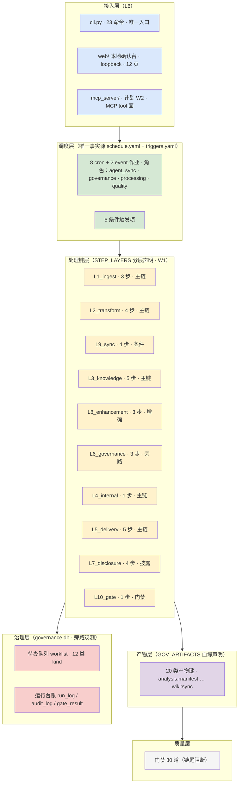
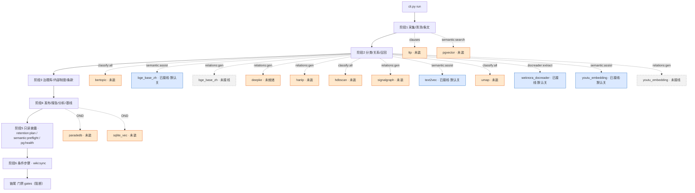

# 监管合规治理编排仓（regulatory_compliance_orchestrator）

> **文档版本**：`v4.0.0`（覆盖式更新，2026-10-21）
> **撰写依据**：`reports/manuals/README撰写规范与内容大纲.md`（七节结构 + 脚本分类 + 调用关系列）
> **本仓定位**：**源码树编排工程**（Single-Repo Orchestrator）——以统一入口把
> 「采集 → 清洗 → 时效核验 → 条文 → 归属/主题 → 关系 → 内部制度 → 发布 → 分析交付 → 门禁」
> 串成**一条可复跑、可审计、可断点续跑**的生产链路。
>
> **v4.0.0 相对 v3.0.0 的主要变更**（细节见 `CHANGELOG.md` 第 99–106 批）：
> ① **本地确认台**（`web/`）从"未记录"补入目录结构，并新增 **§6.6 开机自启动**；
> ② **采集器分层**落地：`gov/collector` 841→451 行（常量/会话/抓取/编排四层）、
>    `mof/collector` 800→632 行（五层），等价性由 `tests/baselines/` 的结构快照守护；
> ③ **`local_path` 基准统一为仓根**（2911 条历史值迁移，此前 gov/supp 用另一种基准）；
> ④ **工作台三个已知缺陷修复**：`/api/overview` 冷态 22s（撞破契约测试 20s 超时，
>    表现为"偶发 flake"）已治理为 118ms；`--outdir` 默认值曾指向错误目录；
> ⑤ **`local_path` 解析统一入口** `std_lib.scraper_std.local_paths.resolve_local_path`。

---

## 1. 项目概述 (Project Overview)

- **背景与痛点**：监管文件来自**五个异构官网**（gov/mof/nfra/pbc/supp），体裁混杂（法律/通知/公告/计划），
  且内部制度以扫描件与多格式文档分散存放。若各处理环节各自为政，会同时出现四类问题：
  ① **口径二重**（同一概念多处各写一份字面量）；② **静默劣化**（增强能力未生效却无人知）；
  ③ **断点不可复现**（换个模型/权重，产物变了但无人能判定）；④ **失败被吞**（步骤超时被杀，
  产物仍落盘被下游采用，而门禁报"全绿"）。
- **核心目标**：以**唯一入口 + 唯一事实源 + 可观测降级 + 机器化门禁**四条纪律，
  构建一条**端到端高可用、无阻断、可审计**的监管合规治理链路；任何增强能力**可缺失**（零硬依赖）
  但**不可静默**，任何失败**可恢复**但**不可隐藏**。
- **技术栈全景**：
  - **语言/运行**：Python **≥ 3.13**（`requires-python`）；Windows 计划任务调度（`cli.py schedule`）
  - **数据存储**：文件产物（JSONL/CSV）+ **SQLite FTS5**（全文检索）+ **PostgreSQL/pgvector**（向量检索，可选）
  - **治理留痕**：`data/governance.db`（SQLite 治理库：水位/门禁结果/步骤台账）
  - **质量工具**：`ruff`（Lint）/ `mypy`（类型）/ `pytest`（测试）/ 自研 **30 道门禁**（`cli.py gates`）
  - **P1 语义增强（可选叠加，对应 `.[semantic]` extra）**：`sentence-transformers` / `transformers` /
    模型权重**随仓外置于 `external/models/`**（git 忽略）
  - **依赖管理**：`pyproject.toml`（PEP 621，含 `[dev]` `[ocr]` `[semantic]` 三个 extra）

---

## 2. 目录结构规范与文件用途详解 (Directory Structure & File Manifest)

> **核心原则**：本节定义物理文件组织规范。标注 **【常规流程】** 与 **【特殊/工具】**，
> 用于区分**随链运行的运行时逻辑**与**运维/一次性辅助逻辑**（SRE 责任划分依据）。

### 2.1 根目录与一级模块总览

```
regulatory_compliance_orchestrator/
├── cli.py                      # 【常规流程·唯一入口】全部命令的统一入口（run/gates/relations/...）
├── bootstrap.py                # 【常规流程】唯一引导点（sys.path 注入 + 环境归一）
├── paths.py                    # 【常规流程】**路径唯一事实源**（ROOT/DATA_DIR/*_DIR + 访问器）
├── file_list_watcher.py        # 【特殊/工具】FILE_LIST.md 生成器
├── pyproject.toml              # 【元数据】PEP 621 依赖与 extras（dev/ocr/semantic）
├── config/                     # 【常规流程】**配置唯一事实源**
├── interfaces/                 # 【常规流程】数据契约 + 四协议 + `*_api` 进程内接口层
├── gates/                      # 【常规流程·门禁】ALL_GATES **30 道**交付门禁
├── commands/                   # 【常规流程】cli.py 子命令实现（自 cli.py 迁移）
├── modules/                    # 【常规流程】**业务模块**（五模块，单向依赖）
├── std_lib/                    # 【常规流程】**共享库**（scraper_std + common_lib）
├── tools/                      # 【混合】编排与运维工具（**入口消费** + **刻意独立**两类）
├── tests/                      # 【常规流程】自动化测试 + `baselines/`（采集器拆分等价性结构快照）
├── docs/                       # 【特殊辅助】人类文档根：`adr/`（架构决策）+ `deliverables/`（分析交付库 17 项 + manifest）；**链路总图已并入 README §8**
├── reports/                    # 【混合】对内过程文档（refactors/manuals/scratch 三区，口径见 reports/README.md）+ 机器台账留根
├── external/                   # 【特殊辅助】**外部大资产**（git 忽略：PaddleOCR/tesseract/**tessdata**/models——外部资产统一外置）
├── web/                        # 【常规流程】**本地确认台**（H 轨）：server/api/snapshots/sse + assets 单文件前端（零 CDN）
├── data/                       # 【运行期】governance.db / corpus / inbox（git 忽略）
├── exports/ · archive/ · backups/ · logs/   # 【运行期/辅助】（git 忽略或按规则）
├── BENCHMARK.md                # 【生成物】**语义质量基线**（每轮全链刷新，勿手改）
├── CHANGELOG.md · CODEBUDDY.md · FILE_LIST.md
└── README.md                   # 本文档
```

### 2.2 核心目录文件用途清单（脚本分类明细）

| 路径 (Path) | 类型 | **脚本分类** | 用途描述 | 依赖/被调用方 (Caller) |
| :--- | :--- | :--- | :--- | :--- |
| `cli.py` | 文件 | **常规流程（唯一入口）** | 全部命令入口；启动校验安装形态（非源码树安装以 `rc=4` 拒绝） | 被人工/`schedule`/`tools/run_production_refresh` 调用 |
| `bootstrap.py` | 文件 | **常规流程（引导）** | **唯一引导点**：注入 `sys.path` + 环境归一；`gate_import_bootstrap` 断言各层插入**只减不增** | 被 `cli.py`、`tools/*`、`tests/*` 引用 |
| `paths.py` | 文件 | **常规流程** | **路径唯一事实源**（含 `module_dir()` / `relations_index()` 等访问器） | 被全仓引用 |
| `config/` | 目录 | **常规流程（配置 SSOT）** | `enums.py`（**31 个受控域**）/ `sources.yaml`（源清单）/ `schedule.yaml`（定时） / `triggers.yaml`（条件触发）/ `schema/*.json`（清单与契约） | 被 `interfaces/`、`modules/`、`gates/` 引用 |
| `interfaces/` | 目录 | **常规流程（契约层）** | `contract.py`（字段契约）/ `protocols.py`（四协议）/ `*_api.py`（进程内接口，**跨模块唯一通道**） | 被 `modules/`、`tools/`、`gates/` 引用 |
| `gates/` | 目录 | **常规流程（质量门禁）** | **30 道**门禁实现（`gate_*.py`）；**唯一注册表 = `gates/__init__.py:ALL_GATES`** | 由 `cli.py gates` / `tools/ci_check.py` 驱动 |
| `commands/` | 目录 | **常规流程** | 子命令实现（`gates.py` / `relations.py` / `schedule.py` …） | 被 `cli.py` 分发调用 |
| `modules/regulatory_scrapers/` | 目录 | **常规流程** | 五源采集 + 清洗 + 条文 + 关系 + 时效核验（含 `collectors/` `clean/` `clause_index/` `clean_index/`） | 入口 `cli.py run`；产 `data/{raw,cleaned,clauses}` |
| `modules/regulatory_classifier/` | 目录 | **常规流程** | 归属表/主题表底座链 + 明细表 + 桥表 + 关系产物消费 + `recall_audit` | 被 `cli.py classify` / `analysis` 调用 |
| `modules/internal_policy_base/` | 目录 | **常规流程（内部域）** | 内部制度索引/抽取/扫描/对齐/合并视图 | 被 `cli.py internal …` 调用 |
| `modules/internal_policy_drafter/` | 目录 | **常规流程** | 条款级对照素材（`draft_clause`） | 被 `cli.py draft` 调用 |
| `modules/base_publish/` | 目录 | **常规流程（交付层）** | 双底座发布件 + FTS5 索引（`write_jsonl` 为**包级唯一实现**） | 被 `cli.py base publish` 调用 |
| `std_lib/scraper_std/` | 目录 | **常规流程（共享库）** | 采集/清洗通用能力（`crawler_common` / `unified_schema` / `sentence_split` / `attachments` …） | 被 `modules/regulatory_scrapers` 引用 |
| `std_lib/common_lib/` | 目录 | **常规流程（共享库）** | 跨模块公共能力：`relations`（关系抽取）/ `sentence_boundary`（**句读 SSOT**）/ `semantic_tools`（探测）/ `semantic_models`（加载）/ **`semantic_enhance`（执行门面）** / `governance_store` / `vector_store` / **`timeliness_ssot`（时效 SSOT 的匹配+权威性**唯一实现**，门禁与回填命令同源）** / `fs_lock`（跨进程锁，含 **PID 复用**识别）… | 被 `modules/`、`tools/`、`gates/`、`commands/` 引用 |
| `tools/run_production_refresh.py` | 文件 | **常规流程（编排）** | **全链编排器**：`STEP_ORDER` **32 项**（机器核验：`audit_health`）、按源展开执行、`--resume` 续跑、稳定运行台账 | 被 `cli.py run` / 计划任务调用 |
| `tools/ci_check.py` | 文件 | **常规流程（CI）** | 六项阻断检查：ruff / mypy / schedule / pytest / gates / coverage | 被人工/CI 调用 |
| `tools/smoke_semantic_models.py` | 文件 | **特殊工具** | P1 模型**真实初始化 + 真实调用**冒烟自检 | 按需人工执行 |
| `tools/audit_health.py` | 文件 | **特殊工具** | **九类缺陷机器化审计**（统一入口/断点/门禁/数据源/阻塞/冗余/重复/硬编码/README 一致性） | 按需人工执行 |
| `tools/gen_flow_map.py` | 文件 | **特殊工具** | **生成并注入 README §8「全链数据流总图」受管块**（命令由 **AST** 自源码抽取；含全部接入模型节点与就绪/接线状态、**降级链总表**） | 链路变更后重跑 `python -m tools.gen_flow_map` |
| `tools/gen_benchmark.py` | 文件 | **常规流程** | 刷新 `BENCHMARK.md`（语义质量基线，含 §6.3 定位正确性、§6.6 增强能力） | 全链 `analysis:gen` 后 |
| `tools/retention.py` | 文件 | **常规流程（披露）** | 产物轮转计划（**只移动不删除**；`--apply` 为人工闸门） | 全链 `retention:plan` |
| `tools/governance_sync.py` | 文件 | **常规流程** | 治理库同步（`--apply` 人工闸门） | 全链 `governance:sync` |
| `web/` | 目录 | **常规流程（观测/操作面）** | 本地确认台：`server.py`（HTTP + 单实例/日志/端口递增）、`snapshots.py`（分级 TTL + 预热 + 防击穿的快照层）、`api.py`（路由）、`sse.py`（事件流）、`assets/`（单文件前端，**零 CDN**） | 由 `cli.py serve` 启动；**不在主链上**（故障不影响采集/清洗） |
| `tools/workbench_service.py` | 文件 | **特殊工具** | 确认台**开机自启动**：`install`（计划任务 ONLOGON，用户级零提权）/ `uninstall` / `status`（任务·进程·健康·日志四项）/ `verify`（触发并探活） | 见 §6.6；被人工调用 |
| `tests/baselines/` | 目录 | **常规流程（守卫）** | 采集器**拆分等价性结构快照**（模块名/常量摘要/类方法签名/CLI 选项）；由 `tests/collector_baseline.py --source <src>` 生成与比对 | 被 `test_gov_collector_split` / `test_mof_split` / `test_baseline_delete_semantics` 使用 |
| `tools/gen_schedule_doc.py` / `install_schedule.py` | 文件 | **特殊工具** | 由 `schedule.yaml` **反向生成**手册定时表 / 安装计划任务 | 按需人工执行 |
| `tests/` | 目录 | **常规流程** | 单元/集成/E2E（`-m "not data"` 可跑纯代码集） | `pytest` / `tools/ci_check.py` |
| `README.md` **§8**（受管块） | 区块 | **生成物** | 链路事实源（顺序 ←`STEP_ORDER`；命令 ←**AST** 抽 `_run` 调用点；含降级链总表） | 由 `gen_flow_map` **注入**，**勿手改该块** |
| `BENCHMARK.md` | 文件 | **生成物** | 质量基线（关系定位/条文结构/主题/召回/增强能力） | 由 `gen_benchmark` 生成，**勿手改** |
| `external/models/` | 目录 | **特殊辅助（资产）** | P1 语义模型权重（**≈13.1GB，git 忽略**）：`bge-base-zh-v1.5` / `text2vec-base-chinese` / `Youtu-Embedding` / `LTPbase` | 由 `semantic_models` 只读加载 |

> **文件级颗粒度**：完整文件树（数千项）见 `FILE_LIST.md`；本表只保留**关键路径**，避免 README 臃肿。

---

## 3. 核心数据字典与物理模型 (Data Dictionary & Schema)

> **规范**：所有数据项在此定义，作为客户端/服务端/下游消费方的**单一事实来源**。
> 程序可读契约 = `interfaces/contract.py`；受控域 = `config/enums.py`（**31 个**）。

### 3.1 实体关系总览 (ER Diagram)



> **关系语义**（上图标签为单字缩写）：Mermaid 的 `erDiagram` 关系标签只接受**无空格、
> 无标点的单词**，因此图中用单字，完整含义在此列示 ——
> **清洗**=39 列契约 + 校验隔离 · **条文**=条/款/项结构 · **时效**=北大法宝核验 ·
> **归属**=RFN 权威归属表 · **主题**=主题底座 · **明细**=11 份明细表 ·
> **桥表**=RFN↔clean 桥 · **关系**=依据/废止关系 · **对齐**=内部制度↔RFN 对齐 ·
> **外发/内发**=外部/内部双底座发布件 · **分析**=17 项分析交付 · **结构**=五级分析结构。

### 3.2 核心数据对象定义

| 数据项名称 (Field) | 类型 | 必填 | 枚举值/格式约束 | 业务含义/示例 | 所属模块 |
| :--- | :--- | :--- | :--- | :--- | :--- |
| `dedup_key` | `string` | 是 | 稳定哈希；**全库唯一** | 清洗层唯一键；重复即覆盖（`SENT/dedup` 门禁守护） | `cleaned` |
| `source_id` | `enum` | 是 | `gov` `mof` `nfra` `pbc` `supp`（`SOURCE_ORDER`） | 五源标识，顺序即权威顺序 | `cleaned` |
| `parse_mode` | `enum` | 是 | `law` `notice` `bulletin` `plain` `plan` `empty`（`CLAUSE_PARSE_MODES`） | **体裁**（非质量等级）；`degraded` 旧口径 = 非 `law` 计数 | `clauses` |
| `article.no` | `string` | 是 | 规范条号（如 `12`） | 条文序号；`article_placement` 记录定位来源 | `clauses` |
| `relation_id` | `string` | 是 | 判别字段 = `src/dst_ref/relation/article/action/scope/reason`（**不含 snippet**） | 关系唯一键（改 snippet 不换 id） | `relations` |
| `source_snippet` | `string` | 是 | ±100 字符**窗口** | 溯源上下文（**定位输入**） | `relations` |
| `source_span` | `string` | 否 | 引用跨度（命中+紧随尾部） | **纯披露字段**（N-98 实测：收窄会劣化定位，故不参与定位） | `relations` |
| `article_placement` | `enum` | 否 | `""` / `src_offset` / `snippet` / `src_offset+snippet` | 目标侧条款定位来源；空 = 未定位 | `relations` |
| `extractor_version` | `string` | 是 | 如 `relations-1.2` | 抽取器版本（产物可否由当前抽取器生成） | `relations` |
| `rfn` | `string` | 是 | 监管文件号（RFN）规范形态 | 归属表权威实体键 | `entry` |
| `is_fallback` | `boolean` | 否 | `true`/`false` | 是否走**回退路径**（可观测降级的留痕） | 全层 |

### 3.3 枚举值（Enum）全量清单（源 = `config/enums.py`，**31 个受控域**）

| 域 (Domain) | 取值（节选/全量） | 语义 |
| :--- | :--- | :--- |
| `SOURCE_ORDER` | `gov` `mof` `nfra` `pbc` `supp` | 五源**规范顺序**（亦是权威优先级） |
| `CLAUSE_PARSE_MODES` | `law` `notice` `bulletin` `plain` `plan` `empty` | 条文**体裁**（不等于质量） |
| `RELATION_KIND` | 依据 / 废止 / （跨底座） | 关系大类 |
| `BASIS_TYPE` | `substantive` / `procedural` | 依据类型（实体/程序） |
| `REPEAL_ACTION` / `REPEAL_SCOPE` | 废止动作 / 废止范围 | 废止关系两维 |
| `ARTICLE_PLACEMENT` | `""` `src_offset` `snippet` `src_offset+snippet` | 条款定位来源标记 |
| `EXIT_CODE`（`config/exitcodes.py`） | `OK` `FAIL` `USAGE` `ENV` `DATA` | 语义化退出码（禁裸整数） |
| 其余 24 域 | `ALIGN_METHOD` `BODY_SOURCE` `BRIDGE_RELATION` `CATEGORY_SET` `FILE_TYPES` `INTERNAL_STATUS` `LEGAL_DOC_TYPES` `REF_MATCH_METHOD` `RELATION_TARGET_CLASS` … | 见 `config/enums.py` 与门禁 `gate_enum_values` |

> **纪律**：受控域是"属性全部合法取值的集合"——**不得含永不产出的值**（N-105：方案否决后必须回退域取值）。

### 3.4 产物分级存储（ADR-0007：文件事实源 / SQLite 索引治理 / PG 可选门槛）

产物按**四级形态**组织（分级纪律：文件即权威，关系库只承载可重建的派生层）：

| 级 | 形态 | 内容 | 本项目实例 | 演进规则 |
|---|---|---|---|---|
| **L-a 事实源** | 文件（JSONL/CSV） | 正文、条款、关系边、发布件——**文件即权威** | `data/raw/*.jsonl`、`cleaned/*.jsonl`、`published/external_records.jsonl`(289MB) | **永不入关系库** |
| **L-b 索引/查询** | SQLite（FTS5 + 可选 sqlite_vec/pgvector） | 检索索引、向量索引——**可随时重建的派生层** | `external_index.sqlite`(908MB FTS5) | 重建命令必须存在且被测试覆盖 |
| **L-c 治理元数据** | SQLite `governance.db` | 水位/血缘/台账/审计/待办/关系投影 | 11 表 28.8MB（目标 <50MB） | 超 50MB 或并发写冲突实测出现 → 评估迁移 PG |
| **L-d 查询服务（可选）** | PostgreSQL（env `PGVECTOR_DSN` 注入） | 多消费方并发结构化查询——**按需启用的服务层** | pgvector 已部署（127.0.0.1:7777，wired=false） | 引入门槛见 ADR-0007（实测需求/降级链先行/仅索引元数据可入/运维责任明确，缺一不可） |

> 治理库 28.8MB 远低于 50MB 门槛 ⇒ **当前无需 PG 迁移**（证据记录在案，ADR-0007）。
> 双轨决策（cleaned CSV 保留 / clauses MD 默认关）见 ADR-0013。

---

## 4. 数据流转与拓扑 (Data Flow & Topology)

### 4.1 业务端到端数据流图（Mermaid）

> 精确链路（**含全部接入模型节点、就绪/接线状态与降级链总表**）见**本文档 §8**（机器生成受管块，**勿手改**）；本节为人工概览。



**依赖纪律**：`scraper → classifier → internal_base → drafter → analysis` **单向**；跨模块仅经 `interfaces/`；
唯一同仓互引 = `classifier → clean_index`（由 `gate_no_cross_module_import` 守卫）。

<!-- BEGIN GENERATED: 架构共识图（E-5，由 tools/gen_flow_map.py 生成，勿手改） -->



> 事实源：`STEP_LAYERS`（链层）· `schedule.yaml`/`triggers.yaml`（调度层）· `GOV_ARTIFACTS`（产物与血缘）· `ALL_GATES`（质量层）· `worklist.kind`（治理层）。**计数由生成器派生，勿手改**；`python -m tools.gen_flow_map --check` 核验一致性。
<!-- END GENERATED: 架构共识图 -->

### 4.2 ETL/数据处理管道明细

| 阶段 (Stage) | 数据源 (Source) | 目标存储 (Target) | 转换逻辑 (Transform) | 所属脚本/Job | **脚本分类** |
| :--- | :--- | :--- | :--- | :--- | :--- |
| **Extract 采集** | 五源官网 | `data/raw` | 各源 collector；nfra 另有周度增量链 | `modules/.../collectors/*.py` | **常规流程** |
| **Transform 清洗** | raw | `cleaned/{src}_cleaned_{date}.{csv,jsonl}` | `unified_schema` 归一（39 列 + 枚举归并 + **校验失败隔离** + `dedup_key` 唯一性）；**超时按源体量配置**（大源 6h 上限） | `clean/run_clean_pipeline.py --project <src>` | **常规流程** |
| **时效核验** | cleaned 效力空记录 | `verification_state.json` + 归属表 | 北大法宝 CLI 判定（7 值）+ R13 三态摘要；**降级不误标** | `timeliness_review/verify_missing.py` | **常规流程（需 token）** |
| **Load 底座** | 归属表（权威） | `_t{n}_base/final.json` | base 投影（血缘）→ cluster 子主题 | `cli.py classify --steps base,cluster` | **常规流程（幂等断点）** |
| **关联 Load** | base/final + clean | 明细表（11 份 14 列）/ 桥表 / 关系 | 条款引用与上位法抽取；RFN↔clean 漂移判定 | `build_detail_tables` / `reconcile_clean_drift` / `extract_relations` | **常规流程** |
| **Index 内部对齐** | internal originals | `processed/*_clauses.{json,md}` + `merged_view` | OCR → 全文 → 条文结构 → 主题对齐 × RFN 引用 | `cli.py internal index/align/merged` | **常规流程** |
| **Export 起草** | merged_view | `drafter/data/draft_clause/*.md` | 条款级对照素材（逐条链接 RFN / ⚠ 待核文号） | `cli.py draft` | **常规流程** |
| **Publish 发布** | cleaned + merged | `published/external_*.jsonl` + internal 发布件 + FTS5 | 发布件构建（附件 7 字段契约 / 关系边汇聚） | `cli.py base publish` | **常规流程** |
| **Analysis 交付库** | final × 明细 × 图 × 关系 | `docs/deliverables/`（**17 项 + `_manifest`**） | 五级分析结构（全数据驱动）；关系类复用**单源渲染** | `cli.py analysis gen` | **常规流程** |
| **Disclose 披露** | 运行态/能力 | 控制台 + `BENCHMARK.md` + 运行台账 | `retention:plan`（轮转计划·只移动）/ `quarantine:triage`（隔离体检）/ `semantic:preflight`（P1 五闸）/ `pg:health`（向量后端） | 各披露步骤 | **常规流程（只读披露·恒 rc=0）** |
| **Knowledge 同步** | 发布件 | `<Obsidian vault>/监管法规库` | frontmatter 溯源 + 截断声明 + `--prune` | `tools/sync_wiki_sources.py` | **特殊工具** |
| **Ingest 投放区** | `data/inbox` | worklist 决策项 | 按 `inbox_registry.yaml` 归类 → worklist | `tools/inbox_scan.py` | **常规流程** |
| **Validate 门禁** | 全仓数据/代码 | 门禁报告（+ 治理库归档） | **30 道** `ALL_GATES`（契约/枚举/漂移/时效 SSOT/血缘/水位/跨模块/运行时卫生/调度触发一致性/运行台账…） | `cli.py gates` | **常规流程（阻断）** |

---

## 5. 自动化任务节点与门禁设置 (Automation & Guardrails)

### 5.1 CI/CD 流水线任务矩阵（`tools/ci_check.py`，**六项全阻断**）

| 任务节点 (Job) | 触发条件 (Trigger) | 执行动作 (Action) | 失败处理 (Failure Handling) |
| :--- | :--- | :--- | :--- |
| **ruff** | 提交前 / CI | `ruff check .`（零 Error） | 阻断；输出文件:行:规则 |
| **mypy** | 提交前 / CI | `mypy std_lib modules tools config interfaces gates commands` | 阻断；按文件报类型错误 |
| **schedule** | CI | 比对已装计划任务与 `schedule.yaml` | 阻断；列出差异 |
| **pytest** | CI | `pytest -q`（含 `data` 标记用例） | 阻断；输出失败用例 |
| **gates** | CI | `cli.py gates`（**30 道**） | 阻断；输出未过门禁清单 |
| **coverage** | CI | `pytest --cov`（当前 ≈42%） | 阻断；输出 TOTAL |

### 5.2 定时与事件驱动任务清单（**唯一事实源 = `config/schedule.yaml` + `config/triggers.yaml`**）

> 下表与运行手册**同源**：均由 `tools/gen_schedule_doc.py` 从 `schedule.yaml` **反向生成**
> （**勿手改**；漂移由 `gate_config_integrity` 判据 **S4** 阻断）。含「脚本分类 / 失败处理」
> 的完整视图见 `reports/运行手册_编排与定时_*.md`。

<!-- SCHED:AUTO -->
| 频率 | cron | 角色 | 命令 | 说明 |
| :--- | :--- | :--- | :--- | :--- |
| **每月 3 日 01:00** | `0 1 3 * *` | processing | `cli.py run --collect gov_zhengceku_backfill --only collect:gov_zhengceku_backfill,clean:gov,apply:gov` | zhengceku 历史存量补全（月度；扫全 629 页，仅跑 clean/apply:gov） |
| **每周三 01:00** | `0 1 * * 3` | processing | `cli.py run --collect gov,mof,pbc` | 周度增量：gov（**已拆为 xzfgk/zhengceku 两个独立步骤**）+ mof + pbc，随后全链出报告；supp 走投放区（inbox_drop 触发） |
| **每周二 01:00** | `0 1 * * 2` | processing | `cli.py run --collect nfra-weekly` | nfra 周报增量链（单实例锁 / 顶部窗口 / 断点续跑） |
| **每日 06:00** | `0 6 * * *` | processing | `cli.py run --no-scrape --resume` | 全链刷新（raw 已抓取，仅重清洗 + 全链；当日无 raw 变化时各阶段快跳）（漏跑策略：run_at_next_boot） |
| **每周一 07:00** | `0 7 * * 1` | processing | `cli.py run --only timeliness:verify` | 效力核验批次（有 Token 时；断点续跑，配额耗尽自动停） |
| **每日 07:30** | `30 7 * * *` | governance | `cli.py backlog growth --json` | 待办积压增长监控（open/净增/处置率；超阈值返回非 0 并告警） |
| **每周一 08:00** | `0 8 * * 1` | agent_sync | `cli.py run --only wiki:sync` | 发布件刷新 + llm_wiki 源同步（SHA256 增量；条件触发 wiki_sync，见 triggers.yaml） |
| **每月 1 日 09:00** | `0 9 1 * *` | quality | `cli.py gates` | 月度巡检：门禁（另需人工跑 `cli.py source diff` / `cli.py timeliness summary` / check_llm_wiki_upstream） |
| **事件驱动（after: incremental_weekly）** | — | processing | `cli.py run --collect gov` | gov 源增量（含 zhengceku 子源）——由 `incremental_weekly`（周三 01:00）承接；此处仅登记语义，不重复调度 |
| **事件驱动（after: verify）** | — | processing | `cli.py timeliness sync` | 核验后：台账 → 归属表时效同步（F-C03）；已由 run 主链 6.9 之后的阶段承接 |
<!-- SCHED:END -->

> **调度纪律**：定时表由 `tools/gen_schedule_doc.py` **反向生成**（**勿手改**）；`cli.py schedule install/verify`
> 负责安装与比对；判据 S 断言"手册/README 自动段 == yaml 渲染"。**条件触发**唯一事实源 = `triggers.yaml`（判据 T 断言）。

**事件驱动作业与告警的承接语义（批 63 起由门禁机器核验）**：

- `kind=event` 的作业（`timeliness_sync` / `gov_increment`）**不在 Windows 计划任务中安装**（无 cron）——
  其语义由链内步骤实际承接，故必须声明 `covered_by:` 指明**承接步骤**（须 ∈ `STEP_ORDER`）；
  `after:` 仅表「上游作业」。核验 = 门禁 **E1**（见 §5.3 第 24 道）。
- `notify.on` 列出的每类告警（`failed_step` / `gate_fail` / `worklist_aged` / `doctor_fail`）
  **都必须有真实发送方**（链尾 gates / 自检 / 状态命令）——核验 = 门禁 **E2**。
- 条件触发的 `{vault}` 由 `REG_ORCH_VAULT`（或 `config/vault.yaml:vault_dir`）供给；**缺值即该步骤跳过并写明原因**
  （绝不生成字面 `{vault}` 目录 ✗）——核验 = 门禁 **E3**（`resume` 指向的脚本必须真实可达）。
### 5.3 代码与数据质量门禁 (Quality Gates)

- **代码门禁**：`ruff` 零 Error；`mypy` 零 error；`pytest` 全绿；**引导纪律**（`gate_import_bootstrap`：
  `sys.path.insert` **只减不增**，新代码一律经 `bootstrap`）；**运行时卫生**（`gate_runtime_hygiene`：禁裸整数
  `return N`、禁无意图声明的宽泛吞异常、`interfaces/` 禁 `NotImplementedError` 空壳）。
- **数据门禁（写入/交付拦截，**30 道**）**：契约清单一致性（`gate_contract`）/ 受控枚举（`gate_enum_values`）
  / 清洗契约（`gate_clean_schema`）/ 目录拍平（`gate_flat_layout`）/ 关系产物（`gate_relations`）
  / RFN 漂移与同步 / 血缘与水位 / 跨模块越权（`gate_no_cross_module_import`）/ 时效 SSOT
  / **运行台账（`gate_run_steps`：失败步骤的产物**若落在该步时间窗内 → FAIL**，可经人工确认降级为告警）**
  / 盘符硬编码 / 密钥扫描（`gate_secret_scan`）/ **条件观察对象（`gate_condition_observers`，T4）**
  / **动态步骤运行时覆盖（`gate_dynamic_step_coverage`，R3：`{src}` 模板步骤台账五源覆盖）**
  / **依赖治理与供应链安全（`gate_dependency_audit`，W5：锁与一致性/影子依赖双向断言/
     pip-audit 漏洞 high·critical 零容忍/SBOM 与 lock 的 sha256 同步/子进程解释器路径，
     判据与取舍见 `docs/adr/0011-依赖治理与供应链安全.md`）**…
- **发布门禁**：**人工闸门**保留在三处破坏性动作 —— `retention --apply`（归档）、`governance_sync --apply`
  （写治理库）、`acknowledged.json`（失败步骤知悉登记）；其余一律**机器判定**。
- **提交后自动推送**：`.git/hooks/post-commit` 在每次提交后自动 `git push origin main`
钩子版本化在 **`.githooks/post-commit`**（克隆后执行 `python -m tools.install_git_hooks` 安装：它把 `core.hooksPath` 指向 `.githooks`，**不是** `cp` 到 `.git/hooks/`）。
  （克隆后 `cp tools/git_hooks/post-commit .git/hooks/` 安装）。
  **同步失败不再静默**：结果写入 `logs/git-autopush.log`，失败时回显真实原因与处置命令，
  并由 `tools/audit_health.py` 的「**远程同步**」检查核验「本地领先远程 N 个提交」。
  > 事故注记（N-163）：原钩子以 `>/dev/null 2>&1` 吞掉失败，导致「第二十六批起 8 批提交
  > 从未推送成功」长期无人察觉 —— 故本条纪律：**同步失败属"降级"，必须可观测**。
- **门禁不可执行 ≠ 通过**：判据因缺输入无法执行时（如克隆无数据），**显式披露**而非静默放行。

---

- **执行者存在性门禁（第 24 道，`gates/gate_declaration_executor.py`，批 63）**：核验“声明面”**确有执行者** ——
  E1 `kind=event` 作业的 `covered_by` ∈ `STEP_ORDER`｜E2 `notify.on` 每类告警有发送方｜
  E3 `triggers.yaml` 的 `resume` 解析到真实文件｜E4 `tools/_manifest.json` 条目归属明确
  （`independent`+`independent_why` 或 `step`）。**动因**：既有门禁只校验“名字/文件/字面量存在”，
  不校验“谁执行它” ⇒ 全绿仍失实（第五十九批审计的统一根因）✗。
- **条件观察对象门禁（第 25 道，`gates/gate_condition_observers.py`，W0-5）**：核验条件触发的
  **观察对象**——闭合（条件↔登记互为闭包）/ 可达（`required` 观察路径必须存在）/ 同源（实现引用的
  路径常量必须已登记）/ 归属（路径须在 `paths` 注册目录族内）。**动因（D-1）**：`wiki_sync` 观察
  一份**从未存在**的清单文件 ⇒ 条件恒“不判定”⇒ 触发项从未执行且无门禁发现。
- **动态步骤覆盖门禁（第 26 道，`gates/gate_dynamic_step_coverage.py`，W0-5）**：核验 `{src}`
  模板步骤的**运行时五源覆盖**（台账断言：已演练的模板每个期望实例须有记录、连续成段）。
  **动因（D-3）**：`relevance:{src}` 实装挂在 clean 循环之后用残留变量 ⇒ 只跑 supp，
  而 STEP_ORDER 声明与 README 渲染都“正确”——**静态清单看不出来，只有台账能证伪**。

- **MCP schema 门禁（第 27 道，`gates/gate_mcp_schema.py`，W2）**：核验 MCP 门面——tool `inputSchema` 形态合法（由类型注解派生）、**写能力必须声明副作用且经 `call_tool` 强制落审计**（AST 断言）、E-4 资源 `chain_steps`/`schedule_jobs` 齐备且`list`/`read` 版本一致、门面**零硬依赖**（不 import `mcp` SDK）。**动因**：手写 schema 与实现必然漂移（第二事实源），写工具若无留痕则是最危险形态。
### 5.4 桌面干扰防护（剪贴板/焦点/CPU，第五十六~六十五批）

> 用户症状：**在使用其他办公软件时复制粘贴失效或被抢占**。真凶（活体监控 + A/B 对照定位）= 
> **LibreOffice 每次转换都会清空系统剪贴板**（实测每 2.5~3.5s 一次；单次转换 Δ≥1，超大含表文档达 **Δ=194** ✗）。
> 现以**四重机制**治理，全部可经环境变量关闭（见 §6.3）：

| 机制 | 实现 | 作用 |
|---|---|---|
| ① **独立窗口站隔离** | `std_lib/scraper_std/win_station.py` | `CreateWindowStation`+`CreateDesktop`+桌面继承式启动；剪贴板**按窗口站隔离** ⇒ 普通剪贴板操作不影响用户。自证：`python -m std_lib.scraper_std.win_station --selftest`（Δ=0 ✓） |
| ② **剪贴板保全护栏** | `std_lib/scraper_std/clipboard_guard.py` | 转换前快照、转换后**原样恢复**（仅 `CF_TEXT`/`CF_UNICODETEXT`/`CF_HDROP`；未保格式日志明示）⇒ **用户内容永不丢失** ✓（因实测 LO 会自行挂回 `WinSta0`，单靠 ① 不足 ✗） |
| ③ **内容哈希缓存** | `std_lib/scraper_std/doc_convert.py` | 键 = 输入字节 sha256；命中即**不启动 LibreOffice** ⇒ 零剪贴板窗口（实测 7.3MB 文档：冷转换 102s/Δ=194 → 二次 **0.02s/Δ=0**） |
| ④ **用户活动让路** | `std_lib/scraper_std/user_activity.py` | `GetLastInputInfo` 探测键鼠活动；用户在用 ⇒ **推迟**转换启动（上限 `RCO_QUIET_MAX_WAIT`，默认 60s；不可用时 fail-open 绝不阻塞） |

**配套**：全局**隐藏子进程**（`CREATE_NO_WINDOW`+`SW_HIDE`，见 `std_lib/scraper_std/proc.py`，由 `bootstrap.py` 与
`std_lib/scraper_std/__init__.py` 安装唯二引导点）｜链内子进程 `BELOW_NORMAL_PRIORITY_CLASS` 让路｜`PYTHONUNBUFFERED=1`
（避免子进程 stdout 块缓冲导致日志“假死”）。
## 6. 环境搭建与本地开发 (Quick Start)

### 6.0 异机部署先决条件（必读）

> 本仓为**源码树编排工程**：`data/`、`published/`、`external/`（含 `external/tessdata/`——W4 §7.10 起外部资产统一外置，仓根不再平铺工具数据目录）**均不入 git**。
> 克隆后**代码可运行，但业务链路需按下表补齐前提**。

| 前提 | 要求 | 缺失后果 |
| :--- | :--- | :--- |
| Python | **≥ 3.13** | pip 直接拒绝安装 |
| 安装方式 | `pip install -e ".[dev]"`（**必须可编辑**），或直接在仓根 `python cli.py` | 非源码树安装不含 `modules/`；`cli.py` 以 `rc=4` 显式拒绝 |
| PDF/编码依赖 | 已列 base 依赖（pypdf/pdfplumber/chardet） | 缺则 `internal index` 对 PDF 静默产出空正文 |
| OCR（可选） | `pip install -e ".[ocr]"`；或设 `OCR_PADDLE_ROOT` / `OCR_TESSERACT_BIN` / `OCR_TESSDATA_DIR` | 扫描件走 OCR 降级 |
| 数据 | 活跃数据在 `modules/*/data`，**不入 git**：按 `data_migration_manifest.json` 恢复或按 §6.5 重建 | `cli.py gates` 有数据门禁 FAIL（**属预期，非代码缺陷**） |
| 时效核验（可选） | env `PKULAW_NODE_EXE` + `PKULAW_PKG_DIR` + token 文件 `.pkulaw_token` | R13 三态降级为 `unavailable`（**不误标**） |
| 采集外网 | gov/mof/nfra/pbc 官网可达；mof 附件主机为内网地址 | mof 全量采集长时间空转 |
| **P1 取值口径（✅ 已定案，N-171）** | 唯一事实源 = `config/schema/semantic_tools.json` 的 `usage_policy`（`output_scope=analysis_view`、`write_fact_source=false`、`enabled=false`） | **只产分析视图，不得改写 `_t*_base`/`_t*_final` 事实源**；近邻阈值**刻意留空**（须先在可评样本量出 P/R 再填）；审计「P1 口径」判据机器核验（口径缺失/未定即启用/写事实源 → 报警） |
| **P1 语义增强（可选）** | `pip install -e ".[semantic]"`；清单 = `config/schema/semantic_tools.json`；**启用前置** `python -m std_lib.common_lib.semantic_tools --preflight`（五闸） | 全链走既有**确定性正则**路径（`deps` 闸否）；**模型权重**另见下行 |
| **模型权重（已随仓预置）** | 4 项权重在 `external/models/`（**git 忽略，不入库**）：`bge-base-zh-v1.5` / `text2vec-base-chinese` / `Youtu-Embedding`（嵌入）+ `LTPbase`（分词·词性）。清单以 `local_dir` 声明、`probe` **实检目录**；加载层强制 `local_files_only` + `HF_HUB_OFFLINE=1` | 缺目录 → `offline_ready=False`；`python -m tools.smoke_semantic_models` 复核真实加载与调用 |
| **向量检索（可选）** | PostgreSQL + `vector` 扩展 + env `PGVECTOR_DSN`（**口令仅经 env**）；业务用最小权限角色（`vec` schema） | 探测 `service_reachable=False` → 降级 `sqlite_vec`（与既有 FTS5 同库同源）→ 再退全文 |

### 6.1 标准步骤

1. **克隆代码**：`git clone <repo-url> regulatory_compliance_orchestrator && cd regulatory_compliance_orchestrator`
2. **准备 Python 运行时（≥ 3.13）**：
   ```bash
   PY=<你的 Python 3.13 解释器路径>
   %PY% -m pip install -e ".[dev]"        # OCR/扫描件场景追加 [ocr]；P1 增强追加 [semantic]
   ```
3. **数据就绪**：活跃数据在 `modules/*/data`（不入 git）——按 `data_migration_manifest.json` 恢复或按 §6.5 重建。
4. **骨架自检**：`%PY% cli.py ping` ／ `%PY% cli.py source list`
5. **统一执行入口（推荐）**：
   ```bash
   %PY% cli.py run                       # 完整全链（含采集；大源清洗按体量给足超时）
   %PY% cli.py run --no-scrape           # 跳过采集，仅清洗 + 全链
   %PY% cli.py run --list-steps          # 列出步骤名（执行顺序）
   %PY% cli.py run --resume              # 从上次失败/未执行步骤续跑
   %PY% cli.py run --dry-run             # 只打印将执行的 argv
   %PY% cli.py run --json-logs           # 结构化日志（JSON lines）
   ```
6. **质量自检**：`%PY% tools/ci_check.py --cov`（六项阻断）；`%PY% cli.py gates`（29 道）
7. **缺陷审计（可选）**：`%PY% -m tools.audit_health`（九类）→ `%PY% -m tools.gen_audit_ledger`（判定台账）
8. **P1 语义增强（可选）**：
   ```bash
   %PY% -m std_lib.common_lib.semantic_tools --probe        # 能力与离线就绪
   %PY% -m std_lib.common_lib.semantic_tools --preflight    # 五闸（可启用？）
   %PY% -m tools.smoke_semantic_models                      # 真实加载+调用冒烟
   %PY% -m std_lib.common_lib.semantic_enhance --describe   # 生效选型与就绪度
   ```
9. **验证**：`%PY% cli.py gates` 全绿 + `BENCHMARK.md` 基线刷新 + **本文档 §8** 与源码一致（重跑 `python -m tools.gen_flow_map` 应无差异）。

### 6.2 P1 语义增强：调用入口 / 选型 / 参数 / 异常路径（**唯一约定**）

**三层分工（不得混用）**：探测 `semantic_tools`（事实源 = 清单）→ 加载 `semantic_models`
（本地路径/强制离线/池化）→ **执行 `semantic_enhance`（选型/传参/异常）**。业务代码**只依赖执行门面**。

**模型选型策略（唯一事实源 = 清单 `selection_policy`）**：

| 场景 (`mode`) | 首选 | 降级链 | 依据 |
| :--- | :--- | :--- | :--- |
| **`full`（全量，默认）** | **`bge_base_zh`** | `text2vec` | 全量批处理（17k+ 制度）：768 维、CPU ≈0.06s/句 |
| **`incremental`（增量/显式指定）** | **`youtu_embedding`** | `bge_base_zh` → `text2vec` | 2B/2048 维表示更强，但 CPU ≈3.5s/句 → 仅小批量 |
| 显式 `model="…"` | 该模型 | 同 mode 链 | **优先级最高**（覆盖 mode） |

**分句增强（P1-3，挂接 `relations:gen`）**：**默认关闭**（`REG_ORCH_SEMANTIC_SPLIT=1` 才启用）——
因"改分句口径"会改变条文/关系产物，须先在**可评样本**量出 P/R（v2：无度量不得上线）。
关闭时走 `sentence_boundary.split_by`（受控 SSOT），**与既有实现逐字节对等**。

```python
from std_lib.common_lib import semantic_enhance as se

r = se.embed(texts, mode="full")            # 或 mode="incremental" / model="text2vec"
if r.ok:
    use(r.vectors, fingerprint=se.fingerprint(mode="full"))   # 须写产物 provenance
else:
    fallback_to_rules()                     # r.notice 为可观测回退说明（不得静默）

s = se.split_sentences(text, level="strict")   # level ∈ {strict, loose}（受控 SSOT）
```

**参数传递**：`mode`（场景）/ `model`（显式覆盖）/ `batch`（分批，控内存）/ `normalize`（L2 归一，默认 True）
/ `strict`（**异常语义开关**：`False` 默认回退并留痕；`True` 直接抛 `EnhanceUnavailable`）。

**异常处理路径（唯一约定）**：候选链**逐个尝试** → 成功即返回（带实际模型名 + 指纹）；
**链耗尽**时 `strict=False` 返回 `ok=False` 并打印 `fallback_notice`（**可观测**），
`strict=True` 抛 `EnhanceUnavailable`（含每个候选的失败原因）。**任何路径都不吞错。**

---


### 6.3 环境变量总表（`RCO_*` / `REG_ORCH_*`，**机器核验**：`audit_health` 保证代码用到的变量此处必有记载）

| 变量 | 默认 | 用途 |
|---|---|---|
| `RCO_YIELD_TO_USER` | `1` | 让路总开关：置 0 关闭**全部**让路（优先级 + 用户活动等待） |
| `RCO_QUIET_MAX_WAIT` | `60` | 用户活动让路的**等待上限**（秒） |
| `RCO_DISABLE_CLIPBOARD_GUARD` | `（空）` | 置 1 关闭剪贴板保全护栏（不推荐：用户内容将不再恢复） |
| `RCO_DISABLE_LO_CACHE` | `（空）` | 置 1 关闭转换缓存（每份内容都会真实转换 ⇒ 剪贴板窗口增多） |
| `RCO_DISABLE_LO_CONVERT` | `（空）` | 置 1 **紧急禁用** `.doc→.docx` 转换（默认启用，经窗口站 + 护栏 + 让路） |
| `RCO_ALLOW_LO_CONVERT` | `（空）` | 历史开关（批 58 默认禁用期使用）；现语义等价于“未禁用”，保留兼容 |
| `RCO_ALLOW_OFFICE_COM` | `（空）` | 置 1 放行 Office/WPS COM 调用（默认**全门禁**；仍会驱动外部应用，谨慎） |
| `RCO_ALLOW_VISIBLE_SUBPROCESS` | `（空）` | 置 1 放行**可见**子进程（默认全局隐藏；仅调试用） |
| `REG_ORCH_VAULT` | `（空）` | 条件触发 `{vault}` 的供给（优先级高于 `config/vault.yaml:vault_dir`） |
| `REG_ORCH_SEMANTIC_SPLIT` | `（见 §6.2）` | P1 语义增强的段落切分口径（唯一约定见 §6.2） |
| `REG_ORCH_SEMANTIC_ASSIST_LIMIT` | `代码默认` | `semantic:assist` 入链步骤的条数上限 |
| `REG_ORCH_DOCREADER_LIMIT` | `代码默认` | `docreader:extract` 步骤的条数上限 |
| `REG_ORCH_NOTIFY_WEBHOOK` | `（空）` | 告警 webhook URL（仅 `notify.kind=webhook` 时使用；**禁止入库**） |
| `REG_ORCH_MCP_TOKEN_FILE` | `（空）` | MCP 门面的 token 文件路径覆盖（默认取仓根 `.mcp_token`；**禁止入库、禁止硬编码**，由 `gate_secret_scan` 守护） |
| `REG_ORCH_DISABLE_BODY_BACKFILL` | `（空）` | 置 `1` **整体关闭**正文回填（`pipeline.py` 的回滚开关：回填逻辑若在某批数据上误判，可一键退回旧行为） |
| `REG_ORCH_SEMANTIC_SEARCH_LIMIT` | `1000` | `semantic:search`（含链内调用与 `tools/semantic_search.py`）的默认返回条数上限 |
| `REG_ORCH_RUN_ID` | `自动` | 运行标识（链/门禁/治理库/告警共享，用于串联台账） |
| `REG_ORCH_JSON_LOGS` | `代码默认` | 是否输出 JSON 结构化日志（`common_lib/logging.py`） |
| `REG_ORCH_GOVERNANCE_DB` | `派生` | 治理库路径（默认由 `paths.py` 派生） |
| `REG_ORCH_ROOT` | `派生` | 仓根覆盖（异机/只读挂载时使用） |
| `REG_ORCH_TEST_HANLP` | `（空）` | 测试用：放行 hanlp 相关用例（`tests/test_seg_chunking.py`） |

> 说明：`RCO_*` 为**本仓运行时行为开关**（默认值即生产推荐值）；`REG_ORCH_*` 为**部署/运行期注入**（路径、上限、标识）。
> 该表由 `tools/audit_health.py` 的 README 一致性核验（§5.3 门禁前置）**反向守护**：新增 env 而漏记 ⇒ 报 HIGH。
### 6.5 本地确认台（`cli.py serve`，H 轨 · 方案 §8）

一个**本地界面**同时承载两类能力：**待办闭环管理**（操作面）与**项目数据总览**（观测面）。

```bash
python cli.py serve                 # 默认 http://127.0.0.1:8765/（仅回环，无鉴权）
python cli.py serve --port 9000     # 换端口（被占用时**有限递增**，见下）
python cli.py serve --open          # 启动后打开浏览器
python cli.py serve --verbose       # 逐请求日志
```

**开机自启动专用三参数**（由 §6.6 的计划任务传入，手工调试一般不用）：

| 参数 | 作用 |
|---|---|
| `--single-instance` | 单实例模式：已有实例在跑则本次**直接退出**（返回 0，幂等） |
| `--pid-file <p>` | 单实例锁路径（缺省 `data/state/workbench.lock`） |
| `--log-file <p>` | 日志同时落盘（`pythonw` 无控制台时**唯一可查**，5MB×3 轮转） |

> **为什么端口"被占用时换端口"**：`--help` 一直这么写，但早前实现直接
> `ThreadingHTTPServer((host, port), …)` ⇒ 占用即 `OSError`，**文档与代码不符**。
> 2026-10-21 补齐：`_bind_free_port` 从 `port` 起**有限递增**（最多 20 次）
> 找可用端口。不用 `port=0`（OS 随机）是因为那会让 URL 每次启动都变，
> 对"开机自启动 + 用户收藏地址"极不友好；不用无限循环是为了把"被长期占用"
> 这种配置错误立刻暴露，而不是拖成挂起。

**性能治理（2026-10-21，曾表现为"契约测试偶发失败"）**

`/api/overview` 冷态实测 **22163ms**，撞破 `tests/test_confirm_console.py` 的
20s 超时 ⇒ 该用例表现为"偶发 flake"（单独复跑又绿）。真因是
`storage_usage()` 每次都 `os.walk` 扫 `external/`（**19320 个文件 / 13.8GB**，
单次 4053ms，其余 4 个目录合计仅 8ms）。三级修复：

| 手段 | 说明 |
|---|---|
| **分级 TTL** | 轻量 4 目录保持 2s；外部模型目录独立 **600s**（它以"天"为周期变化） |
| **后台预热** | `build_server` 起守护线程预热，**首次请求不阻塞**；未就绪时返回 `heavy_ready=False` + `note` |
| **防缓存击穿** | `assets()`/`worklist_fields` 一律 `peek` + `warm`，**不在无缓存时同步算**（实测"预热线程与请求线程同时扫 959MB"反而恶化到 11667ms） |

治理后冷态：`/api/overview` **118ms**、`/api/worklist` **107ms**（原 7613ms）、
`/api/assets` **3.5ms**（原 5965ms）。守卫 `tests/test_console_perf_flake.py`。

> **2026-10-22（第一百零九批）页签收敛为 7 个**：P2（数据状态）与 P7（投放看板）
> **并入总览**——它们的读者与"总览"是同一批人（"我的产物在哪、发出去了没"），
> 单开两页只会让"看全一眼"变成三次点击。总览现分三段：
> **关键指标 → 运行与风险 → 产物与发布**。
>
> **2026-10-23（第一百一十批）新增 3 页 = 10 页**：「政策法规」「公司制度」「关系图谱」。
> 前两页是**全量列表**（16607 / 861 条），与待办闭环的区别是：待办只有"待处理"的几十条，
> 而这两页要能**检索任意一份文件**；关系图谱紧邻它们，因为列表的"关系·查看"要跳过去。
> 三页都遵循同一条纪律：**取数只经 `interfaces/`，分页/排序/筛选在服务端**。

| 页 | 内容 | 数据源（**全部经 `interfaces/` 只读门面**） |
|---|---|---|
| **总览** | ① 四个 KPI（门禁通过/待办未处置/链步成功/存储占用）② 六卡（运行健康·门禁·待办·告警·新鲜度·存储）③ **产物清单 + 双底座发布件 + 条文契约自检**（原 P2）④ **wiki 投放源**（原 P7） | 治理库台账、`run_state`、`reports/_alerts/`、`paths` 扫描、`clean_index_api` / `base_api` / `clause_index_api` |
| **数据流转** | **分层 DAG**（L1→L10 每层一列）：48 节点 / 40 条边，节点带**真实记录数**与状态色，边宽 ∝ √记录数；悬停看状态/rc/耗时/作用，点击开抽屉（含日志尾 + 诊断入口） | `STEP_ORDER` + **`StepSpec.produces/depends_on`**（按**产物**连边）+ `clean_index_api` + 运行台账 |
| **指标** | 门禁通过率趋势、待办 aging、**DAMA 六维质量**、**SLI/SLO**、时效三态、主题分布（条形图用 **CSS 网格**，标签不可能压柱） | `governance_api` / `rfn_api` / `timeliness_api` + W5 度量产物 |
| **待办闭环** | 表格列：**操作（勾选+处置，固定最左）/ kind / 唯一标识号 / 名称 / 文号 / 访问地址 / 详情**；处置**就地展开在该行下方**；地址带来源标注（桥表文号/桥表名称/本地文件/未查到/**不匹配**） | `governance_store.worklist_list` / **`worklist_resolve`（唯一写路径）** / `worklist_fields`（能力矩阵 + 一致性校验） |
| **政策法规** | 五源监管文件全量（**16607 条**）：**主题 / 唯一标识号(RFN) / 名称 / 文号 / 时效 / 源 / 访问地址 / 关系**；表头**逐列筛选 + 点击排序**，**服务端分页**（50/页） | `base_api.list_external_page` / `external_facets`（SQL 与白名单只在 `interfaces` 内） |
| **公司制度** | 内部制度全量（**861 条**）：**主题 / 唯一标识号(IPN) / 名称 / 文号 / 访问地址 / 关系**；访问地址**直接打开本地文件**（PDF 内联 / Office 下载） | `base_api.list_internal_page` / `internal_facets` + `worklist_fields.local_for` |
| **关系图谱** | 以某文件为中心的**一跳关系图**：依据（实线）/ 废止（虚线），中心 + 邻居环形布局；点任一节点**换中心继续看**；下方给关系明细表（方向/对方/文号/匹配方式/置信度） | `relations_api.ego`（`by_src` + `by_dst`，弱线索显式计数） |
| **监管统计** | **EAST 资料指针**：覆盖度 KPI（EAST 直接相关 **1** 条 / 合计 35 条 / 无官方链接 1 条 / 字段级校验 **未接入**）+ 4 个受控分类清单（EAST·监管统计·指标报送·金融统计制度）。**不画图**（1 条数据画趋势等于撒谎） | `base_api.regstats_docs`（标题受控关键词 + 跨类去重） |
| **留言板** | 使用者提交问题（分类/严重度/页面/说明/域账号）+ 列表 + 本机处置（ack/closed）。IP/UA/时间由**服务端**记录；域账号**自报**且来源可分辨；**只追加不删** | `interfaces.feedback_api` 到 `governance_store.feedback`（内网唯一允许的写口） |
| **治理审计** | 最近运行 + 审计日志尾部 | `governance_store.list_runs` / `governance_api.audit` |
| **文档检索** | FTS5 全文检索（external → internal 自动回退）+ **访问地址列**；**按词元判定短词**（含 2 字词元自动走 LIKE 兜底）+ **多词 AND** + **bm25 相关性排序** + 同标题多版标注 | `base_api.search_external/search_internal/like`（`fts_capable`/`fts_query`）+ `worklist_fields.lookup` |
| **发布事件** | **全量**提交流（点开看**完整变更**：文件清单 + 完整提交说明 + 原始 `git show`）+ SBOM 组件数/锁哈希 + 契约版本 | `git log` / `git show` + `reports/_sbom/` + `contract_manifest.json` |

**新增只读路由**：`GET /api/commit?sha=`（单提交完整变更）、
`GET /api/local/file?path=`（**白名单内**的本地文件由浏览器打开/下载；
四重校验见 §6.7，**不拉起本机程序**——那会夺焦点，本仓明令禁止）、
`GET /api/records`（政策法规分页：`q_title/q_docno/q_rfn/source/theme/timeliness/sort/desc/page/size`）、
`GET /api/records/facets`、`GET /api/rules`（公司制度分页：`q_title/q_docno/q_ipn/theme/...`）、
`GET /api/rules/facets`、`GET /api/relations?ref=`（关系图谱）。

> **排序白名单**：`sort` 只接受 `EXTERNAL_SORT_COLS` / `INTERNAL_SORT_COLS` 里的列名，
> 其余一律回退默认列 —— 列名是直接拼进 SQL 的，不白名单就是注入面
> （守卫 `test_sort_is_whitelisted` 会拿 `title; DROP TABLE records--` 去试）。

**纪律（与全仓一致，方案 §8.2.2）**

| 原则 | 落实 |
|---|---|
| 零新增依赖 | 服务端纯标准库（`http.server`/`sqlite3`）；前端单文件原生 JS + 手绘 SVG，**零 CDN**（出口网络有过滤，外链即不可用风险） |
| 不裸读 | 一切取数经 `interfaces/`；**唯一写路径** = `worklist_resolve`（处置登记，不执行任意动作） |
| 旁路降级 | 任一数据源故障只让**该卡片**显示「不可用 + 原因」，页面不白屏；确认台进程故障不影响主链 |
| loopback-only | 默认只绑 `127.0.0.1`；改绑非回环会打印**无鉴权**告警 |
| 密钥 env-only | 响应经 `_scrub` 过滤 token/secret/dsn 等 11 类密钥形态字段 |
| 可观测披露 | 每卡标注「数据源 + 抓取时刻」 |
| 机器守护 | 判据 **J12**（`gate_config_integrity`）：禁裸 SQL 写、禁自写 `sys.path`、禁外链 CDN、`serve` 必须注册、响应必须脱敏；契约测试 `tests/test_confirm_console.py` 26 项 |

**明确不做**（§8.2.1 非目标）：不触发主链（执行权归 `run`/计划任务）、不做业务逻辑、不引外部资产、不做多租户/权限、不替代 CLI。

### 6.6 开机自启动（`tools/workbench_service.py`）

一条命令把确认台配成**登录后自动启动**；零提权、可查询、可卸载、可立即验证。

```bash
python -m tools.workbench_service install    # 安装（计划任务 ONLOGON，延迟 30s）
python -m tools.workbench_service status     # 四项状态：任务 / 进程 / 健康 / 日志
python -m tools.workbench_service verify     # 触发一次并探活（装完立刻可验成败）
python -m tools.workbench_service uninstall  # 卸载（只删任务，保留日志备查）
```

**方案选型**（三种，按质量排序）：

| 方案 | 需管理员 | 免登录启动 | 可查询/卸载 | 结论 |
|---|---|---|---|---|
| **计划任务 ONLOGON** | 否（用户级） | 否（需登录） | 是 | **选用** |
| 启动文件夹快捷方式 | 否 | 否 | 否 | 备选（无 schtasks 时降级） |
| Windows 服务（nssm/sc.exe） | 是 | 是 | 是 | 不选：引入第三方依赖 + 提权 |

选计划任务的理由：**零提权**、**可查询/可卸载**、**可延迟**（避开开机 IO 高峰）、
不依赖第三方工具。代价是"需先登录"——对本地单用户工作台完全可接受；
若要"免登录启动"，须改用服务（需管理员 + 第三方）。

**可靠性三件套**（缺任一都会在真实使用中翻车）：

| 机制 | 防的是什么 |
|---|---|
| `--single-instance`（`fs_lock.ProcessLock`） | 计划任务**每次登录都触发**，无保护会起多个进程互相踩踏（各自占端口、读同一份 SQLite） |
| `--log-file`（`RotatingFileHandler` 5MB×3） | `pythonw.exe` **无控制台** ⇒ `print` 全部丢失，排障只能靠猜 |
| `pythonw.exe` | 否则每次登录都弹一个黑框 |

**启动方式**：下次登录时自动运行（延迟 30 秒）；也可随时手动触发
`schtasks /Run /TN WorkBuddyRegulatoryConsole`。

**验证方式**（三层，逐层递进）：

```bash
# ① 静态：任务是否登记
schtasks /Query /TN WorkBuddyRegulatoryConsole /FO LIST

# ② 语义：任务 + 进程 + 健康 + 日志 四项（任一缺失即指出）
python -m tools.workbench_service status

# ③ 行为：真的触发一次，等它起来并探活（最可靠——不用重启验证）
python -m tools.workbench_service verify --wait 45
```

> `status` 全绿的样子：
> ```
>   计划任务  已安装         WorkBuddyRegulatoryConsole
>   进程    在跑          pid=21060 存活
>   健康    通           http://127.0.0.1:8765/api/health → 200
>   日志    有           …/data/state/workbench.log
> 结论：就绪（开机自启动可用）
> ```
> 实测：重复触发计划任务时**进程数仍为 1**（单实例生效）；日志文件有启动
> URL/pid/lock 三条记录（`_log()` 双写控制台 + logger）。

**安装过程中踩到的坑**（已写成守卫 `tests/test_workbench_service.py`）：
`schtasks /DELAY` 的格式是 **`mmmm:ss`（分钟:秒）**，不是 `HHMM` ——
写成 HHMM 会报「值无效（应该是 mmmm:ss 格式）」（rc=2147500037）。

### 6.7 运维要点（**都是实测踩过的**，2026-10-21 汇总）

| 要点 | 事实与做法 |
|---|---|
| **`.cmd` / `.bat` 必须纯 ASCII** | `cmd.exe` 按系统 OEM 代码页（简体中文 = **CP936/GBK**）读脚本。UTF-8 中文注释会变乱码，其中部分字节被当命令分隔符 ⇒ `rem` 行被截断、后半段被执行。实测登录后弹出 `'氭寔涔咃細閲嶈窇' 不是内部或外部命令…`。**生成脚本时用 `encoding="ascii"`**（混入非 ASCII 直接抛错），注释写英文 |
| **`schtasks /DELAY` 格式是 `mmmm:ss`** | 不是 `HHMM`。写成 HHMM 会报「值无效（应该是 mmmm:ss 格式）」（rc=2147500037）。30 秒 ⇒ `0000:30` |
| **`mof` 采集的耗时结构** | 调度参数 `--max-seconds 7200`（2h 软上限），父进程硬超时 `COLLECT_TIMEOUT['mof']=14400`（4h）。**软上限必须显著小于硬超时**，否则等于没有软上限（实测曾设 7200 却跑到 13113s，被 4h 强杀 → `rc=-1 TIMEOUT`）。软上限的检查点必须细到**附件循环内部**（详见 `limits.EarlyStopGuard.deadline`） |
| **`mof` 的内存峰值** | 实测 **6.26 GB** WorkingSet（16 GB 机器）。**不是泄漏**：基线 `read_raw_records` 仅 197 MB；峰值来自**超大单条**（最大 31.3 MB，正文 23.57 MB，Top5 占全库 59.2%）在"去标签/正则/签名/序列化"各步产生的 20–30 MB 临时字符串，叠加 Windows 上 Python 高水位不归还 OS。**改进方向**：对巨型记录做正文截断/分段存储 |
| **异常重启后先清陈旧锁** | 蓝屏/断电/强杀后 `data/run_production_refresh.lock` 会残留。**且 PID 可能被系统进程复用**（实测锁内 `3992` 重启后变成 `svchost.exe`）⇒ `ProcessLock` 只看"PID 是否存在"会误判"锁被占用"，主链**静默拒绝运行**。当前须手工确认 `cli.py run` 进程数为 0 后删除该锁；**修复方案**：锁文件记录"PID + 进程创建时刻 + 可执行名"三者校验（见 eports/refactors/incident_20261021_bsod.md\ §5.2） |
| **手动跑采集会让水位变陈旧** | 水位只在 `run_production_refresh._wm` 里登记。手工执行 `collectors/*/collector.py` 改了 raw 但没登记 ⇒ `gate_watermark` 判陈旧并级联到 cleaned/clauses。**要么走 `cli.py run`，要么事后用 `_wm` 补登记**（不要复制逻辑） |
| **确认台慢路由已治理** | `/api/overview` 冷态曾 **22163 ms**（扫 13.8 GB 外部模型目录）⇒ 撞破契约测试 20 s 超时、表现为"偶发 flake"。现为 **118 ms**（分级 TTL + 后台预热 + 防击穿） |
| **Mermaid 图必须走保守方言** | README 的 4 张图曾**全部**在 GitHub 显示 “Unable to render rich display”。本机无 node、mermaid.ink 亦不可达 ⇒ 无法用真实解析器定位；改为收敛到跨版本稳定的写法：**禁 `<br/>`、禁双引号、禁 `;` 与 `&` 串联、禁非矩形外形、`classDef` 单值**。生成器 `gen_flow_map.py` 统一过 `_mm_sanitize_block()`，`python -m tools.mermaid_lint` 静态校验（可进 CI） |
| **Markdown 表格必须连续** | GFM 表格是**连续块**：表头与表体之间插入任何非表格行（含 `<!-- -->` 注释）都会**终止表格**，后续 `\| … \|` 退化成普通段落（§5.2 定时表即因此显示异常）。另：表头列数必须与表体一致（原表头 4 列 / 表体 5 列）。现由 `gen_schedule_doc` **连表头一起生成**，标记置于表头之前；`tests/test_readme_render.py` 守卫 |
| **`mof` 附件抽取会复用，不再每轮重解析** | 一轮 `collect:mof` 曾 **13113s（3.64h）/ 峰值 6.26GB**，瓶颈不是网络而是"本地已有副本仍重跑 `extract_document_text`"。现按「磁盘大小未变 + `extract_version` 一致」**整段复用**历史抽取结果（实测单记录 9/10 复用、0.9s）。存量数据用 `python -m tools.backfill_extract_version --apply` 盖章后即可生效；改抽取逻辑时**必须递增 `EXTRACT_VERSION`** |
| **确认台支持 hash 深链** | `#metrics` / `#worklist` / `#flow` … 可直接打开对应页（原来只能落到 P0 再点）。既是可用性改进（可收藏/分享），也让**无头浏览器可按 URL 定位页面** |
| **废弃/冗余代码可审计** | `python -m tools.dead_code_audit`（四类判据，只报告）。本仓实测：真死代码 18 项（已删清零）、`if False` 死分支 0、大段注释代码 0 |
| **时效漂移可回填（不依赖 verify 成功）** | `python cli.py timeliness sync --from-state [--dry-run]`：直接读 `verification_state` 回填归属表，**判据与门禁同源**（`std_lib/common_lib/timeliness_ssot.py`）。⚠️ 回填后**必须重建基座**：`classify --steps base --all` 再 `--steps cluster --all`，否则漂移只是从层1 转到层2（门禁会立刻抓到，不会静默） |
| **配额耗尽绝不写 SSOT** | `verify` 只对**成功**结果写判定（0 条=真实无命中⇒pending；有数据⇒judge）。**查询失败/未执行一律不写** —— 否则记录会伪装成"刚核验过、无同名命中"并冻结 90 天（一次配额耗尽即可静默打穿覆盖率）。优先级：从未核验 → 最久未核 → 新公布优先；`--max-items` 为每源预算（截断记 `truncated`，**不算失败**） |
| **子进程输出不会被吞** | `std_lib/scraper_std/proc` 的全局包装器注入 `CREATE_NO_WINDOW`，它会给子进程**新建隐藏控制台**⇒ 父进程重定向到文件/管道时子输出**全丢**（实测 `cli.py timeliness verify --dry-run` 零字节）。现由 `_inject_inherited_stdio()` 显式继承父 std；`check_output` 例外（stdlib 禁止外传 stdout） |
| **没上 Dash（有实测依据）** | 评估见 `reports/refactors/工作台前端选型评估_Dash_20261022.md`：`dash==4.4.1` 新增 **16 个运行时包 / ≈18.6 MB**、前端运行时载荷 **6–8 MB**（现状单文件 46.9 KB）。结论：保留零依赖骨架；需要交互图表时**只加 `plotly`**（本地托管 `plotly.min.js`），不引 Flask/Dash |
| **FTS5 trigram 不支持 <3 字查询** | `records_fts` 用 **trigram** 分词，只索引 3 字窗口 ⇒ `MATCH '"保险"'`（2 字）**必然 0 行**（实测 保险/银行/监管 全 0，保险公司/保险集团 才有）。中文双字词最常见 ⇒ 短词必须走 `LIKE` 兜底（**只扫标题/文号/RFN**，不扫 1.6GB 正文）并在响应里标 `mode="like"` + `note` |
| **本地文件由浏览器打开，不由服务端"打开"** | 初版用系统默认程序弹出（`os.startfile` 一类），被 `tests/test_no_desktop_interference.py` 拦下——**那会夺走用户焦点**，与"抢前台窗口/模拟键鼠"同属黑名单。现改为 `GET /api/local/file?path=` 由服务端提供字节：`.pdf/.txt/.md/.csv/.json` **inline**（浏览器查看器），其余 **attachment**（下载）。**四重边界**：① 仓内相对路径 ② 解析后仍在仓根之下（`..` 拒绝）③ 命中白名单目录（制度原件/清洗产物/报告）④ 存在 + 扩展名白名单；且 `.html`/`.svg` **绝不 inline**（同源存储型 XSS 会借用户身份点处置）。**另注**：`internal_policy_index.json` 的 `original_path` 相对 `source_root` 的**父目录**，直接拼会让 861 条全部解析不到（逐个候选试存在性后 861/861） |
| **图表条形用 CSS 网格，不用手绘 SVG** | SVG `<text>` 没有 ellipsis，标签/数值宽度只能估算，估偏就溢出（三次"渲染异常"里两次的根因）。CSS 网格把标签/柱体/数值分到固定三列 ⇒ **结构上不存在越界**。凡"布局类缺陷"，优先换布局机制而不是调坐标 |

> **蓝屏事件排查**（`KERNEL_SECURITY_CHECK_FAILURE` 等 4 种 BugCheck）见
> `reports/refactors/incident_20261021_bsod.md`：结论是**非本项目导致**
> （纯用户态 Python 无法破坏内核结构；4 种不同码 + 40 天跨度 + 最早一次早于重负载
> ⇒ 硬件/驱动画像），但本项目 mof 的 6.26 GB 峰值是**加重因素**；
> 建议先 MemTest86 + 排查第三方 `HotKeyServiceDSU.exe` 与驱动。


### 6.8 对内网开放（只读）与防火墙

```bash
python cli.py serve --lan                            # 绑 0.0.0.0（等价 --host 0.0.0.0）
python -m tools.workbench_service install            # 开机自启动，**默认对内网开放**
python -m tools.workbench_service install --local    # 退回仅本机
```

**开放什么、不开放什么**（单一事实源 `web/policy.py`，服务端按**来源 IP** 判定）：

| 路由 | 本机 | 内网 | 为什么 |
|---|---|---|---|
| 各只读页签接口（总览/流转/指标/法规/制度/图谱/统计/审计/检索/发布/留言读） | 可以 | 可以 | 看数据是开放的初衷 |
| `POST /api/feedback` | 可以 | 可以 | 任何使用者都要能报问题 |
| `POST /api/worklist/resolve` | 可以 | **403** | 处置是**管理动作**，内网可改等于没有审计主体 |
| `POST /api/feedback/resolve` | 可以 | **403** | 同上 |
| `GET /api/local/file` | 可以 | **403** | 制度原件字节，内网可下即资料外泄 |
| `GET /api/diagnose` / `GET /api/commit` | 可以 | **403** | 主机指纹 / 研发内部信息 |

纪律：**deny by default**（非 GET 一律只限本机，除白名单）｜**只信 TCP 对端**
（绝不看 `X-Forwarded-For`，客户端可伪造）｜**前端隐藏页签不等于安全**（边界是 403）。

**同事打不开时的排查顺序**（按命中率）：

1. **Windows 防火墙**：首次 `--lan` 启动会弹「是否允许」，点取消就不再放行。手工放行：
   `netsh advfirewall firewall add rule name="RegConsole" dir=in action=allow protocol=TCP localport=8765`
   （**需要管理员**；无管理员权限则请 IT 统一下发）
2. **确认不是还绑在回环**：启动日志里应有 `[serve] 内网访问地址：http://<ip>:8765/`；
   没有这行说明 `--lan` 没生效。
3. **确认地址**：`python -m tools.workbench_service status` 与启动日志都会打印内网 IP；
   多网卡机器（VPN/虚拟网卡）会打印多个，挑与同事同网段的那个。
4. **代理**：浏览器若走公司代理，需把该地址加入**代理例外**（否则请求被代理拦掉）。


### 6.9 认证（本机免口令 / 内网需登录）

```bash
python cli.py serve --lan                    # 默认 --auth auto（推荐）
python cli.py serve --lan --auth token       # 严格：本机也要口令（同机反代时用）
python cli.py serve --lan --auth basic       # 每人一账号（需先 adduser，配 TLS 更好）
python -m web.auth token --rotate            # 换共享口令
python -m web.auth adduser --user zhangsan   # 加账号（交互输入口令，存 PBKDF2 哈希）
```

| 来源 | 身份 | 说明 |
|---|---|---|
| 回环 `127.0.0.1` | **本机 Windows 账号**（`src=local`） | 免口令。回环访问者本就有同等文件权限，加门槛不增安全 |
| 内网 | 共享口令 / 账号口令 | 会话 8 小时；口令在启动日志与 `data/state/console_token.txt` |

**三条防误用**：① 带任何代理痕迹头（`X-Forwarded-For`/`X-Real-IP`/`Forwarded`）的
回环请求**不自动认证**（防同机反代把外部用户当本机）；② 同机反代请显式
`--auth token|basic`；③ 对外绑定**永远不允许** `off`。

**集成认证（推荐）**：`--trust-proxy --trusted-proxies <代理IP>` ⇒ 只有受信 IP 的
`X-Remote-User` 被采信，留言板随即**不再要人填域账号**（`account_src=proxy`）。
**绝不**采信 `X-Forwarded-User` 之类的野生头。

**审计到人（个人令牌）**：共享口令下所有操作都记在"内网共享口令用户"名下，
无法回答"是谁"。需要到人时给每人发令牌（只存哈希、可吊销）：

```bash
python -m web.auth token --for zhangsan --note 合规部   # 颁发（明文只显示一次）
python -m web.auth token --list
python -m web.auth token --revoke zhangsan
```

登录后 `/api/health` 回 `audit_level`：`user`（可审计到人）/ `shared`（共享口令，
页面徽标会显式提示"操作无法定位到人"）。

**排障**：`401 未认证` ⇒ 未登录/会话过期；`403 缺少 CSRF 令牌` ⇒ 页面未加载完就发写请求
（先刷新）；`429` ⇒ 口令试错过多。内网打不开先查**防火墙**（见 §6.8）。

### 6.10 外部法规权威表（`RFN-EXT-*`，语料外目标的独立键空间）

关系事实里有一批目标**不在语料内**：国家法律（民法典/水法）、行政法规（国务院令）、
部委规章，以及本公司制度的**历史版本**。给它们登记普通 RFN 等于宣称"已收录"——
而库里没有原文，那是**伪造事实**。故建独立键空间：

```bash
python -m tools.build_external_authority            # 生成（链上 relations:ext 自动调用）
python -m tools.build_external_authority --dry-run  # 只统计
python -m tools.build_external_authority --check    # 校验编号稳定/无冲突
```

| 项 | 取值 |
|---|---|
| 编号 | `RFN-EXT-<12hex>` —— **与语料内 `RFN-<16hex>` 正则不相交** |
| 键 | 文号优先（归一后），无文号用标题；**纯派生 ⇒ 可重算，跨批稳定** |
| 纳入 | 只收 `dst_class == external`；**机关名（`organ`）不登记**（它不是文件） |
| 产物 | `modules/regulatory_classifier/data/relations/external_authority.jsonl` + `_stat.json` |

**两条纪律**：① 本表**只追加不手工编辑**（重建会覆盖，手改不可追溯）；
② 前端必须与语料内节点**视觉可分**（虚线/点线 + 「语料外」标记），且页面明写
"不代表库里能打开这份文件"。

**指标口径**（分开报，不许合成一个更好看的数）：
`file_resolved_ratio` = 语料内定位率；`attributed_ratio` = （实体 + 外部）/分母。

### 6.11 EAST 规范（六页签：概览 / 数据表 / 数据元 / 代码表 / 检核规则 / E-R）

```bash
python -m tools.build_east_structure            # 生成四件产物（按文号自动取附件）
python -m tools.build_east_structure --check     # 校验结构
python -m tools.repair_attachment_text --docno "金非银检函〔2025〕82号" [--apply]   # 补抽正文
```

| 项 | 说明 |
|---|---|
| 代码结构 | `tools/east_parse.py`（**解析**：1-3 版式 / 1-4 目录与层级 / 1-5 规则 / E-R）+ `tools/build_east_structure.py`（**编排**：取附件 → 落四件 → 自检） |
| 附件事实源 | 采集目录（`…/supplementary_regulations_scraper`），经 `interfaces/attachment_api` 单一读取 |
| 产物（四件） | `east_structure.json`（首屏）/ `east_items.json`（按表）/ `east_rules.json`（按类）/ `east_codes.json`（按表） |
| 覆盖 | 附件 1 / 1-1 / 1-2 / 1-3（112 表 3062 项）/ 1-4（63 代码表）/ 1-5（规则 2096 条）/ 1-6（E-R）+ 表单 2~6 |
| **数据元** | 每个数据项带 `element_code/name/desc/value_range`；`code_ref` 由 `参照《业务代码表》“X”，编号CDyyyyyy` 解析，页面可点跳代码表（`枚举值：…` 不给链接） |
| **代码表** | 编号取自附件1-4「目录」表（`CD000001`…）；目录名与工作表名不一致时按归一/包含/相似度匹配，**不臆造编号**；「返回目录」列与单元格残留均在抽取层剔除；多级表按层级缩进 |
| 关系图 | **字段级**校验关系（1-5-E 319 条 + 1-3「关联数据项」362 条），112 节点 / 681 边 |
| E-R 图 | **表级**：把上面 681 条聚合为表到表的有向边；点表看**上游/下游链路**。附件1-6 本体是 JPG，页面明写"按其语义重建、不假装解析了图片" |
| 呈现 | 关系图与 E-R 均为 **3D**（自研正交投影引擎：拖拽旋转 / 滚轮缩放 / 点节点聚焦），**零外链** |


### 6.12 控制台布局：左侧标签栏（2026-10-27）

参照 GitHub Issues 的双栏：**左侧是"第二维"的目录**，右侧是内容。

| 页 | 左侧是什么 | 说明 |
|---|---|---|
| 关系图谱 | 视图（全览 / 制度→监管 / 监管↔监管 / 制度↔制度 / 主题 / 外部法规） | 数字 = 已定位条数 |
| 监管统计 | EAST 七页签（概览 / 数据表 / 数据元 / 代码表 / 检核规则 / 关系图 / E-R 图） | — |
| 政策法规 / 公司制度 | **主题**（带条数，含"未定主题"） | 与表头筛选同源，点左侧即筛选 |
| 待办闭环 | **kind** | 与 `?kind=` 一致 |
| 数据流转 | **节点抽屉**（40 步，带状态点） | 点节点直接开该步抽屉 |
| 发布事件 | **倒序日期流** | 点某天只看那天 |

「发布物证据」（SBOM / 契约版本）已移入**总览 → 02 产物与发布**（它描述"当前产物"，
不属于"某次提交"）。实现是一个 `sideShell()` + `data-side` 事件委托，**不引框架、零外链**。

## 7. 附录与延伸阅读

| 资源 | 位置 | 说明 |
| :--- | :--- | :--- |
| **链路事实源** | **本文档 §8**（受管生成块） | 机器生成：顺序 ←`STEP_ORDER`，命令 ←**AST** 抽 `_run` 调用点，**含全部接入模型节点、就绪/接线状态与降级链总表**；**勿手改** |
| **质量基线** | `BENCHMARK.md` + `reports/评测基线_<date>.json` | 每轮全链刷新：主题/条文/关系定位/召回/清洗/增强能力（§6.6） |
| **重构报告** | `reports/refactors/重构执行报告_第<N>批_<date>.md` | 每批任务清单、变更摘要、遗留风险 |
| **审计台账** | `reports/审计判定台账_<date>.md` | 九类审计发现的**逐条判定**（需修/待人工/接受），规则可复算 |
| **数据迁移** | `data_migration_manifest.json` | 活跃数据清单（克隆后按此恢复） |
| **填充规范** | `reports/manuals/README撰写规范与内容大纲.md` | 本文档的撰写依据（七节结构 + 脚本分类 + 调用关系） |
| **代码索引** | `FILE_LIST.md` | 全仓文件树（含体积/时间戳），由 `file_list_watcher.py` 生成 |
| **助手约定** | `CODEBUDDY.md` | 本仓的 AI 协作约定（入库） |
| **变更日志** | `CHANGELOG.md` | 按批次的变更记录 |

### 📌 撰写与维护提示（据规范 + 本仓实践）

1. **脚本分类的意义**：**常规流程脚本**随链运行、异常须可自动恢复（有日志与埋点）；
   **特殊/工具脚本**按需人工执行（建议双人复核）。分类**决定 SRE 责任**，不是体例装饰。
2. **依赖关系链**：描述文件用途时**必须带"被谁调用"**——本仓的跨层纪律（`scraper→classifier→…` 单向、
   跨模块仅经 `interfaces/`）靠此显式化，README 中每行都标了 Caller。
3. **事实源优先于叙述**：链路/门禁/能力等**易漂移事实**一律**指向机器生成物**
   （**本文档 §8**、`BENCHMARK.md`、`ALL_GATES`；⚠️ **R-3**：`reports/` 下的**历史批次报告**是当时事实的快照，其中若有引用旧路径 `docs/全链数据流总图.md`，一律以**本文档 §8** 为准）；**人工概览与机器产物冲突时，以机器产物为准**。
4. **门禁数/步骤数等数字**由 `tools/audit_health.py` 的「README 一致性」检查**机器核验**
   （声明值与 `len(ALL_GATES)`/`STEP_ORDER` 不符即 FAIL）——改代码后**必须同步本文件**。
5. **Mermaid** 在 GitHub/GitLab **原生渲染**，无需额外工具。

---

<!-- BEGIN GENERATED: 全链数据流总图（由 tools/gen_flow_map.py 生成，勿手改） -->

## 8. 全链数据流总图（`cli.py run`）

> **本节由 `tools/gen_flow_map.py` 机器生成并注入本 README**（受管块；事实源：`STEP_ORDER` + `_run` 调用点（AST）+ `config/schema/semantic_tools.json`）。**请勿手工编辑本节** —— 改链路请改源码后重跑 `python -m tools.gen_flow_map`。
>
> 步骤数：**33**；语义工具：**14**（生成时点实测：可用 5，未装 9）
>
> ⚠️ 上面的「可用/未装」是**本机当次运行的探针快照**（`semantic_tools.probe` 逐个import + 模型实测，**依赖本机已装包与模型/env**），随环境漂移——**不是回归信号**，更不是接线状态：接线事实以 8.2 表「命令」列与 `config/schema/semantic_tools.json` 的`wired` 为准（结构事实，不随环境变）。
### 8.1 链路总览（Mermaid：**含全部接入模型节点**）

> 图中**每个接入模型都作为节点**挂在所属阶段（虚线=挂接关系，边标签为**具体步骤**）；**无论就绪与否均已入图**，样式区分：**实线绿=已接线**、**蓝色=已接线·默认关（env 开启）**、**虚线灰=未接线**（门面就绪，待业务节点接入）、**橙色=依赖或权重未就绪**。



图例：**已接线 0** ／ **已接线·默认关 4** ／ **未接线 2** ／ **未就绪（权重未预置或未装）10** —— **未接线/未就绪的模型同样作为节点存在**，便于在链路上定位其将来挂接的位置（原因见 §8.3）。

### 8.2 逐步骤表（顺序 = `STEP_ORDER`；命令由 **AST** 自源码抽取）

> 说明：命令列取自源码 `_run(...)` 的 `argv` **字面量**（f-string 保留为 `{src}` 占位；`<NAME>` 表示由变量构造的实参）。完整参数以源码为准。「作用」与「降级 / 失败语义」两列均**派生自 `STEP_LAYERS` 的 `StepSpec`**（唯一事实源；`purpose` / `degrade_note`），并按 `LAYER_EXEC_PLAN` 分层分组。另见 §8.2.1「编排层通性」与 §六「降级链总表」。

| 层 | kind | # | 步骤 | 作用 | 脚本/命令（AST 抽取） | 降级 / 失败语义 |
|---|---|---|---|---|---|---|
| `L1_ingest` | main | 1 | `collect:nfra_weekly`（调用点动态计算） | nfra 周报采集（按周触发） | `weekly.py` | 未到周度触发 → SKIP（rc=0）；超时按 COLLECT_TIMEOUT 配置 |
| `L1_ingest` | main | 2 | `collect:{src}`（调用点动态计算） | 各源原始采集（gov 拆 xzfgk/zhengceku 两个子源步骤；mof/nfra/pbc/supp） | `（argv 由变量构造，完整形态见源码）` | 失败即停；--no-scrape → SKIP（rc=0）；--resume 可从该步续跑 |
| `L1_ingest` | main | 3 | `supp:ingest_batch` | 补充库批量摄取（backlog 驱动） | `ingest_batch.py --backlog <args.supp_batch>` | backlog 为空 → SKIP（rc=0） |
| `L2_transform` | main | 4 | `clean:{src}`（调用点动态计算） | 原始 → 清洗（6 态抽取 + 校验隔离） | `run_clean_pipeline.py --project <src> --raw <os.path.join(RAW_DIR, RAW_JSON[src])>` | **超时按源体量配置**（N-150；N-188 重标定 0.24~0.41 s/MB）；当日无 raw 变化 → SKIP（rc=0） |
| `L2_transform` | side | 5 | `relevance:{src}` | 清洗产物监管相关性边界筛选（BOUNDARY 边界案例 → worklist 待办） | `filter_clean_relevance.py --source <src>` | **旁路分析件**：单源失败 WARN 不阻断主链；--stop-on-error 时中断 |
| `L9_sync` | conditional | 6 | `timeliness:verify`（超时见 triggers.yaml） | 时效核验（北大法宝；Node 侧 MCP） | （条件步骤；触发项 `timeliness_verify`，判据见 `config/triggers.yaml`） | 无 token/工具缺失 → verification_state=unavailable（**不误标**）；配额耗尽自动停（断点续跑）；条件未触发 → SKIP（rc=0） |
| `L2_transform` | main | 7 | `timeliness:consolidate` | 时效核验结果汇总 | `consolidate_timeliness.py --use-state` | 无核验输入 → 空汇总（rc=0） |
| `L2_transform` | main | 8 | `apply:{src}` | 时效核验结果回写清洗产物 | `（argv 由变量构造，完整形态见源码）` | 无核验结果可回写 → SKIP（rc=0） |
| `L3_knowledge` | main | 9 | `classify:all` | 主题分类（_t*_base / _t*_final 派生） | `cli.py classify --all` | 断点幂等：输入未变自动跳过 |
| `L3_knowledge` | main | 10 | `relations:gen` | 关系抽取（依据/废止，含条款级定位：窗口优先 + 跨度退路） | `cli.py relations gen` | 失败即停；必须在 cleaned 写入后、下游消费者（base:publish）之前 |
| `L3_knowledge` | side | 11 | `relations:ext` | 外部法规权威表（语料外目标的独立键空间 RFN-EXT-*） | `-m tools.build_external_authority` | 旁路：本步失败不阻断主链（图谱少一屏，不影响数据正确性） |
| `L8_enhancement` | enhancement | 12 | `semantic:assist` | P1 语义增强入链调用点（嵌入 → 主题辅助裁定；只产分析视图） | `-m tools.semantic_assist --source all --limit 200` | 未启用（usage_policy.enabled=false）或嵌入链不可用 → 显式 rc=0；**绝不写事实源** |
| `L8_enhancement` | enhancement | 13 | `docreader:extract` | docreader 入链调用点（版面解析 + 段落级定位；只产分析视图） | `-m tools.docreader_extract --limit 20` | 不可用/自检不过 → 显式 SKIP（rc=0），回退既有 6 态抽取；不替换抽取事实源（替换须先度量） |
| `L3_knowledge` | main | 14 | `reconcile` | 清洗漂移对账（clean_drift） | `reconcile_clean_drift.py` | C2 漂移待人工 → worklist 待办，不阻断主链 |
| `L3_knowledge` | main | 15 | `recall` | 召回复核与四门禁（clean/validity/contract/schema） | `run_retrieval_after_checks.py` | 四门禁不过即 FAIL，留人工 |
| `L9_sync` | conditional | 16 | `inbox:drop`（超时见 triggers.yaml） | 收件箱投放（人工投递的制度文件入库） | （条件步骤；触发项 `inbox_drop`，判据见 `config/triggers.yaml`） | 投放区无新文件 → SKIP（rc=0）；产出 index/align/processed → 必须在 internal:merged 之前 |
| `L9_sync` | conditional | 17 | `internal:update`（超时见 triggers.yaml） | 内部制度索引更新（原件同步） | （条件步骤；触发项 `internal_update`，判据见 `config/triggers.yaml`） | 原件库无未索引文件 → SKIP（rc=0） |
| `L6_governance` | side | 18 | `governance:artifacts` | 原件注册（治理库 artifact 表） | `governance_register_artifacts.py` | N-63：此前**从未入链**（仅 docstring 自述）→ 原件 sha256/路径集长期不刷新；治理库不可用为合法降级 |
| `L6_governance` | side | 19 | `governance:sync` | 治理库同步（run_log / gate_result / relation 等投影） | `governance_sync.py --apply` | N-64：投影后移到 internal:update **之后**（否则投影落后一轮）；库/文件摘要不一致 → 计入失败步骤（分叉判定） |
| `L4_internal` | main | 20 | `internal:merged` | 内部制度合并视图（供条款对照与检索） | `cli.py internal merged` | 必须在 inbox:drop / internal:update（索引与原件同步）之后 |
| `L5_delivery` | main | 21 | `reports:build` | 总览报告生成 | `build_overview_report.py` | **阻断**（失败即停；`--resume` 可从该步续跑） |
| `L5_delivery` | main | 22 | `reports:theme` | 主题报告生成（T0–T10 × 11） | `build_theme_report.py` | **阻断**（失败即停；`--resume` 可从该步续跑） |
| `L5_delivery` | main | 23 | `draft:clause` | 条款对照素材（drafter 视图） | `cli.py draft` | N-52：此前无任何调度导致滞后，故入链并置于 merged_view 之后 |
| `L5_delivery` | main | 24 | `base:publish` | 底座发布（发布清单 publish_manifest） | `cli.py base publish` | 发布清单是 wiki_sync 条件触发（publish_manifest_changed）的观察对象 —— 可达性由门禁 T4 守护 |
| `L5_delivery` | main | 25 | `analysis:gen` | 分析交付物（docs/deliverables，含 17 项 manifest sha） | `cli.py analysis gen` | **阻断**（失败即停；`--resume` 可从该步续跑） |
| `L8_enhancement` | enhancement | 26 | `semantic:search` | 分析交付库语义检索视图（pgvector 嵌入索引 + FTS5 A/B 披露） | `-m tools.semantic_search --build --records-limit 1000` | 后端/嵌入链不可用 → rc=0 显式披露（既有 FTS5 检索路径不受影响；无度量不扩大使用面——ADR-0003 延伸） |
| `L6_governance` | side | 27 | `watch:baseline` | 观测基线快照（source diff --record） | `cli.py source diff --record` | **旁路**：失败告警，不阻断主链 |
| `L7_disclosure` | disclosure | 28 | `retention:plan` | 数据生命周期只读披露（dry-run + 台账） | `retention.py` | 恒 rc=0（无待归档是合法状态）；`--apply` 才是人工闸门 |
| `L7_disclosure` | disclosure | 29 | `quarantine:triage` | 清洗隔离件分类与处置登记（零回写 → worklist 待办） | `quarantine_triage.py` | 恒 rc=0（零回写保证：不修复数据，只分类登记） |
| `L7_disclosure` | disclosure | 30 | `semantic:preflight` | P1 语义增强启用前置披露（五道闸逐项） | `-m std_lib.common_lib.semantic_tools --preflight-report` | 恒 rc=0；未启用是合法状态（真正的启用判定用 semantic_tools --preflight 的 rc） |
| `L7_disclosure` | disclosure | 31 | `pg:health` | 向量存储只读健康检查（pgvector / sqlite_vec 降级链披露） | `-m std_lib.common_lib.vector_store --health` | 恒 rc=0；后端不可用为合法状态 |
| `L9_sync` | conditional | 32 | `wiki:sync`（超时见 triggers.yaml） | llm_wiki 源同步（发布件变化时执行） | （条件步骤；触发项 `wiki_sync`，判据见 `config/triggers.yaml`） | 发布件未变化 / vault 不可达 → SKIP（rc=0）；on_fail=skip_and_warn；观察对象可达性由门禁 T4 守护（D-1 修复） |
| `L10_gate` | gate | 33 | `gates` | 全部门禁（阻断；置于链尾以终态产物为准） | `cli.py gates` | 失败即停并触发 notify(gate_fail)；P3-5 顺序解耦（原 gates 在链首） |

#### 8.2.1 编排层通性（**对所有步骤生效**）

- **步骤选择**：`--only <步骤>` / `--no-scrape`（跳过采集）→ 未选中步骤记 **SKIP（rc=0）并写入原因**（`note`），**不伪装为执行成功**。
- **续跑**：`--resume` 依据「上次该步 rc=0（且非跳过）」**且**「全库水位无 stale/未登记」决定跳过；水位有异常即**全量重跑**（宁重跑不跳：重跑的代价是时间，跳错的代价是数据陈旧）。
- **超时**：采集与清洗均在编排器侧设超时；**清洗超时按源体量配置**（`max(1800, raw_MB × 2)`，上限 21600s，N-150；**系数由 N-188 重标定**）——原固定 1800s 使最大源必然超时；而 N-150 最初的 `15 s/MB` 标定于**被 N-182 缺陷污染**的数据（同数据在缺陷休眠时仅 0.14~0.19 s/MB）⇒ 虚高约 60×，使真实挂死要 6h 才被发现。
- **失败留痕**：每步结果写入**稳定运行台账** `data/run_state/last_run_steps.json`（含 `started_at`/`ended_at` 时间窗），并由 `gate_run_steps` 判定「失败步骤的产物是否已落盘并被下游采用」（危险组合 → FAIL，可人工确认降级）。
- **通知**：存在失败步骤时触发通知通道（无人值守下「失败无人知晓」是原设计的硬缺口）。

### 8.3 模型 ↔ 链路节点定位表（**全部接入模型，含未就绪/未接线**）

> 纪律：**每个接入模型都必须在此表定位到链路节点**；未就绪者须给出**原因**，未接线者须给出**降级措施**（不得留空、不得写「无」）。绑定事实源：`gen_flow_map.MODEL_BINDINGS`。**就绪度与接线状态分开表述** —— 「依赖装好」不等于「链路在用」。

| 模型 | 挂接链路节点 | 阶段 | 在该节点做什么 | 依赖/权重就绪度 | 链路接线 | 降级措施 |
|---|---|---|---|---|---|---|
| `bertopic` | `classify:all` | 阶段2 | **主题内子簇语义化**（P1-5，仅产出分析视图） | 未装 | 未接线（执行门面已就绪，待业务节点接入） | 不做子簇（仅影响分析视图，不产事实源） |
| `bge_base_zh` | `semantic:assist` | 阶段2 | **全量首选嵌入**（P1-1 主题辅助裁定；`mode=full` 首选） | 就绪（依赖 + 权重实检通过） | **已接线**（`usage_policy.enabled=true`（配置开关）） | 降级 `text2vec`；再退关键词/规则判定（既有主题分类器） |
| `bge_base_zh@relations`（`@`：同工具的第二用途） | `relations:gen` | 阶段2 | **关联语义档**（P1-2；`mode=full` 首选嵌入） | 就绪（依赖 + 权重实检通过） | 未接线（执行门面已就绪，待业务节点接入） | 降级 `text2vec`；再退既有正则关系抽取 |
| `deepke` | `relations:gen` | 阶段2 | **知识抽取框架**（NER/关系抽取/属性抽取；P3-1，**替代原 aprcoie**） | **权重不可得**（框架/依赖就位，微调权重本环境未获得） | 未接线（执行门面已就绪，待业务节点接入） | 回退正则关系抽取（框架已就位但**微调权重未得**，见清单 `weights`；P3 可选，未启用不影响主链） |
| `hanlp` | `relations:gen` | 阶段2 | 条文分句（P1-3 二选一后端之一；`split_sentences` 的 `prefer` **默认 `ltp`**） | 未装 | **已接线**（ML 分句**默认关闭**（`REG_ORCH_SEMANTIC_SPLIT=1` 才开）—— 改分句口径会改变条文/关系产物，须先在**可评样本**上量出 P/R（v2 纪律：无度量不上线）） | 用 `ltp`（默认）；两者皆不可用即回退确定性 `sentence_boundary.split_by` |
| `hdbscan` | `classify:all` | 阶段2 | bertopic 的聚类依赖（**不单独使用**，无权重） | 未装 | 未接线（执行门面已就绪，待业务节点接入） | 随 bertopic 一并跳过 |
| `ltp` | `clauses` | 阶段1 | 条文**分句增强**（分词锚切句；LTP 4.x 无原生分句 API，`basis_split=ltp_cws`） | 未装 | **已接线**（`REG_ORCH_SEMANTIC_SPLIT=1`（**默认关**）） | 回退 `sentence_boundary.split_by`（受控 SSOT，**逐字节对等**，零依赖） |
| `paradedb` | **按需节点**（无独立链步骤；由 `pg:health` 披露、业务按需调用） | 阶段4 | 向量+BM25 混合检索（**已被 pgvector 替代**，可选外部后端） | 未装（可选外部后端） | 不适用（按需节点：无独立链步骤，由 `pg:health` 披露） | 使用 pgvector / sqlite_vec（**不建议随仓分发**：AGPL-3.0） |
| `pgvector` | `semantic:search` | 阶段6.85 | **向量检索**后端（P2-2；`vec` schema，最小权限角色） | 未装 | **已接线**（env `PGVECTOR_DSN` 配置 + 嵌入链就绪（缺一即 rc0 降级披露）） | 降级 `sqlite_vec`（同库同源）→ 再退 SQLite FTS5 全文 |
| `signalgraph` | `relations:gen` | 阶段2 | **零 Token 确定性图构建**（P3-2） | 未装 | 未接线（执行门面已就绪，待业务节点接入） | 回退关系三元组 → 既有图构件 |
| `sqlite_vec` | **按需节点**（无独立链步骤；由 `pg:health` 披露、业务按需调用） | 阶段4 | 向量检索**降级后端**（与既有 SQLite FTS5 同库同源） | 未装（可选外部后端） | 不适用（按需节点：无独立链步骤，由 `pg:health` 披露） | 回退 SQLite FTS5 全文检索（零服务依赖） |
| `text2vec` | `semantic:assist` | 阶段2 | 嵌入**降级备选**（768 维，与 bge 同维等价备份） | 就绪（依赖 + 权重实检通过） | **已接线**（`usage_policy.enabled=true`（配置开关）） | 优先 `bge_base_zh`（全量）/`youtu_embedding`（增量）；再退关键词规则 |
| `umap` | `classify:all` | 阶段2 | bertopic 的降维依赖（**不单独使用**，无权重） | 未装 | 未接线（执行门面已就绪，待业务节点接入） | 随 bertopic 一并跳过 |
| `weknora_docreader` | `docreader:extract` | 阶段2 | 文档**版面分析 + 段落级定位**（25+ 格式渲染；补正文抽取的**定位增量**） | 就绪（依赖 + 权重实检通过） | **已接线**（`docreader_bridge.self_test()` 通过（venv 解释器实跑；不可用则显式 SKIP）） | 回退 `crawler_common.extract_document_text`（既有 6 态，**仍是事实源**） |
| `youtu_embedding` | `semantic:assist` | 阶段2 | **增量/指定场景嵌入**（`mode=incremental` 首选；2B/2048 维） | 就绪（依赖 + 权重实检通过） | **已接线**（`usage_policy.enabled=true` + `--mode incremental`） | 降级 `bge_base_zh` → `text2vec`；再退关键词/规则判定 |
| `youtu_embedding@relations`（`@`：同工具的第二用途） | `relations:gen` | 阶段2 | **关联语义档**（P1-2：依据/废止关系的语义近似判定） | 就绪（依赖 + 权重实检通过） | 未接线（执行门面已就绪，待业务节点接入） | 降级 `bge_base_zh` → `text2vec`；再退正则关系抽取 |

合计 **16** 个模型节点（**已接线 0** ／ **已接线·默认关 4** ／ **未接线 2** ／ **未就绪 10**）—— 均已入图（§8.1）。

#### 8.3.1 ⚠️ 未就绪环节（**依赖或权重缺失，单独标记**）

以下工具**未就绪**：或依赖未装，或依赖已装但**权重未预置**（`offline_ready=False`）→ **相关环节在其就绪前不得接线启用**：

| 工具 | 挂接节点 | 方案项 | 就绪度 | 处置 |
|---|---|---|---|---|
| `bertopic` | `classify:all` | v2 P1-5（主题内子簇语义化，可选） | 未装 | 按清单 `pypi`/`extra` 安装依赖（`pip install -e ".[semantic]"`） |
| `deepke` | `relations:gen` | v2 P3-1（原 aprcoie 位；N-176：aprcoie 不再保留为降级方案） | **权重不可得**（框架/依赖就位，微调权重本环境未获得） | 在**可达环境**下载权重后**迁入** `external/models/`（清单以 `local_dir` 声明，`probe` **实检目录**）；`HF_HOME`/`HANLP_HOME` 为可选覆盖 |
| `hanlp` | `relations:gen` | v2 P1-3（分句/结构增强层） | 未装 | 按清单 `pypi`/`extra` 安装依赖（`pip install -e ".[semantic]"`） |
| `hdbscan` | `classify:all` | v2 P1-5（随 BERTopic） | 未装 | 按清单 `pypi`/`extra` 安装依赖（`pip install -e ".[semantic]"`） |
| `ltp` | `clauses` | v2 P1-3（分句/结构增强层） | 未装 | 按清单 `pypi`/`extra` 安装依赖（`pip install -e ".[semantic]"`） |
| `paradedb` | **按需节点**（无独立链步骤；由 `pg:health` 披露、业务按需调用） | v2 P2-2（**须先做零服务替代评估**；且须同时覆盖 search_internal） | 未装（可选外部后端） | 按清单 `pypi`/`extra` 安装依赖（`pip install -e ".[semantic]"`） |
| `pgvector` | `semantic:search` | v2 P2-2（检索语义化；替换 ParadeDB） | 未装 | 按清单 `pypi`/`extra` 安装依赖（`pip install -e ".[semantic]"`） |
| `signalgraph` | `relations:gen` | v2 P3-2（可选；须先证明其**确定性**：同输入同输出） | 未装 | 按清单 `pypi`/`extra` 安装依赖（`pip install -e ".[semantic]"`） |
| `sqlite_vec` | **按需节点**（无独立链步骤；由 `pg:health` 披露、业务按需调用） | v2 P2-2（检索语义化；与 SQLite FTS5 **同库共存**） | 未装（可选外部后端） | 按清单 `pypi`/`extra` 安装依赖（`pip install -e ".[semantic]"`） |
| `umap` | `classify:all` | v2 P1-5（随 BERTopic，不单独使用） | 未装 | 按清单 `pypi`/`extra` 安装依赖（`pip install -e ".[semantic]"`） |

- **受影响的链路环节**：`semantic:preflight` 的 `offline` 闸（**只对「已接线/已装」的后端**按**职责分组**判定：嵌入三选一、分句二选一——**不是**要求全部就绪）。
- **不受影响**：主链（采集→清洗→条文→关系→报告→门禁）**不依赖任何模型权重**，全部走确定性正则/规则路径；本表全部模型均为**可选叠加**，缺失即按「降级措施」列回退。

### 8.4 向量检索接入（P2-2，按需）

- **接入层**：`std_lib/common_lib/vector_store.py`（`*_store` 家族；与 `governance_store` 同级）
- **降级链**：`pgvector`（`vec` schema，最小权限角色）→ `sqlite_vec`（与既有 SQLite FTS5 同库同源）→ **既有全文/正则**（见 §8.6 第 3 条）
- **连接**：env `PGVECTOR_DSN`（口令**仅经 env**，不入库；`gate_secret_scan` 守护）
- **异常语义**：`VectorStoreUnavailable` 供调用方降级；`search_or_fallback()` 失败返回 `None`（**不抛**）
- **不影响主链**：主链**不调用**其读写；`pg:health` 仅做只读披露

### 8.5 披露步骤的失败语义（统一口径）

`retention:plan` / `semantic:preflight` / `pg:health` 三者同为**只读披露**，统一口径：

> **「未就绪」是合法状态** —— 未启用增强、无待归档、后端未部署，都不是链路故障。故披露步骤**恒 rc=0**；真正需要阻断的判定保留给各自的人工/CI 口径（如 `semantic_tools --preflight` 的 rc 反映**可否启用**）。

### 8.6 降级链总表（**完整表述**）

> 本仓的降级原则：**任何增强能力可缺失，但不可静默**（零硬依赖 + 降级可观测）。下表汇总**全部降级链**；每条链的事实源（SSOT）在首列注明，此处只做披露、不重复定义。

| # | 链路（SSOT） | 正常路径 → 降级路径 | 失败/回退语义 |
|---|---|---|---|
| 1 | **嵌入模型选型链**（SSOT：清单 `selection_policy`） | `full`（全量，默认）：`bge_base_zh` → `text2vec`；`incremental`（增量/显式指定）：`youtu_embedding` → `bge_base_zh` → `text2vec`；`model="…"` 显式指定**优先级最高**。链中每一项都须先过 `probe`（`available` 且 `model_ok` 实检）。 | 候选链**逐个尝试**；成功即返回**实际模型名 + 指纹**；链耗尽时 `strict=False`（默认）返回 `ok=False` 并打印 `fallback_notice`（**可观测**），`strict=True` 抛 `EnhanceUnavailable`（含每个候选的失败原因）。**任何路径都不吞错。** |
| 2 | **分句链**（SSOT：`sentence_boundary` + `semantic_enhance`） | ML 增强（`ltp` 分词锚切句，env `REG_ORCH_SEMANTIC_SPLIT=1`）→ 确定性 `sentence_boundary.split_by(text, level)`（受控 SSOT）。 | **默认关闭 ML**（改分句口径会改变条文/关系产物 → 须先在可评样本量出 P/R，v2 纪律「无度量不得上线」）。关闭时与既有实现**逐字节对等**（零回归）；开启后 LTP 失败**自动回退**并留痕。 |
| 3 | **向量检索链**（SSOT：`std_lib/common_lib/vector_store.py`） | `pgvector`（`vec` schema，最小权限角色）→ `sqlite_vec`（与既有 SQLite FTS5 同库同源）→ 既有**全文/正则**。 | `VectorStoreUnavailable` 供调用方降级；`search_or_fallback()` 失败返回 `None`（**不抛**）。连接仅经 env `PGVECTOR_DSN`（口令不入库，`gate_secret_scan` 守护）。**主链不调用其读写**，`pg:health` 仅只读披露。 |
| 4 | **OCR / 文档解析链**（SSOT：`config/ocr.yaml`） | Engine `auto`：`paddleocr` → `tesseract`（`auto_fallback: true`）；PDF **有文本层先走 `pdfplumber`**，扫描件才走 OCR。 | 引擎不可用即降级到下一档；两者皆不可用 → 该文件正文抽取为空并**显式告警**（不静默产出空正文）。 |
| 5 | **版面分析链**（P2-1，N-180 **已部署**：源码模式 + 独立 venv） | `weknora_docreader`（25+ 格式渲染 + **段落级定位**）→ `crawler_common.extract_document_text`（既有 6 态，**仍是事实源**）。 | docreader 不可用/自检不过 → **显式 SKIP**（rc=0）并回退既有 6 态；**不重做** OCR/正文通路（docreader 自身不做 OCR）。其产物为分析视图 → 既不影响事实源，也不阻断主链。 |
| 6 | **时效核验链**（SSOT：`timeliness_review`） | 北大法宝 CLI 核验（需 `PKULAW_NODE_EXE` + `PKULAW_PKG_DIR` + token）→ R13 **三态**（`valid`/`invalid`/`unavailable`）。 | 无 token / 工具缺失 → `unavailable`（**降级不误标**）；配额耗尽自动停并断点续跑。 |
| 7 | **关系抽取链**（SSOT：`std_lib/common_lib/relations.py`） | 条款级定位：**窗口优先（±100 字符 `source_snippet`）→ 跨度退路**；语义档（P1-2，`youtu_embedding@relations`，未接线）→ **既有正则抽取**。 | `article_placement` 记录定位来源（`src_offset`/`snippet`/两者）；未定位即留空并计入基线。`source_span` 为**纯披露字段**（N-98：收窄会劣化定位，故不参与定位）。 |
| 8 | **披露步骤统一口径**（`retention:plan` / `semantic:preflight` / `pg:health`） | **只读**：不写业务事实源。 | **「未就绪」是合法状态**（未启用增强、无待归档、后端未部署）→ 三者**恒 rc=0**；真正需要阻断的判定保留给各自的人工/CI 口径。 |
| 9 | **门禁判定不可执行时**（`cli.py gates`） | 判据因缺输入无法执行（如克隆无数据、水位不可用）。 | **显式披露**「判据不可执行 ≠ 判据通过」；运行台账 `gate_run_steps` 对「失败步骤的产物落在该步时间窗内」判 **FAIL**（可经 `acknowledged.json` 人工确认降级为告警）。 |
| 10 | **编排层降级**（`tools/run_production_refresh`） | `--resume` 续跑（按上次步骤结果 + 全库水位）；`--only`/`--no-scrape` 步骤选择。 | 步骤被跳过时记 **SKIP（rc=0）并写入 `note`（原因）**，不伪装为执行成功；失败步骤写**稳定运行台账** `data/run_state/last_run_steps.json`（含时间窗），并触发通知通道。 |

#### 8.6.1 模型选型（**当前生效**，读自清单 `selection_policy`）

| 场景 `mode` | 首选 | 降级链 | 适用 |
|---|---|---|---|
| `full`（**默认**） | `bge_base_zh` | bge_base_zh → text2vec | 全量批处理（17k+ 制度/条文级向量化）——bge 768 维、CPU ~0.06s/句 |
| `incremental` | `youtu_embedding` | youtu_embedding → bge_base_zh → text2vec | 增量/小批量或**显式指定**（如小规模语义裁定、需要更高表示质量时） |

显式 `model="…"` **覆盖 mode**（优先级最高）；分句增强由 env `REG_ORCH_SEMANTIC_SPLIT=1` 控制（**默认关**，见 §8.6 第 2 条）。

<!-- END GENERATED: 全链数据流总图 -->


