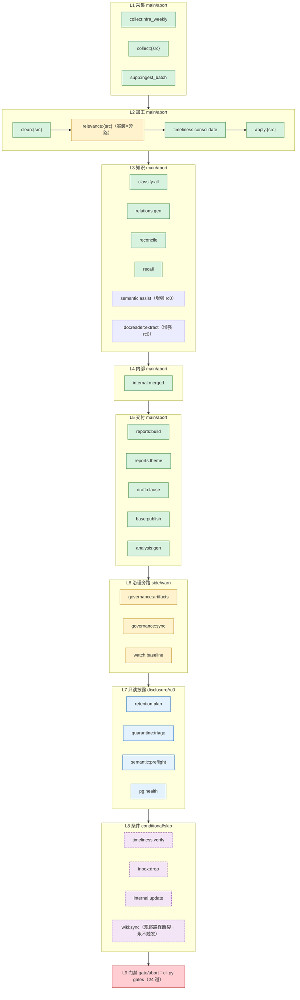

# 全面检视与重构审查报告（V2·用途基线与编排层次专项） — regulatory_compliance_orchestrator

- **审查日期**：2026-10-12
- **审查依据**：`reports/refactors/全面检视与重构审查提示词V1.md`（五阶段：现状 → 选型回溯 → **用途基线** → 偏差分析 → 重构建议；**第十一维度「编排层次」为重点**；**用途二必须覆盖完整监管数据体系**）
- **审查方式**：独立重新取证（未依赖任何既有总结）——重读全部核心源码、AST 解析关键常量、实测数据产物与运行台账、实测 Windows 计划任务、git 历史回溯、三个并行只读子代理（用途-能力匹配证据、编排层次证据，共 85 次工具调用）、关键结论全部二次复核
- **约束遵守**：未修改任何代码（临时复核脚本已删除）；所有结论附文件路径 + 行号 + 片段；不确定项标「待人工确认」
- **审查基线**：`main` 分支，HEAD = `72bd5c7`（第六十七批），280 个提交

---

# 阶段一：项目现状阐述（事实层，不做评判）

## 1.1 项目定位与目标

**定位**（README.md:5-7）：源码树编排工程（Single-Repo Orchestrator）——以统一入口把「采集 → 清洗 → 时效核验 → 条文 → 归属/主题 → 关系 → 内部制度 → 发布 → 分析交付 → 门禁」串成一条可复跑、可审计、可断点续跑的生产链路。

**核心目标**（README.md:18-20）：唯一入口 + 唯一事实源 + 可观测降级 + 机器化门禁四条纪律；任何增强能力可缺失但不可静默，任何失败可恢复但不可隐藏。

**技术栈**：Python ≥3.13（pyproject.toml:12，P0 起未变）；文件产物（JSONL/CSV）+ SQLite FTS5 + PostgreSQL/pgvector（可选）；`data/governance.db` 治理库；ruff/mypy/pytest + 24 道自研门禁；extras = dev/ocr/semantic；模型权重外置 `external/models/`（git 忽略）。

**版本事实**：pyproject version 0.1.0；README v3.0.0（2026-09-30）；CHANGELOG 最新条目「第五十六~六十五批」。

## 1.2 目录结构与模块划分

```
regulatory_compliance_orchestrator/
├── cli.py / bootstrap.py / paths.py / file_list_watcher.py     # 入口·引导·路径 SSOT
├── config/        # enums.py(受控域) sources.yaml schedule.yaml triggers.yaml ocr.yaml
│                  #   inbox_registry.yaml constants.py exitcodes.py loader.py schema/*.json
├── interfaces/    # contract.py(420行) protocols.py(四协议) + 9 个 *_api.py（进程内唯一通道）
├── gates/         # ALL_GATES 24 道（gates/__init__.py:20-132）
├── commands/      # 18 个子命令实现
├── modules/       # 五模块（约 91 个 .py + 数据）：scrapers/classifier/internal_policy_base/
│                  #   internal_policy_drafter/base_publish
├── std_lib/       # common_lib(20 模块) + scraper_std(约 40 模块 + common/ 10 模块)
├── tools/         # 37 根目录脚本 + retired/ 2 + _manifest.json（39 条目）
├── tests/         # 48 个 test_*.py
├── docs/reports/  # 分析交付库（17 项 + _manifest.json）
├── reports/       # 按批次重构报告 + 运行手册 + _tmp 台账
├── refactor/      # 属其他用户的独立模块（本仓不检查）
├── .codebuddy/    # 助手状态目录（历史归档；权威=仓外用户级记忆，README.md:1-21）
└── external/ data/ exports/ archive/ backups/ logs/   # 运行期/大资产（git 忽略）
```

依赖纪律（README.md:202-203）：`scraper → classifier → internal_base → drafter → analysis` 单向；跨模块仅经 `interfaces/`；唯一同仓互引 = `classifier → clean_index`（`gate_no_cross_module_import` 守护）。

## 1.3 入口与调度

### CLI（cli.py:48-70，18 个命令）

`gates` / `governance` / `source` / `internal` / `classify` / `timeliness` / `draft` / `rfn` / `base` / `analysis` / `relations` / `worklist` / `run` / `doctor` / `status` / `schedule` / `triggers` / `ping`。唯一主链入口 = `run`（commands/run.py:3，转调 `run_production_refresh.main()`，:95-97，不新开子进程）。

### STEP_ORDER 的数据结构（V1 新增重点）

**本轮独立取证**（AST + 括号配平解析，`tools/run_production_refresh.py:674-735`）：

- **数据结构 = 平铺 `tuple[str, ...]`，31 项纯字符串步骤名**（无分层、无分组对象、无每步元数据）
- **4 个动态模板**：`collect:{src}` / `clean:{src}` / `relevance:{src}` / `apply:{src}`（五源循环展开）
- **执行性质与失败语义在数据结构中完全不存在**：无 `kind`（main/side/disclosure/conditional/gate）字段、无 `fail_semantics`（abort/warn/rc0/skip）字段；`_run` 的签名同样不携带语义参数：
```python
# tools/run_production_refresh.py:456
def _run(step: str, argv, cwd=ROOT, timeout: int | None = None) -> dict:
```
- 步骤清单的机械治理只到「名单一致性」：671-673 注释自述该表用于 `--from`/`--list-steps`/`--only` 判定，`gate_config_integrity` 判据 R 断言它与 `_run("<step>")` 调用点一致（防清单漂移）——**不治理语义**。

31 项模板（执行序）：
```
 1 collect:nfra_weekly      17 governance:artifacts
 2 collect:{src}            18 governance:sync
 3 supp:ingest_batch        19 internal:merged
 4 clean:{src}              20 reports:build
 5 relevance:{src}          21 reports:theme
 6 timeliness:verify（条件） 22 draft:clause
 7 timeliness:consolidate   23 base:publish
 8 apply:{src}              24 analysis:gen
 9 classify:all             25 watch:baseline
10 relations:gen            26 retention:plan
11 semantic:assist          27 quarantine:triage
12 docreader:extract        28 semantic:preflight
13 reconcile                29 pg:health
14 recall                   30 wiki:sync（条件）
15 inbox:drop（条件）        31 gates（链尾）
16 internal:update（条件）
```

### 调度事实源（config/schedule.yaml）

7 个 cron 作业：`refresh`（每日 06:00 --no-scrape --resume）/ `nfra_weekly`（周二 01:00）/ `incremental_weekly`（周三 01:00 gov,mof,pbc）/ `gov_zhengceku_backfill`（每月 3 日）/ `verify`（周一 07:00）/ `publish_wiki`（周一 08:00）/ `monthly_check`（每月 1 日 09:00）；2 个 event 作业（`timeliness_sync` covered_by=timeliness:consolidate；`gov_increment` covered_by=collect:{src}，after=incremental_weekly）；notify=file 四类告警。

**实测计划任务**（`schtasks /Query`）：`REG_ORCH_*` 7/7 已安装且 Ready，下次运行时间与 yaml 一致。**已安装任务与 schedule.yaml 完全对应。**

### 条件触发（config/triggers.yaml，5 项）

`timeliness_verify`（token_exists + days_since≥7）/ `internal_update`（unindexed_originals）/ `supp_ingest`（explicit_arg）/ `inbox_drop`（inbox_has_new）/ `wiki_sync`（publish_manifest_changed）。4 项已入链为条件步骤（`_run_conditional`），supp_ingest 显式触发。

## 1.4 数据流与产物（2026-10-12 实测）

| 产物 | 路径 | 格式 | 大小 |
|---|---|---|---|
| gov/mof/nfra/pbc/supp 主库 | `modules/regulatory_scrapers/data/raw/*.jsonl` | JSONL（_meta 信封） | 458.6 / 63.6 / 90.3 / 2.6 / 13.8 MB |
| 五源 cleaned 双轨 | `data/cleaned/{src}_cleaned_20261011.{csv,jsonl}` | CSV+JSONL | gov 581.5+716.6；mof 45.3+87.6；nfra 44.1+115.7；pbc 5.1+5.5；supp 5.8+14.4 MB |
| 隔离件 | `*.quarantine.jsonl`（nfra×3、supp×1） | JSONL | ~0.06 MB each |
| 五源 clauses 双轨 | `data/clauses/{src}_clauses_20261011.{jsonl,md}` | JSONL+MD | gov 189.8+147.4；其余 16.0+12.4 / 29.2+17.3 / 3.8+2.0 / 0.9+0.5 MB |
| 关系产物 | `modules/regulatory_classifier/data/relations/relations_index.jsonl` | JSONL（27+ 字段） | total 4191 边（relations_stat.json：basis 3131/repeal 1060） |
| 治理库 | `data/governance.db` | SQLite（11 表） | 28.8 MB |
| 外部发布件 | `modules/regulatory_scrapers/published/` | JSONL×4 + FTS5 | 289.1+84.2+0.99+0.49 MB；索引 908.8 MB |
| 内部发布件 | `modules/internal_policy_base/published/` | JSONL×2 + FTS5 | 9.2+0.34 MB；索引 27.8 MB |
| 内部制度 | `modules/internal_policy_base/data/` | originals 879 / processed 3793 / merged_view 861 | 索引 963 KB、对齐 964 KB、merged 529 KB |
| 分析交付库 | `docs/reports/` | 17 项 + _manifest.json | 18 文件 |
| 运行台账 | `data/run_state/last_run_steps.json` | JSON | 16.3 KB（2026-10-12 08:00:24，41 条） |

**契约清单**（config/schema/contract_manifest.json）：19 条目（cleaned_csv_columns 39 / detail_table_fields 14 / relation_fields 31 / clause_line_fields 20 / cn_field_registry 38 / cross_basis_fields 31 等）。

**残留观察**：`published/external_records.jsonl.tmp`（289.1 MB，与正式件同大小）疑似写入中断残留——待人工确认。

## 1.5 共享库与公共能力

- **common_lib（20 模块）**：relations(1081 行，关系抽取 SSOT) / sentence_boundary(句读 SSOT) / semantic_tools(探测) / semantic_models(加载) / semantic_enhance(305 行，门面) / governance_store(1507 行，DAO) / vector_store(266 行) / fs_lock(锁+原子写 SSOT) / io_atomic(哈希+原子写) / index_store / norm(归一 SSOT) / logging(门面) / notify / triggers / mirrors / artifact_shape / clause_locator / docreader_bridge / git_hooks
- **scraper_std（约 40 + common/ 10）**：crawler_common(1234 行) / http(382 行) / unified_schema / schema_validation(285 行) / cleaner / pipeline / cache_store / circuit_breaker / checkpoint / ocr_engine / doc_convert / win_station / clipboard_guard / user_activity / proc / attachments / table_recovery / text_reflow / document_structure / rich_object / excel_structure / excel_matrix / doc_type_cleaner / category_classifier / clean_rules_registry / doc_number / encoding / naming / sentence_split / pkulaw_cli / secret_scan / metrics / logging_setup

## 1.6 门禁与质量保障

**ALL_GATES = 24 道**（本轮独立计数 `gates/__init__.py:20-132`，`"module": "gates.` 出现 24 次）：gate_run_steps / hardcoded_paths / enum_values / flat_layout / no_duplicate_libs / contract / hardcoded_snapshots / rfn_sync / rfn_drift / timeliness_ssot / citations / sources_config / provenance / field_aliases / secret_scan / original_resolvable / relations / watermark / no_cross_module_import / config_integrity / import_bootstrap / runtime_hygiene / clean_schema / declaration_executor。

**ci_check.py 实际检查项**（tools/ci_check.py:64-131）：ruff → mypy（全仓）→ schedule → **flowmap** → pytest(1500s) → gates(600s)；`--cov` 追加 coverage。

**tests/**：48 个 test_*.py（CHANGELOG v2 记载 487 用例；BENCHMARK.md:39 自述 34 文件——已过期）。

## 1.7 配置与事实源

- `config/enums.py`：约 27 个受控域 frozenset/list + 映射表，`assert_enum_bindings()` 自检（README 称「31 个受控域」——统计口径差异，待人工确认）
- `config/exitcodes.py`：ExitCode(IntEnum) = OK(0) / FAIL=USAGE=GATE(1) / DATA=CONFIG=DEPENDENCY(2) / ENV=LOCKED=PRECONDITION(3) / NOT_SOURCE_TREE(4)（别名制）
- `paths.py`：ROOT/DATA_DIR/CORPUS_DIR/INBOX_DIR/GOVERNANCE_DB + `module_dir()`/`relations_index()` 访问器
- `interfaces/contract.py`：420 行字段契约（与 contract_manifest.json 19 条目互锁）

## 1.8 模型与增强层

`config/schema/semantic_tools.json`（唯一事实源）登记 **14 个语义工具**（本轮 AST 实测 MODEL_BINDINGS 16 键，含 2 个 `@relations` 双用途）：
- usage_policy（N-171 定案）：`output_scope=analysis_view`、`write_fact_source=false`、**`enabled=true`**（N-177 用户明示接入并启用）、`adoption.enabled=false`（只产建议视图）
- selection_policy：full→bge_base_zh→text2vec；incremental→youtu_embedding→bge→text2vec
- 入链调用点：`semantic:assist`（--limit 200 默认）、`docreader:extract`（--limit 20 默认）、分句（env `REG_ORCH_SEMANTIC_SPLIT`，默认关）
- 状态（README §8.1 图例）：已接线 0 / 已接线·默认关 6 / 未接线 7 / 未就绪 3（deepke 权重不可得、paradedb 未部署、signalgraph 未装）；pgvector 已部署验证通过但 wired=false

## 1.9 近期变更

- git log 最近主题：第六十七批（W-V 快照排序非确定性根治）→ 第六十六批（README/CHANGELOG 对齐）→ 第六十五批（遗留风险闭环）→ 第六十四~五十六批（桌面干扰四重机制）→ 第六十三批（relevance 入链 + 第 24 道门禁 + T7 死代码 28 项）→ 第六十一~五十九批（声明面清剿 59 条）
- v2 重构（2026-09-24~26，九批）：P0 骨架→水位/待办/契约/语料→interfaces 收口+日志失败语义→调度/触发事实源+统一入口+投放区→生命周期+测试 CI+gates 移链尾→审查驱动收口→D6 接入→运行时卫生→mypy 转阻断+计划任务安装
- 运行台账实证（2026-10-12 08:00:24，41 条）：本次为 `publish_wiki` 作业（--only wiki:sync），39 步因 `--only` SKIP；`wiki:sync` SKIP，note = 「条件未满足：publish_manifest_changed=True → 不满足（publish_manifest.json 不存在 → 不判定）」；relevance 家族台账仅 `relevance:supp` 一条

---

# 阶段二：技术选型回溯评估（选型层）

> 结构：【选型点】【当前实现】【选型时间】【当时理由】【当时约束】【当前约束】【约束是否变化】【当前替代方案】【是否应改变】【改变代价】【优先级】。「当时理由」以 git log/CHANGELOG/注释为据；无记录标「无记录」。**按用户要求优先回溯早期、影响面大的选型：raw 格式、调度器、编排器、编排结构。**

## A1. raw 文件格式（**最高优先级**）

- 【选型点】raw 主库：单文件 JSON 数组 → JSONL（首行 `_meta` 信封 + 一行一记录）
- 【当前实现】`data/raw/*.jsonl`（run_production_refresh.py:134-143 `RAW_JSON`）；写入流式（.tmp+os.replace）；读取双格式流式（pipeline.load_raw_records）
- 【选型时间】**2026-10-09 批 47（a02be4d）**；批 49（05a9c52）四源统一。此前 P0~批 46 为 JSON 数组
- 【当时理由】（提交信息原文）「`.json` 单数组解析 1GB 主库实测峰值 5.24~6.13GB；JSONL 读写均可流式 ⇒ 峰值与语料体积解耦」；迁移有等价性证明（13178 条滚动 sha 一致才删旧文件）
- 【当时约束】gov 943.6MB/13178 条
- 【当前约束】实测 gov 458.6MB，其余四源 <100MB
- 【约束是否变化】是（已迁移，问题解决）
- 【当前替代方案】Parquet（需 pyarrow，本环境网络不可达）/ 分片 JSONL / 保持 JSONL——**JSONL 为当前最优**
- 【是否应改变】否
- 【遗留欠账】`_raw_size()`（:850-859）仍 `json.load` 全量解析统计记录数——对 JSONL 必然抛 `JSONDecodeError: Extra data`（本轮实测复现）→ except 后 `records=None` → **运行汇总 raw 记录数自批 47 起静默失效**（详见阶段四 D-2）

## A2~A5. 其余数据格式选型（紧凑结构）

| 选型点 | 当前实现（证据） | 选型时间/理由 | 回溯结论 |
|---|---|---|---|
| cleaned CSV+JSONL 双轨 | `data/cleaned/*.{csv,jsonl}`（gov 581+717MB）；JSONL=权威轨（run_production_refresh.py:302-305） | P3a（96cd355）；「当时理由」无 ADR——CSV 面向人工检视、JSONL 面向程序 | **待评估**：CSV 消费面未盘点（待人工确认）；每轮全量重写成本真实 |
| clauses JSONL+MD 双轨 | `data/clauses/*.{jsonl,md}`（gov 190+147MB）；85245a3「与 internal 双产物对齐」 | 2026-09 上旬 | **待评估**：MD 消费面未盘点（待人工确认） |
| relations JSONL | `paths.relations_index()` 唯一出口（paths.py:78-86，2026-09-29 收敛，此前 8 文件各自拼路径） | R-F01 2026-09-14 | 成立（一行一边可流式） |
| 契约 JSON / 配置 YAML | contract_manifest.json 19 条；sources/schedule/triggers/ocr/inbox_registry YAML | v2 §3.4（2026-09-26） | 成立（YAML 注释能力是事实源组成部分，不应改 TOML） |
| 治理库 SQLite / FTS5 | `data/governance.db` 28.8MB（<50MB 设计目标）；external_index.sqlite 908.8MB | 治理库 2026-09-18（f1f520e）；「三轨制」c3054a9 | 成立（零运维+克隆可移植） |
| 向量 pgvector/sqlite_vec | pgvector 已部署（127.0.0.1:7777）但 wired=false；pg:health 只读披露 | P2-2 2026-09-29 | 选型成立、**接线缺失**（阶段三用途一/阶段四 D-9） |

## C1. 调度器：Windows 任务计划 + schedule.yaml

- 【选型点】OS 级计划任务为执行体，schedule.yaml 为唯一事实源，install_schedule.py 生成 XML
- 【选型时间】P2-2（2026-09-24，9d31728）；更早 2026-09-12 为手工建任务（install_schedule.py:5-6 docstring 记载原状三处不一致）
- 【当时理由】「把安装也变成由 yaml 派生」；单机 Windows 部署、无 Docker
- 【当前约束】7/7 任务实测一致；历史事故（任务从未执行：DisallowStartIfOnBatteries + .py 关联）已于 427516b/e2bc5f1 修复并实测 Last Result=0
- 【替代方案】APScheduler（需常驻，与「唤醒即跑」冲突）/ Prefect/Dagster（引入服务端）
- 【是否应改变】否（安装形态问题已修，非选型问题）

## C2. 编排器：自研 run_production_refresh.py（31 步链）

- 【选型点】自研脚本编排（子进程 argv 链）vs 工作流引擎
- 【选型时间】P0（2026-09-09）；v2 §3.13 起为库 + cli.py run 唯一入口
- 【当时理由】按源体量配超时（N-150/N-188）、水位驱动续跑、零外部服务（克隆可移植）
- 【当前约束】31 步 + 单实例锁 + 步骤日志落盘 + 稳定台账 + 失败通知——能力远超普通脚本编排
- 【替代方案】Prefect/Luigi/Dagster/Airflow
- 【评估】本链特性（动态超时/水位续跑/失败时间窗/条件入链）全是领域特定语义；引擎需常驻服务。**不改变**。真问题在个别步骤实现缺陷（D-1/D-3）与**编排结构无语义表达**（C4）
- 【是否应改变】否

## C4. 编排结构：STEP_ORDER 平铺列表（**V1 新增重点回溯点**）

- 【选型点】以平铺字符串 tuple 表达 31 步链，执行性质/失败语义/依赖层次无机器可读声明
- 【当前实现】run_production_refresh.py:674-735 `STEP_ORDER: tuple[str, ...]`；`_run(step, argv, cwd, timeout)` API 无语义参数（:456）；语义散落于三处彼此不完全同步的机制：① 调用点自由注释（31 个调用点中仅 8 个有失败语义注释）；② gen_flow_map.STEP_FAILURE（平铺 dict 16 键 + DEFAULT_FAILURE 兜底，无前缀匹配）；③ README §8.2 机器生成表
- 【选型时间】P0 骨架即平铺（ee3e535）；P2-6（2026-09-24）补 STEP_ORDER 作为 --from/--only 判据源；N-165（2026-09-30）建 STEP_FAILURE「逐步声明的事实源」
- 【当时理由】「步骤清单（执行顺序）：--from 判定、--list-steps 输出、--only 合法性都以此为准；判据 R 断言它与调用点一致（防清单漂移）」（671-673）——治理的是**名单一致性**；STEP_FAILURE 建立动因是「逐步声明降级/失败语义供 README 披露」（gen_flow_map.py:94-96）
- 【当时约束】31 步以内、人工编排、文档披露优先
- 【当前约束】下游 20 项用途（阶段三）要求机器可消费步骤语义（MCP 编排调用、多频度调度、健康度评估）；平铺结构使「主链/旁路/披露/条件/门禁」无法被程序区分——`governance:artifacts`（旁路治理）与 `clean:{src}`（主链）在数据结构中同等；`gates`（阻断）与 `retention:plan`（恒 rc=0）无区别；31 步无阶段分组
- 【约束是否变化】是（消费面从「人读文档」扩展到「机器编排/多体系调度」）
- 【当前替代方案】① `STEP_LAYERS` 分层字典（L0~L9，每层声明 kind/fail_semantics/steps/conditional/enhancements）——与提示词 V1 建议一致；② 步骤表外置 YAML（steps.yaml）；③ dataclass 步骤对象（StepSpec(name, kind, fail_semantics, timeout_policy, depends_on)）
- 【替代方案评估】方案①改动最小且保留 STEP_ORDER 为「派生视图」（Layers 扁平化 = 现行 tuple，判据 R 与 --only 语义不变）；方案③类型最强但需迁移全部调用点；方案②与「编排逻辑即代码」现纪律冲突（超时按体量动态计算等逻辑须留代码）
- 【是否应改变】**是**（推荐方案①，STEP_ORDER 保留为兼容视图）
- 【改变代价】中（判据 R/_step_index/_step_matches/_skip_reason 需适配；gen_flow_map 的 PURPOSE/STEP_FAILURE 可被 Layer 声明取代；README §8.2 改为从 Layers 生成——实际上会**修复**现有三处文档-实装不一致）
- 【优先级】高（阶段五 R-4 给出完整方案）

## B/C3/D/E/F/G 组其余选型（紧凑结论）

| 组 | 选型点 | 结论 |
|---|---|---|
| B | 缓存自研 cache_store / 锁自研 fs_lock / 熔断 circuit_breaker / 断点 checkpoint | 均成立（与领域语义耦合；cache 边界处有私造原子写/哈希，应收敛） |
| B/D | **HTTP 三套并存**（http.py urllib 382 行 / crawler_common.robust_get requests / common/ratelimit.py requests；退避公式逐字符重复，UA 版本号已漂移） | **应改变**（收敛为 robust_get 单栈） |
| D | schema_validation 自研 vs pydantic | 不改（迁移需重写清洗规则+推翻隔离治理语义） |
| D | 日志（单实现双门面）/ CLI argparse（有意双轨）/ 配置 loader | 成立 |
| E | 分句 SSOT（N-90 已收口）/ 三嵌入选型（用户 2026-09-30 明示）/ 正则关系抽取为事实源 / docreader 边界 | 成立；BERTopic/DeepKE「未接线但已定位」处置正确 |
| F | Python 3.13（P0 起无记录）/ 单仓（唯一演进点）/ mypy 全仓 0 error / ruff | 成立 |
| G | 全量清洗+增量采集 / 串行 / 快照单版化 | 成立（清洗需全库上下文；并行化待评估低优先） |

## 阶段二结论摘要

| 选型 | 结论 |
|---|---|
| raw JSONL | 已改变且成立（遗留 _raw_size 未收口） |
| cleaned/clauses 双轨 | 待评估（先盘点消费面） |
| SQLite 治理库 / FTS5 / pgvector 选型 | 成立（pgvector 缺接线） |
| Windows 计划任务 + schedule.yaml | 成立 |
| 自研编排器（31 步链） | 成立 |
| **编排结构（STEP_ORDER 平铺）** | **应改变 → STEP_LAYERS 分层（R-4）** |
| HTTP 三套并存 | 应改变（收敛单栈） |
| 其余自研件 / Python 3.13 / 单仓 / 质量工具 | 成立 |

---

# 阶段三：用途基线与能力匹配（用途层）

> 方法：对 20 项用途逐项输出【用途描述】【依赖的现有能力】（代码事实）【现有能力是否满足】【缺口清单】【所需新增模块】【所需新增依赖】【对现有架构的影响】【优先级】。用途二按约束覆盖完整监管数据体系（不止 EAST）。

## 3.1 用途一：封装 MCP 供 Agent 调用

- 【用途描述】将核心能力封装为 MCP（Model Context Protocol）服务供外部 Agent 调用
- 【依赖的现有能力】（本轮实证）
  - **进程内接口面成熟**：`interfaces/` 9 个 `*_api.py` —— base_api（`manifest` L58 / `query_external` L66 / `search_external` L104 FTS5 / `get_external` L123 / `query_internal` L129 / `search_internal` L156 / `get_policy` L174 / `version_chain` L185 / `view_active` L214）、clean_index_api（15 函数）、clause_index_api（7 函数）、relations_api（`load/stat/by_src/by_dst/summary`）、rfn_api（12 函数）、timeliness_api（7 函数）、governance_api（只读消费面 11 函数）、internal_policy_api（InternalPolicyAPI + merged_view 加载）、theme_api（`set_theme` 唯一写口）
  - `interfaces/protocols.py`：4 个消费侧 Protocol（CleanIndexProvider L37 / RfnProvider L52 / InternalPolicyProvider L65 / RelationsProvider L78）+ `assert_provider` L92——**已具备「接口先于实现」的契约基础**
  - `interfaces/contract.py`：420 行字段契约（19 条 manifest 登记）
  - CLI 18 命令 + `commands/base.py` query/search（--json 机器可读输出，:43/:109-110）
  - 发布件与 FTS5 索引实体就绪（external_records 289MB / external_index.sqlite 908MB）
- 【现有能力是否满足】**部分满足**（有内核无门面）
- 【缺口清单】① 无 MCP server 框架/运行时（pyproject 无 mcp 包；全仓 29 处 `mcp` 命中全部是北大法宝 Node CLI 客户端 `pkulaw_cli.py:5-6` 与已删 extra 的说明 pyproject.toml:53-55——**零 MCP 实现**）；② 无 tool/resource schema 定义；③ 无认证/权限层（interfaces 全部函数无鉴权参数）；④ 调用审计未绑定接口（governance_store audit_log 表 L195-208 存在但 interfaces 无 actor 概念）；⑤ 无传输层（CLI 为进程级入口 cli.py:141-160）
- 【所需新增模块】`mcp_server/`（tool 注册表 + schema + stdio/SSE 传输）+ `interfaces/mcp_api.py`（鉴权装饰器 + 审计埋点）
- 【所需新增依赖】`mcp`（Python SDK）
- 【对现有架构的影响】低（纯新增门面层；接口面已稳定）；需把 audit_log 的 actor 从「内部 run_id」扩展为「调用方身份」
- 【优先级】高（Agent 化是本仓下游的首要消费形态）

## 3.2 用途二：多监管数据体系合规检核规则（约束：必须覆盖完整体系，不止 EAST）

- 【用途描述】将监管文件、内部制度条款与人身保险公司完整监管数据体系（10 套）对照，制定可执行合规检核规则
- 【依赖的现有能力】（本轮实证）
  - **EAST 链路已通**：`tools/build_east_backlog.py`（docstring L2-15：金非银检函〔2025〕82号 13 文件 → supp backlog：pdf→body_text、docx→正文、xlsx×6→table_structured 结构化轨、jpg E-R 图→rich 轨、.et WPS→登记不可解）→ `supp_ingest_batch` → `supplementary_regulations.jsonl:60`（task_index=EAST-20250410-01 已入库）→ clean pipeline（supp cleaned 58 条）
  - **素材库已归集**：`reports/corpus/regulatory_stats.manifest.json`（313 文件 = EAST2.0 全套素材）；`config/inbox_registry.yaml:35-50` 登记 `regulatory_stats` 域
  - **主题建模覆盖大半体系**：THEME_MAP T0-T10（`rfn/__init__.py:34-46`）中 T1 销售行为与消费者保护 / T2 产品精算 / T3 资本与偿付能力 / T4 公司治理与股权关联交易 / T5 资金运用与资产负债 / T7 反洗钱 / T10 数据治理与信息披露 均有监管文件素材与 cluster 关键词（`cluster_keywords.json` X 组）
- 【现有能力是否满足】**部分满足**（EAST 素材链 + 主题底座就绪；多体系建模与规则引擎缺失）
- 【缺口清单】
  1. **regulatory_stats 域无下游消费者**：inbox_registry.yaml:38-41 显式标注 `consumer=pending_consumer`（「无已实现下游消费者，不假装已消费」）——EAST 素材归集后停在语料层，**未进入 cleaned→clauses→关系链**
  2. **监管条款→数据项映射零实现**：全仓「映射」命中均为字段级 schema 映射（supp_mapper）或一次性人工双向映射文档（`internal_policy_drafter/docs/*_05_双向映射表.md`）；无「监管条款 ↔ EAST 112 张数据表/3053 个数据项」映射代码
  3. **县域机构统计制度、税收体系零素材零建模**：代码层「县域」唯一命中是 verification_state.json:30346 的无关通知；「税收」仅间接命中 cluster_keywords.json:67「税延」
  4. 无规则引擎（规则形式化 DSL/SQL/配置、版本管理、双向追溯、责任映射——「谁管业务谁管数据」的责任部门/责任人无数据模型）
  5. 报送频度差异（月度/季度/按笔）无差异化调度（schedule.yaml 只有数据链频度，无报送频度概念）
- 【所需新增模块】`modules/reg_frameworks/`（多体系结构化模型：体系/数据表/数据项/报送频度/责任映射）+ 条款↔数据项映射器 + 检核规则引擎（规则 DSL + 版本 + 追溯）
- 【所需新增依赖】规则引擎可自研（DSL + 求值器）或引入 jsonlogic/duckdb
- 【对现有架构的影响】中（新增第六模块；须接入 interfaces 契约层与门禁）
- 【优先级】高（用途二是业务核心；EAST 素材已备、缺建模与消费）

## 3.3 用途三：监管文件与内部制度关联（文件级 + 条款级）

- 【用途描述】主题下完整的关联网络：监管↔监管、监管↔制度、制度↔制度（文件级 + 条款级）
- 【依赖的现有能力】（本轮实证）
  - **监管↔监管最强**：relations_index.jsonl 4191 边（relations_stat.json：basis 3131/repeal 1060；reg→reg 4049）+ `build_clause_graph.py`（docstring L3-19：主题内条/款/项级引用图，P1 跨文件条款引用《X》第N条 / P2 自指 / P3 裸条号 / P4 上位法依据 / P5 书名号文件级；正则统一取自 relations.py）
  - **监管↔制度可用**：cross 边 123 条（internal→regulatory）+ merged_view 861 条制度×RFN 视图（`merged_view.json`：ipn/title/docno/primary_theme/associated_rfns 血缘签名 L1-10）
  - **制度↔制度薄弱**：仅 19 边；reg→internal 反向 0 条
- 【现有能力是否满足】**部分满足**（监管内图完整；跨底座条款级实时对齐缺失）
- 【缺口清单】① unresolved 2459/4191（58.6%）、实体解析率 20.95%——「完整关联」的最大缺口；② clause_graph 不跨底座（无监管条款↔制度条款细粒度对齐，draft_clause 是离线生成的 500+ md 素材）；③ 无关联置信度分层消费（confidence 字段存在但无阈值策略）；④ 无关联变更追踪（上游文件变化后关联边的增量重算）；⑤ 无主题级关联聚合视图（按 T0-T10 汇聚全部边）
- 【所需新增模块】条款级跨底座对齐器（merged_view × clause_graph 联接）+ 关联增量重算 + 主题关联视图
- 【所需新增依赖】可复用现有（relations.py + clause_graph 模式集）
- 【对现有架构的影响】低~中（主要是算法增强与产物新增，不改主链结构）
- 【优先级】高（关联网络是用途五/七/二十的地基；先补 unresolved 解析率）

## 3.4 用途四：内部制度落地与执行检视

- 【用途描述】检视内部制度落地执行表及作证材料与制度要求的实际差距
- 【依赖的现有能力】（本轮实证）
  - IPB 全链就绪：originals 879 / processed 3793（861 `_clauses.json`+861 `_clauses.md`）/ merged_view 861 / draft_clause 条款级对照素材（`build_draft_clause_view.py` docstring L2-19：§1 引用监管依据 + §2 逐条条款对照 + §3 依据废止关系，样本 IPN-0089da186546d198《监管统计管理办法》32 条对照）
  - `verify_regulatory_citations.py`（引用监管文件强制校验门禁）
  - `internal_policy_base/data/ledgers/`：按 10+ 部门的执行台账 xlsx 素材（投放区归集）
- 【现有能力是否满足】**不满足**（最薄弱用途）
- 【缺口清单】① ledgers 台账 xlsx **未解析**（inbox_registry.yaml:31-32 dept_policies pipeline 不含 ledger 解析步骤；代码层「执行表」零命中）；② 无作证材料管理数据模型（「作证」modules 零命中）；③ 无差距分析引擎（制度条款 vs 执行现状 vs 作证三方比对不存在——现有仅为一次性人工/LLM 交付文档 `internal_policy_drafter/docs/`）；④ 无差距分类（未执行/部分执行/执行无作证/作证不充分）与优先级排序；⑤ 无整改追踪（「整改」命中均为动词词表/路径建议文本）
- 【所需新增模块】`modules/implementation_audit/`（执行表解析器 + 作证材料索引 + 三方差距引擎 + 整改追踪 worklist 专用 kind）
- 【所需新增依赖】openpyxl（已有）；差距规则可复用 draft_clause 对照逻辑
- 【对现有架构的影响】中（新增模块；消费 merged_view + draft_clause；产出入 worklist）
- 【优先级】高（业务价值直接；当前完全空白）

## 3.5 用途五至二十：现有能力证据与匹配度

| # | 用途 | 现有能力（证据） | 满足度 | 关键缺口 |
|---|---|---|---|---|
| 五 | 监管变化影响分析 | 时效核验 R13 三态 + verification_state 14797 记录 + apply 回写 + watch:baseline 变更监听（cli source diff） | 部分 | 无「变化→受影响制度条款」自动传播分析 |
| 六 | 合规体系健康度评估 | BENCHMARK §6.1 主题金标准 1015/1162=87.4%、§6.3 关系定位率、§6.4 召回四门禁、audit_health 九类审计 | 部分 | 指标未聚合成健康度评分/等级 |
| 七 | 条款级引用网络分析 | build_clause_graph（监管内条款图 P1-P5）+ clause_graph 产物 11 份 | 部分 | 不跨底座（见用途三） |
| 八 | 监管问答与智能检索 | base search（FTS5 trigram）+ semantic:assist（分析视图）+ pgvector（已部署未接线） | 部分 | 无 RAG 问答链；向量检索未投产 |
| 九 | 监管要求追溯矩阵 | merged_view（制度→RFN）+ draft_clause（条款→RFN）+ 治理库 watermark/audit_log | 部分 | 缺「执行落地→作证材料」后两段（用途四） |
| 十 | 合规审计支持 | governance_store 11 表（run_log/watermark/artifact/audit_log/gate_result/worklist/run_step/document/theme_assign/relation/timeliness_history）+ governance_api.audit L132 | **基本满足** | 审计证据导出格式（面向内外部审计的报告化） |
| 十一 | 监管报送材料自动生成 | 17 项分析交付物生成器（gen_analysis_deliveries）+ 条款对照素材 | 部分 | 无报送材料模板（依赖用途二检核结果） |
| 十二 | 合规培训材料生成 | draft_clause 素材 + 关联关系 | 部分 | 无培训材料模板与生成器 |
| 十三 | 监管趋势预测预警 | 2.1.3.6 监管趋势预判交付物（gen_analysis_deliveries.py:1078）+ 时效/差距/引用完整性数据面 | 部分 | 「预测」为规则推演；无预警规则引擎与通知通道绑定 |
| 十四 | 内部制度体系优化建议 | align_result 963 条 + unaligned worklist kind | 部分 | 无「新增/修订/废止」建议生成器 |
| 十五 | 监管文档智能摘要 | cleaned 39 列（summary 字段）+ supp summary | 部分 | 摘要为采集态字段，无 LLM 摘要管线 |
| 十六 | 条款级变更追踪 | clause_index 快照单版化 + history 近三版 + timeliness_history 表 | 部分 | 无条款 diff 与版本演进链 |
| 十七 | 跨机构合规对标 | 无（单法人） | 不满足 | 需多租户数据模型（低优先） |
| 十八 | 合规风险画像 | 差距/时效/引用完整性/主题覆盖数据面均有 | 部分 | 无画像聚合模型 |
| 十九 | 合规仪表盘 | 无（CLI + md 报告为主） | 不满足 | 需可视化层（graphify-out 已有图谱基础可复用） |
| 二十 | 监管条款级影响传播 | clause_graph + relations | 部分 | 无传播分析算法（BFS/影响集） |

## 3.6 用途-能力匹配度总表

| 用途 | 匹配度 | 业务价值 | 实现成本 | 紧迫性 | 综合优先级 |
|---|---|---|---|---|---|
| 一 MCP 封装 | 部分（内核强、门面缺） | 高 | 中 | 高 | **P0** |
| 二 多体系检核规则 | 部分（EAST 通、建模缺） | 极高 | 高 | 高 | **P0** |
| 三 关联网络 | 部分（监管内强、跨底座弱） | 高 | 中 | 高 | **P1** |
| 四 落地执行检视 | 不满足（空白） | 极高 | 中 | 高 | **P1** |
| 五 变化影响分析 | 部分 | 高 | 中 | 中 | P1 |
| 六 健康度评估 | 部分 | 中 | 低 | 中 | P1 |
| 七 条款引用网络 | 部分 | 高 | 中 | 中 | P1 |
| 八 问答检索 | 部分 | 高 | 中 | 中 | P2 |
| 九 追溯矩阵 | 部分 | 高 | 中 | 中 | P2 |
| 十 审计支持 | 基本满足 | 中 | 低 | 中 | P2 |
| 十一~十六 报告/材料/预测/摘要/变更 | 部分 | 中 | 低~中 | 低~中 | P2 |
| 十七 跨机构对标 | 不满足 | 中 | 高 | 低 | P3 |
| 十八 风险画像 | 部分 | 中 | 低 | 中 | P2 |
| 十九 仪表盘 | 不满足 | 中 | 中 | 中 | P2 |
| 二十 影响传播 | 部分 | 高 | 中 | 中 | P1 |

---

# 阶段四：偏差分析（差异层）

> 对照阶段三用途基线与 19 维度需求清单，逐条核对阶段一现状。先总览，再展开重点证据链；第十一维度（编排层次）按提示词要求单列专项（11.1~11.8 + 分层流程图 + 分层表格 + 重构代码结构）。

## 4.0 偏差总览

| 编号 | 对应需求/用途 | 摘要 | 优先级 |
|---|---|---|---|
| **D-1** | REQ-09/用途三·八 | **triggers.py:46-48 publish_manifest 观察路径断裂**（指向不存在的 `modules/base_publish/published/`，真实清单在 scrapers/published 与 internal_policy_base/published）→ wiki_sync 条件永远「不判定」→ wiki 同步链路静默失效（台账实证 note） | **P0** |
| **D-2** | REQ-15 | `_raw_size()`（:850-859）`json.load` 读 JSONL 必然失败 → 运行汇总 raw 记录数全部 None（本轮实测复现 JSONDecodeError） | 高 |
| **D-3** | REQ-10 | `relevance:{src}`（:1006）使用 for 循环残留变量 `src`（=supp）→ 五源仅 supp 执行；台账实证；`gen_flow_map.PURPOSE` 缺 relevance 键（README §8.2 自标「⚠️ 未登记作用」） | 高 |
| **D-4** | REQ-17 | BENCHMARK.md 生成物过期：23 道（实际 24）、34 测试文件（实际 48）、快照 20260929（实际 20261011） | 高 |
| **D-5** | REQ-17 | README 漂移：门禁数 23≠24（:25/:184 加粗 + :355 非加粗）；CI 项列表漏 flowmap、错列 coverage；§6.0 usage_policy enabled=false≠实际 true | 高 |
| **D-6** | 用途一/维度十一 | **STEP_FAILURE 平铺 dict 16 键无前缀兜底**：`collect:{src}`/`clean:{src}`/`apply:{src}`/`relevance:{src}` 四个动态模板步骤在 README §8.2 显示 DEFAULT_FAILURE 兜底文案，clean 的「超时按体量/无 raw 变化 SKIP」、apply 的「无核验结果 SKIP」专属语义丢失 | 高 |
| **D-7** | 维度十一 | **relevance:{src} 文档-实装矛盾**：README §8.2 机器生成「阻断（失败即停）」vs 调用点实装「旁路分析件，失败不阻断主链」+ try/except WARN（:1001-1013）；根因 = STEP_FAILURE 缺 relevance 键 | 高 |
| **D-8** | REQ-13 | `--stop-on-error` 帮助文案宣称「任一步 rc!=0 即中止」（:1481），实装仅覆盖 collect（:920-921）与 clean（:987-988）两个循环——阶段 1.9 之后的 20+ 步骤失败仍继续跑 | 中 |
| **D-9** | REQ-24/用途二 | pgvector 已部署验证（2026-09-29）但 wired=false 13 天，链上零调用；模型 7 未接线 3 未就绪 | 中 |
| **D-10** | REQ-06 | 37 个零引用脚本（tools 16 已登记 independent + **modules 21 无登记机制**）；含 supp_ingest.py「纸面 collector」（sources.yaml:34 登记但无执行路径）、sync_three_modules.py（无调度方的编排器）、build_clean_index.py（文档称被调用无实证） | 中 |
| **D-11** | REQ-08 | HTTP 三套并存 + 公共原语漂移（sha256_of×5、normalize_date×5、norm_docno×2、`_norm_title` 私有名可绕过 gate_no_duplicate_libs） | 中 |
| **D-12** | REQ-10/维度十一 | **编排层次无机器可读表达**：STEP_ORDER 平铺 tuple；无 kind/fail_semantics 字段；31 个调用点仅 8 个有失败语义注释；无步骤级 depends_on（依赖仅在 GOV_ARTIFACTS 产物级 9 条 inputs 边 + 顺序注释） | 高 |
| **D-13** | REQ-10/维度十一 | inbox:drop / internal:update 是条件步骤但 README §8.2 语义列未声明「未触发→SKIP（rc=0）」（对比 timeliness:verify/wiki:sync 有声明） | 低 |
| **D-14** | REQ-17/SD-7 | audit_health（README 一致性守卫）未纳入 ci_check；其门禁数检查只匹配加粗 `**N 道**` 形态 | 中 |
| **D-15** | REQ-19 | `published/external_records.jsonl.tmp`（289MB）疑似写入中断残留；retention 无 .tmp 清理条目 | 低 |
| **D-16** | REQ-12/维度十九 | `--resume` 跳过判据只问「上次 rc=0」不问「输入是否变化」；raw 不在 GOV_ARTIFACTS 水位声明内——链外 raw 更新 + clean 上次成功 → 跳过 clean（当前靠 schedule 显式设计绕开，边界无门禁守护） | 中 |
| **D-17** | REQ-12 | gate_config_integrity docstring（:39）称 R 判据「待接」但已实装（_check_step_order :732-758，:1198 接入） | 低 |
| **D-18** | REQ-22 | commands/run.py:107-108 重复 print（同义两行） | 低 |
| **D-19** | 用途二 | regulatory_stats 域 consumer=pending_consumer——EAST 313 文件素材归集后无下游消费者；监管条款→数据项映射零实现；县域/税收体系零素材 | 高 |

## 4.1 重点偏差证据链

### D-1（P0）：wiki_sync 触发条件观察路径断裂

**证据链**（本轮独立复核）：
1. `std_lib/common_lib/triggers.py:45-48`：
```python
# 发布件清单（`publish_manifest_changed` 条件的观察对象）
_PUBLISH_MANIFEST = os.path.join(
    paths.MODULES_DIR, "base_publish", "published", "publish_manifest.json"
)
```
2. `Test-Path modules/base_publish/published/publish_manifest.json` = **False**（该目录不存在；`modules/base_publish/` 仅 4 个 .py + `__init__.py`）
3. 真实清单写盘方：`build_external.py:320-324`（→ `modules/regulatory_scrapers/published/`）、`build_internal.py:137-141`（→ `modules/internal_policy_base/published/`）；`interfaces/base_api.py:32-33` EXT_DIR/INT_DIR 亦指此两处，且 base_api 提供 `manifest()` 访问器（L58-63）
4. `triggers.py:149-150`：文件不存在即 `return False, "publish_manifest.json 不存在 → 不判定"`
5. **运行台账实证**（data/run_state/last_run_steps.json，2026-10-12 08:00:24）：`wiki:sync rc=0 exit=SKIP note=条件未满足：publish_manifest_changed=True → 不满足（publish_manifest.json 不存在 → 不判定）`

**后果**：`wiki_sync` 触发项永不满足 → 链步骤 `wiki:sync` 永远 SKIP → `sync_wiki_sources.py`/`gen_theme_moc.py`/`check_llm_wiki_upstream.py` 三个已接线脚本 + schedule.yaml 的 `publish_wiki`（周一 08:00）作业**全部空跑**；「发布件变化→wiki 同步」的上游变更感知链断裂（用途三/用途八的 vault 侧数据停止更新）。

**为何 24 道门禁未发现**：判据 T 只断言 triggers 的 argv 目标文件存在；E3 只查 resume 字段可达；**无判据校验「条件观察对象路径」与「生产者实际写盘路径」一致**——与 gate_declaration_executor 自述的根因模式（README:296-297「既有门禁只校验名字/文件/字面量存在，不校验谁执行它」）同构。

### D-2（高）：_raw_size 与 JSONL 迁移脱节

`tools/run_production_refresh.py:850-859`（本轮原文复核）：
```python
def _raw_size() -> dict:
    out = {}
    for src, fn in RAW_JSON.items():
        p = os.path.join(RAW_DIR, fn)
        try:
            data = json.load(open(p, encoding="utf-8"))
            out[src] = {"bytes": os.path.getsize(p), "records": _raw_records(data)}
        except Exception:  # noqa: BLE001
            out[src] = {"bytes": os.path.getsize(p) if os.path.exists(p) else 0, "records": None}
    return out
```
RAW_JSON 全部指向 `.jsonl`（:134-143）；本轮实测 `json.load` 对 gov_laws.jsonl 抛 `JSONDecodeError: Extra data: line 2 column 1 (char 109)` → 每源落入 except → `records=None`。汇总打印（:1386-1392）显示 `gov=None条/458.6MB`。**自批 47（2026-10-09）起失效 3 天，无门禁/告警覆盖。**

### D-3（高）：relevance 步骤只执行 supp 一个源

`tools/run_production_refresh.py:1001-1013`（本轮原文复核）：`f"relevance:{src}"`（:1006）中的 `src` **不在任何 for 循环内**——它是 clean 阶段循环（:962-988）结束后的**残留变量**，恒等于 `SOURCES[-1]`="supp"。STEP_ORDER 声明模板 `relevance:{src}`（:680），语义为「每源一步」。台账实证 41 条记录中 relevance 家族仅 `relevance:supp`。判据 R 的 `_quoted_after`（gate_config_integrity.py:658）显式跳过 f-string 前缀提取到模板 `relevance:{src}` 与 STEP_ORDER 一致 → R2 通过；**无任何判据校验「动态步骤的运行时展开值覆盖全部源」**。另 PURPOSE 缺 relevance 键（本轮 AST 实测 30 键 vs STEP_ORDER 31 项）→ README §8.2 作用列自标「⚠️ 未登记作用」。

### D-6/D-7（高）：STEP_FAILURE 无前缀兜底 + relevance 文档-实装矛盾

本轮 AST 实测（tools/gen_flow_map.py）：
- `PURPOSE`：dict **30 键**（缺 `relevance`）
- `STEP_FAILURE`：dict **16 键** = collect / collect:nfra_weekly / supp:ingest_batch / clean / apply / timeliness:verify / timeliness:consolidate / recall / retention:plan / quarantine:triage / semantic:preflight / semantic:assist / docreader:extract / pg:health / wiki:sync / gates
- `DEFAULT_FAILURE`：`"**阻断**（失败即停；--resume 可从该步续跑）"`
- `READONLY_DISCLOSURE`：set 3 项（retention:plan/semantic:preflight/pg:health；quarantine:triage 靠专属键）
- 渲染逻辑：`degr = STEP_FAILURE.get(s, DEFAULT_FAILURE)`——**精确键查找，无前缀兜底**（PURPOSE 反而有前缀兜底，两者不对称）

后果两处：
1. **动态模板步骤丢语义**：`collect:{src}`/`clean:{src}`/`apply:{src}`/`relevance:{src}` 精确匹配不到键 → README 第 2/4/5/8 行显示 DEFAULT_FAILURE 兜底文案；clean 的「超时按体量配置/无 raw 变化 SKIP」、apply 的「无核验结果 SKIP」在 README 不可见
2. **relevance 文档-实装矛盾**：README §8.2 第 5 行生成「**阻断**（失败即停）」；调用点实装「旁路分析件，失败不阻断主链」+ try/except WARN——**机器生成的文档宣称与代码实装相反**

### D-8（中）：--stop-on-error 文案与实装不符

argparse 帮助（:1481）：「任一步 rc!=0 即中止（默认继续并汇总）」；实装全文仅两处 break——:920-921（collect 循环）、:987-988（clean 循环）。**阶段 1.9 之后的 20+ 步骤（含 gates）即使 --stop-on-error 生效，失败也继续往下跑**。失败传播实际依赖链尾 `gate_run_steps` 事后裁决（N-152 稳定台账），而非链中语义拦截。

### D-4/D-5/D-14（高/中）：文档一致性漂移三件套

- **D-4**：BENCHMARK.md（生成时间戳 2026-09-30 19:13:57）：:8「实装 23 道」（实际 24，gate_declaration_executor 批 63 新增）；:39「用例文件 34」（实际 48，本轮列举实证）；:50-54 快照 20260929（实际 20261011）；gen_benchmark 是人工工具（_manifest.json:99-105 independent），**无链步骤、无新鲜度门禁**
- **D-5**：README 本轮实测 `\*\*(\d+)\s*道` 命中 7 处：:25「**23 道」、:184「**23 道」、:355「（23 道）」（非加粗，正则不覆盖）vs 其余 5 处 24；另 :83/§5.1 CI 表列「ruff/mypy/schedule/pytest/gates/coverage」——实际 ci_check 为 ruff/mypy/schedule/**flowmap**/pytest/gates + coverage 仅 --cov；:331 usage_policy「enabled=false」≠ JSON:517 `true`
- **D-14**：audit_health.check_readme_consistency（:550-596）的门禁数检查只匹配加粗形态，且 audit_health 自身未入 ci_check（人工工具）——守卫存在但既不强制、模式覆盖也不全

### D-19（高）：多监管数据体系覆盖缺口（用途二专项）

本轮实证：`config/inbox_registry.yaml:35-50` regulatory_stats 域 `consumer=pending_consumer`（显式标注「无已实现下游消费者，不假装已消费」）；EAST 素材 313 文件已归集（reports/corpus/regulatory_stats.manifest.json）、1 条 supp 结构化记录已入库（supplementary_regulations.jsonl:60）；但「监管条款→数据项映射」全仓零实现；县域机构统计制度/税收体系零素材零建模；规则引擎（DSL/版本/追溯/责任映射）不存在。

## 4.2 第十一维度专项：编排层次与主次区分（重点）

### 11.1 编排结构是否分层——**不符合**

`STEP_ORDER` 是 `tuple[str, ...]` 平铺 31 项（run_production_refresh.py:674-735），无 Layer 0~9 分组、无阶段对象。对比：产物级有 `GOV_ARTIFACTS` 声明表（:167-264，键=产物名），步骤级无对应物。`_run` API 无语义参数（:456）。

### 11.2 执行性质是否声明——**不符合**

31 个调用点中仅 8 个在注释中声明语义（relevance=旁路、semantic:assist/docreader:extract=非阻断 rc0、retention:plan/quarantine:triage/semantic:preflight/pg:health=只读披露恒 rc0、wiki:sync=条件 skip_and_warn）；其余 23 个调用点**无任何就近语义声明**。数据结构中无 `kind` 字段，运行时不可消费。

### 11.3 失败语义是否声明——**不符合（同上）**

无 `fail_semantics` 字段。实际失败传播口径（本轮实证）：默认全部跑完 → `return 0 if not summary["failed"] else 2`（:1460）；`--stop-on-error` 仅覆盖 collect/clean 两循环（D-8）；失败事后由 `gate_run_steps` 裁决「产物是否被下游采用」。四类语义（abort/warn/rc0/skip）中，rc0/skip 在 5 个披露步骤与 4 个条件步骤有**代码级**体现（`_run_conditional` 三态 rc 处理 :603-662），abort/warn 仅体现为注释。

### 11.4 依赖层次是否清晰——**部分符合**

- 产物级依赖显式：GOV_ARTIFACTS `inputs` 9 条边（clauses→cleaned、classify:products→cleaned、reports:classifier→classify+rfn_attr+rfn_theme、relations_index→cleaned+internal_index、reconcile:drift→cleaned、merged_view→internal_index、published:external→cleaned+clauses+relations_index、published:internal→internal_index+merged_view、analysis:manifest→7 项）
- **步骤级依赖无声明**：全库 `depends_on` 零命中；顺序即依赖，仅有注释（如 :1173-1176「inbox_drop → internal_update → 必须在 merged 之前」、:732-733「wiki_sync 依赖 published 清单」）且**无机械校验**
- 跳过决策（`_skip_reason` :777-791 / `_resume_plan` :811-836）完全寄生水位系统（v2 R13），与步骤执行性质无关

### 11.5 主链与治理是否分离——**不符合**

- 治理步骤（governance:artifacts :1184 / governance:sync :1193 / watch:baseline :1292）与主链步骤在平铺列表中仅以位置相邻暗示分层，数据结构中无 `kind: side` 标记；`governance:sync` 失败会计入 failed（rc≠0）但注释明言治理库是「旁路观测设施」（:1539-1556）——**旁路步骤失败与主链步骤失败在 rc 上无区别**
- 披露步骤（retention:plan/quarantine:triage/semantic:preflight/pg:health）与主链无分离标记（靠 READONLY_DISCLOSURE set + 注释）
- 条件步骤（timeliness:verify/inbox:drop/internal_update/wiki:sync）与必跑步骤在数据结构中无区别（`_run_conditional` 是运行时形态差异，STEP_ORDER 中四个条件步骤与 27 个常规步骤同形）

### 11.6 增强步骤是否标记——**不符合（结构上）**

`semantic:assist`（:1102-1116）/`docreader:extract`（:1124-1136）的「增强、可缺失、非阻断」只在调用点注释声明；STEP_ORDER 中与 `classify:all` 同形；无 `enhancements` 分组概念。

### 11.7 可视化是否清晰——**部分符合**

README §8.1 有 Mermaid 总图（六阶段 + 模型节点挂接 + 颜色图例）；§8.2 有 31 行逐步表——但图与表都是**从平铺 STEP_ORDER + STEP_FAILURE 渲染**，主次靠文字描述而非结构；且因 D-6/D-7 存在模板步骤语义丢失与 relevance 矛盾。**无分层流程图**（按主链/旁路/披露/条件/门禁着色分组的图）。

### 11.8 代码结构是否支撑——**不符合**

无 `STEP_LAYERS`；每步无 kind/fail_semantics/conditional/enhancements 声明。支撑重构需改：STEP_ORDER 定义（674-735）、`_step_index`/:744-753、`_step_matches`/:756-767、`_skip_reason`/:777-791、判据 R（gate_config_integrity.py:641-758）、gen_flow_map（PURPOSE/STEP_FAILURE/渲染）、README §8（受管块）。

### 11.9 分层表格（按当前实装语义归纳——本表语义来源为调用点注释 + STEP_FAILURE + 代码行为，非数据结构声明）

| 层 | 步骤 | 当前语义来源 | 实装语义 |
|---|---|---|---|
| **主链 L1 采集** | collect:nfra_weekly、collect:{src}、supp:ingest_batch | 兜底 DEFAULT_FAILURE（无专属声明） | 失败 rc≠0 入汇总；--stop-on-error 时 break |
| **主链 L2 加工** | clean:{src}、relevance:{src}、timeliness:consolidate、apply:{src} | clean/apply 有专属键但模板步骤失配；relevance 注释=旁路 | clean/apply 阻断性失败入汇总；relevance 实装旁路 WARN |
| **主链 L3 知识** | classify:all、relations:gen、reconcile、recall | 兜底 | 阻断性失败入汇总 |
| **主链 L4 内部** | internal:merged | 兜底 | 阻断性失败入汇总 |
| **主链 L5 交付** | reports:build、reports:theme、draft:clause、base:publish、analysis:gen | 兜底 | 阻断性失败入汇总 |
| **治理旁路** | governance:artifacts、governance:sync、watch:baseline | 注释（治理库=旁路设施） | rc≠0 与主链无区别地入汇总 |
| **只读披露** | retention:plan、quarantine:triage、semantic:preflight、pg:health | READONLY_DISCLOSURE set + 注释 | 恒 rc=0（quarantine 靠零回写保证） |
| **条件触发** | timeliness:verify、inbox:drop、internal:update、wiki:sync | _run_conditional 三态 | 未满足→SKIP rc=0；满足且成功 rc=0；失败传播 rc |
| **增强** | semantic:assist、docreader:extract | 注释 | 非阻断 rc=0 |
| **门禁** | gates | 兜底 | 链尾阻断；失败触发 notify(gate_fail) |

### 11.10 分层流程图（Mermaid，按建议的 STEP_LAYERS 语义着色）



### 11.11 重构建议：STEP_ORDER → STEP_LAYERS（代码结构）

```python
# tools/run_production_refresh.py（建议新增；STEP_ORDER 保留为派生兼容视图）
from dataclasses import dataclass, field

@dataclass(frozen=True)
class StepSpec:
    name: str                     # 支持 "{src}" 模板
    kind: str                     # main | side | disclosure | conditional | gate
    fail_semantics: str           # abort | warn | rc0 | skip
    timeout: int | None = None    # None = 调用点动态计算
    trigger_id: str = ""          # conditional 专用：triggers.yaml 触发项 id
    enhancement: bool = False     # 增强步骤（可缺失、降级不阻断）

STEP_LAYERS: dict[str, dict] = {
    "L1_ingest":     {"kind": "main", "fail_semantics": "abort",
                      "steps": [StepSpec("collect:nfra_weekly", "main", "abort", 7200),
                                StepSpec("collect:{src}", "main", "abort", None),
                                StepSpec("supp:ingest_batch", "main", "abort", 1800)]},
    "L2_transform":  {"kind": "main", "fail_semantics": "abort",
                      "steps": [StepSpec("clean:{src}", "main", "abort", None),
                                StepSpec("relevance:{src}", "side", "warn", 900),   # 实装口径
                                StepSpec("timeliness:consolidate", "main", "abort", 600),
                                StepSpec("apply:{src}", "main", "abort", 600)],
                      "conditional": [StepSpec("timeliness:verify", "conditional", "skip",
                                               trigger_id="timeliness_verify")]},
    "L3_knowledge":  {"kind": "main", "fail_semantics": "abort",
                      "steps": [StepSpec("classify:all", "main", "abort", 5400),
                                StepSpec("relations:gen", "main", "abort", 1800),
                                StepSpec("reconcile", "main", "abort", 1200),
                                StepSpec("recall", "main", "abort", 3600)],
                      "enhancements": [StepSpec("semantic:assist", "main", "rc0", 1800, enhancement=True),
                                       StepSpec("docreader:extract", "main", "rc0", 1800, enhancement=True)]},
    "L4_internal":   {"kind": "main", "fail_semantics": "abort",
                      "steps": [StepSpec("internal:merged", "main", "abort", 1800)],
                      "conditional": [StepSpec("inbox:drop", "conditional", "skip", trigger_id="inbox_drop"),
                                      StepSpec("internal:update", "conditional", "skip", trigger_id="internal_update")]},
    "L5_delivery":   {"kind": "main", "fail_semantics": "abort",
                      "steps": [StepSpec("reports:build", "main", "abort", 1800),
                                StepSpec("reports:theme", "main", "abort", 1800),
                                StepSpec("draft:clause", "main", "abort", 3600),
                                StepSpec("base:publish", "main", "abort", 1800),
                                StepSpec("analysis:gen", "main", "abort", 600)]},
    "L6_governance": {"kind": "side", "fail_semantics": "warn",
                      "steps": [StepSpec("governance:artifacts", "side", "warn", 3600),
                                StepSpec("governance:sync", "side", "warn", 900),
                                StepSpec("watch:baseline", "side", "warn", 300)]},
    "L7_disclosure": {"kind": "disclosure", "fail_semantics": "rc0",
                      "steps": [StepSpec("retention:plan", "disclosure", "rc0", 900),
                                StepSpec("quarantine:triage", "disclosure", "rc0", 600),
                                StepSpec("semantic:preflight", "disclosure", "rc0", 300),
                                StepSpec("pg:health", "disclosure", "rc0", 300)]},
    "L8_sync":       {"kind": "conditional", "fail_semantics": "skip",
                      "steps": [StepSpec("wiki:sync", "conditional", "skip", trigger_id="wiki_sync")]},
    "L9_gate":       {"kind": "gate", "fail_semantics": "abort",
                      "steps": [StepSpec("gates", "gate", "abort", 1800)]},
}

# 兼容视图：扁平化 = 现行 STEP_ORDER（判据 R/--only/--from/--list-steps 语义不变）
STEP_ORDER: tuple[str, ...] = tuple(
    s.name for layer in STEP_LAYERS.values()
    for s in [*layer["steps"], *layer.get("conditional", []), *layer.get("enhancements", [])]
)
```

**收益**：① `--stop-on-error` 按 `fail_semantics=abort` 自动决策（修 D-8）；② `gate_run_steps` 可按 kind 判定「旁路失败≠主链失败」；③ README §8.2 与 Mermaid 从 Layers 直接渲染（修 D-6/D-7，专属语义按模板前缀匹配）；④ 步骤级 depends_on 可顺势引入（`inputs` 提升为步骤字段）；⑤ 多体系报送频度调度（用途二）可复用 Layer 声明（不同体系挂不同 Layer/频度）。

## 4.3 十九维度偏差核对结论

| # | 维度 | 结论 | 主要偏差 |
|---|---|---|---|
| 一 | 架构与设计 | 部分符合 | 单向依赖+interfaces 收口 ✓；D-16（resume 边界）、旁路失败与主链失败 rc 无别（D-12） |
| 二 | Python 3.10+ 现代特性 | 符合 | PEP 604/Enum/dataclass/from-future 100%/mypy 0 error；大文件流式已迁移（遗留 _raw_size） |
| 三 | PEP 8 与风格 | 部分符合 | 大文件未拆（relations 1081/governance_store 1507/crawler_common 1234，待人工确认）；D-18 重复 print |
| 四 | 元数据管理 | 符合 | 四 SSOT + 自检断言 + 门禁 |
| 五 | 数据校验逻辑 | 符合 | 隔离件/uncertain 兜底/时间窗判定/dedup_key 唯一性 |
| 六 | 共享不重复造轮子 | 部分符合 | D-11（HTTP 三套 + 原语漂移） |
| 七 | 唯一事实源 | 部分符合 | D-1（观察路径≠写盘路径）、D-10（纸面 collector） |
| 八 | 数据一致性 | 部分符合 | D-1（上游变更不可感知）、D-16（raw 不在水位体系） |
| 九 | 统一全局调度 | 符合 | 7/7 实测一致 + S/E 判据；D-5（README 定时表由 gen_schedule_doc 生成 ✓ 无漂移——本轮核对运行手册含 incremental_weekly 等新作业） |
| 十 | 节点归入全流程链路 | 部分符合 | D-3（relevance 只跑 supp）、D-10（21 个 modules 零引用脚本无登记） |
| **十一** | **编排层次与主次区分** | **不符合（重点）** | **D-12（无分层无声明）+ D-6（模板步骤语义丢失）+ D-7（relevance 文档矛盾）+ D-8（--stop-on-error 名实不符）+ D-13（条件 SKIP 语义未声明）** |
| 十二 | 数据治理深度 | 部分符合 | 血缘/水位/生命周期/主数据齐备；D-9（pgvector 投产闲置）；无数据资产目录查询面 |
| 十三 | 可靠性工程 | 部分符合 | 幂等/续跑/熔断/降级链/台账/告警齐备；D-1（同步链路静默失效属可观测性缺口） |
| 十四 | 安全 | 符合 | secret_scan + env 口令 + 路径 SSOT + 参数化 DAO；**待人工确认**：MCP 化后的认证权限（用途一） |
| 十五 | 性能 | 部分符合 | 流式已迁移 ✓；D-2（_raw_size 全量解析）、D-15（.tmp 289MB） |
| 十六 | 测试与质量 | 部分符合 | 48 文件/487 用例/契约/回归/分层 ✓；modules 覆盖率不在口径（待人工确认）；BENCHMARK 过期（D-4） |
| 十七 | 文档与可维护性 | 部分符合 | D-4/D-5/D-14（漂移三件套 + 守卫未强制）；无 ADR 目录 |
| 十八 | 运维 | 部分符合 | 部署/回滚/依赖 ✓；D-15（.tmp 无清理）、D-4（基线过期） |
| 十九 | 数据工程 | 部分符合 | 增量/快照/乱序 ✓；D-16（CDC：链外 raw 更新捕获） |

## 4.4 监管数据体系覆盖度专项（用途二，约束：不止 EAST）

| 体系 | 素材 | 结构化建模 | 下游消费 | 结论 |
|---|---|---|---|---|
| EAST 2.0（15 域/112 表/3053 项） | 313 文件已归集（regulatory_stats corpus）+ 1 条 supp 结构化记录（table_structured 轨） | 浅（素材级 table_structured，无数据表/数据项模型） | **无**（consumer=pending_consumer） | 素材就绪、建模与消费双缺 |
| 县域机构统计制度 | 零 | 零 | 零 | 完全空白 |
| 保险统计信息系统 | 间接（1 条内部制度《监管统计管理办法》+ relations 1 条依据边） | 零 | 零 | 空白 |
| 偿付能力/资金运用/消保/反洗钱/公司治理 | 有（T1/T3/T4/T5/T7 主题监管文件 + cluster 关键词） | 中（主题分类 + 条款结构，非数据表级） | 有（主题链） | 文档级就绪、数据项级无 |
| 税收/中介 | 零/间接（中介仅排除词） | 零 | 零 | 空白 |

**结论**：当前覆盖 = 「EAST 素材链 + 十大主题文档体系」；**完整监管数据体系的结构化建模（数据表/数据项/报送频度/责任映射）为零**；条款→数据项映射零实现；多体系规则引擎不存在。

---

# 阶段五：重构建议（方案层）

## 5.1 建议清单（按优先级）

### R-1（P0）修复 wiki_sync 触发条件观察路径 + 新增「观察路径可达」门禁

- 【对应】D-1
- 【方案】① `triggers.py:45-48` `_PUBLISH_MANIFEST` 改经 `interfaces.clean_index_api.published_dir()` 派生（外部底座清单；需双底座则显式定义两处并写明判定规则）；② `gate_config_integrity` T 判据区新增 **T4**：断言 `CONDITION_IMPLS` 各条件实现中的观察路径字面量（或 triggers 顶部 `_OBSERVE_*` 常量）`os.path.exists` 或由 interfaces 访问器派生——**观察对象不存在即 FAIL**；③ 修复后跑 `cli.py triggers --dry-run` 确认判定从「不判定」变为真实版本比较；wiki:sync 首次真实执行（--prune 会删 vault 过期文件）需人工确认后择期
- 【收益】wiki 同步链路（3 脚本 + 1 计划任务）恢复；消灭「全绿仍失实」活案例
- 【风险】修复后首次同步有 --prune 破坏面（人工闸门）；T4 可能暴露其他条件路径问题（预期内）
- 【优先级】P0（当天）

### R-2（高）relevance 每源一步 + 「动态步骤运行时覆盖」判据 + PURPOSE 补登

- 【对应】D-3/D-13
- 【方案】① :1001-1013 包进 `for src in SOURCES:`；② `gen_flow_map.PURPOSE` 补 `relevance:{src}` 键并重跑 `gen_flow_map`；③ 判据 R 增加 **R3**：STEP_ORDER 中 `{src}` 模板项须断言「运行台账近 N 次出现全部五源的该步骤」或「调用点位于 for…in SOURCES 循环体内」
- 【收益】BOUNDARY 产生面 1 源→5 源；杜绝循环残留变量类缺陷
- 【优先级】高（本周）

### R-3（高）修复 _raw_size 为流式双格式计数

- 【对应】D-2
- 【方案】:839-859 按扩展名分流：`.jsonl` 用 `sum(1 for _ in fh)`（跳 `_meta` 行）、`.json` 保留现有分支；或复用 `pipeline.load_raw_records` 迭代器取计数；补单测
- 【优先级】高（本周）

### R-4（高）编排层次重构：STEP_ORDER → STEP_LAYERS

- 【对应】D-6/D-7/D-8/D-12/D-13（第十一维度全部发现）
- 【方案】按 §11.11 代码结构实施：① 新增 `StepSpec` dataclass + `STEP_LAYERS`；② `STEP_ORDER` 改为派生视图（判据 R/--only/--from/--list-steps 语义不变）；③ `_run`/`_run_conditional` 按 `fail_semantics` 决策中止（`--stop-on-error` 按 abort 集合，修 D-8）；④ gen_flow_map 的 PURPOSE/STEP_FAILURE/渲染改从 Layers 派生，STEP_FAILURE 查找加模板前缀匹配（修 D-6），relevance 语义按 side/warn 如实渲染（修 D-7），inbox:drop/internal:update 声明条件 SKIP（修 D-13）；⑤ README §8.1/§8.2 改为分层渲染（修 D-7 的文档矛盾）；⑥ `gate_run_steps` 增加 kind 感知（旁路失败不判「产物被下游采用」）
- 【收益】主次分层机器可读；文档-实装矛盾根治；为多体系报送频度调度（用途二）与 MCP 编排描述（用途一）提供步骤语义事实源
- 【风险】中（触及判据 R 与全部调用点；需回归 --only/--from/--resume 行为 + 全链试跑）
- 【优先级】高（本周启动，两周完成）

### R-5（高）用途一起步：MCP 门面层（薄封装 + 审计绑定）

- 【对应】阶段三用途一（缺口①-⑤）
- 【方案】① 新增 `mcp_server/`：tool 注册表（每个 interfaces 函数一个 tool，schema 从 contract.py + 类型注解生成）+ stdio 传输（本地 Agent 场景优先，SSE 后续）；② `interfaces/mcp_api.py`：鉴权装饰器（本地 token 文件/环境变量，复用 .pkulaw_token 模式）+ audit_log actor 绑定（调用方身份 → governance_store.audit_log）；③ 首批 tool 面：base query/search（FTS5）、relations stat/by_src、timeliness load_state、governance audit/watermarks（只读先行，写操作后置）；④ pyproject 新增 `mcp` extra
- 【收益】Agent 可调用核心能力；审计链从「内部 run_id」扩展到「外部调用方」
- 【风险】低（纯新增门面，不动主链）；注意 MCP SDK 的网络可达性（pypi/tuna 白名单内）
- 【优先级】高（与 R-4 并行）

### R-6（高）用途二起步：regulatory_stats 域消费者 + EAST 数据表建模

- 【对应】D-19（用途二）
- 【方案】① 新增 `modules/reg_frameworks/`：体系/数据表/数据项/报送频度/责任映射五实体模型（contract 登记 + 门禁）；② EAST 112 数据表从 table_structured 轨半自动抽取（人工校验闸门）→ 数据表清单；③ regulatory_stats 的 `consumer` 从 `pending_consumer` 改为 `reg_frameworks`，inbox pipeline 增加「EAST 表结构抽取」步骤（条件步骤入链）；④ 条款↔数据项映射器（条款引用 RFN × 数据表关键词/文号关联，低置信度入 worklist）；⑤ 县域/税收体系先补素材采集（ inbox 投放），再建模
- 【收益】从「EAST 素材堆积」到「可检核」；为用途十一（报送材料）打底
- 【风险】中（新模块须接入 interfaces + 门禁体系；数据项抽取质量需人工校验）
- 【优先级】高（Q4 业务核心）

### R-7（中）文档一致性收口 + 守卫强制

- 【对应】D-4/D-5/D-14/D-17
- 【方案】README 三处 23→24、CI 表改实际六项、§6.0 usage_policy enabled=true；重跑 gen_benchmark；_manifest「25 步」→「31 项」；docstring 删「待接」；**audit_health 入 ci_check** 且门禁数检查正则扩展为「`(\d+)\s*道` 全形态（排除历史报告）」
- 【优先级】中（本周）

### R-8（中）modules 零引用脚本处置 + supp_ingest 语义降级

- 【对应】D-10
- 【方案】21 个 modules 脚本逐一处置（登记 independent_why 或退役）；supp_ingest.py 从 sources.yaml collector 登记降级为「ingest 工具」，gate_sources_config 区分「collector（有采集路径）」与「ingest 工具」两类
- 【优先级】中（两周）

### R-9（中）用途三起步：关联网络增强（unresolved 收敛 + 跨底座条款对齐）

- 【对应】用途三缺口
- 【方案】① unresolved 2459 条（58.6%）分类治理（文号变体/同名不同文/语料外文件分别入 worklist 或补登）；② 跨底座条款级对齐器（merged_view × clause_graph 联接，confidence 分层）；③ 主题级关联聚合视图（T0-T10）
- 【优先级】中（下迭代）

### R-10（中）用途四起步：落地执行检视模块

- 【对应】用途四（完全空白）
- 【方案】新增 `modules/implementation_audit/`：ledgers 台账 xlsx 解析器（条件步骤入链，inbox pipeline 扩展）→ 作证材料索引（挂 IPB processed）→ 三方差距引擎（制度条款 × 执行记录 × 作证，产出差距分类：未执行/部分执行/执行无作证/作证不充分）→ 整改追踪（worklist 新 kind）
- 【优先级】中（下迭代；业务价值极高）

### R-11（中）HTTP 栈收敛 + 公共原语 SSOT 化

- 【对应】D-11
- 【方案】http.py 能力并入 crawler_common.robust_get 后退役；sha256_of/normalize_date/norm_docno/write_jsonl 改引 io_atomic/norm/fs_lock SSOT；gate_no_duplicate_libs 扫描模式扩展 `def _?norm_title`；先加采集契约测试锁定行为再迁移
- 【优先级】中（采集淡季）

### R-12（中）pgvector 接线（用途八）

- 【对应】D-9
- 【方案】选低风险消费场景（分析交付语义检索视图 / semantic:assist 相似主题检索）接入 `vector_store`，降级链不变；doctor 加 PG 服务检查项；sqlite_vec 后端实测
- 【优先级】中

### R-13（中）raw 纳入水位体系 + resume 语义收紧

- 【对应】D-16
- 【方案】GOV_ARTIFACTS 增 `raw:{src}` 观察型登记；`cleaned:{src}` 声明 raw 为 input；`_resume_plan` 跳过判据增加「输入当前版本 == 上次执行记录版本」；台账试运行一周后转判据
- 【优先级】中

### R-14（低）数据卫生与微瑕

- 【对应】D-15/D-18 + 双轨盘点
- 【方案】retention POLICY 增 published_tmp 清理；清理 289MB .tmp（人工确认后）；run.py 重复 print 删一行；cleaned CSV / clauses MD 消费面盘点（待人工确认后决策去留）；建 `docs/adr/` 固化既有选型（raw JSONL 化/调度修复/P1 口径/分句 SSOT/gates 移链尾）
- 【优先级】低

## 5.2 总体评估

**项目健康度：良好（工程纪律与数据链路成熟度显著高于平均水平；核心风险集中在「声明面与执行面的一致性」与「用途跃进所需的能力缺口」两处）。**

- **强项**（本轮实证）：① 调度事实源与实装 7/7 一致；② 数据校验/隔离/失败传播链完整（uncertain 兜底、隔离件、失败时间窗判定）；③ 水位/血缘覆盖链内全部自产自销产物；④ 增强层零硬依赖 + 降级可观测执行彻底；⑤ interfaces 九接口 + 四 Protocol 的契约面成熟（MCP 化的良好内核）；⑥ EAST 素材链已打通（素材→backlog→supp→结构化轨）；⑦ 桌面干扰四重机制是罕见的深度运维实践
- **最紧迫的 3 项改进**：① **R-1（P0）** wiki 同步因一条硬编码错路径静默失效（D-1，台账实证）；② **R-4（高）** 编排层次重构——31 步平铺链已到「机器消费步骤语义」的临界点（用途一 MCP 编排、用途二多频度调度都要求 kind/fail_semantics 机器可读），且已衍生 D-6/D-7/D-8 三处文档-实装不符；③ **R-2（高）** relevance 只跑一个源（D-3，台账实证）+ _raw_size 统计失效（D-2）——两个「静默退化」实证
- **主要风险**：① 「门禁只校验声明面、不校验执行面语义」模式性风险（D-1/D-3 均由此逃逸——T4/R3 判据是通用补丁）；② 生成物（BENCHMARK/手册）新鲜度无机器守护；③ 用途二/四的能力空白（多体系建模、落地检视）与业务紧迫性之间的缺口；④ 文档漂移三件套削弱「机器化门禁」纪律的可信度

## 5.3 技术选型回溯结论

| 类别 | 仍然成立 | 应改变 | 待评估 |
|---|---|---|---|
| 数据格式 | raw JSONL（已迁移；遗留 _raw_size）、relations JSONL、契约 JSON、配置 YAML、SQLite 治理库、FTS5 | — | cleaned CSV 轨、clauses MD 轨（先盘点消费面） |
| 调度编排 | Windows 计划任务 + schedule.yaml、自研 31 步编排器、triggers 机制（选型层面） | **编排结构：STEP_ORDER 平铺 → STEP_LAYERS 分层（R-4）** | — |
| 存储依赖 | fs_lock/cache_store/circuit_breaker/checkpoint/logging/CLI/loader | **HTTP 三套并存 → 单栈（R-11）** | 自研校验 vs pydantic（不建议迁移） |
| NLP/模型 | 分句 SSOT、三嵌入选型、正则关系抽取为事实源、docreader 边界 | — | pgvector 接线（R-12）、BERTopic/DeepKE（待权重/度量） |
| 架构工程 | Python 3.13、单仓、mypy 0 error、ruff | — | 大文件拆分（relations 1081/governance_store 1507 行，待人工确认） |
| 流程 | 全量清洗+增量采集、单版化快照 | — | resume 收紧（R-13）、并行化（低优先） |

## 5.4 用途优先级矩阵（20 项 × 业务价值 × 实现成本 × 紧迫性）

| 优先级 | 用途 | 判定依据 |
|---|---|---|
| **P0** | 一 MCP 封装、二 多体系检核规则 | 内核已备（interfaces 契约面成熟、EAST 素材链通）；门面/建模缺失是「最后一公里」；Agent 化与合规检核是下游首要消费形态 |
| **P1** | 三 关联网络、四 落地检视、五 变化影响、六 健康度、七 条款引用网络、二十 影响传播 | 数据面基本就绪（relations 4191 边、merged_view 861、draft_clause、BENCHMARK 指标），缺聚合/传播/检视引擎；四完全空白但模块边界清晰 |
| **P2** | 八 问答、九 追溯矩阵、十 审计支持、十一 报送材料、十二 培训材料、十三 趋势预警、十四 制度优化、十五 摘要、十六 条款变更、十八 风险画像、十九 仪表盘 | 依赖 P0/P1 产物（追溯矩阵依赖用途四后两段；仪表盘可复用 graphify-out 图谱） |
| **P3** | 十七 跨机构对标 | 单法人架构下低优先；需多租户模型 |

## 5.5 架构适配性分析（当前架构能否支撑 20 项用途）

**判断：内核适配、门面与领域层缺位——「数据管道强、服务与检核弱」。**

| 架构面 | 适配性 | 证据与理由 |
|---|---|---|
| 数据管道（采集→清洗→知识→交付） | **强适配** | 31 步链 + 水位血缘 + 24 门禁；用途五/六/十/十六的数据面已就绪 |
| interfaces 契约层 | **强适配** | 9 api + 4 Protocol + contract；用途一 MCP 可直接以 interfaces 为 tool 面 |
| 编排层 | **不适配（当前形态）** | 平铺 STEP_ORDER 无法表达多体系报送频度（用途二）、步骤语义（用途一）；R-4 后适配 |
| 服务化/传输层 | **缺位** | 无 HTTP/SSE/stdio 服务（用途一/十九的前提） |
| 领域检核层（reg_frameworks/implementation_audit） | **缺位** | 用途二/四需要新模块；现有五模块边界清晰，新增不破坏单向依赖（scraper→classifier→…→analysis 之后追加） |
| 治理与审计 | **强适配** | 11 表治理库（含 audit_log）+ worklist；用途十基本满足 |
| 单仓约束 | 适配 | 唯一演进点纪律下，新模块入 modules/ + interfaces/ 注册 + 门禁登记即可 |

**结论**：20 项用途中 15 项可在现有架构上「加模块/加门面」实现，无需重构内核；真正的架构级改造只有一项——**编排层分层化（R-4）**，且它是用途一/二的前置。

## 5.6 重构路线图（P0/P1/P2/P3）

| 阶段 | 时间窗 | 内容 | 出口判据 |
|---|---|---|---|
| **P0 止血** | 2026-10-12~14 | R-1（triggers 路径 + T4 判据 + wiki:sync 择期实跑）、R-3（_raw_size 流式 + 单测） | wiki_sync 判定真实化；汇总 raw.records 非 None；CI 6/6 |
| **P1 接线与分层** | 2026-10-15~28 | R-2（relevance 五源 + R3 判据）、R-4（STEP_LAYERS + 判据适配 + README §8 分层渲染）、R-7（文档收口 + audit_health 入 CI）、R-5 启动（MCP 门面首批只读 tool） | 台账 relevance 五源齐全；--stop-on-error 按 fail_semantics；README §8 无 relevance 矛盾；audit_health 0 HIGH；MCP 只读 tool 冒烟 |
| **P2 领域能力** | 2026-10-29~11-25 | R-6（reg_frameworks + EAST 数据表建模 + regulatory_stats 消费者）、R-10（implementation_audit 起步）、R-9（unresolved 治理 + 跨底座条款对齐）、R-8（modules 脚本处置）、R-12（pgvector 接线）、R-13（raw 水位 + resume 收紧） | EAST 数据表清单 v1 + 条款↔数据项映射首批；ledgers 解析入链；pg 降级链实测；水位覆盖 raw |
| **P3 收敛与扩展** | 2026-11-26~12-20 | R-11（HTTP 单栈 + 原语 SSOT）、MCP 写操作 tool + 鉴权、健康度评分（用途六）、追溯矩阵（用途九，依赖 R-10） | 采集 A/B 等价；MCP 全 tool 面 + 审计链 |
| **持续** | — | R-14（数据卫生/ADR 制度化）、P2 用途（十一~十六/十八/十九）按业务排期 | — |

## 5.7 未接线脚本与死代码清单（单独列表）

**A. tools/ 零代码调用方 16 个**（均已登记 independent——保留、定期复审）：
artifact_snapshot / audit_health / build_east_backlog / build_migration_manifest / check_mirrors / ci_check / dedupe_original_storage / gen_audit_ledger / gen_benchmark / gen_supp_timeliness_audit / ingest_corpus / install_git_hooks / prune_orphan_processed / reconcile_original_paths / smoke_semantic_models / split_internal_nonpolicy

**B. modules/ 零调用方 21 个（无登记机制，R-8 处置）**：
supp_ingest.py（纸面 collector）/ supp_ingest_local_dir.py / supp_sanitize.py / supp_mapper.py（注册点 clean/supp_runtime.py 不存在）/ supp_downloader.py（自判死代码）/ supp_fix_raw_factual.py / supp_parser.py / pbc_recover.py / pbc_merge_scrape.py / pbc_serve.py / pbc_run_batched.py / pbc_fix_doc.py / nfra_seed_cache.py / nfra_prefetch.py / nfra_validate_cache.py / clean_index/build_clean_index.py（文档称被调用、无实证）/ scripts/source_stats.py / scripts/rfn_lookup.py / timeliness_review/sync_three_modules.py（无调度方的编排器）/ internal_policy_drafter/scripts/dump_external_articles.py / dump_related_systems.py

**C. 已接线但执行不完整**：filter_clean_relevance.py（只跑 supp，D-3）；sync_wiki_sources.py + gen_theme_moc.py + check_llm_wiki_upstream.py（触发条件路径断裂，D-1）。

## 5.8 游离在链路外的数据处理节点清单（单独列表）

| 节点 | 产物 | 游离性质 | 处置 |
|---|---|---|---|
| regulatory_stats 域（313 文件 EAST 素材） | corpus + 1 条 supp 记录 | consumer=pending_consumer——**最大游离节点**：素材已归集、无下游消费者 | R-6（reg_frameworks 消费） |
| supp_ingest.py（sources.yaml:34 登记） | 无 | 登记为 collector 但无执行路径 | R-8（语义降级或给路径） |
| sync_three_modules.py | 跨三模块同步 | 自身是编排器却无调度项 | R-8（登记或入链） |
| build_clean_index.py | clean_index/index.json | 文档称被 __init__ 调用，实证由 rebuild 自建 | R-8（确认后退役 + 修文档） |
| internal_policy_base/data/ledgers/（10+ 部门台账 xlsx） | 投放素材 | inbox pipeline 不含 ledger 解析 | R-10（implementation_audit 解析） |
| tools/gen_benchmark.py | BENCHMARK.md | 无链步骤、无新鲜度门禁（D-4） | R-7（重跑 + 入月检） |
| tools/audit_health.py | 审计报告 | 未入 CI（D-14） | R-7（入 ci_check） |
| tools/ingest_corpus.py + data/corpus/ | 语料本体 | 归集入口人工；inbox→corpus 路径可达性待确认 | R-8（登记 + 确认） |
| tools/graphify_sync.py + graphify_offline_html.py | graphify-out/ | 由 git 钩子调用（非链）——合理设计 | 保持 |
| refactor/（41 py） | — | 属其他用户的独立模块 | 保持排除、转交登记 |

## 5.9 事实源与一致性风险清单

| # | 事实源 | 风险 | 证据 | 优先级 |
|---|---|---|---|---|
| 1 | triggers 条件观察对象 | 观察路径 ≠ 生产者的写盘路径（wiki_sync 永不触发） | triggers.py:46-48 vs build_external.py:320-324 / base_api.py:32-33 | P0 |
| 2 | STEP_ORDER 步骤语义 | 语义无机器可读声明；STEP_FAILURE 平铺无前缀兜底 → 动态模板步骤 README 语义丢失 | gen_flow_map STEP_FAILURE 16 键 + DEFAULT_FAILURE | 高 |
| 3 | relevance 步骤 | 文档（机器生成「阻断」）与实装（旁路 WARN）矛盾 | README §8.2 第 5 行 vs run_production_refresh.py:1001-1013 | 高 |
| 4 | 门禁数 | README 3 处 23 ≠ ALL_GATES 24；BENCHMARK 23；audit_health 守卫未入 CI 且只匹配加粗 | README:25/:184/:355；BENCHMARK:8 | 高 |
| 5 | raw 记录数统计 | _raw_size 对 JSONL 静默失败（None） | run_production_refresh.py:850-859 | 高 |
| 6 | relevance 运行时展开 | 循环残留变量 → 仅 supp 执行 | :1006 + 台账实证 | 高 |
| 7 | usage_policy.enabled | README §6.0 写 false、JSON 为 true | README:331 vs semantic_tools.json:517 | 中 |
| 8 | _manifest 步骤数 | 「25 步」≠ 31 项 | _manifest.json:239 | 中 |
| 9 | CI 检查项 | README 列 coverage（默认项）实际仅 --cov；漏 flowmap | README:83/§5.1 vs ci_check.py:64-131 | 中 |
| 10 | gate_config_integrity docstring | R 判据「待接」与实装矛盾 | :39 vs :732-758/:1198 | 低 |
| 11 | raw 与水位体系 | raw 不在 GOV_ARTIFACTS 声明内 → 链外 raw 更新 + clean 成功 → resume 跳过 clean | :167-264 + :811-836 | 中 |
| 12 | supp_runtime 注册点 | supp_mapper 声称的注册点 clean/supp_runtime.py 不存在 | scrapers/__init__.py:6 docstring | 低 |
| 13 | BENCHMARK 数据基线 | 快照 20260929/34 测试文件/16611 记录均已过期 | BENCHMARK:8/:39/:50-55 | 中 |
| 14 | --stop-on-error 文案 | 「任一步」vs 仅 collect/clean 两循环 | :1481 vs :920-921/:987-988 | 中 |

## 5.10 十九维度问题汇总表

| # | 维度 | 发现数 | 高 | 中 | 低 | 评价 |
|---|---|---|---|---|---|---|
| 一 | 架构与设计 | 2 | — | D-16 | 旁路/主链 rc 无别（D-12） | 良 |
| 二 | Python 3.10+ 现代特性 | 0 | — | — | — | 优 |
| 三 | PEP 8 与风格 | 2 | — | 大文件未拆（待确认） | D-18 | 良 |
| 四 | 元数据管理 | 0 | — | — | — | 优 |
| 五 | 数据校验逻辑 | 0 | — | — | — | 优 |
| 六 | 共享不重复造轮子 | 1 | — | D-11 | — | 中 |
| 七 | 唯一事实源 | 2 | — | D-1、D-10 | — | 中 |
| 八 | 数据一致性 | 2 | D-1 | D-16 | — | 中 |
| 九 | 统一全局调度 | 0 | — | — | — | 优（7/7 实测） |
| 十 | 节点归入全流程链路 | 3 | D-3 | D-10 | D-13 | **薄弱区** |
| **十一** | **编排层次与主次区分** | **5** | **D-12、D-6、D-7** | **D-8** | **D-13** | **最薄弱（重点维度）** |
| 十二 | 数据治理深度 | 1 | — | D-9 | — | 良 |
| 十三 | 可靠性工程 | 1 | — | D-1 | — | 优（其余项强） |
| 十四 | 安全 | 0 | — | — | — | 优（MCP 化后需补认证——用途一） |
| 十五 | 性能 | 2 | D-2 | — | D-15 | 良 |
| 十六 | 测试与质量 | 2 | — | D-4 | modules 覆盖率口径（待确认） | 良 |
| 十七 | 文档与可维护性 | 5 | D-4、D-5 | D-14 | D-17 + 无 ADR | **薄弱区** |
| 十八 | 运维 | 2 | — | D-4 | D-15 | 良 |
| 十九 | 数据工程 | 1 | — | D-16 | — | 良 |
| — | 合计 | 33 | 6 | 14 | 13 | — |

## 5.11 用途缺口汇总（20 项用途的能力建设清单）

| 建设项 | 服务用途 | 对应建议 |
|---|---|---|
| MCP 门面（schema/传输/鉴权/审计绑定） | 一、八、十九 | R-5 |
| reg_frameworks 多体系建模（体系/数据表/数据项/频度/责任） | 二、十一 | R-6 |
| 条款↔数据项映射器 | 二 | R-6 |
| implementation_audit（执行表解析/作证/差距/整改） | 四、九 | R-10 |
| 关联网络增强（unresolved 治理/跨底座条款对齐/主题聚合） | 三、五、七、二十 | R-9 |
| 编排分层（STEP_LAYERS） | 一、二（频度调度）、全部链路消费方 | R-4 |
| 健康度评分聚合 | 六、十八 | P2 排期（数据面已备） |
| 向量检索接线 | 八 | R-12 |

---

## 附录：本报告证据索引

| 主题 | 文件:行号 |
|---|---|
| STEP_ORDER 平铺结构 | tools/run_production_refresh.py:674-735；_run API :456 |
| relevance 残留变量 | :1001-1013（:1006 f-string）；台账 data/run_state/last_run_steps.json |
| _raw_size | :839-859 |
| triggers 观察路径 | std_lib/common_lib/triggers.py:45-48、:147-165、:197-204 |
| 发布件写盘方 | modules/base_publish/build_external.py:320-324；build_internal.py:137-141；interfaces/base_api.py:32-33/:58-63 |
| gen_flow_map 常量 | tools/gen_flow_map.py：PURPOSE 30 键、STEP_FAILURE 16 键、DEFAULT_FAILURE、READONLY_DISCLOSURE 3 项、MODEL_BINDINGS 16 键（AST 实测） |
| GOV_ARTIFACTS 产物级依赖 | run_production_refresh.py:167-264（9 条 inputs 边） |
| 失败传播 | :1373-1379（failed 口径）、:1460（rc=2 收口）、:920-921/:987-988（--stop-on-error 仅两循环）、:1481（帮助文案） |
| ALL_GATES | gates/__init__.py:20-132（24 道） |
| 判据 R | gates/gate_config_integrity.py:641-758、:1198；f-string 跳过 :658；docstring 漂移 :39 |
| README 漂移 | README.md:25/:184/:355（23 道）、:83/§5.1（CI 项）、:331（usage_policy） |
| BENCHMARK 过期 | BENCHMARK.md:8（23 道）、:39（34 文件）、:50-55（快照/记录数） |
| interfaces 面 | interfaces/ 9 api + protocols.py:37-92 + contract.py（420 行） |
| EAST 链 | tools/build_east_backlog.py:2-15；supplementary_regulations.jsonl:60；config/inbox_registry.yaml:35-50 |
| 关联数据 | relations_stat.json（4191 边/cross 分布/解析率）；build_clause_graph.py:3-19；merged_view.json（861 条） |
| 治理库表 | std_lib/common_lib/governance_store.py _DDL：run_log L161/watermark L169/artifact L185/audit_log L195/gate_result L209/worklist L226/run_step L253/document L270/theme_assign L297/relation L311/timeliness_history L343 |
| 17 项交付物 | tools/gen_analysis_deliveries.py:226-1131 |
| .codebuddy 口径 | .codebuddy/README.md:1-21；gate_config_integrity.py:766-858（判据 U） |

*报告完毕。所有代码引用保持原样；「待人工确认」项共 9 处（cleaned CSV 消费面、clauses MD 消费面、.tmp 恢复价值、大文件拆分、487 用例现值、16611 索引记录现值、B 清单去重口径、modules 覆盖率抽样、enums 受控域计数口径）。本报告未修改任何代码；临时复核脚本已删除。*


