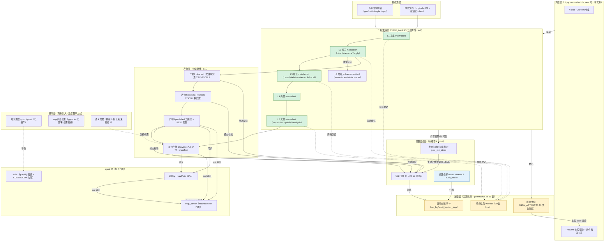

# 架构草图评估与融合设计 — regulatory_compliance_orchestrator

- **评估日期**：2026-10-12
- **评估对象**：用户提供的架构草图（六层：数据源 → python处理链 → 结构化产物 → 质量监控/辅助 → 调度 → agent）
- **评估依据**：两轮审查的全部代码/数据实证（《全面检视与重构审查报告V2_20261012.md》《项目最优重构方案_20261012.md》，HEAD=`72bd5c7`）
- **结论先行**：**草图的分层骨架合理且与本项目目标架构高度同构，可直接作为架构沟通的共识底图；但有三处必须修正（产物全量 MySQL、质量监控仅产物级、调度仅驱动处理链）、两处必须补充（治理层、增强层），否则会把本项目已实证的最优实践（SQLite 分级存储、步骤级失败传播、水位血缘）倒退成过时设计。**

---

# 一、草图设计意图还原

| 草图元素 | 还原的设计意图 |
|---|---|
| 数据源（国家网站/内部文档） | 五源官网采集 + 内部制度投放 |
| python 处理数据链路层（数据处理1-4） | 确定性 ETL 管道（采集→清洗→加工→交付） |
| 产物层（建议结构化数据，例如 mysql） | 每阶段产出落结构化库，供下游与消费方查询 |
| 产物↔处理双向箭头 | 下游处理读上游产物；产物状态（水位/新鲜度）反哺处理调度 |
| 辅助-质量监控层（检验规则1-N） | 旁路规则引擎，对产物持续质检 |
| 辅助（知识图谱、rag，「加入需谨慎」） | 语义增强层，克制引入 |
| 调度层（python 逻辑） | 统一调度处理链路 |
| agent 层（知识库/mcp/skills，依靠 codebuddy） | Agent 化消费面：检索库 + 工具协议 + 技能 |

**一句话概括草图思想**：「确定性 python 管道 + 结构化产物 + 旁路质量监控 + agent 门面」——这与本项目 v2 以来的演进方向（唯一入口/唯一事实源/可观测降级/机器化门禁）**方向一致**。

---

# 二、逐元素合理性评估

## 2.1 合理的元素（可直接采纳）

| 元素 | 评估 | 本项目实证 |
|---|---|---|
| 数据源与处理链分离 | **合理**。国家网站/内部文档双源与五源采集器 + 投放区（inbox）一一对应 | `config/inbox_registry.yaml`；`modules/regulatory_scrapers/collectors/` |
| 产物分层（产物1-3 → 最终产物） | **合理**。与本项目 cleaned→clauses→relations→published 的递进完全同构；「最终产物」= 双底座发布件 + 分析交付库 | `published/external_records.jsonl`(289MB) + `docs/reports/` 17 项 |
| 质量监控旁路 | **合理且关键**。与 24 道门禁链尾终态校验的设计一致 | `gates/__init__.py:20-132`；gates 移链尾（P3-5） |
| 图谱/rag 谨慎引入 | **完全正确**。与本项目「无度量不上线」纪律（BERTopic/pgvector/semantic:assist 全部就绪但默认关/只产分析视图）不谋而合——这是草图最有价值的判断 | `semantic_tools.json` usage_policy；README §8.3 未接线 7 模型 |
| agent 三件套（知识库/mcp/skills） | **合理**。与用途一（MCP 封装）+ wiki vault + graphify skills 精确对应 | `interfaces/` 9 api；`tools/sync_wiki_sources.py`；`CODEBUDDY.md` graphify 约定 |

## 2.2 部分合理但需修正的元素

### 修正 1：产物层「全量结构化例如 MySQL」——**不可整体采纳，须分级**

草图中「产物 = 结构化数据（例如 mysql）」的一刀切设计，在本项目的数据实证下会**倒退**：

| 本项目事实 | 全量 MySQL 的后果 |
|---|---|
| 治理元数据 28.8MB（水位/门禁/台账/worklist，设计目标 <50MB） | 需要常驻 PG/MySQL 服务——违背「克隆可移植、零服务依赖」纪律（本仓单机 Windows 部署，README:319-320） |
| 语料正文 289MB JSONL + cleaned 1.6GB + clauses 337MB | 正文进关系库 = 行宽灾难 + 备份恢复噩梦；关系库应存**索引与元数据**，正文留文件（本项目「三轨制」正是此设计：SQLite 元数据 + 文件正文 + JSON 交换快照，commit c3054a9） |
| FTS5 索引 908MB 单库运行正常 | 迁移 MySQL 需重建全部检索栈（trigram/中文分词差异），收益为零 |
| pgvector 已部署但**刻意不接线**（wired=false） | 说明本仓对「引入服务」的默认姿态是克制——全量 MySQL 与该姿态矛盾 |

**正确设计（分级存储）**：
```
产物分级：
  L-a 事实源（权威）  ：JSONL/CSV 文件（正文、条款、关系边）——文件即事实
  L-b 索引/查询层    ：SQLite FTS5（908MB 检索）+ 可选 pgvector/sqlite_vec（向量）
  L-c 治理元数据     ：SQLite governance.db（28.8MB，11 表）
  L-d 查询服务化     ：可选 PostgreSQL（仅当并发查询/多消费方成为真实需求，
                       且以 PGVECTOR_DSN 同款「env 注入 + 降级链」形态接入，绝不默认）
```
即：**MySQL/PG 是「可选查询后端」而非「产物默认形态」**。草图的方向（结构化查询能力）本仓已用 SQLite 家族覆盖；引入重型服务应以「可度量需求」为前提（与草图自己对 rag 的谨慎态度应保持一致——不能对 raɡ 谨慎、对 MySQL 鲁莽）。

### 修正 2：产物↔处理的双向箭头——语义须澄清为「依赖边」而非「数据回流」

草图的双向箭头若解读为「产物数据回流处理链」会形成环，违背本仓单向依赖纪律（`gate_no_cross_module_import` 守护）。真实语义应是：**下游声明对上游产物的依赖边，产物版本变化驱动下游重跑**——这正是本项目已实装的 `GOV_ARTIFACTS.inputs` 水位机制（9 条依赖边 + `gate_watermark` 判 stale）。建议在草图中把双向箭头改为「下游 →（读取）→ 上游产物」+「治理库登记依赖版本」的显式标注。

### 修正 3：质量监控层只连产物——**必须扩展到「步骤级 × 产物级」矩阵**

草图的检验规则只指向产物，缺失两个本项目已实证必要的视角：
1. **步骤级失败传播**：步骤失败但产物已落盘并被下游采用（N-152 事故：`clean:gov` 超时被杀、产物仍被采用、门禁却全绿）——本项目以 `gate_run_steps`（失败步骤时间窗 vs 产物 mtime）封杀此风险；
2. **规则分级语义**：阻断性规则（契约/枚举/漂移）vs 披露性规则（隔离率/覆盖率）vs 待办类规则（→ worklist）——本项目 24 道门禁已按此分级，草图「检验规则1-N」平铺表达不出「哪些 FAIL 会阻断交付」。

**正确设计**：质量监控 = 「链尾终态产物门禁（24 道，阻断）」×「步骤失败时间窗判定（gate_run_steps）」×「披露指标（BENCHMARK/audit_health）」×「待办队列（worklist 10 类 kind）」四层，且随本项目重构方案 W1 进一步获得 **kind 感知**（旁路失败不判「产物被下游采用」）。

## 2.3 缺失的元素（本项目核心实践，草图未表达）

| 缺失 | 本项目实证 | 后果 |
|---|---|---|
| **治理层**（水位/血缘/运行台账/审计） | `GOV_ARTIFACTS` 16 类产物声明 + `governance.db` 11 表（run_log/watermark/artifact/**audit_log**/gate_result/worklist/run_step/document/theme_assign/relation/timeliness_history） | 没有治理层，「产物新鲜度/谁改的/能否追溯」无可操作答案——草图的「产物反哺调度」将失去实现机制 |
| **增强层**（可缺失、不可静默） | `semantic:assist`/`docreader:extract`/分句（默认关）+ 降级链 10 条 + 模型就绪度披露 | 草图把「图谱/rag」画成普通功能块，表达不了「就绪但默认关、未就绪有降级、绝不阻断主链」的本仓核心纪律 |
| **条件/旁路/披露步骤的区分** | STEP_LAYERS 分层（W1）：main/side/disclosure/conditional/enhancement/gate | 草图的「数据处理1-4」平铺，看不出 `governance:*`（旁路）与 `clean:*`（主链）主次不同——这正是本项目 V2 审查指出的最薄弱维度（D-12） |
| **调度层覆盖面** | schedule.yaml 7 cron + 2 event；`--resume` 水位驱动跳过；条件触发 5 项 | 草图调度只画了「→数据处理」，缺「→质量监控（monthly_check）」「→agent 同步（wiki:sync）」「←水位反馈（resume 判据）」三条边 |

---

# 三、适用性结论

| 问题 | 结论 |
|---|---|
| 骨架是否适用于本项目？ | **适用**。六层骨架与本项目目标架构（接入/编排/契约/领域/共享/数据/治理）同构，且「结构化产物 + 旁路质量 + agent 门面」与 20 项用途基线（用途一 MCP、用途六健康度、用途十审计）精确对应 |
| 是否可作为团队沟通底图？ | **可以**（打上三处修正标记后），比现有 README §4.1 的 Mermaid 更直观地表达「处理-产物-监控-调度-消费」闭环 |
| 是否可参考优化本项目架构设计？ | **可，且已吸入重构方案**。草图验证了重构方案 W1（编排分层）/W2（MCP 门面）/W3（领域模块）的方向，并提示三处方案增强（见下章） |

---

# 四、对《项目最优重构方案》的增强（草图驱动）

| # | 增强项 | 内容 | 落入 |
|---|---|---|---|
| E-1 | **产物存储分级 ADR** | 将「产物分级 L-a~L-d」固化为 ADR-0007：文件=事实源、SQLite=索引/治理、PG=可选查询后端（env 注入+降级链+需求门槛）；明确「引入 MySQL/PG 的前置条件」（并发查询需求实测/多消费方/容量超 SQLite 实测阈值） | W4 增补 |
| E-2 | **质量监控矩阵化** | `gate_run_steps` 的 kind 感知（W1 已有）+ 门禁分级（阻断/披露/待办）在 README §5.3 用矩阵表达——与草图「检验规则层」对齐但分级 | W1/W4 |
| E-3 | **调度全层化** | schedule.yaml 作业按「处理/质量/治理/agent 同步」四类标注 kind；`gate_declaration_executor` E1 判据扩展为「每类作业的 covered_by ∈ STEP_ORDER 对应层」 | W1 增补 |
| E-4 | **agent 层消费 STEP_LAYERS** | `mcp_server/resources.py` 的 `chain_steps` 资源按草图「agent 看见处理全链」设计：序列化 STEP_LAYERS（层/kind/fail_semantics/降级注记）——草图顶部 agent 层由此获得机器可读的链路心智 | W2 已有设计，草图确认其价值 |
| E-5 | **架构共识图入 README** | 将「融合架构图」（下图）以受管块形式入 README §4.1 之前（由 `gen_flow_map` 生成，防漂移）——把草图的沟通价值固化为仓内资产 | W1 交付物 |

---

# 五、融合架构图（草图思想 × 本项目事实 × 重构方案）



## 融合图与草图的差异标注

| 草图 | 融合图修正 | 理由 |
|---|---|---|
| 产物 = mysql（一刀切） | 产物分级（文件事实/SQLite 索引/SQLite 治理/PG 可选） | 本项目数据规模与克隆可移植纪律（修正 1） |
| 产物↔处理双向箭头 | 单向读取 + 治理库依赖边登记 + 水位反馈调度 | 防环，落实为已实装的 GOV_ARTIFACTS 机制（修正 2） |
| 检验规则 1-N 平贴产物 | 质量监控三层（链尾阻断门禁/步骤时间窗/披露指标）+ 待办队列 | 步骤级失败传播是 N-152 事故的封杀机制（修正 3） |
| 调度 → 数据处理（单箭头） | 调度驱动处理链 + 门禁月检 + wiki 同步 + 水位反馈 resume | schedule.yaml 实况（7+2 作业） |
| （无治理层） | 治理层独立（水位/血缘/台账/审计/worklist） | 本项目核心基础设施 |
| 图谱/rag 为普通块 | 辅助层单列 + 「就绪/默认关/未接线」三态披露 | 可缺失不可静默纪律 |
| agent 层三盒 | mcp 门面细化为 tool/resource + chain_steps 资源消费 STEP_LAYERS | 用途一的落地形态（W2） |

---

# 六、最终结论

1. **草图合理**：分层骨架、产物递进、质量旁路、图谱/rag 谨慎论、agent 三件套——五个判断全部正确，且与项目 20 项用途基线吻合；可作为团队架构沟通的共识底图。
2. **不可直接照做**：产物全量 MySQL 会把本项目倒退（违背零服务依赖/三轨制实证）；产物-处理双向箭头有成环风险；质量监控缺步骤级视角。
3. **价值定位**：草图的最大贡献是**用一张图说清了「agent 时代的数据管道应该长什么样」**——这与重构方案 W1（编排分层）/W2（MCP 门面）互相印证；建议采纳 E-1~E-5 增强项，将融合图以受管块固化进 README，并把「产物分级」立为 ADR-0007。
4. **对实施的影响**：零返工——草图不改变五波路线（W0~W4），仅在 W4 增补产物分级 ADR、W1/W2 增补架构共识图与 chain_steps 资源设计。

*评估完毕。本评估不改任何代码；融合图为设计资产，建议随 W1 由 `gen_flow_map` 扩展生成入 README 受管块。*
