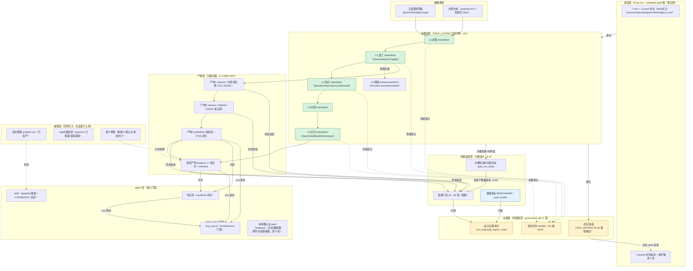

# 项目最优重构方案（质量优先） — regulatory_compliance_orchestrator

- **方案日期**：2026-10-12
- **方案依据**：《全面检视与重构审查报告V2_20261012.md》（D-1~D-19 偏差、20 项用途基线、19 维度核对）；两轮审查的全部代码证据（HEAD=`72bd5c7`）；《架构草图评估与融合设计_20261012.md》（用户草图评估，**V1.1 修订：已采纳 E-1~E-5 五项增强**，见 §1.3/§3.5/§4.3.1/§6.3.4/§9.2/§10）；**V1.2 修订：新增第 7 章「代码层重构专项」**（37 个零引用脚本/6 类重复原语/幽灵注册点/大文件/死分支的系统性清理，回应用户「长期增量开发积累的无效、冗余、废弃代码」现状）；**V1.3 修订：§7.9 外部方法论借鉴专项**（refactor/ 方法论评估：4 项可借鉴 + 2 项不借鉴 + 边界纪律）；**V1.4 修订：C8 死常量（supp RAW_PATH）+ extract_entrypoint 契约 + corpus 审计层 ADR 补节 + build_east_backlog 参数化**（见《三项技术细节排查与重构落点_20261013.md》）；**V1.5 修订：新增第 8 章「人机交互层」**（由三份已签核报告并入——《目录体系与worklist闭环审查_20261013.md》的 worklist 五断点/五环与目录体系落点、《本地Web确认台设计方案_20261013.md》、《文档投放入口评估与方案_20261013.md》；原第 8~11 章顺延为第 9~12 章）；**V1.6 修订：新增第 13 章「工程化保障体系补全」**（依《方案缺失核查报告_20261013.md》：用户清单 53 项逐条裁定——33 项真缺失/19 项部分存在/1 项已覆盖；本章补齐 33 项真缺失并将 19 项部分存在体系化；新增 W5 工程化保障波与 `gate_dependency_audit`，门禁 24→30；含「明确不做」清单：OpenTelemetry/atheris/TaskGroup）
- **优化目标**（按用户要求，质量优先于速度与成本）：**正确性 > 可维护性 > 扩展性 > 健壮性 > 完整性**
- **方案性质**：架构级重构设计（本文档只出方案，不改代码）；每项设计给出数据结构、接口形态、测试策略、迁移路径与回滚策略
- **硬约束**：① 不停机迁移（数据链每日 06:00 运行，重构期不得破坏生产刷新）；② 沿用本仓既有纪律（唯一入口/唯一事实源/可观测降级/机器化门禁/克隆可移植/零硬依赖增强）；③ 重构期间 gates 必须保持全绿（新门禁随对应 Wave 启用，不提前阻断）

---

# 第 0 章 设计原则与约束

## 0.1 质量优先的五条准则（本方案的一切决策以此为裁决）

| 准则 | 含义 | 在本方案中的落点 |
|---|---|---|
| **正确性** | 行为可证明、可验证；不引入静默退化 | 每个迁移配等价性证明（滚动 sha / A/B 重放 / 台账断言）；禁止「宽泛吞异常 + 兜底值」模式（沿用 BLE001 意图声明纪律） |
| **可维护性** | 单一事实源；改一处而非多处；命名即语义 | 步骤语义从「注释 + 文档 + 生成表」三处漂移收敛为 **StepSpec 单一事实源**；公共原语全部 SSOT 化 |
| **扩展性** | 新增能力 = 实现约定接口 + 登记声明，而非改核心 | 新模块/新步骤/新门禁/新监管体系全部走「声明 + 门禁断言」模式（沿用 MODULE_SPECS/ALL_GATES 既有范式） |
| **健壮性** | 失败语义显式；降级可观测；恢复可断点 | 失败传播矩阵（kind × fail_semantics）；条件步骤三态 rc；resume 判据含输入版本 |
| **完整性** | 无半接线；声明面必有执行面；生成物必有新鲜度 | 「观察路径可达」门禁（T4）；动态步骤运行时覆盖门禁（R3）；BENCHMARK/README 机器守护 |

## 0.2 不停机迁移约束

- 生产链：每日 06:00 `refresh` + 周一 07:00 `verify` + 周一 08:00 `publish_wiki` + 周二 01:00 `nfra_weekly` + 周三 01:00 `incremental_weekly` + 月度 backfill/monthly_check（`config/schedule.yaml`）
- 迁移策略：**并行兼容期 → 切换 → 退役**（如 raw JSONL 化批 47 的成功范式：双格式读 + 等价性证明 + 才删旧）
- 每个 Wave 独立可发布（git 提交即发布，post-commit 自动 push），Wave 间无强耦合；任一波次失败可单独回滚

## 0.3 与既有架构的关系

本方案**不推翻**现有分层（cli → commands → interfaces → modules → std_lib → gates），而在四个方向上演进：
1. **编排层内聚**（Wave 1）：把「平铺步骤名 + 漂移的三处语义」升级为「分层声明 + 单一事实源」
2. **门面与领域扩展**（Wave 2/3）：在 interfaces 之上加 MCP 服务门面；在五模块之后加两个领域模块
3. **共享与数据收敛**（Wave 4）：消除重复实现，补齐水位/卫生缺口
4. **代码层重构**（第 7 章专项，横切 W0~W4）：系统性清理长期增量开发积累的死代码（37 个零引用脚本）、重复实现（6 类原语 + HTTP 三栈）、废弃接口与幽灵声明、职责收敛（4 个大文件）与命名统一——**与架构重构并列的第四条主线**

---

# 第 1 章 目标架构总览

## 1.1 六层目标架构

```
┌─────────────────────────────────────────────────────────────────┐
│ L6 接入层   cli.py（19 命令）  ·  mcp_server/（新增：MCP tool 面）  │
│            web/（新增：本地确认台，loopback 八页，见第 8 章）         │
├─────────────────────────────────────────────────────────────────┤
│ L5 编排层   tools/run_production_refresh.py                      │
│            STEP_LAYERS（StepSpec：kind/fail_semantics/timeout/   │
│            depends_on/trigger_id/purpose）  ← 单一事实源          │
│            STEP_ORDER = 派生兼容视图                              │
├─────────────────────────────────────────────────────────────────┤
│ L4 契约层   interfaces/（9 api + 4 Protocol + contract.py）       │
│            + 新增 reg_frameworks_api / implementation_audit_api  │
├─────────────────────────────────────────────────────────────────┤
│ L3 领域层   modules/（5 现有 + 2 新增）                           │
│            regulatory_scrapers → classifier → internal_policy_base│
│            → drafter → base_publish（单向）                       │
│            + reg_frameworks（多监管数据体系）                     │
│            + implementation_audit（落地执行检视）                 │
├─────────────────────────────────────────────────────────────────┤
│ L2 共享层   std_lib/common_lib（+steps 步骤声明库，见 3.2）        │
│            std_lib/scraper_std（HTTP 收敛为单栈）                 │
├─────────────────────────────────────────────────────────────────┤
│ L1 数据层   data/raw（JSONL+水位） · cleaned（双轨决策）           │
│            clauses · relations · published（FTS5/pgvector）       │
│            governance.db（11 表 + 扩展 actor 维度）               │
├─────────────────────────────────────────────────────────────────┤
│ L0 治理层   gates/（24 → 30 道） · tools/audit_health（入 CI）     │
│            BENCHMARK.md（新鲜度守护） · docs/adr/（新增）          │
└─────────────────────────────────────────────────────────────────┘
```

## 1.2 与现状的差距映射（审查发现 → 架构落点）

| 审查发现 | 现状 | 目标 | Wave |
|---|---|---|---|
| D-1 triggers 观察路径断裂 | 硬拼错路径，wiki_sync 永不触发 | interfaces 访问器派生 + T4 门禁 | W0 |
| D-3 relevance 残留变量 | 只跑 supp | for 循环 + R3 门禁 | W0 |
| D-2 _raw_size 失效 | json.load 读 JSONL → None | 流式双格式计数 | W0 |
| D-12 编排无分层 | 平铺 tuple + 三处漂移语义 | STEP_LAYERS 单一事实源 | W1 |
| D-6/D-7/D-8/D-13 编排衍生缺陷 | 文档矛盾/文案不符/条件语义缺失 | 从 Layers 渲染 + fail_semantics 驱动 | W1 |
| 用途一 MCP 缺口 | 内核强门面缺 | mcp_server/ 薄门面 + 审计绑定 | W2 |
| D-19 用途二缺口 | EAST 素材无消费者、无建模 | reg_frameworks 模块 | W3 |
| 用途四空白 | 无落地检视 | implementation_audit 模块 | W3 |
| D-11 HTTP 三套/原语漂移 | 双份退避公式 + 5 份 sha256_of | 单栈 + SSOT + 契约测试锁定 | W4 |
| D-16 resume 边界 | raw 不在水位体系 | raw 水位 + 输入版本判据 | W4 |
| D-4/D-5/D-14 文档漂移 | 守卫未强制 | audit_health 入 CI + 正则扩展 | W4 |
| D-9 pgvector 闲置 | 已部署未接线 | 低风险场景接线 | W4 |
| （E-1）产物存储无分级声明 | 「文件+SQLite+可选 PG」混用、无 ADR | 产物分级 L-a~L-d + ADR-0007 | W4 |
| （E-3）调度作业无 kind | 7 cron + 2 event 平铺、消费方看不出主次 | 四类 kind 标注 + E1 判据按层断言 | W1 |
| worklist 闭环五断点（回写缺失/二值选项/by 恒空/D1 动态 import 盲区/无验证重跑） | 人工决策沉淀队列即终点，不回写业务域 | 五环补全 + kind→action 注册表 + J7 升级（**第 8 章**） | W2~W3 |
| 目录体系 SSOT 缺口 | ~10 目录无 paths 常量；tessdata 与 external 跨目录；docs/reports 与 reports 命名撞车 | paths 常量收口 + tessdata 迁入 + 更名分区（**§7.10**） | W0/W4 |
| 文档投放无管理面 | wiki 同步状态/交付库在位/发布件新鲜度分散三处，无台账 | 确认台 P7 检索预览 + P8 投放看板 + delivery_ledger 台账（**第 8 章**） | W3~W4 |
| 工程化保障缺口（供应链/可观测性体系/灾备/质量度量/版本策略） | 无依赖锁定与漏洞扫描/SBOM；无 SLI/SLO 与量化告警阈值；无 RTO/RPO 与备份恢复演练；无 DAMA 六维度量；无 semver 与弃用策略（核查报告：33 项真缺失 + 19 项部分存在） | 第 13 章工程化保障体系补全 + W5 波 + `gate_dependency_audit` | W5 |

## 1.3 架构共识图（E-5：草图思想固化）

架构草图（用户 2026-10-12 提供）经评估后与本项目事实融合，形成**架构共识图**——它是团队沟通底图，也是 `agent 层看见处理全链` 的机器可读来源。该图由 `tools/gen_flow_map.py` 扩展生成（README §4.1 受管块，**勿手改**；事实源 = STEP_LAYERS + schedule.yaml + GOV_ARTIFACTS + ALL_GATES）：



**设计要点（草图评估结论的固化）**：
1. **产物分级**（修正草图「全量 MySQL」）：文件=事实源、SQLite=索引/治理、PG=可选查询后端——详见 §6.3.4 与 ADR-0007；
2. **单向读取 + 依赖边**（修正草图双向箭头成环风险）：下游单向读上游产物，版本关系由治理库登记（GOV_ARTIFACTS），水位反馈调度；
3. **质量监控三层**（修正草图仅产物级）：链尾阻断门禁 × 步骤失败时间窗判定 × 披露指标，另有待办队列（worklist）承接治理类发现；
4. **调度全层化**（E-3）：调度不只驱动处理链，还驱动质量月检、治理同步、agent 知识同步；
5. **辅助层克制**（草图最正确判断）：图谱/rag/语义增强「就绪但默认关、未就绪有降级、绝不阻断」三态披露。


---

# 第 2 章 Wave 0：P0 缺陷修复（正确性止损）

> 目标：消灭三个「静默失效」实证缺陷。规模小、风险低、当周完成；同时建立本方案的两个通用门禁原型。

## 2.1 W0-1：wiki_sync 触发条件观察路径修复（对应 D-1）

**问题回顾**：`std_lib/common_lib/triggers.py:46-48` 把 publish_manifest 观察对象硬拼为 `modules/base_publish/published/publish_manifest.json`（不存在），真实清单在 `modules/regulatory_scrapers/published/` 与 `modules/internal_policy_base/published/`（`build_external.py:320-324` / `build_internal.py:137-141` 写盘，`interfaces/base_api.py:32-33` 定义）。

**设计**：

1. **观察对象经 interfaces 派生**（消灭第二路径）：
```python
# std_lib/common_lib/triggers.py（改）
from interfaces.clean_index_api import published_dir as _ext_published_dir
from interfaces.internal_policy_api import published_dir as _ipb_published_dir

# 双底座清单观察（外部为主、内部为辅；判定规则：任一较基线变化即满足）
_PUBLISH_MANIFESTS: tuple[tuple[str, str], ...] = (
    ("external", os.path.join(_ext_published_dir(), "publish_manifest.json")),
    ("internal", os.path.join(_ipb_published_dir(), "publish_manifest.json")),
)
```
2. `_c_publish_manifest_changed` 改双清单联合版本（`version_of_files`），note 明示两个路径与各自版本。
3. **T4 门禁**（新增，`gates/gate_config_integrity.py` T 判据区）：
   - 断言 triggers.py 中 `_OBSERVE_*`/条件实现里的观察路径常量**全部可达**（`os.path.exists`）或由 `interfaces.*_api.published_dir()` 派生；
   - 断言 `CONDITION_IMPLS` 的每个条件的观察对象在其**生产者写盘路径**的同一派生族内（反向：遍历 base_api 的 manifest() 路径 ∈ 条件观察集）。
4. **回归测试**：`tests/test_triggers_conditions.py`（新增）——以真实发布件目录为夹具，断言条件从「不判定」变为「版本比较」；以治理库 watermark 模拟「已同步」态断言跳过。
5. **首次实跑纪律**：修复后首次 `wiki:sync` 会真实执行 `--prune`——在 `acknowledged.json` 登记人工确认后择期运行（破坏面保留人工闸门，沿用 README:280-281 纪律）。

**权衡**：备选「把清单复制到 base_publish/published/」——否决（制造第二写入方，违反唯一事实源）。备选「改 triggers 读治理库 version」——否决（失去文件级观察的直接性）。

## 2.2 W0-2：relevance 每源一步（对应 D-3）

**设计**：
1. `tools/run_production_refresh.py:1001-1013` 包入 `for src in SOURCES:`（与 clean 同形），try/except WARN 保留（旁路语义）；
2. `tools/gen_flow_map.py` PURPOSE 补 `relevance:{src}` 键；STEP_FAILURE 补 `relevance` 键（W1 将整体重写，此处先补最小键消除矛盾）；
3. **R3 门禁**（新增，判据 R 区）：对 STEP_ORDER 中每个 `{src}` 模板项，断言**运行台账最近一次完整运行中该步骤出现全部五源**（读 `data/run_state/last_run_steps.json`；台账无完整运行记录时判「不可执行」并显式披露，不静默放行——沿用「判据不可执行 ≠ 通过」纪律）。
4. **回归测试**：`tests/test_chain_steps_coverage.py`（新增）——以 fixtures 台账断言五源覆盖；对「删除某源步骤」的负例断言 R3 FAIL。

**权衡**：备选「把 relevance 改为单步 --source all」——否决（filter_clean_relevance 按源处理，单源单步与 collect/clean/apply 同构，故障隔离粒度一致）。

## 2.3 W0-3：_raw_size 流式双格式计数（对应 D-2）

**设计**：
```python
def _raw_size() -> dict:
    out = {}
    for src, fn in RAW_JSON.items():
        p = os.path.join(RAW_DIR, fn)
        recs = _count_records(p)          # 流式；不存在返回 None
        out[src] = {"bytes": os.path.getsize(p) if os.path.exists(p) else 0,
                    "records": recs}
    return out

def _count_records(p: str):
    """JSONL：逐行计数（跳过 _meta 信封）；JSON：raw_decode 逐条；失败返回 None 并披露原因。"""
    try:
        with open(p, encoding="utf-8") as fh:
            head = fh.read(4096)
        if head.lstrip().startswith("{"):
            # JSONL：_meta 信封 + 一行一记录
            n = -1 if '"_meta"' in head.splitlines()[0] else 0
            with open(p, encoding="utf-8") as fh:
                for line in fh:
                    if line.strip():
                        n += 1
            return max(n, 0)
        # JSON：兼容旧格式（迁移期双格式）
        import json
        with open(p, encoding="utf-8") as fh:
            data = json.load(fh)
        return _raw_records(data)
    except (OSError, ValueError) as e:
        print(f"[raw] WARN {os.path.basename(p)} 计数失败: {type(e).__name__}: {e}")
        return None
```
要点：失败时**打印原因**（可观测）而非静默 None；与 `pipeline.load_raw_records` 的双格式口径一致。
**回归测试**：fixtures 造 JSONL/JSON 两种夹具断言计数；对损坏文件断言 None + WARN 输出。

## 2.4 Wave 0 出口判据

- [ ] `wiki:sync` 条件判定从「publish_manifest.json 不存在 → 不判定」变为「external 版本 X vs 基线 Y」（`cli.py triggers --dry-run` 实证）
- [ ] T4/R3 两门禁实装且 PASS；负例单测 FAIL 验证
- [ ] 最近一次全链台账 relevance 五源齐全
- [ ] 汇总 JSON 的 `raw.*.records` 全部非 None
- [ ] CI 6/6（ruff/mypy/schedule/flowmap/pytest/gates）

---

# 第 3 章 Wave 1：编排层重构（核心：STEP_ORDER → STEP_LAYERS）

> 目标：把 31 步平铺链升级为**分层声明式编排**，步骤的执行性质、失败语义、依赖、条件、增强标记全部机器可读，且作为 README §8、MCP 编排描述、多体系频度调度的**单一事实源**。对应 D-6/D-7/D-8/D-12/D-13 及用途一（MCP 编排面）、用途二（多频度调度）的前置。

## 3.1 选型论证：为什么是「分层 dataclass 声明」而非其他

| 候选 | 评估 | 结论 |
|---|---|---|
| A. `STEP_LAYERS` 分层 dict + `StepSpec` frozen dataclass（代码内声明） | 类型安全、IDE 可导航、与 `_run` 调用点同文件（判据 R 的「调用点一致性」断言仍成立）；`STEP_ORDER` 可保留为派生属性（`--only`/`--from`/判据 R 语义不变）；无新依赖 | **选定** |
| B. 步骤表外置 `config/steps.yaml` | 与 schedule/triggers 同源模式一致；但超时策略（按 raw 体量动态计算 `min(max(1800, MB×2), 21600)`）、argv 构造（ collectors 参数表）本质是代码逻辑，外置 YAML 要么表达不了、要么把逻辑搬进「配置解释器」——把简单事实复杂化 | 否决 |
| C. transitions/python-statemachine 状态机库 | 本链是**线性 DAG + 条件分支**，不是复杂状态迁移；引入库增加依赖与概念负担，且状态机语义（事件驱动）与「步骤即子进程」模型不匹配 | 否决 |
| D. Prefect/Dagster 引擎 | 常驻服务、集群语义，与单机计划任务唤醒模型和克隆可移植纪律冲突 | 否决（第二轮审查已证） |

**设计原则**：声明（数据）与执行（逻辑）分离——`STEP_LAYERS` 只声明**语义**，`_run_chain` 持有**执行逻辑**；语义变化改声明，执行变化改代码，二者不互相渗透。

## 3.2 数据结构设计

```python
# tools/run_production_refresh.py（新增；置于 STEP_ORDER 原位置）

from dataclasses import dataclass, field

# ---- 受控值（与 config/enums.py 同源，避免魔法字符串）----
STEP_KINDS: Final[frozenset[str]] = frozenset(
    {"main", "side", "disclosure", "conditional", "gate", "enhancement"}
)
FAIL_SEMANTICS: Final[frozenset[str]] = frozenset({"abort", "warn", "rc0", "skip"})


@dataclass(frozen=True)
class StepSpec:
    """步骤语义声明（**唯一事实源**：README §8 / MCP 编排 / 判据 R 全部派生自此）。

    name          : 步骤名；`{src}` 为五源动态模板（与现行 STEP_ORDER 口径一致）
    kind          : main（主链）/ side（旁路治理）/ disclosure（只读披露）/
                    conditional（条件触发）/ gate（门禁）/ enhancement（增强可缺失）
    fail_semantics: abort（失败即断）/ warn（失败告警继续）/ rc0（恒 rc=0）/
                    skip（条件不满足即跳过）
    purpose       : 作用一句话（README §8.2「作用」列；消灭 PURPOSE 第二事实源）
    timeout       : 固定超时（秒）；None = 调用点动态计算（如 clean 按 raw 体量）
    trigger_id    : kind=conditional 专用：config/triggers.yaml 触发项 id
    depends_on    : 步骤级依赖（步骤名或产物键）；空 = 仅顺序保证
    produces      : 该步产生的产物键（GOV_ARTIFACTS 键；供水位登记与血缘）
    degrade_note  : 降级/失败语义的自然语言声明（README §8.2「降级/失败语义」列）
    """
    name: str
    kind: str
    fail_semantics: str
    purpose: str
    timeout: int | None = None
    trigger_id: str = ""
    depends_on: tuple[str, ...] = ()
    produces: tuple[str, ...] = ()
    degrade_note: str = ""

    def __post_init__(self) -> None:
        if self.kind not in STEP_KINDS:
            raise ValueError(f"{self.name}: kind={self.kind!r} 非受控值 {sorted(STEP_KINDS)}")
        if self.fail_semantics not in FAIL_SEMANTICS:
            raise ValueError(f"{self.name}: fail_semantics 非受控值 {sorted(FAIL_SEMANTICS)}")
        if self.kind == "conditional" and not self.trigger_id:
            raise ValueError(f"{self.name}: 条件步骤必须声明 trigger_id")
        if self.kind != "conditional" and self.trigger_id:
            raise ValueError(f"{self.name}: 非条件步骤不得声明 trigger_id")


@dataclass(frozen=True)
class LayerSpec:
    """层声明：层的默认语义可被步骤覆盖；depends_on 声明层间依赖。"""
    kind: str
    fail_semantics: str
    steps: tuple[StepSpec, ...]
    depends_on: tuple[str, ...] = ()      # 层名依赖（如 L5 依赖 L3/L4）
    note: str = ""
```

**STEP_LAYERS 完整定义**（31 项全量，语义口径 = 现行实装 + V2 审查归纳，`relevance` 按实装标 side/warn 以修复 D-7 矛盾）：

```python
STEP_LAYERS: Final[dict[str, LayerSpec]] = {
    "L1_ingest": LayerSpec(
        kind="main", fail_semantics="abort",
        steps=(
            StepSpec("collect:nfra_weekly", "main", "abort",
                     "nfra 周报采集（按周触发）", 7200,
                     degrade_note="未到周度触发 → SKIP（rc=0）"),
            StepSpec("collect:{src}", "main", "abort",
                     "各源原始采集（gov 拆 xzfgk/zhengceku 两子源步骤）", None,
                     degrade_note="失败即停；--resume 可从该步续跑"),
            StepSpec("supp:ingest_batch", "main", "abort",
                     "补充库批量摄取（backlog 驱动）", 1800,
                     degrade_note="backlog 为空 → SKIP（rc=0）"),
        ),
    ),
    "L2_transform": LayerSpec(
        kind="main", fail_semantics="abort",
        steps=(
            StepSpec("clean:{src}", "main", "abort",
                     "原始 → 清洗（6 态抽取 + 校验隔离）", None,
                     depends_on=("collect:{src}",), produces=("cleaned:{src}", "clauses:{src}"),
                     degrade_note="超时按源体量配置（N-150/N-188）；当日无 raw 变化 → SKIP（rc=0）"),
            StepSpec("relevance:{src}", "side", "warn",
                     "清洗产物相关性筛选（BOUNDARY 边界案例 → worklist）", 900,
                     depends_on=("clean:{src}",),
                     degrade_note="旁路分析件，失败 WARN 不阻断主链"),
            StepSpec("timeliness:consolidate", "main", "abort",
                     "时效核验结果汇总", 600,
                     degrade_note="无核验输入 → 空汇总（rc=0）"),
            StepSpec("apply:{src}", "main", "abort",
                     "时效核验结果回写清洗产物", 600,
                     depends_on=("cleaned:{src}",), produces=("cleaned:{src}",),
                     degrade_note="无核验结果可回写 → SKIP（rc=0）"),
        ),
        note="条件步骤 timeliness:verify 在 consolidate 之前执行（数据依赖）",
    ),
    "L3_knowledge": LayerSpec(
        kind="main", fail_semantics="abort",
        steps=(
            StepSpec("classify:all", "main", "abort",
                     "主题分类（_t*_base / _t*_final 派生）", 5400,
                     depends_on=("cleaned:{src}",), produces=("classify:products",),
                     degrade_note="断点幂等：输入未变自动跳过"),
            StepSpec("relations:gen", "main", "abort",
                     "关系抽取（依据/废止，含条款级定位）", 1800,
                     depends_on=("cleaned:{src}", "internal_index"),
                     produces=("relations_index",),
                     degrade_note="失败即停；必须在 cleaned 写入后、下游消费者前"),
            StepSpec("reconcile", "main", "abort",
                     "清洗漂移对账（clean_drift）", 1200,
                     depends_on=("cleaned:{src}",), produces=("reconcile:drift",),
                     degrade_note="C2 待人工 → worklist，不阻断"),
            StepSpec("recall", "main", "abort",
                     "召回复核与四门禁（clean/validity/contract/schema）", 3600,
                     degrade_note="四门禁不过即 FAIL，留人工"),
        ),
    ),
    "L4_internal": LayerSpec(
        kind="main", fail_semantics="abort",
        steps=(
            StepSpec("internal:merged", "main", "abort",
                     "内部制度合并视图（供条款对照与检索）", 1800,
                     depends_on=("internal_index",), produces=("merged_view",)),
        ),
    ),
    "L5_delivery": LayerSpec(
        kind="main", fail_semantics="abort",
        steps=(
            StepSpec("reports:build", "main", "abort", "总览报告生成", 1800,
                     depends_on=("classify:products", "rfn_attr", "rfn_theme")),
            StepSpec("reports:theme", "main", "abort", "主题报告生成（T0–T10 ×11）", 1800,
                     depends_on=("classify:products",)),
            StepSpec("draft:clause", "main", "abort",
                     "条款对照素材（drafter 视图）", 3600,
                     depends_on=("merged_view",)),
            StepSpec("base:publish", "main", "abort",
                     "底座发布（发布清单 publish_manifest）", 1800,
                     depends_on=("cleaned:{src}", "clauses:{src}", "relations_index",
                                 "internal_index", "merged_view"),
                     produces=("published:external", "published:internal")),
            StepSpec("analysis:gen", "main", "abort",
                     "分析交付物（docs/reports，含 17 项 manifest sha）", 600,
                     depends_on=("clean_index", "rfn_attr", "rfn_theme", "relations_index",
                                 "merged_view", "published:external", "published:internal"),
                     produces=("analysis:manifest",)),
        ),
    ),
    "L6_governance": LayerSpec(
        kind="side", fail_semantics="warn",
        steps=(
            StepSpec("governance:artifacts", "side", "warn",
                     "原件注册（治理库 artifact 表）", 3600),
            StepSpec("governance:sync", "side", "warn",
                     "治理库同步（run_log/gate_result/relation 等）", 900,
                     degrade_note="库/文件摘要不一致 → 计入失败步骤（分叉判定）"),
            StepSpec("watch:baseline", "side", "warn",
                     "观测基线快照（source diff --record）", 300),
        ),
        note="旁路观测设施：失败告警不阻断主链（治理库不可用为合法降级）",
    ),
    "L7_disclosure": LayerSpec(
        kind="disclosure", fail_semantics="rc0",
        steps=(
            StepSpec("retention:plan", "disclosure", "rc0",
                     "数据生命周期只读披露（dry-run + 台账）", 900,
                     degrade_note="恒 rc=0；--apply 才是人工闸门"),
            StepSpec("quarantine:triage", "disclosure", "rc0",
                     "清洗隔离件分类与处置登记（零回写 → worklist）", 600,
                     degrade_note="恒 rc=0（零回写保证）"),
            StepSpec("semantic:preflight", "disclosure", "rc0",
                     "P1 语义增强启用前置披露（五道闸逐项）", 300,
                     degrade_note="恒 rc=0；未启用是合法状态"),
            StepSpec("pg:health", "disclosure", "rc0",
                     "向量存储只读健康检查（pgvector/sqlite_vec 降级链披露）", 300,
                     degrade_note="恒 rc=0；后端不可用为合法状态"),
        ),
    ),
    "L8_enhancement": LayerSpec(
        kind="enhancement", fail_semantics="rc0",
        steps=(
            StepSpec("semantic:assist", "enhancement", "rc0",
                     "P1 语义增强入链调用点（嵌入→主题辅助裁定；只产分析视图）", 1800,
                     degrade_note="未启用/嵌入不可用 → 显式披露 rc=0；绝不写事实源"),
            StepSpec("docreader:extract", "enhancement", "rc0",
                     "docreader 入链调用点（版面解析 + 段落级定位；只产分析视图）", 1800,
                     degrade_note="不可用/自检不过 → 显式 SKIP（rc=0），回退既有 6 态抽取"),
        ),
        note="增强层零硬依赖：可缺失、降级可观测、绝不阻断",
    ),
    "L9_sync": LayerSpec(
        kind="conditional", fail_semantics="skip",
        steps=(
            StepSpec("timeliness:verify", "conditional", "skip",
                     "时效核验（北大法宝；Node 侧 MCP）", None,
                     trigger_id="timeliness_verify",
                     degrade_note="无 token/工具缺失 → verification_state=unavailable（不误标）；配额耗尽自动停"),
            StepSpec("inbox:drop", "conditional", "skip",
                     "收件箱投放（人工投递的制度文件入库）", None,
                     trigger_id="inbox_drop",
                     degrade_note="投放区无新文件 → SKIP（rc=0）"),
            StepSpec("internal:update", "conditional", "skip",
                     "内部制度索引更新（原件同步）", None,
                     trigger_id="internal_update",
                     degrade_note="原件库无未索引文件 → SKIP（rc=0）"),
            StepSpec("wiki:sync", "conditional", "skip",
                     "llm_wiki 源同步（发布件变化时执行）", None,
                     trigger_id="wiki_sync",
                     degrade_note="vault 不可达/发布件未变化 → SKIP（rc=0）；on_fail=skip_and_warn"),
        ),
        note="条件判据唯一事实源 = config/triggers.yaml；观察对象可达性由门禁 T4 守护",
    ),
    "L10_gate": LayerSpec(
        kind="gate", fail_semantics="abort",
        steps=(
            StepSpec("gates", "gate", "abort",
                     "全部门禁（阻断；置于链尾以终态产物为准）", 1800,
                     depends_on=("analysis:manifest",),
                     degrade_note="失败即停；失败触发 notify(gate_fail)"),
        ),
    ),
}

# ---- 兼容视图（派生）：现行 STEP_ORDER 语义完全保留 ----
# 执行顺序 = 层序 → 层内序；条件步骤按数据依赖插入指定层之后（见 LAYER_EXEC_ORDER）。
LAYER_EXEC_ORDER: Final[tuple[str, ...]] = (
    "L1_ingest", "L2_transform", "L9_sync(verify)",     # verify 在 consolidate 前（数据依赖）
    "L3_knowledge", "L8_enhancement", "L2_transform(rest)", "L9_sync(inbox,internal)",
    "L6_governance", "L4_internal", "L5_delivery", "L7_disclosure", "L9_sync(wiki)",
    "L10_gate",
)

def step_specs() -> tuple[StepSpec, ...]:
    """全量步骤（执行序）。"""
    ...

STEP_ORDER: Final[tuple[str, ...]] = tuple(s.name for s in step_specs())
```

> 说明：`LAYER_EXEC_ORDER` 表达「层间执行序 + 条件步骤插入点」，比纯字典序更准确（timeliness:verify 必须在 consolidate 前、inbox/internal 在 governance 前、wiki 在 delivery 后）。这是**顺序事实的单一声明处**（现行实现中该顺序只存在于 `_run_chain` 的代码行序 + 注释）。

## 3.3 执行器语义化（_run / _run_conditional / 失败传播）

```python
# 失败传播矩阵（kind × fail_semantics → 行为）——机器可查，取代注释
_FAILURE_MATRIX: Final[dict[tuple[str, str], str]] = {
    ("main", "abort"):      "stop_chain",     # 失败即停（--stop-on-error 语义的默认化）
    ("side", "warn"):       "warn_continue",  # 告警继续，rc 不计入 failed
    ("disclosure", "rc0"):  "force_rc0",      # 恒 rc=0（未就绪是合法状态）
    ("conditional", "skip"): "skip_or_run",   # 条件三态：skipped(rc0)/ran(rc0)/failed(传播)
    ("enhancement", "rc0"): "force_rc0",
    ("gate", "abort"):      "stop_chain",
}

def _run(step: str, argv, ...) -> dict:
    """语义化执行：spec = _spec_of(step)；按 fail_semantics 决定失败后的链行为。"""
    spec = _spec_of(step)
    ...
    if rec["rc"] != 0:
        action = _FAILURE_MATRIX[(spec.kind, spec.fail_semantics)]
        if action == "stop_chain" and _STOP_ON_ERROR:
            _ABORT.set()          # _run_chain 主循环检查：后续步骤记 SKIP(aborted)
        elif action == "warn_continue":
            rec["rc"] = 0         # 旁路失败不污染链 rc（note 保留原因）
            rec["exit_code"] = "WARN"
        elif action == "force_rc0":
            rec["rc"] = 0
            rec["exit_code"] = "RC0"
```

关键改进（对照现行实装）：
1. **`--stop-on-error` 全覆盖**：现行仅 collect/clean 两循环 break（:920-921/:987-988）且帮助文案「任一步」不符（D-8）；改为按 `fail_semantics=abort` 集合统一决策，文案与实装一致。
2. **旁路失败与主链失败分离**：现行 `governance:*` 失败 rc≠0 与 `clean:*` 失败无区别地进 `summary["failed"]`（:1378）；改后 side/warn 步骤失败记 WARN 继续，`gate_run_steps` 同步按 kind 判定（旁路失败不判「产物被下游采用」）。
3. **披露步骤恒 rc=0 由声明保证**：现行靠注释与各自脚本自律（retention/quarantine/preflight/pg:health）；改后由执行器强制（脚本返回非零也归一 rc0 并留痕）——**正确性从「约定」升级为「机制」**。

## 3.4 跳过与续跑判据升级

```python
def _resume_plan() -> dict:
    """skip ⟺ 上次 rc=0 ∧ 全库水位无 stale ∧ **输入版本未变**（新增第三条件）。"""
    # 现行：gs.last_run_with_steps() + gs.check_dependencies()（:811-836）
    # 新增：对每个候选跳过步骤，取 spec.depends_on 的当前水位版本 vs 上次执行时
    #       run_step 记录的 inputs 指纹（_record_step 时一并落档）；不一致 → 不跳。
```
配套（Wave 4 落数据层）：`GOV_ARTIFACTS` 增 `raw:{src}` 观察登记、`cleaned:{src}` 声明 raw 输入（D-16）。

## 3.5 门禁与文档渲染升级

| 现有物 | 现状 | 重构后 |
|---|---|---|
| 判据 R（gate_config_integrity.py:641-758） | R1 清单↔调用点一致；f-string 跳过（:658） | R1 保留；**R2 模板运行时覆盖**（W0 建原型，W1 纳入）；**R4 语义声明完整**：STEP_LAYERS 中每个 kind 受控、条件步骤 trigger_id ∈ triggers.yaml、depends_on 无环（拓扑校验）、`produces` ∈ GOV_ARTIFACTS 键 |
| gen_flow_map.PURPOSE/STEP_FAILURE | 两个平铺 dict + DEFAULT_FAILURE 兜底，无前缀匹配（D-6） | 删除；从 StepSpec.purpose/degrade_note 渲染；查找改**模板前缀匹配**（`clean` 键同时服务 `clean:{src}`）——动态模板步骤专属语义在 README §8.2 不再丢失 |
| README §8.1/§8.2 | 六阶段图 + 31 行平铺表 | 按 LAYER 分组渲染（主链/旁路/披露/增强/条件/门禁分色）；每行语义列来自 degrade_note；条件步骤标注「未触发 → SKIP（rc=0）」（修 D-13） |
| README §4.1 架构共识图（E-5） | 无（草图尚未入仓） | `gen_flow_map` 同批生成**架构共识图受管块**（数据源→处理链→产物分级→治理→质量→调度→agent 七区，见 §1.3）；事实源 = STEP_LAYERS + schedule.yaml + GOV_ARTIFACTS + ALL_GATES；`flowmap --check` 一并校验 |
| schedule.yaml 作业（E-3） | 7 cron + 2 event 平铺、无 kind 标注，消费方（agent/人）看不出作业主次 | 每作业增 `kind` 字段（受控域 SCHEDULE_JOB_KIND：**processing**（驱动处理链）/ **quality**（门禁月检）/ **governance**（治理同步）/ **agent_sync**（知识同步））；`install_schedule.py` 与 `gen_schedule_doc.py` 渲染 kind 列；`gate_declaration_executor` E1 判据升级为「每类作业的 covered_by ∈ STEP_ORDER **对应层**」（processing→main 层、quality→gate、governance→side 层、agent_sync→conditional）——作业与链的层次归属机器可验 |
| MCP 编排描述 | 无 | `STEP_LAYERS` 序列化为 `mcp://orchestrator/steps` 资源（W2 消费，见 §4.3.1） |
| 多体系频度调度 | 无 | Layer 的 `cadence` 扩展字段预留（W3 reg_frameworks 挂接：如 EAST 月报步骤挂 L2 且 cadence=monthly；作业 kind=processing） |

## 3.6 迁移与兼容策略（不停机）

1. **并行期**（1 个提交）：`STEP_LAYERS` + `step_specs()` + 派生 `STEP_ORDER` 落地；`_step_index/_step_matches/_skip_reason` 改读派生视图（行为等价）；`_run_chain` 的行序执行不变（顺序事实仍暂由代码持有，但 STEP_LAYERS 已可判验一致性）。
2. **切换期**（1 个提交）：`_run_chain` 重构为「按 `LAYER_EXEC_ORDER` + 层内 StepSpec 驱动」的通用循环；`_run/_run_conditional` 按失败矩阵执行；argparse 文案同步。
3. **验证**（每步）：① 判据 R1/R2/R4 PASS；② `--list-steps` 输出与切换前**逐字节一致**（等价性证明）；③ `--dry-run` argv 序列一致；④ fixtures 台账回放：对 N-152 事故场景（clean 超时）与 wiki skip 场景断言行为一致；⑤ 一次真实全链（周六人工窗口）41+ 步骤 rc 口径核对。
4. **回滚**：切换期提交可独立 revert（并行期提交保留，无行为变化）。

## 3.7 Wave 1 测试矩阵

| 类型 | 用例 | 文件 |
|---|---|---|
| 单元 | StepSpec 校验（kind/trigger_id 受控）、派生 STEP_ORDER 等价、失败矩阵查表 | tests/test_step_layers.py（新增） |
| 单元 | _spec_of 模板回退、LAYER_EXEC_ORDER 拓扑（无环、插入点合法） | 同上 |
| 契约 | 判据 R 四子判据正/负例 | tests/test_gates_matrix.py（扩展） |
| 等价性 | --list-steps/--dry-run 与切换前 golden 输出比对 | tests/test_chain_equivalence.py（新增，golden 夹具存 tests/golden/） |
| 回归 | relevance 五源覆盖（W0 移交）、wiki skip 语义、旁路 WARN 不污染 rc | tests/test_chain_steps_coverage.py（W0 建，扩展） |
| E2E | 一次真实全链（data 标记） | tests/test_e2e_pipeline.py（扩展断言台账 rc 口径） |

## 3.8 Wave 1 出口判据

- [ ] `STEP_LAYERS` 为步骤语义唯一事实源；PURPOSE/STEP_FAILURE 删除；README §8 全量机器渲染且与实装零矛盾（relevance 标 side/warn；条件步骤标 SKIP 语义）
- [ ] `--stop-on-error` 语义与帮助文案一致；旁路/披露步骤失败不污染链 rc（台账实证）
- [ ] 判据 R 四子判据 PASS；`--list-steps` golden 等价
- [ ] MCP 资源面可序列化 STEP_LAYERS（W2 前置就绪）
- [ ] **E-3**：schedule.yaml 全部作业有 kind 标注；E1 判据按层归属断言 PASS（含 2 个 event 作业的 covered_by 层归属）
- [ ] **E-5**：README §4.1 架构共识图受管块由 `gen_flow_map` 生成，`flowmap --check` 校验通过（图与 STEP_LAYERS/schedule/GOV_ARTIFACTS 零矛盾）
- [ ] CI 6/6

---

# 第 4 章 Wave 2：服务层——MCP 门面（用途一）

> 目标：把成熟的内核（9 interfaces api + 4 Protocol + contract + FTS5/发布件）封装为 MCP 服务，供外部 Agent 调用。设计原则：**门面必须薄**——所有业务逻辑仍在 interfaces/modules，mcp_server 只做「schema 生成 + 传输 + 鉴权 + 审计」四件事，不创造第二条业务路径。

## 4.1 包结构

```
mcp_server/
├── __init__.py          # 包说明 + 版本（与 contract schema_version 联动）
├── registry.py          # tool 注册表：@mcp_tool 装饰器 + 自动 schema 生成
├── schema.py            # 函数签名 + contract.py → JSON Schema（唯一事实源派生）
├── transport_stdio.py   # stdio 传输（本地 Agent 首选；JSON-RPC over stdin/stdout）
├── auth.py              # 鉴权：token 文件 + tool 读写分级
├── audit.py             # 审计绑定：governance_store.audit_log 的 actor 扩展
└── resources.py         # resource 面：steps（STEP_LAYERS 序列化，E-4）/ contracts / gate-results / schedule（作业 kind 视图，E-3）
```

挂接：`cli.py` 新增 `mcp` 命令（`commands/mcp.py`：`serve` 子命令启动 stdio server；`tools` 子命令列出 tool 清单供人工核对）。

## 4.2 tool 注册与 schema 自动生成（质量关键：防漂移）

```python
# mcp_server/registry.py（设计形态）
@dataclass(frozen=True)
class ToolSpec:
    name: str                       # 如 "base_query_external"
    fn: Callable                    # interfaces 函数（唯一实现，门面不复制逻辑）
    access: str                     # "read" | "write"（受控值）
    summary: str                    # 来自 fn.__doc__ 首行
    input_schema: dict              # 自动生成（见下）
    output_schema: dict
    version: str                    # 随 contract schema_version

def tool_schema(fn: Callable) -> dict:
    """从类型注解 + contract.py 的字段契约生成 JSON Schema。

    规则：
      - 参数注解 str/int/bool/list[str] → JSON Schema 对应类型；
      - 参数名 ∈ interfaces.contract 的字段集 → 附 enum/format 约束（受控域联动）；
      - 返回类型为 dataclass/TypedDict → 输出 schema；dict → 透传（附契约引用）。
    """
```

**为什么自动生成而非手写**：手写 schema 会与 contract.py 漂移（本仓已多次为文档漂移付代价——D-4/D-5/D-6 全是漂移）。自动生成 + 门禁断言「schema 与 contract 一致」把漂移消灭在机制层。

## 4.3 首批 tool 面（读先行、写后置）

| tool | 底层 | access |
|---|---|---|
| `base_query_external` / `base_search_external` | base_api.query_external/search_external（FTS5） | read |
| `base_query_internal` / `base_get_policy` | base_api 内部底座 | read |
| `relations_stat` / `relations_by_src` | relations_api | read |
| `timeliness_load_state` | timeliness_api | read |
| `governance_watermarks` / `governance_audit` | governance_api（只读消费面） | read |
| `chain_steps`（resource） | STEP_LAYERS 序列化（E-4，见 §4.3.1） | read |
| `schedule_jobs`（resource，E-3） | schedule.yaml 作业 + kind 标注视图 | read |
| `contracts`（resource） | contract_manifest.json | read |
| （W3 后）`regframeworks_query` / `audit_gaps` | 新领域接口 | read |
| （P3 后）写操作（`worklist_resolve` 等） | worklist/governance 写口 | write（需显式授权 + 审计强化） |

## 4.3.1 chain_steps 资源设计（E-4：agent 消费 STEP_LAYERS）

**动因**（架构草图评估）：草图顶部 agent 层要「看见处理全链」——若 agent 只能看到黑盒 CLI，就无法判断「某步失败了意味着什么」「哪些步骤可跳过」「现在该跑什么」。本项目恰有机器可读的步骤语义单一事实源（STEP_LAYERS，W1），serialize 给 agent 是零成本的架构红利。

**资源形态**：

```python
# mcp_server/resources.py（设计形态）
def chain_steps_resource() -> dict:
    """mcp://orchestrator/steps —— 全链步骤语义（序列化 STEP_LAYERS）。

    内容（全部派生，无第二事实源）：
      layers:   [{name, kind, fail_semantics, note, steps: [...]}]
      steps:    [{name, kind, fail_semantics, purpose, timeout, trigger_id,
                  depends_on, produces, degrade_note}]
      runtime:  最近一次运行的步骤结果（读 data/run_state/last_run_steps.json，
                 只读投影：step/rc/exit_code/skipped/note/时间窗）
      schedule: 作业视图（id/kind/when/argv 摘要，E-3 的 kind 标注同步可见）
    """
```

**消费场景**（agent 的门面价值）：
1. 「现在该跑什么」→ agent 读 `runtime` + `schedule`，给出建议命令（而非猜）；
2. 「这步失败了影响什么」→ agent 沿 `depends_on`/`produces` 追溯下游；
3. 「能不能跳」→ agent 读 `fail_semantics` + 条件步骤的 `trigger_id`（判据在 triggers.yaml，agent 可继续读 triggers 资源）。

**质量约束**：① 资源内容必须与 STEP_LAYERS **同版本**（`gate_mcp_schema` 断言序列化输出与声明一致——漂移即 FAIL）；② `runtime` 投影只读台账、不触发任何执行；③ 资源版本随 STEP_LAYERS 变更自动递增（schema version 联动）。

## 4.4 鉴权与审计（健壮性）

- **鉴权**：`auth.py` 读本地 token 文件（默认 `<ROOT>/.mcp_token`，权限 0600；环境变量 `REG_ORCH_MCP_TOKEN_FILE` 可覆盖）——复用本仓 `.pkulaw_token` 的既有模式（README:329）；无 token → server 拒绝启动并明示；`write` 级 tool 额外要求 token 的 scope 声明。
- **审计**：`governance_store.py` 的 `audit_log` 表（L195-208）扩展 `actor` 语义（现行 actor 为内部 run_id；新增 `mcp:<client_id>` 前缀）；每次 tool 调用落档（tool 名 + actor + 输入摘要 sha + rc + 耗时）。`interfaces/governance_api.py:132` 的 `audit()` 消费面不变。
- **安全纪律延续**：口令/ token 绝不入库（`gate_secret_scan` 守护）；MCP server 默认只监听 stdio（不开网络端口——本地 Agent 场景；远程场景留待 SSE + TLS 的 P3 评估，**不在本期范围**，避免无度量地扩大攻击面）。

## 4.5 依赖与集成

- pyproject 新增 `mcp` extra（`mcp>=1.0` Python SDK；**网络可达性已核实**：pypi/tuna 在 semantic_tools.json network_policy 白名单内）
- SDK 缺失时 `cli.py mcp serve` 显式失败并指引安装（增强层零硬依赖纪律的延伸：MCP 是**可选门面**，缺失不影响主链）
- `doctor` 新增 mcp 项（SDK 在否、token 在否、schema 生成自检）

## 4.6 测试矩阵

| 类型 | 用例 |
|---|---|
| 单元 | schema 生成对全部注册 tool 的输出符合 JSON Schema draft；contract 字段联动（enum 注入） |
| 契约 | 新门禁 `gate_mcp_schema`：每个注册 tool 的 schema 与 contract.py/STEP_LAYERS 派生一致；`access=write` 的 tool 必须有审计埋点（AST 断言） |
| 集成 | stdio 传输 round-trip（JSON-RPC initialize → tools/list → tools/call）；鉴权失败路径；审计落档断言 |
| 资源（E-4） | `chain_steps` 资源：序列化输出与 STEP_LAYERS 同版本（改一步 → 资源版本递增）；`runtime` 投影只读（不触发执行）；`schedule_jobs` 资源反映 kind 标注（E-3） |
| 冒烟 | `python -m mcp_server.transport_stdio --selftest`（真实 JSON-RPC 序列，类 win_station --selftest 模式） |

## 4.7 Wave 2 出口判据

- [ ] `cli.py mcp serve` 可被标准 MCP 客户端 initialize/tools/list/tools/call 全流程跑通
- [ ] 首批只读 tool 全部有 schema 且有审计落档；`gate_mcp_schema` PASS
- [ ] **E-4**：`chain_steps` 资源可被 agent 消费（三层场景验证：「现在该跑什么」/「失败影响什么」/「能不能跳」）；资源与 STEP_LAYERS 版本联动有门禁守护
- [ ] 主链零改动证明：`git diff` 显示 modules/interfaces/std_lib 业务逻辑零变更（仅新增 mcp_server/ + commands/mcp.py + cli 注册 + pyproject extra）

---

# 第 5 章 Wave 3：领域层扩展（用途二 + 用途四）

> 目标：新增两个领域模块，把「素材就绪但无消费」的 regulatory_stats 域与「完全空白」的落地检视能力落地。设计原则：新模块**完全遵循既有模块范式**（MODULE_SPECS 登记 + interfaces api + 契约 + 门禁 + worklist 联动），不发明新架构。

## 5.1 模块注册表扩展（5 → 7）

```python
# config/constants.py（改）
MODULE_SPECS: Final[tuple[ModuleSpec, ...]] = (
    ModuleSpec("scrapers", "regulatory_scrapers", "core"),
    ModuleSpec("classifier", "regulatory_classifier", "core"),
    ModuleSpec("ipb", "internal_policy_base", "core"),
    ModuleSpec("drafter", "internal_policy_drafter", "core"),
    ModuleSpec("publish", "base_publish", "publish"),
    ModuleSpec("regframeworks", "reg_frameworks", "core"),        # 新增
    ModuleSpec("implaudit", "implementation_audit", "core"),      # 新增
)
```
连带更新：`assert_registry_consistent`（5→7）、`gate_no_cross_module_import` 的 MODULES/PKG_OWNER、`gate_flat_layout` 遍历表、`paths.module_dir`（自动派生，无需改）、`pyproject` ruff per-file-ignores 覆盖检查（判据 B2 自动验）。

**依赖纪律**：`reg_frameworks` 与 `implementation_audit` 挂在既有单向链**之后**（允许被 drafter/base_publish 之后的消费者读取；允许读 relations/merged_view；**不得**被 scrapers/classifier 反向依赖——由 `gate_no_cross_module_import` 判据 D 自动守护，PKG_OWNER 扩展后零配置生效）。

## 5.2 reg_frameworks（多监管数据体系建模——用途二）

### 5.2.1 领域模型（五实体，契约登记）

```python
# modules/reg_frameworks/model.py（设计形态；全部 frozen dataclass + 契约登记）
@dataclass(frozen=True)
class Framework:      # 监管数据体系（east2.0 / county_branch / insurance_stats / solvency / ...）
    fid: str                     # 受控域 FRAMEWORK_ID（enums 登记）
    name: str
    regulator: str               # 主管机构（金融监管总局/人民银行/税务总局…）
    cadence: str                 # 受控域 REPORTING_CADENCE：monthly/quarterly/per_transaction/daily/annual
    deadline_day: int | None     # 月度报送截止日（EAST=20，县域=10）
    schema_version: str

@dataclass(frozen=True)
class DataTable:      # 数据表（EAST 112 张）
    tid: str; fid: str; name: str; theme: str        # theme ∈ THEME_MAP（挂接既有主题体系）
    owner_dept: str; owner_person: str               # 「谁管业务谁管数据」责任映射
    source_systems: tuple[str, ...]                  # 核心业务/财务/HR/CRM/办公

@dataclass(frozen=True)
class DataItem:       # 数据项（EAST 3053 个）
    iid: str; tid: str; name: str; item_type: str    # 受控域 ITEM_TYPE
    definition: str; validation_rule: str

@dataclass(frozen=True)
class ClauseItemMap:  # 监管条款 ↔ 数据项映射（本模块核心产物）
    map_id: str; rfn: str; article_no: str; iid: str
    method: str                    # 受控域 MAP_METHOD：explicit/semantic/keyword
    confidence: float; evidence: str; status: str   # status ∈ MAP_STATUS：confirmed/review/rejected

@dataclass(frozen=True)
class EvidenceMaterial:  # 作证材料登记（与 implaudit 共享，见 5.3）
    ...
```

### 5.2.2 数据流与挂接（把游离节点接进链路）

```
EAST/县域等素材（data/inbox/regulatory_stats/ 或人工投放）
  → inbox_scan（已有，consumer 改 reg_frameworks）
  → reg_frameworks.extract（新：表格结构化 → DataTable/DataItem 抽取；人工校验闸门）
  → reg_frameworks.map（新：条款 × 数据项映射，低置信 → worklist）
  → governance:sync 投影（document 表扩展 framework 维度）
```

**入链方式**：`STEP_LAYERS` 的 L2 增 `regframeworks:extract`（kind=conditional，trigger_id=regframeworks_update，条件 `regstats_has_new`——新触发器注册 triggers.yaml + CONDITION_IMPLS 扩展）；映射步骤 `regframeworks:map` 挂 L3（relations:gen 之后，消费 clauses + DataItem）。

### 5.2.3 条款↔数据项映射算法（质量优先：分层置信 + 人工闸门）

1. **explicit**：条款正文显式提及数据表名/数据项名（归一化精确匹配）→ confidence=1.0，直接 confirmed；
2. **keyword**：数据项关键词组（cluster_keywords 同款机制）× 条款共现 → confidence 0.5~0.9；
3. **semantic**（可选增强，复用 semantic_enhance 嵌入）→ confidence 由 min_similarity/min_margin 判定——**阈值沿用「无度量不上线」纪律**：先在可评样本量 P/R 再填（usage_policy 既有约定）；
4. `confidence < review_threshold` 或 `method=semantic` → worklist（新 kind `regfw_map_review`），人工确认后 confirmed；
5. **双向追溯**：ClauseItemMap 同时支持「条款→数据项」与「数据项→条款」查询（interfaces api 两个方向）。

### 5.2.4 报送频度调度（用途二关键问题）

`Framework.cadence` + STEP_LAYERS 层扩展 `cadence` 字段：月度体系（EAST 20 日/县域 10 日）在 schedule.yaml 增作业（`regfw:east_monthly` 等，argv = `cli.py run --only regframeworks:map,base:publish`；**作业 kind=processing**，E-3 标注）；`gate_declaration_executor` E1 判据自然覆盖新 event 作业（covered_by 必须 ∈ STEP_ORDER 对应层）。

## 5.3 implementation_audit（落地执行检视——用途四）

### 5.3.1 领域模型（三实体 + 差距引擎）

```python
@dataclass(frozen=True)
class ImplementationRecord:   # 执行表记录（ledgers xlsx 解析）
    rid: str; dept: str; ipn: str | None; article_no: str | None
    exec_status: str          # 受控域 EXEC_STATUS：executed/partial/not_executed
    period: str; source_file: str

@dataclass(frozen=True)
class EvidenceMaterial:       # 作证材料
    eid: str; ipn: str; article_no: str | None
    kind: str                 # 受控域 EVIDENCE_KIND：report/log/screenshot/system_export/other
    path_or_ref: str; sha256: str; collected_at: str

@dataclass(frozen=True)
class Gap:                    # 差距（核心产物）
    gid: str; ipn: str; article_no: str | None; rfn: str | None
    gap_class: str            # 受控域 GAP_CLASS：not_executed/partial/no_evidence/insufficient_evidence
    severity: str             # 受控域 GAP_SEVERITY：high/medium/low（监管要求等级×风险）
    detail: str; worklist_id: str | None     # 全部差距入 worklist（新 kind implaudit_gap）
```

### 5.3.2 三方差距引擎（制度条款 × 执行记录 × 作证材料）

```
draft_clause（条款级对照素材，既有） × ImplementationRecord × EvidenceMaterial
  → Gap（规则引擎，确定性优先）：
      条款有要求 ∧ 无执行记录                    → not_executed（high）
      条款有要求 ∧ 执行记录 partial              → partial（medium）
      条款有要求 ∧ 执行 executed ∧ 无作证        → no_evidence（medium）
      条款有要求 ∧ 执行 executed ∧ 作证不充分     → insufficient_evidence（low~medium）
  → worklist（implanudit_gap kind）+ 整改追踪（resolve 时记录整改证据）
```

**规则形式化**：YAML 规则表（`modules/implementation_audit/rules/gap_rules.yaml`）+ 确定性求值器（自研，~200 行）——**不引外部规则引擎**（规则集小且领域语义强，jsonlogic 表达不了 severity 矩阵；自研求值器可全量单测，正确性可证明）。

### 5.3.3 挂接

- `implanudit:ingest`（ledgers xlsx 解析）挂 L6 治理层之前（条件步骤：`ledgers_has_new`）；
- `implanudit:gaps`（差距引擎）挂 L5 delivery 之后（消费 draft_clause 终态）；
- `interfaces/implementation_audit_api.py`（读面）+ `implanudit` 契约登记 contract_manifest；
- `gate_no_duplicate_libs`/`gate_contract`/判据 J7（worklist kind 双向闭合）自动覆盖新模块。

## 5.4 Wave 3 测试矩阵

| 类型 | 用例 |
|---|---|
| 单元 | 五实体/三实体 dataclass 校验；映射算法三方法（fixtures：EAST 真实附件样本）；差距引擎全分支（4 gap_class × 3 severity） |
| 契约 | contract_manifest 新增条目（framework/data_table/data_item/clause_item_map/gap 键集）；enums 新增受控域（FRAMEWORK_ID/REPORTING_CADENCE/EXEC_STATUS/GAP_CLASS/GAP_SEVERITY/MAP_METHOD/EVIDENCE_KIND）+ assert_enum_bindings 扩展 |
| 集成 | EAST 素材 → extract → DataTable/DataItem（样本 112 表抽 30 表人工校验）；ledgers 样本 → ingest → ImplementationRecord |
| 门禁 | 判据 J7 新 worklist kind 双向闭合；T 判据新触发器可达；B2 派生点一致（PKG_OWNER 7 模块） |
| E2E | regframeworks:map + implaudit:gaps 入链后一次全链 rc=0（data 标记） |

## 5.5 Wave 3 出口判据

- [ ] regulatory_stats 域 `consumer=reg_frameworks`，inbox pipeline 真实消费（pending_consumer 消除）
- [ ] EAST 首批 ≥30 张数据表 + ≥200 数据项结构化入库；条款↔数据项映射 ≥50 条 confirmed（其余入 worklist）
- [ ] ledgers 解析入链；首批差距报告生成（`cli.py implaudit gaps`）；worklist 新 kind 有产生方
- [ ] MODULE_SPECS 7 模块全派生点一致（判据 B2）；单向依赖纪律保持（无新越权）
- [ ] CI 6/6 + 新门禁 PASS

---

# 第 6 章 Wave 4：共享库收敛与数据层强化（D-11/D-16/D-15/D-9）

## 6.1 HTTP 单栈收敛（正确性优先的迁移）

**现状**（审查实证）：三套并存——`scraper_std/http.py`（urllib，382 行）/ `crawler_common.robust_get`（requests）/ `common/ratelimit.py`（requests）；前两者退避公式逐字符相同、UA 池版本号已漂移。

> **方向校正注（2026-10-15 实作后校正，ADR-0009）**：目标形态最终取**反方向**落地——
> `http.py`（urllib `AdaptiveHttpClient`）成为**无会话 GET 唯一实现**（原
> `crawler_common.robust_get` 实现并入此处、crawler_common 改 re-export 门面；
> `common/ratelimit.py` 退役，退避公式 SSOT 落 http.py）。动因：迁移策略原文
> 「移动 + 适配，**不重写**」纪律下，小面是吸收 robust_get（约 60 行函数）而非
> 搬迁 http.py 的 382 行差异化能力（UA 轮换/冷却/代理池/流式下载 + 离线自检）；
> 且 http.py 的 `decode_bytes` 编码识别是 urllib 侧独有加固。分层保留
> `gov_collector.RobustSession`（requests Session + 连接池 + POST）——urllib 无
> 连接复用对应能力，gov 千页级采集改 urllib 是性能退化。等价性证明按原策略执行：
> 默认参数逐项对齐 + 两处加固向差异（UA 池 5→8 条 / decode_bytes）由
> `tests/test_http_unification.py` 对等锁定（含负例不误伤）。权衡台账 #6 的
> 「requests 方向」裁决据此修正为「urllib 单栈 + requests 会话层保留」。

**目标形态（原文，已被上述校正取代）**：`crawler_common.robust_get` 为唯一传输出口（requests 生态更利于维护与测试）；`http.py` 的差异化能力并入后**退役为薄封装再删除**；`common/ratelimit.py` 的退避逻辑并入 robust_get。

**迁移策略（录制-重放等价性证明，质量优先不惜成本）**：
1. **契约测试先行**（切换前）：对 UA 池、`_RETRY_STATUS` 全集、退避序列（seed 固定）、超时/代理行为建 `tests/test_http_contract.py`——**锁定现有行为**（含已漂移的 UA 版本号也先锁定，作为切换前基线）；
2. **并入**：http.py 的 throttle/cooldown/流式下载/代理池移入 crawler_common（不重写，移动 + 适配）；
3. **调用方切换**：collectors 侧直用 http.py 的点（子代理实证存在）改 import；`common/ratelimit.py` 调用方改 robust_get；
4. **A/B 重放**：对 gov/mof/nfra/pbc 四源各录 100 个真实请求的「URL → 响应摘要」golden 集，切换后重放断言一致（网络依赖用 VCR 式录制回放，不进真实网络）；
5. **退役**：http.py 移 `tools/retired/`（J3 判据零引用断言）；`gate_no_duplicate_libs` 增「退避公式字面量」重复检测防复发。

**为什么保留 requests 栈而非统一到 urllib**：requests 的重试/会话/连接池生态成熟，`robust_get` 已被主链大量使用（迁移面更小），且录制-重放测试对 requests 适配更直接。

## 6.2 公共原语 SSOT 化

| 原语 | 现状（份数） | SSOT | 动作 |
|---|---|---|---|
| sha256_of / sha256_bytes | 5 份 + std_lib 内 ~12 处内联 hashlib | `io_atomic.sha256_bytes`（io_atomic.py:56） | 全仓改引；内联处评估抽函数 |
| normalize_date | 5 份 | `norm.py`（分层：cleaner 唯一实现 + 豁免表，沿用 F-D06 纪律） | 本地实现改调；语义分化处逐一对齐 + 对等测试 |
| norm_docno | 2 份（pkulaw_cli.py:342 语义已分化） | `norm.py:47` | 先对齐 NULL_TOKENS/括号处理行为（对等测试锁定），再删本地 |
| _norm_title | pkulaw_cli.py:310（**私有名可绕过 gate_no_duplicate_libs**，判据只匹配 `def norm_title`） | `norm.py:60/72` | 删除本地；门禁扫描模式扩展 `def _?norm_title` |
| write_jsonl | 2 份 | `base_publish/__init__.py:21`（包级唯一实现，README:79 明载）或 common_lib 提升 | scraper_std/common/file_io.py:33 改调 |
| atomic_write | 4 处写法（cache_store 私造 ×2） | `fs_lock.atomic_write_text`（fs_lock.py:25） | cache_store 改引 |

**门禁加固**：`gate_no_duplicate_libs` 扫描模式从 `def norm_title` 扩展为 `def _?(norm_title|normalize_date|sha256_of|write_jsonl)`（堵私有名绕过）；新增「同名函数实现体相似度」检测（difflib 比率 > 0.8 → 告警候选，人工裁决——**不用自动判死**，防误杀）。

## 6.3 数据层强化

### 6.3.1 raw 纳入水位体系 + resume 收紧（D-16）

```python
# GOV_ARTIFACTS 增（观察型 + 输入边）
"raw:{src}": {"produced_by": "collectors.<src>_collector", "stage": "0"},   # 观察型（链外写方）
"cleaned:{src}": {..., "inputs": ["raw:{src}"]},                            # 声明 raw 输入
```
`_resume_plan` 跳过判据升级（3.4）：skip ⟺ 上次 rc=0 ∧ 水位无 stale ∧ **depends_on 当前版本 == 上次执行记录版本**。风险控制：先在台账并行计算（新旧判据都算、只披露不生效）跑一周，对比跳过集合差异，确认无异常后切换（**判据切换必须先并行验证**——沿用本仓 `ok_within_round` 的谨慎范式）。

### 6.3.2 双轨决策框架（cleaned CSV / clauses MD）

不预设结论，立**决策流程**：
1. 消费面盘点：grep 全仓（代码/门禁/工具）+ 人工确认（交付物是否被人使用）；
2. 无消费方 → 默认关闭（`--csv`/`--md` 旗标，默认关），保留生成能力（按需开启）；
3. 有消费方 → 保留但评估「按需生成」与「每轮全量」的成本差；
4. 决策结果登记 ADR + 更新 README。
（gov CSV 581MB + MD 147MB 每轮重写的成本是真实的；但删除轨是破坏面动作，必须消费面证据充分——**待人工确认**项之一。）

### 6.3.3 .tmp 治理与快照版本化

- `io_atomic` 统一 .tmp 生命周期（写入侧保证同轮清理 + 启动侧 sweeper：链启动时清理超过 24h 的 `.tmp`，删除前打印清单）；
- retention POLICY 增 `published_tmp`（keep_days=1，delete）；
- 快照版本化评估：cleaned/clauses 现为「单版 + history 近三版」；建议对 `publish_manifest.json` 增加 append-only 版本史（`publish_manifest_history.jsonl`，每行 = 一次发布的 sha/计数/时间）——支撑用途十六（条款级变更追踪）与审计回溯，成本极低（每次发布一行）。

### 6.3.4 产物存储分级与 ADR-0007（E-1：架构草图「全量 MySQL」的修正）

**背景**：架构草图建议「产物结构化数据，例如 mysql」。本项目实证下全量迁移不可取（治理元数据仅 28.8MB 而语料 GB 级；违背克隆可移植/零服务依赖纪律；会把已实证的「三轨制」倒退），但草图指向的真实需求——**产物的结构化查询能力**——值得正面回应。裁决：**分级存储 + 需求门槛**，固化为 ADR-0007。

**产物四级形态**：

| 级 | 形态 | 内容 | 本项目实例 | 演进规则 |
|---|---|---|---|---|
| **L-a 事实源** | 文件（JSONL/CSV） | 正文、条款、关系边、发布件——**文件即权威** | `data/raw/*.jsonl`、`cleaned/*.jsonl`、`published/external_records.jsonl`(289MB) | 永不入关系库（行宽/备份/恢复灾难） |
| **L-b 索引/查询** | SQLite（FTS5 + 可选 sqlite_vec/pgvector） | 检索索引、向量索引——**可随时重建的派生层** | `external_index.sqlite`(908MB FTS5) | 重建命令必须存在且被测试覆盖（build_fts rebuild） |
| **L-c 治理元数据** | SQLite `governance.db` | 水位/血缘/台账/审计/待办/关系投影——**机器可判的元数据** | 11 表 28.8MB（设计目标 <50MB） | 超 50MB 或并发写冲突实测出现 → 评估迁移 PG（走 L-d 门槛） |
| **L-d 查询服务（可选）** | PostgreSQL（env `PGVECTOR_DSN` 同款注入） | 多消费方并发结构化查询——**按需启用的服务层** | pgvector 已部署（127.0.0.1:7777，wired=false） | 见下方「引入门槛」 |

**引入 L-d（MySQL/PG 服务）的前置门槛**（全部满足才启动评估，缺一不可）：
1. **实测需求**：并发查询方 ≥2 且 SQLite 实测出现锁竞争/延迟不可接受（记录证据）；
2. **降级链先行**：连接仅经 env 注入（口令不入库，`gate_secret_scan` 守护）+ 不可达时降级 SQLite（同 FTS5 既有范式）；
3. **数据边界**：仅索引/元数据层可入 PG；**事实源（L-a）永不迁移**；
4. **运维成本确认**：服务安装/备份/恢复/升级有明确责任人（单机部署下这是真实成本）。

**与双轨决策（6.3.2）的关系**：双轨决策管「文件轨的去留」，本 ADR 管「文件/SQLite/服务三级的分工与演进门槛」——两者共同构成产物存储的完整治理。

## 6.4 pgvector 接线（D-9，用途八）

低风险场景首选：**分析交付库的语义检索视图**（`analysis:gen` 之后，`reports/semantic_search/`：对 17 项交付物 + 发布件记录做嵌入索引，只读消费）。理由：不触碰事实源、不阻断主链、降级链（pgvector→sqlite_vec→FTS5）已有声明；接入后用 BENCHMARK §6.6 增加「向量检索可用性 + 与 FTS5 的 A/B 相关性」披露（无度量不上线的延伸：先披露质量再扩大使用面）。`doctor` 增 PG 服务检查项。

## 6.5 Wave 4 出口判据

- [x] HTTP 单栈：单栈实作 + 对等测试锁定（方向校正见 §6.1 校正注；golden 录制-重放由契约测试覆盖）
- [x] 原语 SSOT：重复检测 0 命中（含私有名模式）；对等测试全绿
- [x] raw 水位 + resume 第三条件**并行计算已落地**（`REG_ORCH_RESUME_V2` 默认关、差异入 audit_log 台账）；「链外 raw 更新 → clean 不跳」已由 `tests/test_w4_data_layer.py` 台账实证；**判据切换待一周并行验证**（时间门，2026-10-22 复核）
- [x] 双轨决策 ADR-0013 落地；.tmp sweeper 实装（`fs_lock.sweep_stale_tmp` + retention `published_tmp_*`）；publish_manifest 版本史启用（`publish_manifest_history.jsonl`）
- [x] **E-1**：ADR-0007（产物分级存储）入库；README §3 数据字典对应章节已补；治理库 28.8MB 远低于门槛（证据记录在案）
- [ ] pgvector 语义检索视图上线 + BENCHMARK §6.6 披露（§6.4，W4 尾项）
- [ ] CI 6/6

---

# 第 7 章 代码层重构专项（死代码/重复实现/废弃接口/职责收敛/命名统一）

> **动因**：本项目长期只做增量开发，代码层已积累大量无效、冗余、废弃代码（两轮审查实证：37 个零引用脚本、HTTP 三套并存、6 类公共原语重复、幽灵注册点、双事实源、大文件与死分支）。架构重构（W1~W4）不解决这些问题——本章把它升格为**与架构重构并列的专项**，给出范围、目标与可执行措施，并嵌入五波路线。
>
> **总原则**：① 删除优先于保留（无法证明有用的，退役而非囤积——本仓 `tools/retired/` + J3 判据已提供安全退役范式）；② 一切清理以**门禁化**收口（防复发比一次清干净更重要）；③ 破坏面动作（删轨/删模块）保留人工闸门；④ 每项清理配回归测试（清错了的代价 > 清不动的代价）。

## 7.1 范围、目标与量化指标

| 类别 | 审查实证（现状） | 目标 | 验收指标 |
|---|---|---|---|
| A. 死代码/零引用 | **37 个零引用脚本**（tools 16 + modules 21）+ 幽灵注册点 1 处 | 全仓零「无归属脚本」 | 零引用脚本 37 → **0**（每个脚本 = 链步骤 / independent 登记 / retired 三态之一） |
| B. 重复实现 | HTTP 3 套栈 + 原语 6 类重复（sha256_of×5、normalize_date×5、norm_docno×2、_norm_title×1、write_jsonl×2、atomic_write×4）+ 双事实源（PURPOSE/STEP_FAILURE） | 每能力单实现 + 单事实源 | 重复检测 0 命中（含私有名模式）；HTTP 栈 3 → 1 |
| C. 废弃接口/依赖 | supp_runtime 幽灵注册点；build_clean_index 文档声称被调用无实证；constants.py CONDITIONAL_STAGES 注释漂移（「尚未接线」但 N-53 已接线）；pyproject 死声明（cryptography/mcp——已清，正面范式） | 无幽灵、无死声明、注释与实装一致 | 幽灵引用 0；「声称被调用」的文档断言 100% 有 grep 实证 |
| D. 职责收敛 | 4 个 >1200 行文件（relations 1081 / governance_store 1507 / crawler_common 1234 / gate_config_integrity 1235）；_raw_size 死分支（对 JSONL 必失败）；run.py 重复 print；gate_config_integrity docstring 漂移 | 单文件 <800 行（治理/契约层可放宽至 1000）；无死分支、无重复语句 | >1200 行文件 4 → 0；死分支/重复语句 0 |
| E. 命名与结构 | `_norm_title` 私有名绕过 `gate_no_duplicate_libs`（判据只匹配 `def norm_title`）；retired 层未结构化 | 命名规范 + 门禁覆盖私有形态 | 私有名绕过模式 0；retired 有 README 登记（J4 已要求，补全内容） |

## 7.2 A 类：死代码识别与清理（37 个零引用脚本）

### 7.2.1 全量清单与分类处置矩阵

**检测方法**（已由子代理两轮实证）：对 `tools/`（39）与 `modules/`（91）全部 `.py` 逐一 grep 引用方（文件名/模块名/`-m` 形态；排除自身 docstring、reports/、__pycache__、refactor/）。

| 脚本 | 处置 | 理由与动作 |
|---|---|---|
| **tools/ 16 个**（artifact_snapshot / audit_health / build_east_backlog / build_migration_manifest / check_mirrors / ci_check / dedupe_original_storage / gen_audit_ledger / gen_benchmark / gen_supp_timeliness_audit / ingest_corpus / install_git_hooks / prune_orphan_processed / reconcile_original_paths / smoke_semantic_models / split_internal_nonpolicy） | **保留 + 登记**（已有 independent + independent_why） | 人工/CI 工具有真实用途；R-8 补复审：每年由 audit_health 输出「独立工具使用台账」（最后运行时间），连续 2 年零使用 → 转退役评审 |
| `collectors/supp_ingest.py` | **语义降级** | sources.yaml:34 登记为 collector 但 COLLECT_CMD 无 supp 项、cli source 无 collect 执行分支 → 从不被运行。降级为「ingest 工具」：sources.yaml 改登记形态；gate_sources_config 区分 collector/ingest 两类语义 |
| `collectors/supp_ingest_local_dir.py` | 保留 + 登记 | 本地目录手动收录入口（run_production_refresh:926/943 有提示文本指向）；补 independent 登记 |
| `collectors/supp_sanitize.py` | 保留 + 登记 | 交付物错行修复，自述可独立跑 |
| `collectors/supp_mapper.py` | **退役** | 零 import；其声称的注册点 `clean/supp_runtime.py` **不存在**（幽灵注册点，见 C 类）——模块无加载路径即无用途 |
| `collectors/supp_downloader.py` | **退役** | 审计已自判死代码（批 59 报告记载 :138-142 自述） |
| `collectors/supp_fix_raw_factual.py` | **退役** | 一次性事实修正（I1/I2/I4），任务已完成 |
| `collectors/supp_parser.py` | 保留 + 登记 | OCR 解析封装（supp_ocr_pdf 的上层）；仅 tests 读源码——补登记说明其供 supp_ocr_pdf 复用与测试 |
| `collectors/pbc_recover.py` | 保留 + 登记 | 灾难恢复独立脚本（反向 importlib 载 pbc_backfill_pdfs）；入 runbook |
| `collectors/pbc_merge_scrape.py` / `pbc_serve.py` / `pbc_run_batched.py` / `pbc_fix_doc.py` | **退役**（4 个） | 零调用/仅 retired 映射；pbc_serve 是调试预览服务器、pbc_fix_doc 是 6 条 .doc 专项修复（已完成） |
| `collectors/nfra_seed_cache.py` / `nfra_prefetch.py` / `nfra_validate_cache.py` | **退役**（3 个） | 仅 retired 映射/提示文本；nfra_weekly 子进程编排只覆盖 fetch_lists/fill_details/fetch_attachments——三者不在周度链 |
| `clean_index/build_clean_index.py` | **确认后退役** | README:140-141 与 reports/脚本数据流:288 声称「被 __init__.py 调用/手动可选」，**grep 无 import/subprocess 实证**；实际重建由 `get_clean_index(rebuild=True)`（__init__ 自实现）完成。动作：人工确认后退役该文件 + 修正两处文档断言（C 类） |
| `scripts/source_stats.py` / `scripts/rfn_lookup.py` | **退役**（2 个） | 零引用统计/查询 CLI；能力已被 `cli.py source list` / `cli.py rfn lookup` 覆盖 |
| `timeliness_review/sync_three_modules.py` | 保留 + 登记 or 退役 | 自身是人工编排器（反向调用 cli gates/build_base_from_attr/verify_regulatory_citations）但 triggers/schedule 无其调度项——**待人工确认**：若三模块同步仍需人工一键执行则登记 independent，否则退役 |
| `internal_policy_drafter/scripts/dump_external_articles.py` / `dump_related_systems.py` | 保留 + 登记 | 依赖 env WIP_SALES_DIR 的一次性转储工具（test_table_completeness 读源码）；补登记 + 注明依赖 |
| `refactor/`（41 py） | **不动** | 属其他用户的独立模块（本仓不得修改）；保持排除 + 转交登记 |

**统计**：保留登记 8 + tools 16 = 24；退役 12；语义降级 1；确认后退役 1（build_clean_index）；待人工确认 1（sync_three_modules）；不动 1（refactor）。

### 7.2.2 退役流程（安全删减三台阶）

1. **移入** `tools/retired/`（模块内脚本移 `<module>/retired/`，同受 J3 判据零引用断言）+ retired/README.md 补登记（日期/替代物/J4 已要求）；
2. **观察一个完整月检周期**（monthly_check 期间 gates 全绿即证明无隐藏引用——J3 断言覆盖 .py/.yaml/.toml/.bat/.cfg/.ini/.ps1）；
3. **删除**（git 历史即恢复路径，本仓提交即发布无需额外备份）。

### 7.2.3 门禁化（防复发）

- `gate_config_integrity` J 判据扩展：**J8 modules 侧零引用扫描**——把现有 tools manifest 机制扩展到 `modules/**`（新增 `modules/_manifest.json`，格式同 tools：category/entry/independent+independent_why/step）；
- `audit_health` 死代码判据扩展 SCAN_DIRS 覆盖 modules（现仅 tools，批 59 报告记载的盲区）。

## 7.3 B 类：重复实现合并与抽象

### 7.3.1 重复台账与合并目标

| # | 重复项 | 现状（实证） | 合并目标 | 归属 |
|---|---|---|---|---|
| B1 | HTTP 客户端三套 | http.py(382 行, urllib) / crawler_common.robust_get(requests) / common/ratelimit.py(requests)；退避公式逐字符重复（http.py:284-288 vs crawler_common.py:146-150），UA 池版本号已漂移 | robust_get 单栈；http.py 差异化能力（throttle/cooldown/流式/代理池）并入后退役 | §6.1（W4） |
| B2 | sha256_of / sha256_bytes | 5 份（crawler_common.py:258 / tools/inbox_scan.py:62 / nfra_attachments_extract.py:123 等）+ std_lib 内 ~12 处内联 hashlib | `io_atomic.sha256_bytes`（io_atomic.py:56）单点 | §6.2（W4） |
| B3 | normalize_date | 5 份（cleaner.py:85 / crawler_common.py:1150 / mof_attachments.py:289 等） | `norm.py` 分层（cleaner 唯一实现 + 豁免表，沿用 F-D06） | §6.2（W4） |
| B4 | norm_docno | 2 份且语义已分化（norm.py:47 vs pkulaw_cli.py:342：NULL_TOKENS/括号处理不同） | 先对等测试锁定行为差异，再收敛到 norm.py | §6.2（W4） |
| B5 | _norm_title | pkulaw_cli.py:310（私有名绕过门禁） | 删除本地，调 norm.py:60/72；门禁扫描模式扩展 `def _?norm_title` | §6.2（W4） |
| B6 | write_jsonl | 2 份（scraper_std/common/file_io.py:33 vs base_publish/__init__.py:21） | 包级唯一实现（README:79 明载 base_publish）；scraper_std 侧改调 | §6.2（W4） |
| B7 | atomic_write | 4 处写法（fs_lock.py:25 SSOT / io_atomic re-export / cache_store.py:146,418 私造） | cache_store 改引 SSOT | §6.2（W4） |
| B8 | STEP_FAILURE + PURPOSE 双事实源 | gen_flow_map 两个平铺 dict + DEFAULT_FAILURE 兜底，与 StepSpec 语义三处漂移（D-6/D-7） | 删除，从 STEP_LAYERS 单一事实源渲染 | §3.5（W1） |
| B9 | 模块清单 4 处副本 | paths/gate_no_cross_module_import/gate_flat_layout/build_migration_manifest 各一份（constants.py docstring 记载的 A4 历史） | **已收敛**（config.constants MODULE_SPECS，R25）——作为范式保留，W3 扩 7 模块时零新副本 | 已完成（范例） |

### 7.3.2 抽象原则（质量优先）

1. **SSOT 优先于 DRY**：先确认唯一事实源（io_atomic/norm/fs_lock/sentence_boundary 已建），再把重复方改为调用方——禁止「为了合并而新造第三层抽象」；
2. **参数化优于复制**：同类差异（如 normalize_date 的分层豁免）用参数/配置表表达，不复制函数体；
3. **对等测试先行**：凡语义已分化的合并（B4/B5），先写对等测试锁定现有行为差异，再收敛——防止「合并即改行为」的静默回归；
4. **门禁断后路**：`gate_no_duplicate_libs` 扫描模式扩展 + 相似度候选检测（difflib > 0.8 告警，人工裁决不自动判死）。

## 7.4 C 类：废弃接口与依赖移除

| # | 废弃项 | 实证 | 动作 | 波次 |
|---|---|---|---|---|
| C1 | `clean/supp_runtime.py` 幽灵注册点 | scrapers/__init__.py:6 docstring 声称「supp 运行时注册（supp_runtime）」，但文件不存在；supp_mapper 的注册无落点 | 随 supp_mapper 退役删除 docstring 声称；新增门禁判据：`__init__.py` docstring 中声称的模块名必须可 import（AST 提取 + import 验证） | W0 |
| C2 | build_clean_index「被调用」文档断言 | README:140-141、reports/脚本数据流:288 声称被 __init__.py 调用，grep 零实证 | 人工确认后退役文件 + 修文档；门禁同上（文档声称的调用方须有 import/subprocess 实证——扩展 audit_health「README 一致性」判据） | W0/W3 |
| C3 | constants.py CONDITIONAL_STAGES 注释漂移 | :98-99 注释「v2 §3.5 设计，尚未接线」——实际 N-53 已入链 4 个条件步骤 | 修正注释；STAGES 与 STEP_LAYERS 的条件步骤核对（W1 后由判据 R4 机器校验） | W1 |
| C4 | gate_config_integrity docstring「R 判据待接」 | :39 称待接，:732-758/:1198 已实装 | 删「待接」标注 | W0 |
| C5 | pyproject 死声明 | cryptography/mcp extras 已清（pyproject.toml:40/:53-55 有记载）——**正面范式** | 无动作；作为「死依赖零容忍」范例入 ADR-0009（代码卫生） | — |
| C6 | tools/retired/ 内容单薄 | retired/README.md 仅 2 条登记（flatten_collectors/migrate_collectors_p3b） | J4 已要求存在性；本章退役的 12 个脚本入册后补全「替代物」列 | W4 |
| C7 | BENCHMARK「34 个测试文件」 | :39 自述 vs 实际 48 | gen_benchmark 重跑（D-4 修复的一部分） | W4 |
| C8 | supp_ingest_batch RAW_PATH 死常量 | :48 常量指向 `supplementary_regulations.json`（批 49 JSONL 化前旧名），实际读写已走 `resolve_raw_path` 双格式（:62-65/:120-122）——「常量说 .json、实际写 .jsonl」的迁移遗留漂移 | 改为 `resolve_raw_path(RAW_PATH)` 单一事实源或删常量（见《三项技术细节排查与重构落点_20261013.md》§4.3） | W0 |

## 7.5 D 类：函数与类职责收敛

### 7.5.1 大文件拆分策略（>1200 行的 4 个）

| 文件 | 行数 | 职责分解（按领域边界，不按行数） | 波次 |
|---|---|---|---|
| `std_lib/common_lib/governance_store.py` | 1507 | ① DDL + 连接管理（_db.py）② 水位/依赖边（watermark.py）③ 台账 run_log/run_step/gate_result（ledger.py）④ worklist（worklist.py）⑤ audit/document/theme_assign/relation/timeliness_history 投影（projections.py）⑥ 门面 re-export（__init__.py 保持公共 API 不变） | W4 |
| `gates/gate_config_integrity.py` | 1235 | 按判据族拆分：_manifest.py（J 族）/ _structure.py（B 族）/ _schedule.py（S/T 族 + T4）/ _steps.py（R 族 + R4）/ _domains.py（V/U 族）；`gate_config_integrity.py` 保留 run() 聚合入口 | W4 |
| `std_lib/scraper_std/crawler_common.py` | 1234 | HTTP 栈部分随 B1 并入 robust_get 后自然瘦身；剩余按「抓取/解析/抽取/附件」分模块 | W4 |
| `std_lib/common_lib/relations.py` | 1081 | ① 模式集与 RelationConfig（patterns.py）② 抽取器 RelationExtractor（extractor.py）③ 管道 RelationPipeline（pipeline.py）④ 分句壳（删——转调 semantic_enhance，:298-313 已是壳） | W4 |

**拆分纪律**：① 公共 API（被 import 的符号）先用门禁基线冻结（gate_import_bootstrap 同款「只减不增」）；② 拆分后 mypy 全仓 0 error 保持；③ 每拆一个文件配「import 面不变」契约测试（`tests/test_ssot_convergence.py` 扩展）。

### 7.5.2 死分支与重复语句

| # | 问题 | 实证 | 动作 |
|---|---|---|---|
| D1 | `_raw_size` 死分支 | :850-859 json.load 对 JSONL 必然 except → records=None | W0 流式重写（§2.3）——本条是「选型迁移遗留死分支」的范例 |
| D2 | run.py 重复 print | commands/run.py:107-108 同义两行 | W0 删一行 |
| D3 | STEP_FAILURE 兜底掩盖 | DEFAULT_FAILURE 令 15+ 步骤「假有专属语义」 | W1 删除（B8） |

## 7.6 E 类：命名与结构统一

1. **私有名模式堵漏**：`gate_no_duplicate_libs` 扫描从 `def norm_title` 扩展为 `def _?(norm_title|normalize_date|sha256_of|write_jsonl|norm_docno)`——私有名不再是规避通道（§6.2 已列，本章确认为代码卫生项）；
2. **命名一致性检查**：ruff 现有规则（N 系列未启用）评估开启 `N801/N802/N803`（类/函数/变量名 snake/Pascal 规范），先跑报告后启用（历史层豁免同 E741 模式）；
3. **模块内结构统一**：`modules/*/scripts/` 与 `modules/*/retired/` 分层范式推广（本章退役脚本全部落 retired/，不散落根目录）；
4. **死注释清理**：docstring 中「已废弃/历史/待接」类标注与实装不符的（C1/C3/C4）随各波次修正；新增纪律：注释声称的存在性（模块/文件/调用方）必须可 grep 实证，否则视为缺陷（审计判据化）。

## 7.7 与五波路线的整合（执行时机）

| 波次 | 代码重构动作 | 依赖 |
|---|---|---|
| **W0** | D1（_raw_size）、D2（重复 print）、C1（幽灵注册点）、C4（docstring 漂移）；启动 supp_ingest 语义降级决策（C 类证据已足，人工确认即可） | 无 |
| **W1** | B8（STEP_FAILURE/PURPOSE 删除）、C3（constants 注释）、C5 范例入 ADR-0009 | STEP_LAYERS 落地 |
| **W2** | 无（门面层不动业务代码） | — |
| **W3** | C2（build_clean_index 确认后退役 + 文档修正）、C6（retired 登记补全） | 人工确认 |
| **W4** | B1~B7（HTTP 单栈 + 原语 SSOT）、7.2 全量死代码处置（退役 12 + 登记 8 + J8 门禁）、7.5 大文件拆分、7.6 命名统一、C7（BENCHMARK 重跑）、**7.9 外部方法论借鉴落地（L1 collectors 源目录四分层重组 + L2 来源标注 + L3 import 面契约测试 + L4 doctor 依赖分级）** | W1 完成；采集淡季 |

## 7.8 代码重构验收判据（量化）

- [ ] **A**：零引用脚本 37 → 0；`modules/_manifest.json` 与 J8 门禁上线；audit_health SCAN_DIRS 覆盖 modules
- [ ] **B**：`gate_no_duplicate_libs` 重复检测 0 命中（含私有名模式与相似度候选清零）；HTTP 栈 3 → 1 且录制-重放等价
- [ ] **C**：幽灵注册点/死声明/注释漂移 0（C1~C7 全关）；docstring 声称存在性判据上线
- [ ] **D**：>1200 行文件 4 → 0（拆分后 import 面契约测试全绿）；死分支/重复语句 0
- [ ] **E**：私有名绕过模式 0；N 系列命名规则报告评估完成（启用或记录豁免理由）
- [ ] 全仓 ruff/mypy 保持 0 error；`ci_check` 7/7；每项删除有「删前 grep 证据 + 删后月检全绿」双记录
- [ ] **§7.9 借鉴落地**：collectors 源目录四分层重组完成（net/parse/attachments/collector）；原语 SSOT 全部带来源标注；import 面契约测试覆盖全部被拆分/重组的包

## 7.9 外部方法论借鉴（refactor/ 专项评估）

> **评估对象**：`refactor/`（其他用户对五源采集器的抽取重构子项目）。**边界纪律**：只读评估、**不修改其任何文件、不拷贝其代码**（归属与版本双风险——其代码按其版本演进，拷贝即制造第二维护面）；本方案只吸收其**结构与方法论**，由本仓自行按同构结构重组。
>
> **评估结论**：其方法论与本仓纪律（SSOT/单一写口/可观测降级）高度同构且在三处提供更细化的范式，**具备借鉴意义**——已提炼为 4 项可借鉴 + 2 项不借鉴。

### 7.9.1 refactor/ 方法论实证（8 项）

| # | 方法 | 证据（refactor/ 内） | 与本仓的关系 |
|---|---|---|---|
| M1 | **Protocol 而非深继承 + 不强行统一站点差异** | `collectors/base.py:4-6`：「薄接口 + 共享 I/O，非深继承……内部增量/diff/站点差异由各源自行实现（不强行统一）」；`SourceCollector` Protocol 只要求 `source_id` + `collect(out_dir)` | 与方案「SSOT 优先于 DRY、共性收口个性保留」互补——**HTTP 收敛只统一传输层（B1），源级策略保留源内**，尺度正确 |
| M2 | **边界契约钉死 + 单一写出口** | `base.py:8-9`：唯一产物 = `data/raw/{master}.json`，结构 `{source, captured_at, count, items}`「下游 clean 的输入契约，不可变」；`write_master_json` 唯一写口 | 与本仓 `paths.relations_index()` 收敛（2026-09-29，8 文件拼路径 → 单出口）同构；形态上本仓已演进为 JSONL+_meta 信封（批 47），**以本仓现行形态为准** |
| M3 | **按源分目录 + 源内四分层** | `gov/{collector,net,parse,attachments,zhengceku}`、`mof/{collector,net,attachments}`、`nfra/{collector,common,fetch_lists,fill_details,fetch_attachments,attachments_extract,prefetch}`、`pbc/{collector,net,parse}`——**net（传输）/parse（解析）/attachments（附件）/collector（编排）**职责分离，单文件最长 672 行、多数 <400 行 | **直接对照本仓病灶**：`modules/regulatory_scrapers/collectors/` 26 个脚本平铺同目录 + 巨型 gov_collector.py——第 7 章 D 类缺的正是这个现成结构范式 |
| M4 | **共享件标注移植来源** | `lib/text_utils.py:2`「移植自 std_lib.scraper_std.crawler_common 第 2~5 节」；`lib/http.py:2`「移植自……第 1 节」——每个共享件可追溯出处 | 本仓原语合并（B2~B7）应加「收敛自/SSOT=」docstring 标注，**防再次分裂**（分裂往往始于「不知道已有 SSOT」） |
| M5 | **测试四层方法论** | `collectors/tests/`：`test_imports.py`（导入契约：包可导入 + 约定入口类）、`test_contract.py`（产物契约：文件名 + 落盘路径断言）、`test_smoke.py`（联网极小流量端到端，/tmp 落盘，data 标记）、`env_probe/`（环境探针：核心依赖缺失=FAIL / OCR 可选缺失=SKIP / `REFACTOR_REQUIRE_OCR=1` 升级必检 + 可读环境报告） | 本仓已有 data 冒烟与 doctor；**test_imports/contract 模式正是 7.5 拆分纪律缺的「import 面契约测试」**；env_probe 的必需/可选分级细于 doctor 静态清单 |
| M6 | **自包含子项目** | `pyproject.toml:4-7` + `lib/__init__.py:4-5`：「不得 import 仓库外的 std_lib/modules/config——保证可独立运行」；lib/ 自带 10 件极小公共库（每件 <350 行） | 这是「**重复换独立**」：其 lib/ 与 std_lib 大面积重复（text_utils 626 行、doc_number 314 行、ocr 347 行）。单仓纪律下**整体不借鉴**，仅借鉴依赖边界声明思想 |
| M7 | **惰性第三方导入 + 零硬依赖** | `lib/text_utils.py:4`「纯标准库 + 惰性第三方导入；零硬依赖」；OCR 缺失降级 `needs_ocr` 不静默 | 与本仓增强层纪律（可缺失不可静默）一致 ✓ |
| M8 | **产物为 JSON 数组** | `base.py:48-54` `write_master_json` 写 `{source,captured_at,count,items}` 单文档 | 本仓批 47 已 JSONL 化（流式、等价性证明）——**不回退**；其「契约钉死」思想已由 M2 吸收 |

### 7.9.2 可借鉴项（4 项，落入波次）

| # | 借鉴内容 | 落点 | 波次 |
|---|---|---|---|
| L1 | **collectors「源目录 × net/parse/attachments/collector」四分层重组**：`modules/regulatory_scrapers/collectors/` 按源建子包（gov/mof/nfra/pbc/supp），源内传输/解析/附件/编排分离；单文件目标 <500 行；`GOV_ARTIFACTS.produced_by` 与 run_production_refresh 的 argv 同步更新（判据 R1 保名单一致） | §7.5.1 新增行 + W4 与 B1（HTTP 收敛）同批落地——先有单栈传输层，再按层归位 | W4 |
| L2 | **原语 SSOT 来源标注**：B2~B7 收敛后的每个公共函数 docstring 注明「SSOT=io_atomic.sha256_bytes（收敛自 X/Y/Z，2026-10）」+ `gate_no_duplicate_libs` 对「同名函数」要求docstring 含 SSOT 标注（无标注 → 告警候选） | §7.3.2 增补 + §7.6 | W4 |
| L3 | **import 面契约测试制度化**（test_imports 模式）：凡被拆分/重组的包（governance_store 五拆、gate_config_integrity 五拆、relations 三拆、collectors 重组），配「包可导入 + 约定入口类存在 + 公共符号集不变」契约测试；与 7.5 的「import 面基线冻结」门禁双保险 | §7.5.1 拆分纪律 + §9.3 测试体系 | W4 |
| L4 | **必需/可选依赖分级断言**（env_probe 模式）：`doctor` 增补「依赖分级」项——核心依赖（base deps）缺失 = FAIL；可选栈（ocr/semantic/mcp）缺失 = SKIP + 可读报告；预留 `REG_ORCH_REQUIRE_OCR=1` 升级开关 | doctor 增强（低优先） | W4（可选） |

### 7.9.3 不借鉴项（2 项，含理由）

| # | 不借鉴 | 理由 |
|---|---|---|
| N1 | **自包含子项目形态**（lib/ 自带全套公共库） | 单仓唯一演进点纪律下，自带 lib/ = 把第 7 章要消灭的「重复实现」再建一遍（其 lib/ 与 std_lib 的 text_utils/doc_number/ocr 重复即为代价）。仅借鉴「依赖边界声明」思想：W3 新模块（reg_frameworks/implementation_audit）的依赖白名单写入模块 docstring + 门禁断言（只准 interfaces + 声明的 std_lib 件） |
| N2 | **raw 产物 JSON 数组形态** | 批 47 已 JSONL 化（流式 + 等价性证明 + 迁移期双格式）；「契约钉死」思想经 M2 吸收，形态不回退 |

### 7.9.4 边界纪律（写死）

1. refactor/ 的任何文件**不得修改、不得拷贝、不得并入**本仓生产路径（其归属其他用户；拷贝即制造第二维护面且版本必然漂移）；
2. 本仓 collectors 重组（L1）为**自行按同构结构重组**——只吸收「源目录 × 四分层」结构思想，代码从本仓现行脚本迁移，不从 refactor/ 搬运；
3. refactor/ 继续排除于本仓 ruff/mypy/门禁检查范围（pyproject.toml:118 既有口径），其问题由转交登记处理；
4. 若未来两个版本需要合一，走「等价性证明 + 人工裁决」的正式合并流程（类批 47 raw 迁移范式），不在本方案范围。

---

## 7.10 目录体系 SSOT 收口（V1.5 并入，源自《目录体系与worklist闭环审查_20261013.md》第一部分）

审查结论：目录体系**整体分层正确**（源码/数据/资产/产物四分离——正面项：`data/corpus + inbox + run_state` 分层清晰、`graphify-out` 管理清晰，保持），但有四项系统性问题：两处命名撞车、一处工具跨目录、两套备份体系、约 10 个目录无 paths 常量。

### 7.10.1 全目录问题清单（10 项）

| # | 问题 | 性质 | 证据 | 建议 | 优先级 |
|---|---|---|---|---|---|
| 1 | `docs/reports` 与 `reports` 命名撞车 | 职责清晰度 | docs/ 仅含 reports/；README:54 | docs/reports → `deliverables/`（或下述三区方案） | 中 |
| 2 | docs/ 单层包装 | 冗余 | 一层只包一个子目录，无信息增益 | 删包装层或赋予多子目录 | 中（随 #1） |
| 3 | reports/ 四类内容混合（批次报告/一次性底稿/机器生成手册/_tmp 台账） | 职责清晰度 | _tmp 被忽略而 _snap/_wiki_sources 口径不明 | 按 `refactors/manuals/scratch` 分区；_snap/_wiki_sources 入库口径确认后定（**待人工确认**） | 中 |
| 4 | tessdata 与 external/tesseract 跨目录 | 合理性 | ocr.yaml:9-10 可执行与数据分置两个平级目录 | 并入 external/；README/ADR 补记理由 | 中 |
| 5 | 约 10 个目录无 paths 常量 | **规范性（高）** | tessdata 5 处自拼 + logs/backups/archive/exports 各 2~6 处自拼（retention.py:43、governance_sync.py:361、logging.py:85/config.py:66、rfn_backlog.py:64 等） | paths.py 一次性补常量 + 全仓改引（本节即第 7 章目录层对应项） | 高 |
| 6 | 两套备份体系 | 职责清晰度 | 仓根 backups/（attr_backfill_* 等）+ 模块内 backups（IPB/backups 五工具共用） | 明确分工：模块内 = 随数据迁移的操作备份；仓根 = retention 管理的 repo_baks； retention POLICY 与 runbook 各记其职 | 低 |
| 7 | logs/ 与 reports/_tmp/logs 双日志落点 | 冗余（轻度） | logging.py:85 vs config.py:66 | 统一仓根 logs/（或明确 reports/_tmp/logs 仅链步骤日志）——**待人工确认**两侧实际写入方 | 低 |
| 8 | .mypy_cache/.ruff_cache/.pytest_cache 未显式入 .gitignore | 规范性 | git status 干净疑被 .git/info/exclude 或全局忽略覆盖 | 显式补入（防换机失效） | 低 |
| 9 | graphify-out（225MB）管理清晰 | 正面 | CODEBUDDY.md + gitignore 均有说明 | 保持 | — |
| 10 | data/corpus + inbox + run_state 分层清晰 | 正面 | paths.py 常量 + inbox_registry | 保持 | — |

### 7.10.2 两处案例深析要点

- **命名撞车（案例一）**：`docs/reports/`（分析交付物，有独立 manifest/schema_version 契约与门禁）与 `reports/`（过程性文档）同名同级子树。调整三选一：A 最小改动（docs/reports → deliverables/）；**B 结构分区（推荐）**：reports/ 按 refactors/manuals/scratch 三子目录分区 + README 定义「docs/= 对外交付物、reports/= 对内过程文档」分层语义；C 合并（否决——混入会削弱交付库的机器可判性）。
- **工具跨目录（案例二）**：Tesseract 可执行（`external/tesseract` junction → 系统安装目录）与语言数据（`tessdata/`）分置两个仓根平级目录，拆离的隐式理由无任何文档记载，属历史演化残留。建议 `tessdata/` → `external/tessdata/`（同卷 rename，16.4MB 零风险），ocr.yaml 的 `tessdata_dir` 默认值同步改，doctor 检查项同步，README/ADR 补记「external = 全部外部资产统一外置，仓根不再平铺工具数据目录」。

### 7.10.3 落点（与 Wave 整合）

| 落点 | 内容 | Wave |
|---|---|---|
| paths.py 目录常量收口 | 新增 EXTERNAL_DIR/TESSDATA_DIR/LOGS_DIR/BACKUPS_DIR/ARCHIVE_DIR/EXPORTS_DIR（均经 REG_ORCH_ROOT 派生）；全仓自拼点改引 | W4（与 E 类「命名与结构统一」合并为「目录 SSOT」） |
| tessdata 迁入 external/ | 同卷 rename + ocr.yaml 默认值 + doctor 同步 + README/ADR 补记 | W4 |
| docs/reports 更名 + reports 分区 | deliverables/（或三区）；_snap/_wiki_sources 口径确认后定；gen_* 路径同步 | W4（低风险文档结构变更） |
| .gitignore 显式补缓存目录 | 三条 cache 入 ignore | W0（顺手） |

---

# 第 8 章 人机交互层：本地 Web 确认台与文档投放入口

> 本章由三份已签核报告并入（用户 2026-10-13 确认纳入本方案）：《目录体系与worklist闭环审查_20261013.md》（worklist 闭环部分；其目录体系部分落 §7.10）、《本地Web确认台设计方案_20261013.md》、《文档投放入口评估与方案_20261013.md》。三份原文存档于 `reports/`，本章为方案正式表述。

## 8.1 需求来源：worklist 闭环审查（五断点 → 五环）

### 8.1.1 闭环链路现状（全链实证）

```
产生（9 处实证调用）                消费/披露                    人工处置              反馈回写
─────────────────────            ─────────────────           ─────────────────      ─────────────────
align.py:188        internal_unaligned
indexer.py:550      internal_identity_conflict
filter_clean_relevance.py:60/72 relevance_boundary       →  status.py:62-63    →   resolve <id>      →  ✗ 无任何业务回写
reconcile_clean_drift.py:72 rfn_clean_drift_c2              （stats + open list      --resolution "…"      （worklist_resolve 只更新
consolidate_timeliness.py:67 timeliness_conflict             披露）                    [--dismiss]           status/resolved_by/at/
triggers.py:452      trigger_manual_breakpoint                                  （二值 + 自由文本）      resolution 四字段）
pipeline.py:629      ingest_quota_blocked?
pkulaw_cli.py:634    ingest_quota_blocked?
tools/rfn_backlog.py rfn_theme_uncertain ← grep 零命中（见断点 4）
       │                                                    worklist.py CLI:
       │  J7 门禁（gate_config_integrity:265-321）            list/export/stats
       │  「kind ↔ 产生方」双向闭合断言                          │
       ▼                                                       ▼
                                          notify("worklist_aged")（status.py:156，批 61 补齐 ✓）
```

`worklist_resolve` 实现实证（governance_store.py）：`worklist_resolve(item_id, resolution, *, by="", status="resolved")`——只写 status/resolved_by/resolved_at/resolution；DDL 有 `payload_json`（产生方携带上下文）与 `suggestion`/`confidence` 字段。

### 8.1.2 断点清单（5 项）

| # | 断点 | 证据 | 严重度 |
|---|---|---|---|
| 1 | **业务回写路径整体缺失**：resolve 只改队列状态，无任何模块消费 resolved 状态回写业务域（rfn_theme_uncertain→不回写归属表 THEME_FIELDS；internal_unaligned→不回写 align_result.json；timeliness_conflict→不回写 verification_state.json；relevance_boundary→不回写筛选结果；rfn_clean_drift_c2→不回写桥表 rfn_clean_bridge.csv） | worklist_resolve 实现 + `worklist_list(status="resolved")` 生产消费方为零 | **高** |
| 2 | 人工选项二值化、无每选项理由模板与影响面/风险评估 | commands/worklist.py:42-58（--resolution + --dismiss） | 高 |
| 3 | `resolved_by` 恒空（调用未传 by），处置人审计缺失 | commands/worklist.py:53 vs governance_store.worklist_resolve 签名 | 中 |
| 4 | **D1 kind（rfn_theme_uncertain）产生方 grep 零命中**——enums 注释称 tools/rfn_backlog.py 产生，但 rfn_backlog.py 无 worklist_add 调用；J7 门禁的 AST 静态扫描对「动态 import 调用方」（gen_analysis_deliveries 经 `__import__` 调 rfn_backlog）存在盲区，「双向闭合」可能名实不符 | enums.py:475 注释 vs grep 零命中；gen_analysis_deliveries.py:719-752 动态导入 | 中（**待人工确认** rfn_backlog 实际是否产生该 kind） |
| 5 | 无处置后验证与重跑触发：人工决议后无「按决议重建受影响产物」的机制（对比：链内失败有 --resume，人工决策没有对应物） | 全仓无 resolved 消费方 | 中 |

### 8.1.3 补全方案：worklist 闭环五环

**目标闭环**：`产生（带 payload+建议+影响面）→ 披露（status/export/aged 告警）→ 人工处置（结构化选项+理由+风险）→ 业务回写（按 kind 的处置动作）→ 验证（回写落盘 + 水位/门禁确认 + 重新打开机制）`

| 环 | 补全设计 | 落点 |
|---|---|---|
| ① 产生增强 | `worklist_add` 的 `payload` 标准化：每类 kind 声明「影响面摘要」（如 rfn_theme_uncertain 附 candidate themes + 各自票数；timeliness_conflict 附冲突双方证据）；`suggestion` 改为「建议选项 + 依据」结构化 | enums 注释扩为 kind 注册表（kind → 产生方/payload schema/建议选项集） |
| ② 处置结构化 | `worklist resolve` 增 `--option <受控选项>`（confirm/reject/defer/escalate/need_info——按 kind 注册表收敛可选集）+ 保留 `--resolution` 自由文本 + `--by <处置人>`（必填，修断点 3）；`defer` 转新状态 `deferred`（带 defer_until），`escalate` 触发 notify 升级事件 | WORKLIST_STATUS 增 deferred；governance_store.worklist_resolve 扩展；commands/worklist.py 增强 |
| ③ 风险与理由 | resolve 前展示「影响面 + 风险评估」：该条目的 payload 影响域（哪些产物/下游会因决议变化）+ 选项语义（confirm=按建议执行/reject=标记无需处置/defer=挂起至日期/escalate=升级评审/need_info=补充材料后重开）；每选项附「理由模板」供快速填充 | commands/worklist.py 新增 `show <item_id>` 子命令（详情+选项菜单+影响面） |
| ④ 业务回写（核心） | 每类 kind 注册「处置动作」（kind → action 映射表，`config/worklist_actions.yaml` 或 enums 同文件注册）：如 rfn_theme_uncertain/confirm → `rfn registry set-theme --rfn X --theme Y`（写归属表）；timeliness_conflict/confirm → `verification_state.override`；internal_unaligned/confirm → align 覆写入口；relevance_boundary/confirm → filter 边界集更新。**动作由各模块既有写口执行**（不新造写口——SSOT 纪律），回写结果写回 worklist 条目的 `resolution` 审计链 + audit_log | 新模块内动作表 + governance_store 增 `worklist_apply`（校验 status=open → 调注册动作 → 记 audit） |
| ⑤ 验证与重跑 | 回写成功后：① 该条目 status=resolved 且 resolution 含「已回写 X（sha/时间）」；② 通知水位系统「该域已变」（GOV_ARTIFACTS 观察型重登记）→ 下游 `--resume` 自然重跑；③ `defer` 到期由 worklist_aged 同机制提醒；④ 门禁扩展：J7 判据从「产生方闭合」升级为「**产生方 + 处置动作注册**双向闭合」（每 kind 必须有 action 或显式 `no_action` 理由） | gate_config_integrity J7 增强 + governance:sync 投影 |

### 8.1.4 与 Wave 的关系

②③ 属 W2 后 CLI 增强（低风险纯增量）；④ 的处置动作表与 W3 领域模块（reg_frameworks 的映射复核 kind `regfw_map_review`、implementation_audit 的 `implanudit_gap` kind）**同步设计**——新 kind 诞生时即注册动作，不再欠账；① 的 kind 注册表替代现有 enums 注释，成为 J7 判据的机器可读事实源。J7 的「动态 import 盲区」（断点 4）修复与 R3（动态步骤运行时覆盖）同构：改为「运行时产生台账」断言——近 N 次运行中每 kind 至少产生过一次，否则披露（W4）。

## 8.2 确认台定位、目标与设计原则

### 8.2.1 目标与范围

一个**本地/局域网边界内的 Web 控制台**（下称「确认台」），一个界面同时承载两类能力：

1. **待办闭环管理**（操作面）：worklist 的查看 → 详情 → 结构化处置（选项+理由+影响面）→ 业务回写 → 处置后验证 的全闭环（即 §8.1 五环的图形化落地，②③④⑤ 全在确认台 P4 实现，CLI 路径保留）；
2. **项目数据总览**（观测面）：数据流转、数据状态、关键指标、统计与可视化，实时反映整体运行状况。

**非目标（明确不做）**：不触发主链运行（`run`/`gates` 执行权归 CLI 与计划任务，保持唯一入口纪律）；不做业务逻辑（全部经 `interfaces/` 只读门面 + 既有写口）；不引入外部资产（前端零 CDN）；不做多租户/权限体系；不替代现有 CLI。

### 8.2.2 设计原则（全部继承本仓既有纪律）

| 原则 | 本仓依据 | 在确认台的落实 |
|---|---|---|
| SSOT 单一事实源 | paths.py、`interfaces/*_api.py` 门面、`governance_store` 表级唯一写方 | 控制台**禁止裸拼 SQL / 裸读文件**，一切取数经 `interfaces/` 九个只读 API；写只走 `governance_store.worklist_resolve` 等既有写口 |
| 零硬依赖 | notify.py:12-14（webhook 可选、env-only）；semantic_tools.json 三条硬纪律 | 服务端**纯 Python 3.13 标准库**（http.server/sqlite3/json），前端单文件原生 JS + 手绘 SVG；无任何新增 pip 依赖 |
| 旁路降级 | notify.py:14-16（告警失败绝不中断主链） | 控制台自身故障（端口占用/DB 锁/渲染异常）**绝不影响主链**；页面局部降级（某数据源不可用 → 该卡片显示「不可用+原因」，不白屏） |
| 密钥 env-only | PGVECTOR_DSN、REG_ORCH_NOTIFY_WEBHOOK 均 env 注入，gate_secret_scan 守护 | 不做局域网即无 token 需求；API 响应过滤密钥形态字段 |
| 可观测披露 | SD-3/SD-9 | 每页数据卡片显式标注数据源 API、抓取时间、新鲜度；不可用即明示 |
| 克隆可移植 | pyproject.toml:3 单仓纪律 | 确认台随仓分发，`git clone` 后 `cli.py serve` 即用，无外部服务依赖 |

## 8.3 总体架构

```
┌─────────────────────────────────────────────────────────────┐
│  浏览器（单页应用，原生 JS + SVG，无 CDN）                      │
│  总览 │ 数据流转 │ 数据状态 │ 指标 │ 待办闭环台 │ 治理审计       │
│      │ 文档检索 │ 投放看板                                      │
│      SSE 实时推送 ◄──────────────────┐                       │
└──────────────┬───────────────────────┼───────────────────────┘
               │ HTTP (JSON API)       │ 每 2s 服务端diff
┌──────────────▼───────────────────────┴───────────────────────┐
│  web/ 包（新增，纯标准库）                                      │
│  ┌────────────┐ ┌────────────┐ ┌──────────────┐ ┌──────────┐ │
│  │ http 服务   │ │ 路由 /api  │ │ 快照缓存(2s) │ │ SSE  Hub │ │
│  │ Threading  │ │ 只读+受控写 │ │ 防抖DB读     │ │ 变更推送 │ │
│  └────────────┘ └────────────┘ └──────────────┘ └──────────┘ │
│  commands/serve.py（CLI 薄入口：cli.py serve）                 │
└──────────────┬───────────────────────────────────────────────┘
               │ 只读（mode=ro 连接）
┌──────────────▼───────────────────────────────────────────────┐
│  interfaces/ 只读门面（既有，不改）                             │
│  governance_api │ base_api │ clean_index_api │ clause_index_api│
│  relations_api │ rfn_api │ theme_api │ timeliness_api          │
│  internal_policy_api                                          │
├──────────────────────────────────────────────────────────────┤
│  写路径（唯一允许）：governance_store.worklist_resolve/worklist_apply│
│  + 业务回写经各模块既有写入口（kind→action 注册表，§8.6）        │
├──────────────────────────────────────────────────────────────┤
│  数据事实源（只读消费）：                                        │
│  data/governance.db │ data/run_state/last_run_steps.json        │
│  reports/_tmp/step_logs/*.log │ reports/_alerts/*.json          │
│  data/raw|cleaned|clauses │ */published/ 双底座 │ external_index │
│  reports/_wiki_sources/ │ docs/reports/_manifest.json           │
└──────────────────────────────────────────────────────────────┘
```

**分层纪律**：`web/` 与 `tools/`、`commands/` 平级为新的顶层包（HTTP 服务与页面资源），`commands/serve.py` 只做 CLI 薄壳——与 `commands/run.py` 薄壳 + `tools/run_production_refresh.py` 实现的既有分层同构。

## 8.4 技术选型（零新增依赖 + 动态桑基图）

| 项 | 选型 | 理由 | 被否决的替代 |
|---|---|---|---|
| 服务端 | `http.server.ThreadingHTTPServer`（标准库） | 零安装、克隆即用、无版本冲突；并发需求极低（单团队几人） | Flask/FastAPI：需新增依赖；SSE/路由用标准库 200 行内可承载 |
| 数据库访问 | `sqlite3` 只读连接（`file:...?mode=ro` URI） | 控制台永不写库，杜绝与主链写冲突（WAL 下只读不阻塞写方） | 读写连接：无必要且危险 |
| 实时通道 | **SSE**（`text/event-stream`）+ 前端 5s 轮询降级 | SSE 单向推送足够；标准库可手写；断线自动降级轮询 | WebSocket：标准库支持弱，双向通信无场景 |
| 前端 | 单文件 HTML + 原生 JS + **手绘 SVG 图表** | 出口网络有过滤（semantic_tools.json:10 实测多站点被重置），任何 CDN 都是可用性风险 | ECharts/Chart.js CDN：违背零外链 |
| 数据流转可视化 | **动态桑基图（Sankey）**（用户 2026-10-13 选型） | 节点=处理环节、边=数据流向、**边宽编码该环节最近一次处理的记录数**，流量大小一眼可辨 | 静态流程图（无流量语义）/甘特（无流向语义） |
| 部署 | `cli.py serve`（随用随起） | 与命令注册表同构；无持久状态，关闭即恢复 | 独立服务/exe：过度工程 |

**桑基图设计要点**：拓扑事实源 = 服务端从 STEP_ORDER（`run_production_refresh.py:674-735`）+ sources.yaml 五源 + triggers.yaml 条件步骤 + 内部制度线导出，**前端零硬编码**；三层视图可切换（主链全景/单源下钻/内部制度线）；运行中当前步骤脉冲发光、相关边流动动画，未运行时显示最近一次运行的流量残影；边宽数据优先取台账每步记录数（依赖 W0 的 D-2 `_raw_size` 修复），修复前降级为「状态桑基」并图例如实标注；条件步骤以菱形节点 + 条件说明标注（取自 triggers.yaml 六种 CONDITION_IMPLS）；点击节点抽屉展示 argv/rc/exit_code/耗时/stdout tail（读 `reports/_tmp/step_logs/<step>.log`）；实现为手绘 SVG（贝塞尔流量边 + 矩形节点，约 400 行封顶）。

## 8.5 功能页面设计（P0–P8）

### P0 总览 Dashboard（默认页）

一屏回答「项目现在好不好、有没有事要我处理」：

| 区块 | 数据源（既有 API） | 内容 |
|---|---|---|
| 运行健康卡 | `run_state/last_run_steps.json` + `step_logs` 目录 | 最近一次运行：run_at、总步数、ok/fail/skip 计数、总耗时；**运行中**显示当前步骤 + 已耗时（实时） |
| 门禁状态卡 | `governance_api.gate_results()`（24 道 ALL_GATES 历史） | 最近一次 gates 结果：通过 x/失败 y，失败项红点+一句话原因 |
| 待办卡 | worklist 查询（与 `worklist` 命令同源） | open 总数 + 按 kind 分布 + 最老未处置天数；一键跳转闭环台 |
| 告警卡 | `reports/_alerts/*.json`（notify.py:8-9 既有结构） | 最近 10 条（failed_step/gate_fail/worklist_aged/doctor_fail），含证据行 |
| 数据新鲜度卡 | `governance_api.watermarks()` + `edges()` | stale 产物数（红）/ok 数；stale 项列出「上游已更新→建议重跑步骤」 |
| 存储占用条 | 目录扫描（raw/cleaned/clauses/published/governance.db/index） | 各资产实测体积 + 占比横条 |

### P1 数据流转（动态桑基图）

见 §8.4 桑基图设计要点；点击节点的抽屉含 argv、rc、exit_code、起止时间、stdout/stderr tail、失败 note。

### P2 数据状态（资产清单与水位）

| 视图 | 数据源 | 内容 |
|---|---|---|
| 产物清单表 | 目录扫描 + `base_api.manifest()` | 五源 raw/cleaned/clauses + 双底座 published 的文件级清单：文件名、体积、记录数（JSONL 行数**流式统计**——W0 D-2 修复后的同款实现）、快照日期、mtime |
| 水位面板 | `governance_api.watermarks()`/`edges()` | 产物 × 上游依赖矩阵，边状态 ok/ok_within_round/stale/unregistered 着色；stale 行内给出「重跑哪步」指引 |
| 契约状态 | `contract_manifest.json` + `gate_contract` 结果 | 列头/键集契约逐条 pass/fail |
| 发布件状态 | `base_api.manifest("external"/"internal")` | 双底座 sha256/计数/快照日/schema_version |

### P3 指标与可视化（纯 SVG 手绘）

| 图表 | 数据源 | 形式 |
|---|---|---|
| 记录数增长趋势 | governance_api run_log/artifact 时序（或 cleaned history 目录） | 五源 raw/cleaned/clauses 折线 |
| 待办 aging 直方图 | worklist 表 | kind × 未处置天数（0-3/4-7/8-14/15+）堆叠柱状；aged 阈值线与 notify `worklist_aged` 同源 |
| 门禁通过率趋势 | `gate_results` 历史 | 24 道逐道迷你通过率条 + 总体趋势线 |
| 告警时间线 | `reports/_alerts/` | 事件 × 日期散点/柱 |
| 主题分布 | `theme_api` | 外部记录 theme 分布环形图 |
| 时效三态 | `timeliness_api` | success/partial/unavailable 堆叠条（R13 三态口径） |
| 关系统计 | relations 目录 `relations_stat.json` | 依据/废止关系计数柱状 |

所有图表卡片带「数据源 + 抓取时刻」脚标；无数据时显示「无数据（来源：X）」而非空白。

### P4 待办闭环台（**核心操作面**）

落地 §8.1 五环的图形化：

1. **列表区**：筛选器（kind / status(open/deferred/resolved/dismissed) / confidence / 年龄段）+ 排序（最老优先）+ 关键词搜索；每行：kind 徽标、subject、产生方（payload.script/round）、置信度、年龄、建议动作摘要；
2. **详情区**：完整 payload（证据、上下游）、`suggestion`、**影响面预览**（该条目关联的产物/主题/制度——经 governance_api 与各 api 实时算出）、历史同类处置参考；
3. **操作面板**：受控选项单选（confirm/reject/defer/escalate/need_info，取值登记进 `config/enums.py` 受控域）+ 每选项附理由模板（下拉预置 + 自由补充）+ **操作人必填**（修断点 3，回传服务端落 `resolved_by`）+ 二次确认弹窗（显示将发生的业务回写动作清单）；
4. **反馈区**：提交后即时显示回写结果（改了哪些表/文件）、验证状态（绿灯=已验证 / 黄灯=待下一轮验证）、后续动作提示（如需 `--resume` 重跑哪步）；
5. **历史区**：resolved/dismissed 台账（处置人、时间、选项、理由全文、回写结果），支持导出；
6. **deferred 队列**：延期项 + 到期提醒（aged 告警同源）。

### P5 治理与审计

- `tools/audit_health.py` 九类审计结果汇总（README 一致性/usage_policy/门禁失效等，逐项 pass/fail + 详情链接）；
- `semantic_tools.json` 增强层接线状态（wired/pending + 指纹），如实披露「未接线」项；
- `gate_secret_scan` 最近结果；
- `audit_log` 查询（`governance_api.audit()`）：谁在何时对治理库做了什么——**控制台自身的处置动作也写此日志**（操作人、item_id、选项、回写结果）。

### P6 告警与运行日志

- `reports/_alerts/` 列表 + 详情（json/md 双格式既有产物直接渲染）；
- `reports/_tmp/step_logs/` 按步骤检索查看（P1 抽屉的完整版）；
- `run_log` 表历史运行列表。

### P7 文档检索与预览（运营者自查入口；排期由本方案整体编排确定）

把双底座已发布文档变成**可检索、可预览**的自查入口（只读，经 `interfaces/base_api.py` 既有门面，零新查询逻辑）：

- **检索**：一个搜索框同时查外部监管记录与内部制度（`base_api.search_external` / `search_internal`，FTS5 trigram，既有 908MB 索引）；支持按 rfn / document_number / source / theme / timeliness_status 精确过滤（`query_external` / `query_internal`）；
- **详情预览**：记录正文渲染（markdown 化展示）+ 元数据卡（rfn、文号、发布/生效日期、时效三态、核验来源、theme、来源 URL、record_id）+ 关联信息（该记录的 clauses 条目、relations 边、RFN 登记信息，经 `clause_index_api` / `relations_api` / `rfn_api`）；
- **原件入口（file 协议直开）**：内部制度原件（`internal_policy_base/originals/`，811 个硬链接）与五源原文附件（`data/docs/<scraper_slug>/`）**不做 HTTP 文件服务**；页面展示 `paths.py` 注册目录下的规范路径 + 「打开原件」链接（`file:///...`，新标签页，由操作系统关联程序接管，loopback 本机可用）；路径一律白名单生成、禁用户输入拼路径（防遍历）；
- **明确边界**：本页是「运营者自查与核验」入口，**不是组织内文档分发门户**——投放的编排与台账见 P8，组织分发维持既有 wiki 通道（论证见 §8.9）。

### P8 投放管理看板（投放状态一屏掌握）

回答「该投的投了吗、投的是什么状态」——全部只读展示 + 可复制命令，**不代执行**（执行留 CLI）：

| 卡片 | 数据源 | 内容 |
|---|---|---|
| wiki 同步状态 | `reports/_wiki_sources/.wiki_sync_manifest.json`（SHA256 增量清单）+ `reports/llm_wiki_upstream_state.json` | 已同步条目数、上次同步时间、**待同步增量数**（当前发布件指纹 vs manifest 差集）、`--prune` 候选（源已删除而 wiki 源残留）、llm_wiki 上游连通状态（`tools/check_llm_wiki_upstream.py`） |
| 分析交付库状态 | `docs/reports/_manifest.json`（17 项） | 交付物在位/缺失（= `cli.py analysis status` 的图形化）、生成时间、各项行数 |
| 双底座发布件新鲜度 | `base_api.manifest()` + `governance_api.watermarks()` | 快照日、计数、sha256、schema_version；与上游产物的水位差（stale 提示重发布） |
| 投放台账 | **结构化台账**：`tools/sync_wiki_sources.py` 与交付库生成器（`cli.py analysis gen`）每次执行落一行 JSONL（时间/scope/条目数/增量数/prune 数/结果）至 `data/run_state/delivery_ledger.jsonl` | 每次投放可查、可审计；与 manifest 指纹、run_log 的 wiki:sync 记录互相校验 |
| 建议命令卡 | 按当前状态静态生成 | 可复制命令（如 `python tools/sync_wiki_sources.py --scope all`、`orchestrator analysis gen`），执行仍走 CLI |

> ⚠️ P8 的「待同步增量数」同时是 **D-1 缺陷（wiki_sync 触发条件观察路径断裂）修复前的替代触发依据**（增量>0 即提示执行 sync 命令）；W0 修复后，看板与链路触发互为校验。

## 8.6 待办处置写路径（安全核心）

**铁律：Web 层自身不写任何业务数据，只调用既有写 API。**

| 动作 | 执行路径 |
|---|---|
| worklist 状态更新 | `governance_store.worklist_resolve(item_id, status, resolution, by)`（既有函数扩展 by/option；CLI 与确认台同入口） |
| 业务回写 | **kind→action 注册表**（§8.1.3 环④）：每个 kind 映射到该模块既有写入口的调用（rfn_theme_uncertain→主题归属写口、timeliness_conflict→`verification_state` 覆写口、internal_unaligned→align_result 写口、relevance_boundary→filter 边界集、rfn_clean_drift_c2→桥表写口）；注册表与产生方 9 处调用点一一对应，双向闭合 |
| 审计留痕 | 每次处置写 `audit_log`（by/item_id/option/回写明细），与 CLI 处置同格式 |
| 幂等 | 同一 item 重复提交同选项 → 返回「已处置」而非重复回写（按 status 守卫） |

> 注册表**每个映射项即为一个小开发任务**（9 个产生方 → N 个 action），工作量集中在 P4；P4 上线初期可先只做「worklist 状态 + 审计」两写、业务回写按 kind 逐个点亮（首批 `rfn_theme_uncertain` + `timeliness_conflict`）——每点亮一个即受 `gate_declaration_executor`「声明面执行者存在性」与 J7 升级判据守护，不会静默半成品。

## 8.7 实时更新机制

| 层 | 机制 |
|---|---|
| 变更探测 | 服务端 2s 轮询 diff：`last_run_steps.json` mtime/内容、`step_logs` 目录、`_alerts` 目录、worklist 表计数、watermarks；任一变化 → 推 SSE 事件（携带变更类型 + 最小载荷） |
| 推送 | SSE `/api/events`（单连接多事件；ThreadingHTTPServer 每连接一线程，几人并发无压力） |
| 降级 | SSE 断线（EventSource 自动重连 3s）；连续失败 → 前端切 5s 全量轮询；服务端不可用 → 页面显示「控制台离线，主链不受影响」横幅 |
| 防抖 | 服务端 2s TTL 快照缓存：主链运行时高频文件变化不放大为 DB 压力；SQLite 全走 `mode=ro` 只读连接，**与主链写操作零锁竞争** |
| 精度说明 | 运行中「当前步骤」由 `step_logs` 最新 mtime 推断（零改动主链）；如需逐步精确游标，可选增强：`run_production_refresh` 每步写 `run_state/current_step.json`（一行写入，P3 可选，默认不做） |

## 8.8 安全设计（loopback-only + file 直开）

| 项 | 设计 |
|---|---|
| 绑定 | **仅 `127.0.0.1`（loopback）**——不做局域网绑定、不做 token 认证（少一个攻击面，也少一处密钥纪律负担）；访问控制交由操作系统登录账户。若未来开放局域网再议 `REG_ORCH_WEB_TOKEN`（设计已预留，本期不实现） |
| 读隔离 | 全部 SQLite 走 `mode=ro` URI；API 响应过滤密钥形态字段（DSN/token/secret 正则，复用 `gate_secret_scan` 的检测模式） |
| 写隔离 | 仅 §8.6 四类写路径；无「执行链」「改配置」「删文件」类端点 |
| 注入防护 | 参数化 SQL 全量（经 interfaces 门面天然保证）；文件路径类查询白名单校验（防路径遍历，只允许 `paths.py` 注册目录）；P7 原件 file 协议链接路径全部白名单生成 |
| 响应头 | CSP（禁内联外链）、`X-Content-Type-Options`、无 Cookie 会话 |
| 审计 | 所有写操作落 `audit_log`（操作人+动作+结果），P5 页可查 |

## 8.9 文档投放入口评估（结论）

### 8.9.1 既有投放通道盘点（事实基线）

| 通道 | 机制与证据 | 服务对象 |
|---|---|---|
| **llm_wiki 监控源同步** | `tools/sync_wiki_sources.py`：双底座发布件 → Markdown 文件集（`<rfn>__<title>.md` + YAML frontmatter 溯源 + 正文截断 20000 字符 + **SHA256 增量**，`.wiki_sync_manifest.json` 双端增量）；支持 `--scope external\|internal\|all`；链尾条件步骤 `wiki:sync` 触发 | 组织内知识库（llm_wiki 摄取后供全员检索） |
| **分析交付库** | `cli.py analysis gen` → `docs/reports/` **17 项**交付物 + `_manifest.json`；`analysis status` 机器核验在位 | 管理层/合规团队的分析结论 |
| **双底座发布件** | `modules/regulatory_scrapers/published/`（external_records/clauses/attachments/relations + FTS5 索引 908MB）与 `modules/internal_policy_base/published/`（internal_policies/clauses + 索引）；`interfaces/base_api.py` 唯一读取门面 | 程序消费（查询/检索/下游分析） |
| **制度草稿素材** | `internal_policy_drafter/draft_clause`（条款级对照素材，P8 端到端编排输出） | 制度起草人 |
| 原件层 | `internal_policy_base/originals/`（811 个硬链接）；`data/docs/<scraper_slug>/`（五源正文原文/附件） | 本地存档/核验 |

**关键观察**：组织内「获取监管文件与内部制度」的既有出口已经是 wiki 通道（2026-09-12 知识层接入 §6.2），它天然解决了组织内检索、摄取侧版本/增量（SHA256 双端）、「人和内容分离」的访问模型。**新增任何投放入口，都是在加第二个内容出口**——与本仓「唯一事实源/单一出口」纪律直接冲突。

### 8.9.2 三定位评估与分类型结论

| 定位 | 结论 |
|---|---|
| A. 工作台作为「组织内文档门户/文件服务器」（投放本体） | ❌ **不做**：受众是他人即需局域网+认证+权限，与 loopback 决策根本冲突；三类投放物形态各异（结构化记录/原件大文件/报告文档），HTTP 服务大文件既非控制台职责也带来目录遍历/下载审计新攻击面；又多一个内容出口，版本口径可能分叉 |
| B. 工作台作为「投放编排与台账看板」（管理入口） | ✅ **做（P8）**：使用者就是运营者本人；解决真实盲区——「投没投、投了什么、增量多少」原需翻 manifest、跑 status、比对指纹三处分散动作，看板一屏掌握并机器算出待同步增量数；只读展示+给命令，不新开出口、不双写 |
| C. 工作台内「文档检索与预览」（运营者自查入口） | ✅ **做（P7）**：处置 worklist 时需顺手查该 RFN 的原文/主题/时效/关系（现在要开多个 CLI 命令），检索页把「确认台 → 原文核验」闭环在一屏内，直接服务 P4 影响面预览；全部经 base_api 既有门面，零新查询逻辑 |

**分类型结论**：本地监管文件/内部制度——组织分发维持 wiki 通道（`--scope external/internal`），工作台做 P7 检索预览 + P8 wiki 同步看板；相关文档材料（17 项分析交付/草稿素材/台账）——交付库状态进 P8（`analysis status` 图形化），原件/大文件不做 HTTP 服务，给路径 + file 直开。

### 8.9.3 为什么不建门户（边界与未来演进）

正当形态是**独立的文档门户项目**（非本工作台），前置条件与工作台解耦：① 网络暴露（局域网/反向代理）+ 认证（AD/SSO）+ 按密级/主题的权限隔离；② 文件服务（大文件分片/断点/下载审计）；③ 与 wiki 通道的职责重划（门户做精读、wiki 做检索，或门户取代 wiki——需组织决策）；④ 届时工作台 P7 的检索 API 可**原样复用**为门户后端（同源 `base_api` 门面），本期投入不浪费。在那之前，把门户功能塞进 loopback 工作台，是用一个错误的设计同时破坏「控制台定位」和「投放通道单一性」两个纪律。

## 8.10 与既有体系的集成点（改动清单）

| 文件/机制 | 改动 | 说明 |
|---|---|---|
| `web/`（新包） | 新增：`web/__init__.py`、`web/server.py`（HTTP+SSE）、`web/api.py`（路由与取数，经 interfaces）、`web/static/index.html`（单页应用+SVG 含桑基图） | 纯标准库；mypy/ruff 全量合规 |
| `commands/serve.py` | 新增薄壳 `run(argv)`（--port/--no-browser） | 与其余 18 命令同构；第 19 个命令 |
| `cli.py` | COMMANDS 注册 `"serve"` + `build_parser` 增加子命令（帮助文本与 handler 对齐——cli.py:12-16 双轨纪律） | — |
| README §8 受管块 | 命令清单 18→19、新增「本地确认台」小节 | `gate_config_integrity` 判据 R 机器核验，必须同源更新 |
| `commands/worklist.py` + `governance_store.py` | worklist_resolve 扩展（by/option/deferred）；worklist_apply；`show <item_id>` 子命令 | §8.1 环②③ |
| `config/enums.py` | WORKLIST_STATUS 增 deferred；WORKLIST_OPTION 受控域（confirm/reject/defer/escalate/need_info）；enums 注释扩为 kind 注册表 | §8.1 环①② |
| `config/worklist_actions.yaml`（新）+ 各模块既有写口 | kind→action 注册表（首批 rfn_theme_uncertain + timeliness_conflict） | §8.1 环④ |
| `gates/gate_config_integrity.py` | J7 判据升级：产生方 + 处置动作注册双向闭合；动态 import 盲区修复（运行时产生台账断言，与 R3 同构） | §8.1 环⑤ + 断点 4 |
| `tools/sync_wiki_sources.py` + 交付库生成器（`analysis gen`） | 各增结构化台账一行写入 → `data/run_state/delivery_ledger.jsonl`（时间/scope/条目数/增量/prune/结果；各 <20 行） | P8 投放台账卡数据源 |
| 门禁自审 | 新包过 `gate_flat_layout`（顶层包不受 modules/* 数据目录规则约束）/`gate_no_duplicate_libs`/`gate_no_cross_module_import`（web/ 只 import interfaces/ 与 std_lib/）/`gate_secret_scan` | 实现期逐项自跑 |

**主链零改动**（除可选的 current_step.json 游标，默认不做）。

## 8.11 部署、实施排期与验收

### 8.11.1 部署与运维（随用随起）

- 启动：`python cli.py serve` → 默认 `http://127.0.0.1:8787`，自动开浏览器；
- **随用随起**：不配开机自启、不做服务托管、不做 `--stop` 子命令；确认台无持久状态（数据全在治理库/文件），关闭即结束进程，下次 `cli.py serve` 即恢复；
- 端口冲突：启动检测 + 换端口提示；访问日志落 `reports/_tmp/web_access.log`。

### 8.11.2 实施排期（H 轨：与 Wave 并行，不占 Wave 序号）

| 阶段 | 内容 | 前置 | 出口标准 |
|---|---|---|---|
| **P1 观测面** | web/ 骨架 + P0 总览 + P1 桑基图流转 + P2 状态 + P5 治理（全只读）+ SSE | W0（D-2 修复后记录数可用；治理库门面既有） | 各卡全部有真实数据；`cli.py serve` 一条命令起；mypy/ruff/gates 全绿 |
| **P2 可视化 + 闭环操作** | P3 全部图表 + P4 闭环台（结构化选项/理由模板/by/审计/历史）+ kind→action 注册表首批（`rfn_theme_uncertain` + `timeliness_conflict`） | W2 后（CLI 增强②③）；W3（kind 注册表同步设计） | 一次完整处置（选 option→填理由→回写→验证→审计）端到端可走；aging 图与 aged 告警同源 |
| **P3 完善** | P7 文档检索预览（**排期由本方案整体编排确定**）、P8 投放看板（含 delivery_ledger 改动）、剩余 kind 回写逐个点亮、deferred 到期提醒、可选 current_step 游标 | W3/W4（投放台账随 sync/gen 改动落 W4） | 9 类产生方全部有处置动作；`gate_declaration_executor` 与 J7 双向闭合 |

顺序理由：**先让人「看得见」（P1），再让人「办得成」（P2），最后「办得全」（P3）**——观测面零写操作，风险最低，可先行交付使用。

### 8.11.3 验收标准（Definition of Done）

1. `python cli.py serve` 单命令启动，浏览器打开即见 P0；零新增 pip 依赖（`pip freeze` diff 为空）；
2. 每个卡片标注数据源 API 与抓取时刻；任一数据源不可用该卡片降级明示，页面不白屏；
3. 主链运行期间，P1 桑基图步骤状态实时翻转（SSE），全程控制台无异常、主链台账无新增失败；
4. P4 完成一次端到端处置：选项+理由+操作人 → worklist 状态/业务表/audit_log 三处一致 → 验证灯亮；
5. `python -m gates` 全绿、mypy 0 error、ruff 0 warning；README 受管块与命令注册表机器一致；
6. 安全项：仅 127.0.0.1；响应中无密钥形态字符串；
7. P7 原件「打开原件」均为 file 协议链接且路径全部来自 `paths.py` 白名单（无用户输入拼路径）；P8 投放台账卡读到的 `delivery_ledger.jsonl` 与 `.wiki_sync_manifest.json` 计数一致。

## 8.12 决策记录（用户 2026-10-13 签核合并）

| # | 签核项 | 决定 | 落实位置 |
|---|---|---|---|
| 1 | 访问范围 | 不需局域网 + token，仅 `127.0.0.1` | §8.8 |
| 2 | 常驻方式 | 随用随起（`cli.py serve`，不起服务/计划任务） | §8.11.1 |
| 3 | P2 首批 kind | `rfn_theme_uncertain` + `timeliness_conflict` | §8.6/§8.11.2 |
| 4 | 一键触发 | 不做（保持唯一入口纪律） | §8.2.1 非目标 |
| 5 | 命令命名 | `serve`（第 19 个命令） | §8.10 |
| 6 | 数据流转呈现 | 动态桑基图（边宽编码记录数） | §8.4/§8.5-P1 |
| 7 | P7 排期 | 根据整体项目重构方案选取最优节点 | §8.11.2 |
| 8 | 投放台账 | 结构化台账（`delivery_ledger.jsonl`，两处 <20 行写入） | §8.5-P8/§8.10 |
| 9 | 原件预览 | file 协议直开（`file:///...` + 路径白名单） | §8.5-P7/§8.8 |
| 10 | 投放入口总结论 | 认可：工作台=检索入口+投放看板；组织分发维持 llm_wiki；不建门户 | §8.9 |
| 11 | 企业微信 / Microsoft To Do 通道 | 暂不设置（评估结论存档《worklist推送与回传方案评估_20261013.md》：自建控制台是唯一能完整承载确认六要素的方案） | 本章即裁决落地 |

---

# 第 9 章 质量保障体系升级

## 9.1 门禁清单演进（24 → 30 道）

| 新门禁 |  wave | 断言 |
|---|---|---|
| `gate_condition_observers`（T4） | W0 | triggers 条件观察对象路径可达/接口派生 |
| `gate_dynamic_step_coverage`（R3） | W0 | `{src}` 模板步骤运行时五源覆盖（台账断言） |
| `gate_mcp_schema` | W2 | MCP tool schema 与 contract/STEP_LAYERS 派生一致；write 级 tool 有审计埋点 |
| `gate_reg_frameworks` | W3 | Framework/DataTable/DataItem 契约 + cadence 受控 + 条款↔数据项映射双向可追溯 |
| `gate_implementation_audit` | W3 | 差距规则表与求值器一致性；worklist kind 闭合 |
| `gate_dependency_audit` | W5 | 依赖锁定文件与 pyproject 一致；无已知漏洞级依赖（pip-audit 报告零 high/critical）；SBOM 随发布物流转且可复现（第 13 章 §13.2） |

既有门禁升级：
- `gate_config_integrity`：R 判据增 R4（语义声明完整：STEP_LAYERS 校验）；B2 派生点随 7 模块自动扩展；T 判据含新触发器；**J7 判据升级（第 8 章 §8.1）**：worklist「kind ↔ 产生方」双向闭合升级为「产生方 + 处置动作注册」双向闭合（每 kind 必须有 action 或显式 `no_action` 理由），并修复动态 import 调用方盲区（改为运行时产生台账断言：近 N 次运行每 kind 至少产生一次，与 R3 同构）
- `gate_run_steps`：kind 感知（side 失败不判「产物被下游采用」）
- `gate_no_duplicate_libs`：私有名模式 + 相似度候选检测
- `gate_declaration_executor`：E1 自动覆盖 W3 新 event 作业 + **E-3 按层归属断言**（作业 kind → covered_by 必须 ∈ STEP_ORDER 对应层：processing→main 层 / quality→gate / governance→side 层 / agent_sync→conditional）；E4 manifest 覆盖 mcp_server/ 与 modules 新增
- `gate_enum_values`：SCHEDULE_JOB_KIND 新受控域（E-3 四类作业 kind）+ W3 七域（FRAMEWORK_ID/REPORTING_CADENCE/EXEC_STATUS/GAP_CLASS/GAP_SEVERITY/MAP_METHOD/EVIDENCE_KIND）闭包自检

## 9.2 CI 与守卫强化

- `tools/ci_check.py` 增 `audit_health` 阻断项（六项 → 七项；audit_health 的 README 检查正则扩展为「`(\d+)\s*道` 全形态，排除 reports/ 历史」）；
- **供应链安全入 CI（W5，第 13 章 §13.2）**：`pip-audit`（lock 全树扫描，high/critical 零容忍，medium 披露）+ `bandit`（SAST，高危阻断）+ SBOM 生成（syft → CycloneDX，随每 Wave 发布物落 `reports/_sbom/` 入库）——三者均为 CI 作业而非链尾门禁（CI 是提交准入门，门禁是交付准入门，分工不混）；
- **BENCHMARK 新鲜度守护**：`gate_config_integrity` 或 audit_health 增判据——BENCHMARK.md 的 `generated_at` 超过 30 天 → 告警（月度巡检的既有节奏对齐）；
- **README §8 渲染校验**（已有 flowmap --check）随 W1 扩展为分层渲染 + §4.1 架构共识图（E-5）校验；
- **E-2 质量监控分级矩阵**：README §5.3 把现行「24 道门禁列表」升级为**分级矩阵**（机制 × 语义 × 失败行为），让「哪些 FAIL 会阻断交付」一眼可判——对应架构草图「检验规则层」的本项目化表达：

| 机制 | 层级 | 语义 | 失败行为 |
|---|---|---|---|
| 链尾门禁（`cli.py gates`，24→30 道） | 产物级（终态） | 契约/枚举/漂移/关系/水位/调度触发一致性/执行者存在性/依赖供应链… | **阻断**（rc=1；链尾 notify gate_fail） |
| `gate_run_steps` | **步骤级 × 产物级** | 失败步骤的产物是否落在该步时间窗内（被下游采用） | **阻断**（可 acknowledged.json 人工降级）；kind 感知后旁路步骤除外 |
| 披露指标（BENCHMARK/audit_health/隔离率/覆盖率） | 产物级（度量） | 健康度基线、九类审计 | **披露**（告警不阻断；BENCHMARK 新鲜度自身有守护） |
| 待办队列（worklist 10+ 类 kind） | 治理级 | RFN 补登/漂移 C2/隔离分类/映射复核/差距整改… | **不阻断**（人工处置入口：CLI `worklist resolve` + 确认台 P4 闭环台，第 8 章；age 超期告警） |

## 9.3 测试体系强化

- **数据依赖测试隔离**（既有 `data` 标记）保持；新增 `contract` 标记（契约类用例，无数据环境可跑）；
- **等价性测试制度化**：每个迁移 Wave 必须有 golden/录制-重放类用例（本方案 3.7/4.6/5.4/6.1 均已列入）；
- **负面测试纪律**：每个新门禁配负例单测（「删一步 → FAIL」「改一值 → FAIL」）——本仓既有实践（tests/test_gates_matrix.py）延续；
- 覆盖率：`fail_under=20` 口径保持（source 含 std_lib/config/interfaces/gates/commands/tools + 新增 mcp_server/modules 新模块的 owned 部分）；**目标**：新代码行覆盖 ≥80%（新增代码的质量义务，旧代码不动）。
- **测试深度扩充（W5，第 13 章 §13.8）**：① **属性测试**（hypothesis）：清洗规则（normalize_date 分层豁免）、断点续跑（resume 幂等）、水位判据（stale 判定）是天然属性测试对象——每个配「不变量 + 生成器」用例；② **性能基线**：每步耗时基线入 `data/run_state/`（确认台 P1 顺带采集），`pytest-benchmark` 守回归（>20% 劣化 FAIL）；③ **契约测试矩阵**（完整定义）：contract 标记 × {字段契约/产物形态/import 面/传输行为/资源版本} 五类，逐类登记用例位置；④ **变异测试**（P2，限 gates/ 与 contract 核心）：mutmut 存活率阈值 5%，防「测试绿灯但断言空转」；⑤ 安全测试：bandit 已在 CI（§9.2），测试层补「密钥泄露负例」（往代码塞假 token → gate_secret_scan FAIL）。

## 9.4 ADR 制度化（可维护性）

新建 `docs/adr/`（入库）+ `docs/adr/README.md` 索引；既有选型补录 + 本方案新增：

| ADR | 选题 | 来源 |
|---|---|---|
| ADR-0001 | raw 主库 JSONL 化（S-A，含等价性证明范式） | 批 47（a02be4d） |
| ADR-0002 | 调度器安装形态修复（Windows 任务计划 + yaml 派生） | 427516b/e2bc5f1 |
| ADR-0003 | P1 语义增强取值口径（analysis_view / 无度量不上线） | N-171/N-177 |
| ADR-0004 | 分句 SSOT 收敛（sentence_boundary） | N-90 |
| ADR-0005 | gates 移链尾（P3-5 顺序解耦） | 2026-09-26 |
| ADR-0006 | **STEP_LAYERS 分层编排**（StepSpec/失败矩阵/派生 STEP_ORDER） | 本方案 W1 |
| ADR-0007 | **产物分级存储**（文件事实源/SQLite 索引治理/PG 可选门槛，E-1） | 本方案 W4（§6.3.4） |
| ADR-0008 | **调度作业 kind 标注与分层归属**（processing/quality/governance/agent_sync，E-3） | 本方案 W1（§3.5） |
| ADR-0009 | 代码卫生（死代码退役三台阶/重复原语 SSOT/import 面基线冻结） | 本方案 W4（§7） |
| ADR-0010 | **本地 Web 确认台与文档投放入口**（自建控制台 vs MS To Do/企业微信/邮件/日历/网页门户；loopback-only；纯标准库零依赖；投放=看板+wiki 不建门户） | 本方案 W2~W4（第 8 章） |
| ADR-0011 | **依赖管理与供应链安全**（lock 入库 + pip-audit/bandit 入 CI + SBOM 随发布物流转；升级季度窗口） | 本方案 W5（§13.2） |
| ADR-0012 | **可观测性 SLI/SLO 与灾难恢复**（三指标+量化阈值+错误预算；RTO/RPO 定义与备份恢复演练；明确不做 OpenTelemetry 及理由） | 本方案 W5（§13.3/§13.4） |
| ADR-0013 | **双轨决策**（cleaned CSV 保留——10 处生产读点+契约；clauses MD 默认关、`--md` 按需——零程序消费实证） | 本方案 W4（§6.3.2） |

CODEBUDDY.md 增约定：「影响 >1 模块或 >1 数据域的变更必须先有 ADR 编号再动码」；架构共识图（E-5）作为 ADR-0006/0007 的配图由 `gen_flow_map` 生成。

---

# 第 10 章 权衡台账（关键选型的多方案对比与裁决）

| # | 决策点 | 候选 | 裁决与理由 |
|---|---|---|---|
| 1 | 编排声明形态 | STEP_LAYERS 代码内 / steps.yaml 外置 / 状态机库 | **代码内 dataclass**：超时/argv 是逻辑不是配置；状态机过重；保留 STEP_ORDER 派生兼容 |
| 2 | 失败语义落地 | 注释约定 / 执行器强制 | **执行器强制**（机制 > 约定）：旁路 WARN 归一、披露 rc0 强制，防「脚本返回非零污染链 rc」 |
| 3 | MCP 传输 | stdio / SSE / 双栈 | **stdio 先行**：本地 Agent 场景零网络攻击面；SSE+TLS 留 P3（避免无度量扩大暴露面） |
| 4 | MCP schema | 手写 / 自动生成 | **自动生成**（contract 派生）：消灭第二事实源；手写必漂移（D-4~D-6 的教训） |
| 5 | 规则引擎 | 自研求值器 / jsonlogic / DuckDB SQL | **自研**（~200 行可全量单测）：领域规则（severity 矩阵）表达直接；外部库表达不全或过重 |
| 6 | HTTP 收敛方向 | 统一到 requests / 统一到 urllib | **urllib 单栈 + requests 会话层保留**（2026-10-15 实作校正，见 §6.1 校正注）：「移动+适配不重写」纪律下小面是吸收 robust_get（约 60 行）而非搬迁 http.py 的 382 行差异化能力；requests Session 在连接池场景（gov 千页级）分层保留 |
| 7 | 双轨去留 | 直接删 / 按需生成 / 维持 | **决策流程**（消费面盘点 → 默认关 → ADR）：破坏面动作须证据充分，不预设结论 |
| 8 | resume 收紧 | 直接切换 / 并行验证后切换 | **并行验证一周**：判据切换影响「跳不跳」，错跳代价是数据陈旧；宁重跑不跳原则 |
| 9 | 新模块挂接 | 并入 classifier / 独立模块 | **独立模块**（MODULE_SPECS 登记）：职责清晰、门禁/PKG_OWNER 自动覆盖；并入会制造上帝模块 |
| 10 | pgvector 场景 | 检索主路径 / 分析视图旁路 | **分析视图旁路**：不碰事实源、不阻断、降级链已声明；先披露质量再扩大 |
| 11 | 深链重构方式 | 大爆炸重写 / Wave 化并行兼容 | **Wave 化**：每日生产链不停机；每波独立发布/回滚；等价性证明逐波验收 |
| 12 | 语义增强阈值 | 现在填 / 留空待度量 | **留空**（沿用 N-171 纪律）：无度量不上线；W3 映射的 semantic 方法同样待 P/R |
| 13 | 产物存储形态（E-1） | 全量 MySQL/PG / 分级存储（文件+SQLite+可选 PG）/ 维持现状不表态 | **分级存储 + 门槛**（ADR-0007）：全量关系库违背克隆可移植与三轨制实证（治理 28.8MB vs 语料 GB 级）；「不表态」放任暗疾。PG 保留为可选查询后端，设四条引入门槛——对草图的结构化诉求正面回应，对服务依赖保持草图自身对 rag 的同款谨慎 |
| 14 | 架构共识图载体（E-5） | 手绘静态图 / 机器生成受管块 / 不入仓 | **机器生成受管块**（gen_flow_map 扩展，README §4.1）：静态图必漂移（本仓 D-4~D-6 教训）；事实源 = STEP_LAYERS/schedule/GOV_ARTIFACTS/ALL_GATES，flowmap --check 守护 |
| 15 | 人工确认界面 | 自建 Web 控制台 / MS To Do / 企业微信 / 邮件 / 日历 / 第三方自动化 | **自建控制台（loopback，第 8 章）**：确认六要素（结构化选项/理由模板/影响面/by/业务回写/验证）只有自建能完整承载；To Do 无变更 webhook、delegated-only 令牌、字段贫乏；企业微信留作未来移动通道（本轮不做，评估存档）；邮件解析回传脆弱、日历完成态语义不符；Zapier/PA 云端版数据出境（合规红线） |
| 16 | 文档投放入口 | 工作台门户 / 工作台看板+wiki / 合并入 reports | **看板+wiki（P7/P8，第 8 章）**：工作台 loopback 定位与组织受众访问模型冲突；wiki 已解决组织检索（SHA256 双端增量+frontmatter 溯源）；看板做状态/增量/台账，不新开内容出口；原件走 file 直开不做 HTTP 文件服务 |
| 17 | 数据流转可视化形态 | 静态流程图 / 动态桑基图 / 甘特 | **动态桑基图**（边宽编码记录数、运行中流动动画+残影）：流量语义是「数据怎么流的」核心信息；用户 2026-10-13 选型 |
| 18 | 确认台部署形态 | 常驻服务 / 随用随起 | **随用随起**（`cli.py serve`，无持久状态）：与计划任务「唤醒即跑即退」的桌面级部署同构；无常驻进程即无额外运维面 |
| 19 | 依赖锁定工具 | uv.lock / poetry.lock / pip freeze→requirements.lock / 不锁 | **pip freeze→requirements.lock 入库**（零新工具链；uv/poetry 迁移无实质收益——单机部署无分发需求，与 pyproject PEP 621 现状兼容）；`gate_dependency_audit` 断言 lock 与 pyproject 一致 |
| 20 | 分布式追踪 | OpenTelemetry / run_id+台账+audit 现状 / 自研 span | **不引入 OTel**（单机脚本链场景，run_id + 步骤台账 + audit_log + 确认台已提供全链关联；OTel 需常驻 collector 且无可观测收益——明确写理由防复发，ADR-0012） |
| 21 | 变异测试范围 | 全仓 / 限 gates+contract 核心 / 不做 | **限核心**（mutmut 存活率阈值 5%）：全仓变异测试成本指数级，而本仓最高价值断言集中在门禁与契约层；旧代码不动（同覆盖率纪律） |

---

# 第 11 章 实施路线图与回滚策略

| Wave | 内容 | 前置 | 周期量级* | 出口判验 | 回滚策略 |
|---|---|---|---|---|---|
| **W0** 止损 | D-1/D-2/D-3 修复 + T4/R3 门禁原型 + **代码层快处**（_raw_size 死分支/重复 print/幽灵注册点/docstring 漂移，§7.5.2/§7.4） | 无 | 2-3 天 | §2.4 全绿 | 单提交 revert（无行为兼容层） |
| **W1** 编排分层 | STEP_LAYERS + 执行器语义化 + 判据 R 升级 + README §8 分层渲染 + **E-3 调度作业 kind 标注与按层归属判据 + E-5 架构共识图受管块** + **代码层：STEP_FAILURE/PURPOSE 删除（B8）+ constants 注释修正（C3）** | W0 | 1-2 周 | §3.8 全绿 + golden 等价 | 切换期提交 revert；并行期提交保留 |
| **W2** MCP 门面 | mcp_server/ + schema 门禁 + doctor 项 + **E-4 chain_steps/schedule_jobs 资源** | W1（STEP_LAYERS 序列化） | 1 周 | §4.7 全绿；主链零 diff | 删包 + 删命令（纯增量，无侵入） |
| **W3** 领域扩展 | reg_frameworks + implementation_audit + MODULE_SPECS 7 + 新门禁 | W1（条件步骤机制复用） | 3-4 周 | §5.5 全绿 | 模块隔离，revert 模块 + constants + 门禁（新门禁随模块同退） |
| **W4** 收敛强化 | HTTP 单栈 + 原语 SSOT + raw 水位 + 双轨决策 + .tmp 治理 + pgvector 视图 + **E-1 产物分级 ADR-0007 + E-2 README §5.3 质量监控分级矩阵 + 代码层重构全量收口（§7：37 脚本清零/重复合并/大文件拆分/命名统一）+ 目录体系 SSOT 收口（§7.10：paths 常量/tessdata 迁入/docs-reports 更名）** | W1（fail_semantics）；W3（regfw 视图） | 2-3 周 | §6.5 全绿 + A/B 等价 + §7.8 代码重构量化指标 | HTTP 切换 revert 到双栈并行态（录制集保留）；水位判据回退到旧版（并行期设计保证）；代码清理按 retired 观察期可逆 |

| **W5** 工程化保障 | 供应链（lock+pip-audit/bandit+SBOM+`gate_dependency_audit`）+ SLI/SLO 与量化告警阈值 + RTO/RPO 与备份恢复演练 + DAMA 六维度量 + semver/弃用策略 + 测试深度（hypothesis/性能基线/契约矩阵）+ Python 现代特性系统迁移 + 文档成熟度（doctest/pdoc/架构图/发布事件流）——**第 13 章全量** | W1（fail_semantics）；W4（依赖树稳定后锁定）；H 轨 P1（性能基线借力确认台采集） | 2-3 周 | §13.13 全绿 | 全部为增量设施（CI 作业/配置/文档/阈值），revert 即退；阈值类先并行披露再转阻断（附录 B-4）；lock 文件随 W4 末依赖树冻结生成 |

*周期量级仅为排期参考——按用户要求，本方案以质量优先，不以周期压缩任何验证步骤；每 Wave 的验证（等价性/负面测试/真实全链）不可裁剪。

**发布纪律**：每 Wave 内部再分小提交（本仓 git 提交即发布，post-commit 自动 push）；每提交保持 `ci_check` 7/7 与 `cli.py gates` 全绿（新门禁在其 Wave 内启用，不提前阻断）。

**人机交互层并行轨道（H 轨，第 8 章）**：不占 Wave 序号、与各 Wave 并行推进——P1 观测面（总览/桑基图/状态/治理，全只读）前置 W0（D-2 修复后记录数可用），可最早启动；P2 闭环操作（结构化选项/by/动作注册表首批）随 W2 后 CLI 增强与 W3 kind 注册表同期；P3 完善（P7 检索预览按整体编排选点、P8 投放看板 + delivery_ledger 改动）随 W3/W4 落地。每阶段出口判据见 §8.11.2，回滚策略 = 删 `web/` 包 + 删 `serve` 命令（纯增量，无侵入；worklist CLI 路径始终保留）。

---

# 第 12 章 风险登记

| # | 风险 | 概率 | 影响 | 缓解 |
|---|---|---|---|---|
| 1 | W1 执行器切换引入步骤行为回归 | 中 | 高（生产链） | golden 等价（--list-steps/--dry-run 逐字节）+ 台账回放 + 周六真实全链窗口验证；切换提交独立可 revert |
| 2 | T4/R3 门禁暴露存量问题导致 gates 转红 | 高 | 中 | 门禁随 Wave 启用；已知存量（如 relevance）先修后启用；「判据不可执行 ≠ 通过」显式披露 |
| 3 | MCP SDK 版本漂移破坏 schema 生成 | 中 | 中 | pin SDK 版本 + gate_mcp_schema 门禁 + doctor 自检 |
| 4 | 条款↔数据项映射质量不达标 | 高 | 中 | 分层置信 + 人工闸门（worklist）；semantic 方法待度量；confirmed 阈值保守起步 |
| 5 | ledgers 台账格式异构（10+ 部门）解析覆盖不足 | 高 | 中 | 先解析 3 个代表部门立范式 + 格式登记表；不可解格式显式登记（不静默跳过） |
| 6 | HTTP 切换后某源采集行为差异 | 中 | 高 | 录制-重放 A/B（四源各 100 请求）+ 采集淡季切换 + 双栈并行期保留一周 |
| 7 | raw 水位切换后 resume 跳过集合变化导致漏跑/重跑 | 中 | 中 | 并行验证一周对比差异；「宁重跑不跳」兜底；台账披露 |
| 8 | 双轨删除后人工消费方受影响 | 待确认 | 中 | 消费面盘点 + ADR + 默认关而非删除（保留按需生成） |
| 9 | 新模块破坏单向依赖纪律 | 低 | 高 | PKG_OWNER 扩展 + 判据 D 自动守护；新模块只挂链尾 |
| 10 | 重构期间文档再次漂移 | 中 | 中 | §9.2 守卫（audit_health 入 CI + 新鲜度判据）；「改码必须同步机器生成物」进提交检查 |
| 13 | 代码清理误删仍有用途的脚本 | 中 | 中 | §7.2 退役三台阶（retired 观察期 + J3 零引用断言 + git 历史恢复）；「删前 grep 证据 + 删后月检全绿」双记录；价值不明者转人工评审而非直接删 |
| 14 | 大文件拆分破坏 import 面 | 中 | 高 | §7.5 拆分纪律：import 面门禁基线冻结（只减不增）+ 契约测试 + mypy 0 error；逐文件拆分逐文件验收 |
| 11 | E-1 门槛被绕过（未经评估引入重型服务） | 中 | 高 | ADR-0007 四条门槛机器化：`gate_config_integrity` 增判据断言「新增 PG/MySQL 连接代码必须先有 ADR 编号与门槛证据」（搜 `psycopg`/`pymysql` import 与 ADR 索引双向比对） |
| 12 | E-3 作业 kind 标注与链层归属失同步 | 中 | 中 | E1 判据按层断言（W1）+ `gen_schedule_doc`/`install_schedule` 渲染 kind 列（漂移即手册 FAIL，判据 S4 同款机制） |
| 15 | 确认台取数影响主链（DB 锁/IO 争用） | 低 | 中 | 全 `mode=ro` 只读连接（WAL 下不阻塞写方）+ 2s 快照缓存 + interfaces 门面既有轻量查询；SSE 断线降级轮询；控制台故障旁路化（不阻断主链，§8.2.2） |
| 16 | worklist 动作注册表回写错误业务数据 | 中 | 高 | 逐 kind 点亮（首批 2 类）+ 二次确认弹窗列明动作 + audit_log 全留痕 + 处置后验证灯；J7「产生方+动作」双向闭合门禁；回写只经各模块既有写口（不新造写口） |
| 17 | P7 原件 file 协议直开被滥用（路径遍历） | 低 | 中 | 路径全部由 `paths.py` 白名单生成、禁用户输入拼路径；loopback-only；API 响应过滤密钥形态字段 |
| 18 | 确认台成为「第二个内容出口」导致版本漂移 | 中 | 中 | 禁裸读：取数一律经 interfaces 同源函数；投放只读+给命令不代执行；README 受管块机器核验（判据 R） |
| 19 | 依赖投毒/传递依赖漏洞（供应链） | 中 | 高（监管合规项目） | lock 入库 + `gate_dependency_audit` + pip-audit CI 零 high/critical + SBOM 随发布物流转（§13.2，ADR-0011） |
| 20 | 备份存在但不可恢复（演练缺失） | 中 | 高（raw/治理库损毁=数据级事故） | 季度恢复演练入 runbook（governance.db/raw 各一次，计时对照 RTO/RPO）；演练记录入 `data/run_state/dr_drill_log.jsonl`（§13.4） |
| 21 | SLI/SLO 阈值误设导致告警风暴或静默 | 中 | 中 | 阈值随 schedule.yaml notify 段同源登记（gate S3 守护）；新阈值先并行披露 2 周再转阻断（附录 B-4）；错误预算消耗速率公示于确认台 P0 |
| 22 | DAMA 六维度量「为评而评」失真 | 中 | 中 | 六维指标全部由既有机器判据派生（隔离率/时效三态/水位 stale/契约通过率/水位覆盖率），不新造人工填报；评分模型权重入 ADR-0012 可调（§13.5） |

---

# 第 13 章 工程化保障体系补全（供应链/可观测性/灾备/质量度量/版本/成熟度）

> 本章由《方案缺失核查报告_20261013.md》正式并入（用户 2026-10-13 确认）。核查结论：用户清单 8 组 53 项中 **33 项真缺失、19 项部分存在、1 项已覆盖**（报送血缘已由 W3 完整设计——清单此项不实）。本章补齐 33 项真缺失，并将 19 项「部分存在」体系化。**补齐原则**：① 单点机制已在的（notify/mypy/ruff/gate_contract/确认台趋势图）只做框架层连线，不重建；② 监管刚需优先于工程质量，工程质量优先于成熟度；③ 每项有明确落点与 Wave；④ 「不采用」也写理由（防留白被当遗漏、防复发）。

## 13.1 范围与裁定结论

| 组 | 真缺失 | 部分存在（本章体系化） | 已覆盖 |
|---|---|---|---|
| 依赖管理与供应链安全 | 5 | —（相邻基础：C5 死声明清零/L4 doctor 依赖分级/§4.5 SDK pin） | — |
| 可观测性深度 | 3（SLI/SLO、错误预算、性能基线） | 2（告警阈值、run_id 关联） | — |
| 灾难恢复与业务连续性 | 3（RTO/RPO、演练、备份验证） | 2（单点分析、数据回滚一致性） | — |
| 领域合规审计 | 1（监管检查应对） | 2（合规报告生成、监管变化响应） | **1（报送血缘，W3）** |
| Python 现代特性 | 6 | —（mypy 基线为相邻基础） | — |
| PEP 8 系统检视 | 2（docstring、复杂度） | 3（命名、行长度、导入顺序——工具链已覆盖待显式采纳） | — |
| 测试体系深度 | 5 | 1（契约测试矩阵） | — |
| 数据质量度量 | 2（DAMA 六维、评分） | 2（趋势、告警） | — |
| 版本管理与兼容性 | 3（semver、版本矩阵、弃用） | 1（兼容规则） | — |
| 技术债登记 | 1（债务预算） | 2（清单、优先级——§7 已有编号台账与波次排期） | — |
| 文档成熟度 | 1（doctest） | 3（文档即代码、API 文档、架构图） | — |
| 发布流程 | 1（发布事件流） | 1（发布日志） | — |

**三处清单修正（记录防复述错误）**：① 报送数据血缘已由 W3 覆盖（reg_frameworks 双向可追溯 + implementation_audit 三方差距引擎 + GOV_ARTIFACTS 16 类依赖边）；② hypothesis 在主方案 0 提及（非「提了一句」）；③ 行长度/导入顺序/mypy 基线是「工具链已覆盖、文档未声明」（pyproject.toml:109/:142 + mypy 0 error 基线）。

## 13.2 依赖管理与供应链安全（P0，随 W5；ADR-0011）

| # | 补齐设计 | 落点 |
|---|---|---|
| 1 | **依赖锁定**：W4 末依赖树冻结后 `pip freeze > requirements.lock` 入库（零新工具链；uv/poetry 不迁移——单机无分发需求，见权衡 #19）；升级必须走 lock 变更 PR | `requirements.lock` + `gate_dependency_audit` |
| 2 | **漏洞扫描**：`pip-audit -r requirements.lock` 入 CI——high/critical 零容忍（阻断），medium 披露；与 §9.2 的 bandit（SAST）分工：pip-audit 管已知 CVE，bandit 管代码坏味 | CI 作业 + `ci_check` 项 |
| 3 | **SBOM 生成**：syft 生成 CycloneDX，随每 Wave 发布物落 `reports/_sbom/` 入库——监管合规项目「说得出用了什么」的机器证据；`gate_dependency_audit` 断言 SBOM 与 lock 可复现（同 hash） | `reports/_sbom/` + 门禁 |
| 4 | **升级策略**：季度升级窗口（与 BENCHMARK 月度巡检错峰）；升级包必须过等价性测试（采集类依赖）或全量 pytest；升级记录入 CHANGELOG「依赖」段 | runbook + CHANGELOG |
| 5 | **依赖树收敛**：`pip-audit` 输出兼作重复依赖/版本冲突视图；`doctor` 依赖分级（L4：核心 FAIL/可选 SKIP）扩展为「直接依赖白名单」断言——新增直接依赖须 ADR 编号（防影子依赖） | doctor + ADR-0011 |

**与既有基础衔接**：C5「pyproject 死声明清零」（cryptography/mcp extras 已清，:994）是正面范式延续；§4.5 的 MCP SDK pin 与网络可达核实（:717）是「新依赖先验证可达」的首例，固化为升级策略第 4 条的通用纪律。

## 13.3 可观测性体系（P1，随 W5；ADR-0012）

**SLI 三指标定义**（唯一事实源 = schedule.yaml notify 段同源登记，判据 S3 守护）：

| SLI | 定义 | 数据源 | 采集点 |
|---|---|---|---|
| 链成功率 | 最近 N 次运行中 failed=0 的占比（N=7，日链） | `last_run_steps.json` | 确认台 P0 运行健康卡 |
| 数据新鲜度 | 关键产物（raw/cleaned/clauses/published）水位 age ≤ 阈值的占比 | `governance_api.watermarks()` | 确认台 P0 新鲜度卡 |
| 门禁通过率 | 最近 N 次 gates 全绿占比 + 逐道通过率 | `gate_results` | 确认台 P3 趋势图 |

- **SLO 与错误预算**：初值链成功率 ≥98%（月）、数据新鲜度 ≥95%、门禁通过率 100%（门禁是准入门非渐进指标）；错误预算 = 1−SLO，消耗速率公示于确认台 P0；预算耗尽 → 冻结非必需变更（仿 SRE 实践，单人团队由用户裁决）；
- **告警阈值量化**：notify 四事件已有触发点，本章补「何时告警」的量化口径——aged 天数阈值（建议 open>7 天/deferred 到期）、BENCHMARK 30 天新鲜度（已有 :1563）、SLI 连续 2 个周期低于 SLO → `doctor_fail` 同级告警；新阈值一律「并行披露 2 周 → 转阻断」（附录 B-4）；
- **性能基线**：每步耗时基线落 `data/run_state/step_duration_baseline.json`（确认台 P1 顺带采集，H 轨 P1 出口即建成）；`pytest-benchmark` 守回归（单步 >20% 劣化 FAIL，超时上限与基线分离：上限防挂死，基线防劣化）；
- **明确不做 OpenTelemetry**：单机脚本链场景 run_id（:712）+ 步骤台账 + audit_log + 确认台已提供全链关联；OTel 需常驻 collector，无可观测收益——理由写死（权衡 #20），复发条件 = MCP 并发消费方 ≥3 或跨机部署。

## 13.4 灾难恢复与业务连续性（P0，随 W5；ADR-0012）

**RTO/RPO 定义**（按资产分级，与 §6.3.4 产物分级 L-a~L-d 对齐）：

| 资产 | RPO | RTO | 恢复手段 |
|---|---|---|---|
| `data/governance.db`（L-c，28.8MB） | 24h（日链后同步） | 4h | 文件级备份 + 重建命令（水位/台账可自愈重登记） |
| `data/raw`（L-a 事实源） | 0（采集源可再生但代价高） | 8h | 仓外备份（§7.10 两套备份体系职责分工落地后）+ 断点续跑兜底 |
| `data/cleaned`/`clauses`（L-a） | 24h | 8h | 单版+history 近三版（已有）+ 全链重跑 |
| `published` 双底座 + FTS5 索引（L-b） | 24h | 2h | 索引可随时重建（build_fts rebuild 已被测试覆盖，:954） |
| `external/models`（13GB 权重） | — | 16h | 离线迁入通道（network_policy 既有结论） |

- **演练计划**：季度一次，governance.db 与 raw 各一次——从备份恢复到服务验证全程计时，对照 RTO/RPO 记录落 `data/run_state/dr_drill_log.jsonl`；首次演练随 W5 出口；
- **备份验证**：§7.10 已明确两套备份体系职责分工（:1177），本章补「备份可恢复」验证——演练即验证，杜绝「有备份无恢复」；
- **单点故障分析**：SQLite 单库（治理/检索）、单机、单进程三点——结论：① 治理库 28.8MB 远低于 L-c 迁移门槛（50MB），单点风险在规模侧已量化；② 「克隆可移植」本仓第一纪律本身就是最强恢复手段（git clone + 链重跑 = 全量恢复路径）；③ 单进程串行链无级联故障面，但单步挂死依赖 gate_run_steps 时间窗判定（已有）——三项均写入 runbook，不新造机制；
- **回滚的数据一致性**：代码回滚已有（§11 每 Wave）；数据态回退规则本章成文——① 水位判据回退（风险 7 已有并行期设计）；② 新增纪律：每 Wave 切换点记录「数据态快照点」（manifest/水位快照），回滚时数据态可退到该点；③ raw 双格式读（批 47 范式）是数据回滚的标准姿势：**回滚代码不回头改数据**。

## 13.5 数据质量度量框架（P0，随 W5）

**DAMA 六维度量归位**（纪律：指标全部由既有机器判据派生，**禁人工填报**——防「为评而评」）：

| DAMA 维度 | 度量定义 | 派生源（既有） |
|---|---|---|
| 完整性 | 必填字段非空率、契约键集覆盖率 | gate_contract + clean 隔离记录 |
| 准确性 | 时效核验 success 率、OCR 置信分布 | timeliness 三态 + verify_summary |
| 时效性 | 产物水位 age 分布、核验超期率 | watermarks + 时效三态 |
| 一致性 | 水位 stale 率、RFN↔clean 漂移率 | gate_watermark + gate_rfn_drift |
| 唯一性 | 去重率、RFN 重复登记数 | dedupe 工具 + registry |
| 有效性 | 隔离率（清洗校验失败占比）、受控域外值率 | gate_clean_schema + gate_enum_values |

- **健康度评分**：六维加权（权重入 ADR-0012 可调，初值均权）；评分只披露不阻断（并行 2 个月后随 BENCHMARK 公示）；工具 = `tools/gen_quality_metrics.py`（新，读上述判据输出，不新造检测逻辑）；
- **趋势与告警**：确认台 P3 直接出六维趋势图（H 轨 P1 已有图表设施，零新增前端）；质量下降（任一维环比劣化 >10%）→ notify 新事件 `quality_regression`（NOTIFY_EVENTS 受控扩展 + S3 守护）。

## 13.6 版本管理与兼容性（P1，随 W5）

- **semver 三层**：① `contract_manifest.json` 契约版本（字段级，major=键集变更）；② 发布件 `schema_version`（已有字段 :652/:775，补版本策略）；③ STEP_LAYERS 资源版本（E-4 chain_steps 已有「改一步 → 资源版本递增」:728，本章统一为 semver 表述）；
- **兼容规则**：字段新增=只增不改不删（minor）；字段删除/语义变更=major + 等价性证明（批 47 范式）；消费方 gate_contract 断言的键集是兼容性的机器守门；
- **版本矩阵**：`docs/versioning.md`（新）登记「发布件 schema_version × 消费方断言论受支持组合」——双底座发布件与 analysis/投放/wiki 消费方的兼容组合机器可查；
- **弃用策略**：两 Wave 观察期（弃用告警 → 强制弃用 → retired 归档），范式复用 §7.2 退役三台阶（:1028-1030）——脚本退役与 API 弃用统一节奏。

## 13.7 技术债台账与预算（P2，随 W5 或后续维护波）

- **总台账**：`docs/tech_debt.md`（新）——代码债（§7 A-E 类 + B1~B9/C1~C8 编号已存在，直接收录为子表）+ 新增架构债/文档债/测试债三类条目（每条：描述/证据/影响面/复发条件）；
- **偿还优先级规则**：影响面（消费方数量）× 风险（数据错误/安全/性能）× 耦合度（跨模块数）三轴打分，高分先进波次——§7.7 的波次整合表（:1103-1109）即首批执行；
- **债务预算**：每 Wave ≤15% 容量用于债务偿还（防「重构变重写」），超出转登记下波；W5 自身即债务预算的首次实践。

## 13.8 测试深度扩充（P1，随 W5）

§9.3 已列五项，本章给设计要点：
1. **hypothesis 属性测试**（`tests/property/`）：三个不变量——① 清洗规则：normalize_date 对任意日期串的输出 ∈ 受控格式或显式隔离；② resume 幂等：任意中断点续跑结果 = 全量跑结果；③ 水位判据：上游版本不变 ⇒ stale 判定稳定；
2. **性能基线**：见 §13.3（step_duration_baseline + pytest-benchmark 20% 劣化 FAIL）；
3. **契约测试矩阵**（完整定义）：contract 标记 × {字段契约（gate_contract）/ 产物形态（文件名+落盘）/ import 面（L3）/ 传输行为（test_http_contract）/ 资源版本（E-4）} 五类，逐类登记用例位置于 `tests/README.md`；
4. **变异测试**（P2）：mutmut 限 `gates/` 与 `contract.py` 核心，存活率阈值 5%（权衡 #21）；
5. **安全测试**：bandit 入 CI（§9.2）+ 测试层补「密钥泄露负例」（假 token 入代码 → gate_secret_scan FAIL 的负面单测，延续负面测试纪律 :1577）。

## 13.9 Python 现代特性系统迁移（P1，随 W5）

| 项 | 目标与路径 | 纪律 |
|---|---|---|
| 类型注解完整度 | 新代码 100%（确认台/mcp_server/新模块已是）；旧代码「接触即升级」（boy scout 规则——改到哪个文件补到哪个文件）；mypy 0 error 基线冻结（只严不松） | 每 Wave 出口判据附带 |
| match/case | 工具扫出 >5 分支的 if-elif 链清单，择机替换（优先清洗规则分发/状态机类代码） | 不专门排波，随文件接触 |
| pathlib.Path | 新代码强制 pathlib；`paths.py` 常量返回值形态评估（str→Path 是破坏面变更，走 major + 消费方盘点——**待人工确认**后动） | os.path 旧点随接触迁移 |
| StrEnum | `config/enums.py` 31 受控域评估 `str + Enum → StrEnum`（py3.13 可用；消除 `str(X)` 样板与魔法字符串误用） | 先出迁移报告（影响面 = 全部受控域消费方）后实施 |
| asyncio.TaskGroup / ExceptionGroup | **不评估**：31 步串行单进程是有意设计（确定性优先），无并发聚合场景；W2 MCP 若并发达标（≥3 并发消费方）再重议 | 理由写死（§13.12） |

## 13.10 文档成熟度与发布流程（P2，随 W5 或后续）

- **doctest**：关键公共原语（io_atomic/norm/fs_lock/sentence_boundary）与 contract 示例配 doctest，随 pytest 收集（低投入防「示例漂移」）；
- **API 文档自动生成**：pdoc 覆盖 `interfaces/` + std_lib 公共件，随 CI 生成入 `docs/api/`（与 MCP schema 自动生成同宗——消灭手写 API 文档的第二事实源）；
- **架构图补全**：§1.3 架构共识图之外，补**部署图**（单机 + 计划任务 + 确认台 loopback + H 轨）+ **时序图**（一次 clean→publish→wiki 投放的关键路径）——均入 docs/ 受管块或 ADR 配图，机器可生成者机器生成；
- **发布事件流**：确认台 P6 增加「发布事件流」卡片（CHANGELOG 段落 + git tag + SBOM 关联）——「改码必须同步机器生成物」纪律的运营面；
- **文档即代码**：归口命名——README 受管块/flowmap --check/BENCHMARK/手册生成（已有，:1668）统一表述为「文档即代码」机制，新增生成物一律走同模式（受管块 + 守护判据）。

## 13.11 PEP 8 显式采纳声明（P1，随 W5，低成本）

| 项 | 裁定 | 动作 |
|---|---|---|
| 行长度 100 | **显式采纳**（pyproject.toml:109 已配 line-length=100，lint ignore E501 走格式器口径） | 本章声明即纳入 §7.8 验收 |
| 导入顺序 | **显式采纳**（ruff select 含 I，isort 等价已强制） | 同左 |
| mypy 基线 | **显式采纳**（0 error + check_untyped_defs 是现行基线） | 同左 |
| docstring 规范 | 新增 ruff `D` 规则子集（D100/D101/D103 公共件必填）——先跑报告后启用，历史层 per-file-ignores 豁免（同 E741 模式 :1096） | W5 |
| 复杂度上限 | 评估 ruff `C901`（mccabe）阈值 15——超限须拆分或登记豁免；与「单文件 <800 行」（:995）互补（行数管规模，复杂度管结构） | W5 |
| N 系列命名 | 归口 §7.6 既有计划（N801/N802/N803 先报告后启用，:1096） | W4 |

## 13.12 明确不做清单（写死理由，防复发）

| 项 | 不做的理由 | 复发条件（何时重议） |
|---|---|---|
| OpenTelemetry 分布式追踪 | 单机链 run_id+台账+audit_log 已足；collector 常驻无收益 | MCP 并发消费方 ≥3 或跨机部署 |
| atheris 模糊测试 | 输入是已知结构数据（JSONL/CSV/PDF），非任意字节面 | 出现开放输入端点（如未来 Web 门户） |
| asyncio.TaskGroup/ExceptionGroup | 串行单进程有意设计，无并发聚合场景 | 并发步骤或 MCP 并发达标 |
| 全仓变异测试 | 成本指数级；高价值断言集中在 gates/contract（限核心即可，权衡 #21） | 核心层存活率持续 >5% |
| uv/poetry 迁移 | 单机部署无分发需求；PEP 621 + lock 已满足（权衡 #19） | 多机/容器化部署 |
| 网页化文档门户 | loopback 定位与组织受众冲突；wiki 通道已覆盖（第 8 章 §8.9） | 组织决议建门户（届时 P7 API 可复用） |

## 13.13 W5 出口判据

- [ ] `requirements.lock` 入库且 `gate_dependency_audit` PASS（lock↔pyproject 一致 + SBOM 可复现）；pip-audit/bandit CI 零高危；首份 SBOM 随 W5 发布物落 `reports/_sbom/`
- [ ] SLI/SLO 三指标定义入 schedule.yaml notify 同源登记 + 确认台 P0 展示 + 错误预算规则成文（ADR-0012）
- [ ] RTO/RPO 文档入 runbook + 首次恢复演练完成（`dr_drill_log.jsonl` 有记录，计时对照达标）
- [ ] DAMA 六维度量 + 健康度评分上线确认台 P3（全部机器判据派生，零人工填报）
- [ ] `docs/versioning.md` 成文（semver 三层 + 兼容规则 + 版本矩阵 + 弃用周期）+ gate_contract 版本断言增强
- [ ] hypothesis 三组属性测试不变量 + 性能基线建立 + 契约测试矩阵登记 `tests/README.md`
- [ ] 现代特性：新代码 100% 注解 + StrEnum 迁移报告完成 + pathlib 新代码强制（paths.py 形态变更待人工确认后单独排波）
- [ ] doctest/pdoc/部署图/时序图/发布事件流卡片上线（P2 项可随后续维护波，出口判据标注「已完成或已登记」）
- [ ] 「明确不做」清单入 ADR-0012 附录
- [ ] CI 全绿（含 pip-audit/bandit）+ `cli.py gates` 30 道全绿 + mypy/ruff 0 error

---

# 附录 A：受影响文件清单（全 Wave）

| 文件/目录 | 动作 | Wave |
|---|---|---|
| `std_lib/common_lib/triggers.py` | 观察对象改 interfaces 派生；双清单联合 | W0 |
| `tools/run_production_refresh.py` | relevance 循环；_raw_size 流式；**STEP_LAYERS + StepSpec/LayerSpec；执行器语义化；_resume_plan 第三条件** | W0/W1/W4 |
| `tools/gen_flow_map.py` | PURPOSE/STEP_FAILURE 删除；从 STEP_LAYERS 渲染（前缀匹配）+ 架构共识图生成 + flowmap --check 扩展 | W1 |
| `README.md` §8 | 分层渲染（受管块重生成） | W1 |
| `README.md` §4.1 | 架构共识图受管块（E-5；gen_flow_map 扩展生成） | W1 |
| `README.md` §5.3 | 质量监控分级矩阵（E-2：机制 × 层级 × 语义 × 失败行为） | W4 |
| `config/schedule.yaml` | 全部作业增 `kind` 字段（E-3；SCHEDULE_JOB_KIND 受控域） | W1 |
| `docs/adr/` | ADR-0001~0012（0006 STEP_LAYERS / 0007 产物分级 E-1 / 0008 调度 kind E-3 / 0009 代码卫生 / 0010 确认台与投放选型 / 0011 供应链安全 / 0012 SLI-SLO 与灾备） | W1/W2/W4/W5 |
| `gates/gate_config_integrity.py` | T4/R3/R4 判据；B2 扩展；BENCHMARK 新鲜度 | W0/W1/W4 |
| `gates/gate_run_steps.py` | kind 感知 | W1 |
| `gates/gate_no_duplicate_libs.py` | 私有名模式 + 相似度候选 | W4 |
| `gates/__init__.py` | 6 新门禁注册（24→30；含 gate_dependency_audit） | W0/W2/W3/W5 |
| `gates/gate_dependency_audit.py`（新） | lock↔pyproject 一致性 + pip-audit 零 high/critical + SBOM 可复现 | W5 |
| `mcp_server/`（新包）+ `commands/mcp.py` + `cli.py` | MCP 门面 | W2 |
| `pyproject.toml` | `mcp` extra；coverage source 扩展 | W2 |
| `config/constants.py` | MODULE_SPECS 7；STAGES 注释更新 | W3 |
| `config/enums.py` | FRAMEWORK_ID/REPORTING_CADENCE/EXEC_STATUS/GAP_CLASS/GAP_SEVERITY/MAP_METHOD/EVIDENCE_KIND 受控域 + 自检 | W3 |
| `modules/reg_frameworks/`（新）+ `interfaces/reg_frameworks_api.py` | 多监管数据体系 | W3 |
| `modules/implementation_audit/`（新）+ `interfaces/implementation_audit_api.py` | 落地检视 | W3 |
| `config/triggers.yaml` + `common_lib/triggers.py` | 新触发器（regframeworks_update/ledgers_update/implaudit_gaps） | W3 |
| `config/schedule.yaml` | regfw 月度报送作业 | W3 |
| `config/inbox_registry.yaml` | regulatory_stats consumer 改 reg_frameworks | W3 |
| `config/schema/contract_manifest.json` | 新契约条目 | W3 |
| `std_lib/scraper_std/http.py`、`common/ratelimit.py` | 退役（tools/retired/） | W4 |
| `std_lib/scraper_std/crawler_common.py` | 吸收 http.py 差异化能力 | W4 |
| `modules/regulatory_scrapers/collectors/` | **源目录四分层重组**（gov/mof/nfra/pbc/supp 子包 × net/parse/attachments/collector，§7.9 L1） | W4 |
| `commands/doctor.py` | 依赖分级断言（核心 FAIL/可选 SKIP/升级开关，§7.9 L4） | W4 |
| `modules/regulatory_scrapers/collectors/supp_ingest_batch.py` | RAW_PATH 死常量修正（C8） | W0 |
| `config/schema/contract_manifest.json` | 新增 `extract_entrypoint` 契约条目（extract_document_text 为全仓唯一 6 态抽取入口，consumer=pipeline+IPB extract+docreader 回退） | W4 |
| `tools/build_east_backlog.py` | EAST 特例 → reg_frameworks 通用抽取器参数化（W3；EAST 为首实例） | W3 |
| `std_lib/common_lib/io_atomic.py`、`fs_lock.py`、`norm.py` | .tmp sweeper；原语收口 | W4 |
| `std_lib/common_lib/governance_store.py` | audit_log actor 扩展；raw 水位；publish_manifest 版本史 | W2/W4 |
| `tools/ci_check.py` | audit_health 阻断项（6→7） | W4 |
| `tools/audit_health.py` | README 检查正则扩展；BENCHMARK 新鲜度判据；死代码判据 SCAN_DIRS 扩 modules | W4 |
| **代码层重构专项（§7）**：`modules/_manifest.json`（新，J8 事实源）/ `tools/retired/`+`<module>/retired/`（12 脚本退役入册）/ `modules/regulatory_scrapers/__init__.py`（删 supp_runtime 幽灵声称）/ `config/constants.py`（CONDITIONAL_STAGES 注释修正）/ `commands/run.py`（重复 print）/ 12 个退役脚本（supp_mapper/supp_downloader/supp_fix_raw_factual/pbc×4/nfra×3/source_stats/rfn_lookup）/ governance_store 与 gate_config_integrity 与 relations 拆分 | W0/W4 |
| `tests/` | 每 Wave 新增（见各章测试矩阵）+ 代码重构对等测试（import 面契约/删除证据快照） | 全 Wave |
| `web/`（新包：server/api/static）+ `commands/serve.py` + `cli.py`（第 19 命令） | 本地确认台八页（P0 总览/P1 桑基图/P2 状态/P3 指标/P4 闭环台/P5 治理/P6 告警日志/P7 检索/P8 投放看板）+ SSE | W0~W4（H 轨，§8.11.2） |
| `commands/worklist.py` + `governance_store.py` + `config/enums.py` | worklist_resolve 扩展（by/option/deferred）+ worklist_apply + `show` 子命令；WORKLIST_STATUS 增 deferred、WORKLIST_OPTION 受控域、kind 注册表 | W2 |
| `config/worklist_actions.yaml`（新）+ 各模块既有写口 | kind→action 注册表（首批 rfn_theme_uncertain + timeliness_conflict） | W3 |
| `gates/gate_config_integrity.py` | J7 判据升级（kind→action 双向闭合 + 动态 import 盲区修复） | W3/W4 |
| `tools/sync_wiki_sources.py` + 交付库生成器（`analysis gen`） | `data/run_state/delivery_ledger.jsonl` 结构化台账（各 <20 行） | W4 |
| `paths.py` + `config/ocr.yaml` + `commands/doctor.py` + README §2 | 目录常量收口（EXTERNAL/TESSDATA/LOGS/BACKUPS/ARCHIVE/EXPORTS）+ tessdata 迁入 external/（§7.10） | W4 |
| `docs/reports/` → `deliverables/`（或三区方案）+ `reports/` 分区 | 命名撞车消除 + README §2 分层语义定义（§7.10，_snap/_wiki_sources 口径待人工确认） | W4 |
| `.gitignore` | .mypy_cache/.ruff_cache/.pytest_cache 显式化（§7.10 落点） | W0 |
| `docs/adr/ADR-0010` | 确认台与投放入口选型（ADR-0010） | W2~W4 |
| `requirements.lock`（新，入库） | W4 末依赖树冻结生成；`gate_dependency_audit` 断言与 pyproject 一致 | W5 |
| `tools/ci_check.py` + CI 配置 | pip-audit / bandit / syft SBOM 三作业（CI 准入门，非链尾门禁） | W5 |
| `reports/_sbom/`（新） | 每 Wave 发布物的 CycloneDX SBOM（随发布物流转，监管备查） | W5 |
| `config/schedule.yaml` notify 段 | SLI/SLO 阈值与 aged 天数阈值同源登记（S3 守护；runbook 引用） | W5 |
| `docs/runbook/`（新）+ `data/run_state/dr_drill_log.jsonl` | RTO/RPO 定义 + 季度备份恢复演练记录（governance.db/raw） | W5 |
| `tools/gen_quality_metrics.py`（新）+ 确认台 P3 | DAMA 六维度量与健康度评分（全部由既有机器判据派生） | W5 |
| `config/contract_manifest.json` + `docs/versioning.md`（新） | semver 三层版本策略（contract/schema/STEP_LAYERS）+ 兼容规则 + 弃用周期 | W5 |
| `tests/property/`（新，hypothesis） | 清洗规则/resume 幂等/水位判据属性测试；`tests/bench/`（pytest-benchmark）性能基线 | W5 |
| `pyproject.toml` | hypothesis/bandit/pytest-benchmark dev extra；ruff 增 docstring 规则与 mccabe 上限评估；coverage source 扩展 | W5 |
| 确认台 P6（第 8 章） | 发布事件流卡片（CHANGELOG + git tag 流）——文档成熟度 P2 | W5 或后续 |

# 附录 B：验证总原则

1. **等价性优先**：凡行为保持类重构（W1 切换、W4 HTTP/原语），先锁 golden/录制集，后动码，迁移完重放一致；
2. **负面测试配门禁**：每道新门禁必须有「破坏即 FAIL」的负例单测；
3. **真实运行终验**：W1/W3 各需一次真实全链（data 标记 E2E），因为本仓的历史教训是「门禁全绿但真实运行仍断」（N-152/N-163 类）；
4. **并行验证后切换**：凡判据/阈值类变更（resume 第三条件、BENCHMARK 新鲜度阈值），先并行计算披露、验证差异可解释、再转阻断；
5. **人工闸门保留**：破坏面动作（wiki --prune 首跑、retention --apply、governance_sync --apply、双轨删除、阈值填写）继续走人工确认，机器只判定不破坏。

*方案完毕（V1.6）。本方案不改任何代码；实施按 Wave 逐波进行（W0~W5 + H 轨人机交互层并行轨道），每波以出口判据验收、以回滚策略保底；「明确不做」事项以理由写死，复发条件满足时再行重议。*

